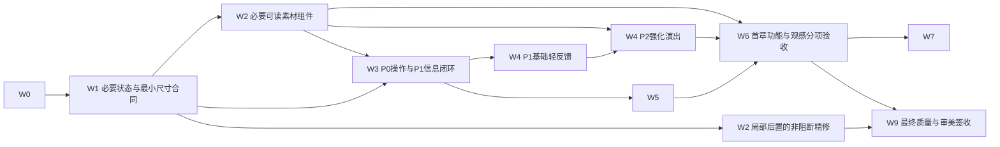

# 《唐宋牌》完整策划与开发交付计划

**14:37 结算布局与指定来源合批已完成检查：** 基线e82c7df8；先实际复现900px封顶、整组顶对齐导致下半屏留白，产品a9aa9c30改为宽屏1120px左右组合、按标题/得分/奖励/操作完整实测高度在安全视口居中；手机超高保字号可触控/滚轮/Home-End到末尾，主按钮48px。普通合入f135六英雄正式新开局回归及苏轼“10♠失效”具体提示（706f），610816ad新商店四分类共享区/内联DIY/金币背包/刷新确认/直接详情/边缘菜单；产品源码无冲突，仅两份公共计划保留双方条目。1199合版9组页面及继续完整事务通过；收口又实际复现PC通关提示侵入左纸面，仅修右列归属并补这1条，不重跑9组。新增36项窄测及7项合版交叉，最终类型/352构建通过；源20/六人原生、源49/商店尺寸按精确范围复用，不扩矩阵。GameScene、源牌/英雄/c12动作、整手节奏、指定音频、领域存档及资产与e82保持。按授权正常dev/main发布，最终SHA以远端回执为准；另已普通合入20567a19高清修复：当前PC三张大图点击前615×768解码替换；新增1次真实结算继续入店交叉通过，状态日志存储不变，源23项/1366实查按来源复用。整体美术/对战手机留白/4×后段/预算/P08三目标及人验正式门保持未通过。见[本批实际证据](evidence/intermission-centered-layout-2026-10-17/README.md)。

**英雄/c12功能批采用并正常发布：** 以已发布main `a061a7c2a0d10dad1da8647fa747011dd1df493b` 为基线，已采用独立交付 `3c90ac3a6e9cfedff9bbaba706ba1a87e745d5ed`（运行时代码同产品fb7290fd，345模块构建通过）。保留a061辛弃疾候选阻断修复、3c整手节奏和用户指定音乐。PC完整英雄立绘与六英雄真实保存收益响应、c12保存成功后源牌到道具箱/满包到金币、失败/取消边界及删除赠品去向查询入口已接线。按各自版本复用12组并版和金币1组局部补验、已有窄检查与345构建；不新增完整矩阵、不等待01a147f6另一任务的六英雄原生操作回归，不将受控Scene调用写成全部原生点击验收。用户都新开局，不追加旧局工作。手机仅安全空位小立绘，中央留白/教学行/技能叠框仍待改，整体美术不通过；原目视FAIL及修复前后证据保留。397文件/37,122,217B仍超20MB，4×后段持续渐密、P08/三目标、人验听感/真机/正式门仍未通过。此批正常eyes/main发布，实际最终SHA以远端交付回执为准；不等CI、不合ca843整分支。

**最高优先级阻断修复与已就绪节奏立即交付：** 基线main `8ebff2a2470ca37d64bafc99827bbf4bcc456cb9`；辛弃疾 `f32029bc7a21f76e3a6f8ec44923c8f1561143f5`（产品80b8）及整手节奏 `3c6e853364d3a58922e53e1edd81e55d447f60c3` 已无冲突正常合入产品 `8d6aa988eb4188f7276bc502323183541d84bc14`。GameScene精确等于3c节奏源码＋80b8四行候选布局修复：弃5后原保留3、实际7候选按7座位排，确认入口不再因undefined.visual中断；规则/存档不改。指定音乐/采样保持8eb已发布内容，3c使用833b/c222等价移植，原4a/cbf不是其祖先但音频源码/资产全同，不重复套补丁。源19窄测和三组候选确认后实际下一手、源78/PC3904×音画各按原版本范围复用，不扩测试集合；一次类型/341生产构建通过。已发现的旧触觉夹具仅补真实phrase字段，原到达断言不改，复用同award方法的5项通过证据。按用户最新都新开局执行，不另加旧局恢复工作。英雄/c12留独立分支020e596b，不夹入本次、不等待其视觉交付；本批立刻普通eyes/main发布，最终SHA以远端回执为准。4×后段200→233ms未持续渐密、听感/真机/整体爽感仍未过；整包397文件/37,102,547B超20MB，P08 in_progress及三目标未达标、ca843整分支不合、原正式门保持。

**用户14:02–14:34商店后继批（dev验证交集成）：** 以main `8ebff2a2470ca37d64bafc99827bbf4bcc456cb9` 的PC/390实图为基线。PC为唐宋牌／消耗工具／自选做牌／长期物品四分类切换，共享大展示区；自选内嵌三路互斥思维导图。余额明确铜钱图标与“金币”，背包带标签和数量，刷新实价先确认、取消零扣款、重复确认只提交一次。共享菜单为边缘箭头展开唯一入口，保留外点、键盘和焦点；培养降为持牌旁次级入口，进入牌桌保持唯一主行动。排序提示给简短用途，不保证所有构筑。14:22/27/34单击稳定详情只改商店，不新增普遍tooltip，GameScene及战斗悬停拖动不动。49项相关测试、类型构建和1180/1366/390原生交互、320补查通过；计划校验与main均有相同15条P08历史记录错误，未改历史格式。普通dev交集成，不推main、不等CI、不部署。见 [本批范围](SHOP_CATEGORY_REFINEMENT_20261017.md) 与 [实际证据](evidence/shop-header-refresh-groups-2026-10-17/README.md)。P08保持in_progress，审美与实体设备验收仍开放。

**用户指定音频独立批：** 以main da671af2为基线，只正常合入我方交付的BGM `4a1f9227e137aaf57122ce812fb52d95eda0bf49` 与计分采样 `cbf2f0f0d5f0506ed5e79b2ad1c085325b811bb2`，产品 `27f32fa3afafc193bdd12249ffa74fd7c15094f5`；33个无重命名展开路径精确来源。现有总线、真实事件主击/回弹继续使用，五声/战鼓/钟声采样与两首BGM已接，GameScene/源牌动作/规则存档/美术不改，不合ca843原型或其计划。新增3文件15项交叉、类型/340构建通过；源8文件110及30采样解码、两首真实循环、静音/同context恢复和后混音未削波按原范围复用，不再签新GameScene音画录像或真人试听（heard=false）。整包397文件/37,100,697B，20MB仍FAIL。按用户指定尽快普通eyes/main发布，不等待原型复审或CI；英雄/c12接线仍在独立dev/hero-gift-scene-integration-20261017验证中，未混入本批，随后继续。P08及三体验目标、人验/真机/听感/正式门保持，最终发布SHA以远端回执为准。

**源牌核心功能批实际整合：** main基线 `2f0dd4e6fcb8d343de79e719b0e9e4ce2d382679`；仅接我方指定 `4eac55ed67cfb2165c26f1caf2545462b1bc2ac3`（产品c2dcab7f），已正常合入 `64c07b005cb022d2fa987a8a803590a773ec3c48`。6609是来源真实祖先，3音频文件精确6609，无重复应用；62新增/变更路径精确来源、8核心文件一致、5编译源指纹匹配，当前商店/头栏/旧名/手册/AI刘娥/规则存档资产保持。顶部五牌分散纯图、左右摆动/回弹、同一arrival主击与同Tween回弹第二拍、同层虹彩及帮助/调序入口仅按功能接线收口。源PC/390/4×各13事件与13双拍、7最终用例和状态保存一致证据按同码范围复用：公开导入受控库存后原生选牌/出牌，含实际master音轨，非自然获取、真人试听或物理手机。作者96核心/4文件48整合不合算；本版新增5文件48交叉、类型/339构建通过，未重跑原生矩阵。已看PC/手机图：牌型文字到待出区仍大幅留白、底部“满足5·待检查0…”整行和技能叠框仍在，明确未通过移动端美术验收；下一批优先把空间给源牌演出。整手导演、透视/反光/惯性、英雄大立绘及c12接线属后续，不阻本批。整包389文件/37,488,800B仍超20MB；P08 in_progress及三目标未达标/听感触感/真机/性能/正式门保持。按既有授权普通eyes/main发布，不等CI；13:02外部边界有效，ca843不合入，最终发布SHA以远端回执为准。

**13:02外部协作边界：** 用户明确新加坡服务器AI只在独立分支交建议、素材/音乐素材/示例代码，无合并职责；须等用户通知后，由我方逐项评审吸收。当前Windows整合不等待它，只接本轮我方已指派且具精确回执的候选白名单，不自动吸收未知新加坡分支、远端新提交或其修改过的计划。已有我方优化继续；此前已交付来源不因本边界倒退。当前已发布main/eyes为 `2f0dd4e6fcb8d343de79e719b0e9e4ce2d382679`，本次只登记到dev，不动main/产品、不重测。若main有未知外部变化，先保留并报告SHA与差异，不reset/force覆盖；本边界仅记录流程，不改GitHub权限。最高源牌音画仍等01a147ec的同版GameScene/真实序列与6609双拍联合包，未知来源不得自动补入。

**商店与说明小批实际整合：** 基线main `5cafa41ace1abbfd5d9fe4ad97f9bb10a00867a4`，上一条6609登记已普通push dev `590d5b0e79e99a17301aedc572425d3867177cc0`。头栏安全区 `aceb2403856440ba280f2dc1453718ee46883620` 已含Shop虹彩后继 `1075bd204e364d867528183d8e0c0c162ced93d9`，再顺序合入旧名出口 `63145adfdecd06af006ea62e21b24455a88367fc` 与极简手册最新回执 `7b18d9d9098464fefcc1562e6a7730b18a1a9d41`，产品 `277d13cc381545e4b2965d2aa019c6bb7e11ad1c`，三次正常merge无冲突。来源35路径全同、63145的23路径中22同（唯一测试差异为完整保留main已有长期文案用例，当前测试精确基线）、手册4路径全同；头栏5个LF源指纹及虹彩/暖金挂载hook保留。新增4文件38项交叉、类型/340模块构建通过，原18/28/30/74窄测和各自双端证据按原版本范围复用，未重跑手册产品测试或浏览器矩阵。GameScene、音频、规则/存档/资产不改；Shop虹彩不代签战斗接线，旧词现场根因仍未知。整包389文件/37,488,833B仍超20MB。按既有授权普通eyes/main发布，最终SHA以远端交付回执为准；不是仅登记。最高源牌音画仍等01a147ec与最新6609真实scoreRebound双拍的同版GameScene/序列证据，不单发旧8a9；不阻塞核心、三目标未达标/P08 in_progress与审美/真人/听感触感/真机/正式门保持。

**最高音画批音频更新（仅登记）：** 现用候选 `6609f4f609199ee1d5c9271c9389daaebb943bd7`，为同分支8a9b后继，含真实回弹阶段scoreRebound双拍契约。源牌owner01a147ec须给GameScene同版接线及实际序列回执后再联合整合；旧一声版不提前单发，不以接口/单测宣称用户双拍或三体验已满足。其余已完成小批不阻塞此最高优先级；本次不合产品、不跑测试、不push main。

**刘娥样例／AI操作一致性后继批：** 商店主批已先正常发布main `934477727201a83b7b2590ee9a2a4645b5f45606`。刘娥 `387c2ea895367cc85a6a52d1661887898d7fe039` 与AI `8cf3b9221f82980062af12eccaddd127a041b34c`（祖先包含e321/24285模块，387证据分支另合）已合入产品 `10c92404fb4e0cac7ca89a10fd47fdcecc6b7ec6`；GameScene/AI/附着五核心文件精确8cf，保持刚发布商店和规则/资产。来源31/51/152窄测与刘娥四段证据按各自版本复用，不合算；新增3文件27项、类型/336构建通过。一次真实Edge143/PC鼠标流程完成选择/AI保目标/取消/再AI/重选/循环/撤销/实际出牌，9次观察无状态写入，实际1390完整state/journal/storage与canonical相同，各候选真实输入逐一核对；不签全局最优、全部六人原生或自然局。首SSR夹具加载超时FAIL保留，仅修验证驱动关闭开发发现/监听，产品不改。按既有授权正常eyes/main交付，原N01源牌动作与三目标仍未达标：顶部五张唐宋牌分散悬浮、去红粗框、真实左右回弹与音效同步是最高下一项，owner01a147ec联调声音8a9b，未交闭环不合单声音。虹彩176及图鉴/额外美化后排，63145旧词/7b18手册可并后续小批但不抢核心；U08不再按旧工具名重测。389文件/37,479,977B预算仍FAIL，P08与听感/设备/正式门保持。

**已发布商店主批（93447772）：** 基线已发布main `7f40cd1b07d2fac8c0cddfb0860ba79fb27ba5b6`；c048主体及最终 `7db6e8395b10f58b19986c181e0e29fd8d4b2192` 已正常无冲突合入产品 `77b19cae62904a45647a8b7c7c30f02d5daabfb7`。adapter由28429044等价移植4b74（patch-id相同），原4b74/9c12不是该分支祖先；当前r2ToolInfo唯一组合精确保留主线9c12长期文案，未重复套补丁。最终74路径73精确，1af6侧栏/GameScene/Xin/规则存档/音频资产/137退役保持7f40。PC四消费区同时显示，竖屏四类同排可达；自选升级/点数/花色三路只在真实保存成功后记共享已用；普通商店按当前场次派生Boss预告/音乐上下文。多彩×1.5、闪箔热度+25、全息倍率+2已接未点击货架及详情/标签。新增4文件41交叉、类型/333构建通过；来源主体136及10页面、追加46及5页面、Boss/扩货架补查各按原范围复用，不重跑旧矩阵或合算检查数。当前dist389文件/37,471,750B仍超20MB。额外收益adapter不再记待接线；AI e321及8cf接线、刘娥387样例已交，留本商店发布后接入；AI须补真实窄验证，真实牌动作/虹光/图鉴不纳不等。审美由父级看图、未获通过；零脚本异常不代签审美或三目标，P08 in_progress及CI/人验正式门保持。

**已发布加演许可／长期物品批（7f40cd1b）：** 基线已发布main `e389ea2c4a7f6d49284546f91992d13055072655`；仅来源 `9c12d119cbd1fa2e763e9e481f526ef6056dfad3` 已无冲突合入产品 `67a187a286f9132f2c8dcb4b032014ffdc9cd00c`，15路径精确，r2ToolInfo来源指纹及四原生UI消费者匹配。U03明确“从下一场起，本局每场出牌次数＋1；当前场次数不变”，其余长期物品写清本局持续范围；规则/存档/场景/音频/资产不改。源Windows105项、PC/390前后及39工具组件审查按原范围复用；新增图鉴10项交叉、类型/329构建通过。孤注旧词未复现、原因未知仍开放，未虚构修复。额外加成4b74 adapter未合，待ShopScene货架/detail/标签接线回执；AI e321仍待01a147f6完整输入/草稿回执，均不以模块单测签落地。携带af45计划登记、正常eyes dev/main发布，不等新问答/多彩虹光或刘娥样例。完整dist389文件/37,460,654B仍超20MB；原CI缺口、人验与三目标未达标/P08 in_progress保持。

**AI准确性待接线候选（af45登记，仍未合模块）：** main已正常发布 `e389ea2c4a7f6d49284546f91992d13055072655`。候选 `e32149e8923e5a885b495e924233225837a077f4`（`dev/ai-preview-context-20261017`，独立模块产品 `24285a60bb049ab5cb87b3e1b56572a008b00738`）尚未合入；[来源边界](https://github.com/big-dimple/dachoupai/blob/e32149e8923e5a885b495e924233225837a077f4/docs/production/evidence/ai-hero-score-context-2026-10-17/README.md)的10文件152窄测/构建只签模块。必须等待唯一GameScene owner `01a147f6` 的两行aiScoreContext输入接线及switchHandType/候选采用时草稿一致性补丁回执，再两者一起合；不孤立应用输入patch，不宣称用户点击出牌已修。高牌最后策略保持，不保证主动技能最优解或实际随机结果。af45当时仅作dev计划登记；现随完成文案批携带此计划，AI模块和输入patch仍未合，不改GameScene；P08及体验目标未达标、既有CI/预算与人验边界保持。

**已发布英雄侧栏批（e389ea2c）：** 基线main `760b9ebd56605d44786e6e8d2221b8ba22ab06a6`；来源 `1af6e1710ad3c5fbb22430b561228bc2b39ce6db` 已无冲突合入产品 `46ced0c81471b18f059a88b5720a60bcf105b44a`。29路径中28精确，GameScene唯一组合保留已发布辛弃疾独立弃牌；7来源指纹中6匹配，不能把源浏览器全文件hash冒称当前合版。PC状态14px全宽独立两行，手机13px短句保层数/倍率/支付/目标；能力启用与可操作阶段分离，胜利后显示本场结束、真实已用保留，B08/Q01仍按自身条件停用。新增3文件16项跨阶段/Xin/Qin检查及类型/329构建通过；源72窄测/24布局232文案/文成受控动态原范围复用，不新跑自然或矩阵。规则/存档/音频/美术及137退役清理保持760；dist389文件/37,460,495B仍超20MB。孤注文案未获SHA不纳入，不等待刘娥样例；按已有授权正常eyes dev/main发布，实际SHA以回执为准。既有CI缺口/三目标未达标、人验听感触感真机及正式门保持，P08 in_progress。

**已发布资源清理／全日对账批（760b9ebd）：** 基线已发布main `179e17414aa9dbae67dfa33dc991c2a298895223`（含辛弃疾2f2e）；计划c6760d6e与旧资源47f15ca6已合入产品 `e92ebe1a7ff32b2b4942d1d93d7681513c7c5d3c`。两文档顶部追加冲突已保留双方；资源152路径精确，137退役文件移除。在用366项及六眼回退保留：362二进制原始字节同179e，4既有SVG按LF内容身份一致，全部构建字节同工作文件；首轮CRLF审计FAIL保留。新增17交叉、423资产只读检查、类型/328构建通过，来源96/6及历史核验原范围复用。当前dist389文件/37,458,958B仍超20MB，不删在用素材凑预算。H17只交计划，首刘娥样例独立实现中、未交付合入，不等待；四消费区/星级评估及三目标待整改边界保留。已正常push main及eyes dev760b9ebd，无CI重跑/域名/部署；CI摘要及15证据格式缺口仍开放，P08保持in_progress。

**已发布辛弃疾安全修复：** 基线main `4b0de064480a9c518f6443984ef6a465c4b3323d`；来源 `2f2eb70893e1ac3aa66e7883d457bddb561b982b` 已无冲突合入产品 `de144e76d7e8d9b14df105da6fa96817862c0dc7`，14路径/6来源指纹精确匹配。提醒返回及主动技能均另开空弃牌草稿，取消保原拟出牌，确认只弃新目标，留牌数读实际领域结果；保当前计分/眼神/触觉和68/98/71小修。来源50窄测与PC/390短交互按精确代码复用；新增4文件13项交叉、类型及328模块构建通过，无新自然局/完整浏览器矩阵。已正常push main/dev `179e17414aa9dbae67dfa33dc991c2a298895223`，不等工坊重排或CI；本地及远端回执已核对。只读两条指定CI已确认15条既有P08证据格式缺口、domain55项混合失配及Linux换行哈希新测试错误、browser待战入口烟测超时，均保留开放且不是预算触发；未重跑CI/改阈值或工作流。三目标仍体验未达标/重新整改、P08 in_progress；完整dist526文件/45,174,068B仍超20MB，真人/设备/听感/触感/正式门不关闭。

**最新发布条件：** 基线main `c4525b2c2faf77ad2df0b5486e0ea64276856d04`；手机热修68affa5c、正名98bc4635、零成长71a02da5已正常无冲突合入产品 `60a81684058bec92c5fb8eabd0937550bd55ad49`。手机来源21路径精确；正名61/62与零成长5/6精确，唯一r2Help同文件自动组合保留两者。新增3文件12项交叉、类型及327模块构建通过，源86/分批304/26及各自DPR3/菜单证据按原范围复用、不相加。锁定内容JSON SHA/规则/存储协议/历史/美术/AudioEngine/GameScene不改。用户已重新明确批准本批正常合并push main；不force、不改权限安全设置、不等CI，背景/工坊结构/资源清理不入此批。三目标仍体验未达标/重新整改，P08仍in_progress，人验/实体手机/听感/触感与正式门保持；实际main完整SHA以成功回执为准。

**历史c452大批回执：** 必要源已全部正常合入产品 `fe532299c50a659be65d01f0cdcfde4a6366fcb9`，含及时交付7c9详情艺术墙与346公共采样/安全区修复。最后8项跨模块/类型/327构建通过；六英雄各分工证据齐，原FAIL保留，2a/346仅对受影响眼位/小字/来源/读数手机边界窄复验通过，源59/72/208/240按自身范围复用，不完整重跑六人、不机械相加。按已有授权正常dev/main发布，不等CI或用户回复，实际main完整SHA以成功回执为准。三目标仍体验未达标/重新整改，局部背景范围、整包45,171,422B超20MB、人验听感实体触感Safari/正式门保持，P08仍in_progress。详见[当前批次](CURRENT_BATCH_20261017.md)和[最终回执](evidence/feedback-batch-integration-2026-10-17/README.md)。

## 当前统一执行计划

**08:10–08:26最新验收与执行补正：** 三项目标明确“体验未达标／重新整改”。父级dot08:15第3章自然两对1199＋四条8906＝本场10105/1800，已自然触发完整高光；观察到小HUD、长射线与全屏opaque打断连续性，作为体验未达标反例。此回执未给精确部署SHA，不将它冒称当前b418新合版或新眼图自然验收。 验收必须覆盖连续动态过程及动态视听触，静态截图/函数参数只能作局部证据。用户休息或未录屏不是停工理由；父级继续竞品与dot自然核查，现有2–3层音效归N01不重复立项，听感仍缺。线上4314仍仅既有12ms拾取；统一触觉aac已合后继dev，GameScene待owner；API实现、设备支持、人体感受分别验收，不相互代签。 美术规则沿既有规范细分：原比例完整；原图自带框不再外套多框；角标签移图外；大背景仅局部压暗且商品不整张灰；选择轻抬柔光。先核商店505a范围，跨场景覆盖保持开放；按钮呈现代码统一不以新图为依赖。 H01只保留自然获得/经营平衡开放，既有规则/17领域检查不重做；H10旧a14d已在发布祖先，不再当未合卡点。本批软件发布仍按b418+当前台账提交/实际push回执，不签三大体验完成。

**当前三项目标仍需整改：** 用户最新明确否定三项目标已达到要求：计分爽感、商店联动、Boss压制均为“体验未达标／重新整改”。已有实现、提交和有界功能证据保留，不能由上线、单测/截图或局部参数调整推导目标完成。父级正在主动对照Balatro及成熟卡牌竞品并继续dot自然对局，形成具体差距与整改动作，不等用户逐项指出；后续动作沿本计划，不新开重复清单。眼图/状态/小图及已交付商店局部整改现已齐源，按最新授权必要检查后普通发布；三项目标体验未达标、需整改的结论不变。

**2026-10-17 当前四路局部整改合批：** b439最终眼图清晰度+b8c89已押+fd7c小图+最终c9商店及秦琼临时阶段（含505a/1607445b）已无冲突合入最终产品`4d496e205ed4683bba5db901e16f1c17fe9b590c`，保43725/b05/战前/规则，GameScene仅含c9授权增量；fd7两条路径由505a有意续接。来源证据按精确范围复用，新增20项共享文字/理牌交叉通过；Shop在尚未main时到达，已纳本批并对最终重做必要类型/326模块构建通过，不重跑已过矩阵。[当前回执](evidence/feedback-batch-integration-2026-10-17/eyes-followups.json)。眼图原字节/提前准备保留，峰值糊字/红线贴标签窄修有源2例3阶段红像素23→0证据；Shop分类/大图无外套角标/单工坊/锚定提示/购后同modal与空目标确认软件已交付，不再当未交付。用户授权普通dev/main push，不等后续连续计分重编排、统一触觉新批次；Qin drawing/settling已由c9交付并复用最终108/鼠标触屏证据，无CI/域名/部署。三项目标仍未验收需整改，不因软件上线/局部调参签完成；预算/历史缺证/源FAIL、人验/听感/自然/真机及正式门保持，P08仍in_progress。

**历史已发布43725f69：共用放大/理牌批。** a73d9ec2是当时基线、fb6是产品绑定，最终已普通push main43725f697b58ebb64bfa47197512d2d39fe46a48，不再待push；9ec861ad+d98b72f2无冲突合入产品`fb6f699c8ac9d0db9d684ed68f3d6596ccfee9ac`，26源路径一致。72唐宋牌+39工具升级+12物品共用注册插画放大，黑底完整contain/44px关闭ESC焦点/失败恢复/无图无入口；理牌三项细短分隔、2px视觉轻抬/浅底阴影、固定hit、触控清理/低动态/字体对齐接齐。GameScene/ShopScene/manifest/原图与a73不变，b05新hash兼容；复用来源152/35与有限短流程，只增当前注册resolver3项/类型/323模块构建通过，[精确回执](evidence/feedback-batch-integration-2026-10-17/zoom-sort.json)。现获准普通dev/main push，完整main见回执，不等01a148ba未完新商店重排/布局/购后流程，不能宣称其完成；无CI/域名/部署。现有615×768详情复用，预算/历史缺证/源FAIL与新合版自然/听感/真机/正式门保持，P08仍in_progress。

**2026-10-17 战前/新图批来源齐全：** 67b4b2cd+最终艺术2e22aa31（含2229来源整改/70340完整b05原图）已无冲突合入最终产品`d2029a560330671a62354c3374cfdfd7a5b2e0e5`，43源路径一致、9e015修复保留。H14/H16软件实现同版，H15当前72来源分层错绑已修，历史缺证保持；b05完整1122×1402PNG的新contain派生/hash与高光48,306B单资源修复接齐，其他80美术/71高光不动。来源68/48与8短流程精确复用，只补跨源14项（原FAIL保留→修单绑定后PASS）、单图复现、最终类型/321模块构建通过。[同一回执](evidence/feedback-batch-integration-2026-10-17/README.md)/[精确绑定](evidence/feedback-batch-integration-2026-10-17/prebattle-art.json)。用户现授权普通dev/main合批push，实际main SHA以回执为准，不等未完新商店/高清鉴赏/理牌精修，不查CI/域名/部署。完整dist519文件/44,514,019B超20,000,000B仍FAIL，历史缺证/源扩展四项基线FAIL保留；53专用/19复用高光守96KiB不抵消整包预算。新合版自然/听感false/眼神/人验/真机及正式门保持，P08仍in_progress。

**2026-10-17 dot反馈两路小修：** 已发布main a470da22为父级dot实际可见版本；自然秦琼第2章正场1705/1350、Boss1874/1800，来源线/数值增量/底栏/技能真名/弃牌可见，未自然触发全屏眼神高光，heard=false。当前6a044ee1（紧凑提醒）+43216be2（c04固定+50与成长0并列/购买去重及用语/Boss页内容收高）无冲突整合产品`b1916e6c6b00bdf6635882755b671ce7a4e8892c`，26源路径逐blob一致，复用来源31/60定向及有限原生受控23→19/取消证据，仅补整合类型/321模块构建通过。[同一回执入口](evidence/feedback-batch-integration-2026-10-17/README.md)/[精确小批绑定](evidence/feedback-batch-integration-2026-10-17/dot-followup.json)；同一批次表/需求台账同步，不新开排程。用户授权普通dev/main合入push，完整main SHA以实际回执为准，不等CI/不部署。跨备战/章节/场内三次同规则H16只登记，H14/H15保留，P08与正式门/人验边界不变。

**2026-10-17 反馈最终合批：** 四来源5273a1fa（音阶）、09249ad5（高光/底栏/六技能名）、236acc4c（手机结算）、3b22614b（商店/Boss备战）已正常合并，最终产品`e978f295136c48f999895e2e9333f8c0b93cc5c1`。GameScene保持09249、手机两文件保持236；音频补2/3材质与轻重/35–65ms内部拍点，八档保存事件主音/arrival不变；T18按用户最新改“换货券 / 刷新一次商店商品”，删除比价冗余，价格/规则/hash/素材不变。31文件365项按最后每文件去重通过，原两次旧名FAIL保留，类型与321模块构建通过；[精确来源和证据](evidence/feedback-batch-integration-2026-10-17/README.md)/[今日逐项入口](CURRENT_BATCH_20261017.md)/[需求台账](REQUIREMENTS_DECISIONS_COMMITMENTS.md)。全部来源与检查齐，已获用户正常dev/main合入push授权；最终main完整SHA以实际推送回执为准，无CI/域名/部署。8.36秒真实AudioEngine短WAV仅软件证据，heard=false；新整合dot自然画面/真人听感/真机待验，P08仍in_progress。节目单开战前选择入口与72图新源链欠账已登记H14/H15，本批不扩修、不阻塞合批。

后续功能验收统一遵循：文字只说必要规则、代价和结果，清楚简短；重要状态由位置、明暗、动效、声音及受支持设备上克制的触感互补传达，不能只依赖声音或颜色；确认用于危险误触和损失，普通点击不叠加弹窗或解释；反馈保主次。沿用既有验收原则和原清单；动态视听触的新增明确授权由当前对应负责人落实。

**2026-10-17 图片详情收尾：** 来源 `4d9910a76c90cdea76f0f61709f7192675359f96` 无冲突合入产品 `2ef939c3446b2c176c1ed746bb1bdb3cc143fa40`。c06首层条件去重和重复卡名caption省略，限定桌面图文详情内容高度，保完整长规则滚动/旧局排除及手机安全区；无新素材、机制或GameScene/动画改动。13交付路径和全部产品/测试树与来源一致，复用122项与一次局部组件检查，仅新增整合类型/315模块构建通过。[整合回执](evidence/card-detail-integration-2026-10-17/README.md)。约499/696px仅来源1180×757组件结果，整合版dot复看归父级，未新增矩阵/自然长局；复杂长规则未全覆盖。用户再次批准正常dev/main推送，无CI/域名/部署；P08仍in_progress。

**2026-10-17 玩家文案与dot实测合批：** 来源 `6a67b0e722f677fbc31b6e69d032d6704c778657` 已无冲突合入最终产品 `24fb33d3efde7531278260131e22da31519adf93`；待提交远端验收记录一并保全。产品/测试树与来源相同，36条blob绑定一致，复用37文件321项，不重跑；只新增整合类型/315模块构建通过。[精确回执](evidence/player-copy-integration-2026-10-17/README.md)。持有/购买详情、配合、比较/出售/回执、工具和成长手记已统一去重与玩家语言收口；复杂多阶段及全部旧身份长规则未逐卡重写，不签全覆盖。此前dot实测属于2cc24a50且线上锁文件modified，新文案远端观感/理解仍待验。用户授权正常dev/main合批推送，无CI/域名/部署或新浏览器测试；P08仍in_progress。

**2026-10-17 当前批次集中整合：** 10个交付源已合入 `dev/current-batch-integration-20261017`，最终产品 `2c3bfe5c48d9d3429dcecc0112bfe3a64ffaa268`；含51工具图、c06新图、选角、章节、紧凑确认、秦琼/底栏/AI、结算累计/卡名、商店真实动态、计分/Boss与台账。最终21文件162项去重通过、类型/生产构建通过；旧回执CRLF原FAIL与必要19项恢复回归均保留。[完整来源、集中证据与待验](evidence/current-batch-integration-2026-10-17/README.md)。GameScene精确保持负责人1eab25d9，不并发覆写。图片预热后台默认静默，仅E2E显式imageDebug诊断可见，传输逻辑不变。用户最新已授权检查通过后正常dev及main合并/push，本段覆盖下方较早“仅dev/暂不main”的当时范围；最终发布SHA以实际push回执为准，不声明部署。今后按清单分批整合后集中验证，失败只补必要回归，试玩使用dot远端；本批候选远端、逐帧/听感/真机仍待验，P08保持in_progress。

**秦琼/理牌与AI最新补正：** 基线a14d；产品 `1e647fa735a86bc2a4c579c2c4d48822efa914aa`（明确重选弃牌、取消保原出牌、首层名单/风险/消耗、等宽两侧及理牌标题分组）和 `195f3f9f830a7b2ae01404dfb7ddd706e6ea11af`（完成候选复用/真实计算状态，保串行与key校验）。最终去重13文件186项、类型/构建通过，[证据与dot远端待验步骤](evidence/touye-discard-footer-ai-2026-10-17/README.md)。复用既有最短本地证据，不重复矩阵/自然长局；全局试玩交dot，父级自然双J步骤当前dev远端PENDING。只普通dev交付，动画/Boss接独立模块，不合main/CI/部署，P08仍in_progress。

**商店与卡名最新补正：** 产品 `6479d4377e843bfcde211efdbca89fef35431cf7`，基线 `f81724b5`，分支 `dev/shop-synergy-copy-20261017`。改为实际购款后的可知条件交集，不再关键词宣称强联动；收据/替换/成长/保存来源与回看在UI边界按ID统一卡名，规则定义和hash保持。43文件373项最终定向、类型/构建及一笔短原生购买/取消/回看通过，[事实与原FAIL](evidence/shop-synergy-ui-names-2026-10-17/README.md)。本批仅普通dev交付，不合main/CI/部署，不等51新图或自然长玩；P08仍in_progress。

**技能提醒最新补正：** 产品 `473a727888d11479e15e3a77bffd5cbe6647c5a0` 承接整批1d80；默认在每次当前有资格且未用主动技能的出牌尝试前提醒，明确继续只放行本次，返回/关闭保留选择；取消首两场/每场一次/引导登记屏蔽，保留独立“不再提醒”。24项短测、受影响构建和类型通过，[精确证据](evidence/hero-reminder-scope-2026-10-17/README.md)。仅同一dev普通推送，不合main或长玩。

**2026-10-17 Windows 整批开发候选：** `070cc16f0d04c7da03850dd62fd34cef450d8227`，接续 `5afce4e4`，已合 `fc681cf7` 高光预算、`36ba1e41` AI/开战与 bundle `f82b3cf9` 底栏。范围为加载去鱼、卡图/高光、音频、AI/开战、弃牌—理牌三块—出牌及独立技能/既有提醒；最终48项、类型/构建和72高光产物预算/hash通过，原生交叉实际结果与来源复用见[整批回执](evidence/windows-batch-integration-2026-10-17/README.md)。仅普通 dev 交付，未合main/查CI/域名/部署；提醒范围已由上述最新补正覆盖，不再受原首两场/每场一次限制。P08仍in_progress，其他评审项/正式门及真人设备听感未签。以下“仅文档/待实施”描述评审来源当时状态，不能覆盖本段整批事实。

**唯一排程与状态入口，2026-10-17新加坡批次评审与整改排程。** 被测产品 `7d7921e76ca794a14e715e3eac3b4d66143862ff`，比较旧 `ba49d4536a21c647a6710b047053def874d29ace`。先读[综合评审](reviews/SINGAPORE_REVIEW_20261017.md)、[待实施整改计划](reviews/REMEDIATION_PLAN_20261017.md)与[原始证据](evidence/singapore-review-2026-10-17/README.md)；机器状态在[plan.json](plan.json)。原作者交付说明/status不改写，评审前当前段已[原样归档](history/DELIVERY_PLAN-current-before-singapore-review-20261017.md)。

本次仅独立 `docs/review-singapore-20261017` 文档分支普通提交/push，**没有实施产品整改，不push main、不改领域hash/数值/断言、不查CI或管理域名部署**。P08保持 **in_progress**，不以72图或43局部测试签整体完成。第一批修跳场保存后转场/错误选角与显示name污染规则导致AI灰色；GameScene同一负责人先恢复数据隔离，再收口punch双写。第二批卡图、音频、商店/折页按文件责任并行，第三批统一UI正名、缓存/来源与规则身份文档。全部出口和局部回退见新计划。

用户追加要求已纳入待实施项：保留章节目录创意，稍后开战只关闭目录并保留当前局，去掉小金鱼；底栏“弃牌—理牌三块—出牌”，技能另设位置；有可用技能出牌自动提醒，先核既有HeroPlayReminder再补齐。AI灰色、重复稍后开战/退出本局与重开无声分别保留用户反馈和本地证据边界。

本轮本地34项 **33通过/1失败**，build通过；跳场和短横zoom实际FAIL，普通Play仍可结算。原43仅局部35+8，不是完整E2E。原plan检查已有12条invalid evidence record，保留FAIL；新增评审记录不覆盖旧结果。指定域名首页/build-info遭代理CONNECT403，线上版本未知，**没玩完一局、未试听/真机**。C04历史暂停仍待用户决策，不自动解锁，也不阻塞本批明确回归的独立修复。以下既有能力清单和历史人验边界保留，新批次优先级以新计划为准。

### 已发布基线、本批批准整合、仅建议与待验收

|类别|精确版本/范围|当前结论与边界|
|---|---|---|
|本次评审/待整改（2026-10-17）|产品 `7d7921e76ca794a14e715e3eac3b4d66143862ff`；[综合评审](reviews/SINGAPORE_REVIEW_20261017.md)、[待实施计划](reviews/REMEDIATION_PLAN_20261017.md)|原72卡/音乐/折页等代码已在被测产品，但跳场、AI、短横zoom及a11入口有确认失败；音频/联动/规则表另有静态缺口。只有文档与证据交付，未修产品，不声明全平台、无缝或100%体验完成。原作者[交付说明](evidence/cards-bgm-tangsong-refresh-2026-10-17/README.md)/status保留作历史。|
|上一批经批准通过交叉|此前main8728e18；胜利dfa755、原画76e64c14、高光3924854b；运行时并集f4d814b1；[本批检查](evidence/visual-three-route-integration-2026-10-16/status.json)|新苏轼原图/版本及黑底关闭返回、高光固定眼位/完整暗场、胜利到商店、短横10位倍率与科学记数终局均同版核对。没有规则/数值变更；最终远端SHA见发布回执。|
|较早已发布基线（历史）|main 646505e7dc8cbf3620d6db795d7d8afdf838f9d0；[Git发布回执](evidence/natural-straight-economy-2026-10-16/prior-batch-release-receipt.json)|高光玩家文案清理/短横倍率分栏与商店图片空闲准备已普通push，远端SHA已核；包含此前六英雄文案、六图接线、加载/R03、输入/音频/成长/移动修复与B05首遇。未查本批CI/域名，不声明部署或全设备体验完成。|
|上一批已发布（61/92）|来源61c78a233a40e90dcff8356f4de083e3d691e9af/产品c96fe6e0；整合815a5d25；[本批检查](evidence/cash-warning-plan-main-integration-2026-10-16/README.md)|只改XiemuBurnCopy，提前说明已持金币门槛因燃金失效；原14项按源码完全相同复用，新构建/原生取消支付通过。用户已批准与92计划合批普通发布，不再列仅本地待评审；精确远端SHA见交付回执。不是花蕊30金自然净收益验收。|
|仅建议/文档|静态复核86d0306e9a11c31092a7a68ab8f04ca219bb30a0；[建议与验收](evidence/natural-straight-economy-2026-10-16/BALANCE_REVIEW.md)|第二章基础900→1000只是待决策候选，**未实施**；固定首手差11/40不证明挑战改善或胜率。没有续玩/新模拟。|
|既有定界验证证据|失败再战ad03aa44；自然经营c93283ae；技能页574829a8；见下表|只读审计/观察脚本和原证据，不是新产品修复；本次集中证据以便汇总。不能把原软件PASS代签真人、真机或平衡。|
|待玩家/设备/美术验收|角色取舍、运行时观感、听感、目标设备、自然晚期/无尽及正式门|不因“没有新复现缺陷”、测试数或main发布而改成done。|

### 已实现范围与新增有界事实

|面向|已经交付/本地已有事实|真正未完成|
|---|---|---|
|美术与人物|六张指定1122×1402原PNG获用户验收；六图派生/裁切/选角头像高光已接线。三男苏轼/秦琼/辛弃疾，三女刘娥/文成公主/花蕊夫人，均青年；[美术当前范围](ART.md)。|运行时整屏角色辨识、裁切/字号/节奏的人验；独立眼原画及B05专属人物/眼神图仍是素材依赖。已有安全眼部裁切不等于独立眼原画。不得据旧1536规格放大或重画已验原图。|
|交互/性能|加载恢复、首页、44px热区、指针隐藏/迟到释放、已持牌短按、经营与移动旋转、音频手势恢复在main；商店按真实目录有界空闲准备已发。[技能页四尺寸返回](evidence/hero-skill-footer-reachability-2026-10-16/README.md)未复现疑点，48px返回真实命中且不改保存，无需再做修复。|真实手机/浏览器/GPU、实际多秒卡顿根因仍需具体输入；本机立即冷点未加速，不宣称全平台无卡顿。结算返回尾部由原会话持有，不能并发接管或重复无变化采样。|
|六英雄|能力、资格/时点/代价/保存、正常新局新技能名/故事/短效果与标签已采用；高光去开发文案已发。[现行机制](CHARACTER_PLAY_PLAN.md)与[文本规范](HERO_TEXT_SPEC_20261015.md)只解释事实，不另排队列。|下面六人实际取舍与真人是否理解；受控镜头/技能成功或六图验收不等于自然资格与机会成本签收。|
|失败再战|原受控13类证据保留；新增[普通资源失败→建议→重试→实际对子](evidence/ordinary-failure-retry-2026-10-16/README.md)，97/400差303、重试6金/空构筑、下一手110及成长+10、冷恢复一致。无产品缺陷，不改代码。|实际流程用了刻意弱单张展示失败，不是玩家失败率/平衡样本；真人是否能自主理解并采用建议仍待验。|
|成长/经营|共同族成长/最高相关族一次/公开目标/培养/自选/推荐/S04试验已实现；已有b03/b10因果与商店接续不重做。[一个新种子三章9场/66命令](evidence/natural-straight-economy-2026-10-16/README.md)及来源/冷恢复通过，染色32金、末75金，九场首手过关。|连续首手过关结束点、第4章后、实际自然S04收尾、晚得/缺件换件/其它流派、六万及无尽仍未覆盖。最新指派已停止续玩；单样本不签平衡，不重开18路线。|
|声音|解锁/静音/后台恢复等软件证据在main，两个音量通道既有设置保留。|真实扬声器/耳机听感、混音、音色和长局疲劳的人验；不无授权生成新音乐/配音。|

### 六英雄尚待实际验收（不是待实现技能）

|人物|当前最小未验出口|最小输入/验收方式|
|---|---|---|
|苏轼|副组取得与失去留手的机会成本|既有合格主手/副组存档，记录一次使用与一次有理由保留；主副组不重复占牌，真人能说明代价。|
|秦琼|成熟核心下刚补牌进入有效核心的真实机会|既有成熟普通存档，核实际弃/补/下一手和成功×2或失败×0.85，不用预植成功当自然获取率。|
|辛弃疾|未留本场不再抽的损失是否理解|一个真实补牌候选窗口，实际选留并记录未留牌边界；不重做已实现选择器。|
|刘娥|不同有效核心点数的H→M取舍|既有对子及以上，选择不同核心说明普通点数而非增强/版次的变化；一次使用/保留由玩家给理由。|
|文成公主|高层蓄放的多手成本和风险|既有自然1/2/3层记录，说明重复不放/低牌清零与主动释放；不是每场一次，不能凭受控高光代签自然高层。|
|花蕊夫人|30金档净收益、留钱与利息/已持门槛机会成本|既有自然足额存档记录实际支付与扣后资格；20金受控警告和61c78提示整合完成不等于30金经营/人验。|

### 原2026-10-16玩家体验事项与依赖（历史输入保留，本批按新计划）

维持现行顺序：**首章技能取舍 → 成长经营 → 移动可达性 → 当前画面/节奏 → 当前声音**。先拿对应的真实输入，再只修确定的表达/操作/性能缺陷；不为填格子新增机制、数值、图音或大矩阵。

|顺序/可安排事项|依赖与最小下一步|可判定的验收出口|
|---|---|---|
|1 六英雄短体验|用既有合格存档让一名玩家完成使用/保留并说理由；不是长局或重新开发技能。|真实动作/代价与保存一致，具体误解/不可达控件能复现；未有反馈则保留“待人验”。这不替代V01正式专题。|
|2 经营/自然S04|有既有自然获得存档时做短购买/取消/使用链；没有则保持未覆盖，不刷种子或注入。|按实际来源、支付、章数/色密度、容量、保存逐项记录；未出现/买不起/失败原样保留。任何新数值先另决策。|
|3 移动/性能|需要目标设备、浏览器、具体卡点或原性能负责人的根因。|同一短流程真实重现，控件可达/输入不误发/保存保持；本机软件视口不代签物理设备。|
|4 现有画面/5声音|人审现有帧/短结算声音；新B05/独立眼素材须另交付/授权。|具体可见或可听问题有版本/位置/设备，按实际人验签；不改已验原图凑成果。|

**61c78已独立审查并获本批合并发布批准，不再作为待评审或重开发任务。** 本批只补必要合并交叉；下一项仍按既定顺序取得真实输入后处理具体缺陷，不自动新增实现、数值或长局。这不是整个开发完成的结论。

### 挑战者、高光与失败体验：下一批有限核对（2026-10-16）

B05已发布持续认招/目标余手/选牌预告和真实回执；GameScene仅既定局部接线，不重开其事件/计分规则，专属人物/眼神素材仍依赖。高光局部×倍率/累计落位与开发文案清理已发布；真人节奏与实体GPU未签。失败软件闭环和普通资源复核均已有，无新缺陷不再重做入口；原失败/高光/结算性能文件仍按原负责人协调。

### 优先级、正式依赖与验收标准

- P08为当前持续包；已做的软件子项只保各自版本/范围，不能抹去P08未完体验出口。
- C04剩余教程/图鉴/历史/完整流程保持blocked；既有运行/保存不重开。A03整体planned且humanGate，六原图的局部验收不解除独立素材/音画总包。V01保持blocked，按QUALITY的真人专题要求另组织，AI不能代玩家签好玩。
- B00依赖C04；B01依赖B00+A03；L00依赖B01+V01；L01依赖L00；L02依赖L01。main代码发布不自动完成这些门。
- 统一证据标准：实际执行才PASS，未执行NOT_RUN，缺输入/批准BLOCKED；原始FAIL和旧SHA保留。机器正确、人工操作、视觉/听感批准、真人理解、物理设备分别记录。
- 改参如获另行批准，须新内容身份、旧档/hash/锁定章目标/重试保持；仅建议86d030不能列入已实现。当前不扩大自然试玩/全量矩阵；本批合并交叉检查单列，不计算整体完成率。

原题材与文案现行来源：[ART](ART.md)、[角色玩法](CHARACTER_PLAY_PLAN.md)、[文本规范](HERO_TEXT_SPEC_20261015.md)；原历史批准只按当时SHA读。本节替换旧当前段，历史原文见归档，不重写测试/玩家事实。

## 历史计划与原证据（只按原日期和SHA读取）

以下完整保留旧文本。旧“当前统一/待图/四男两女/未实施/不再提醒/暂停”等只描述原批次，不覆盖上述现行身份、已实现清单、范围和依赖；历史证据本身没有改写。

### Astra品牌／成长／推荐整合收尾（2026-10-15，当前回执）

基于d31正常合入4df0db49、6be7ecbc、2aa1c197至开发分支dev/astra-integration-20261015；接口统一、系数短标签及f10消费说明修正已完成，3637全量和PC/手机受控核验通过，详见[同源码证据、冲突与原FAIL](evidence/astra-brand-growth-recommendation-2026-10-15/README.md)。最终名单为苏轼、秦琼、辛弃疾、刘娥、文成公主、花蕊夫人，三男三女全青年；覆盖下方同日早期四男两女与姓名草案，旧文档/截图保历史。品牌展示已接线，18姓名SVG明示待图，正式立绘/独立眼图待交付但不暂停其他收尾。技术ID、机制/保存/RNG/数值保持。

本新批次仅开发分支push。用户另已授权精确d31发布main/域名替换，已保全整合并建立独立干净发布worktree；必需CI查询Forbidden、域名build-info HTTP403，按要求停在核验，无main push/部署/旁路，不冒称发布完成或新头CI成功。

### 正式题材决定与资源映射（2026-10-15早期记录，名单与接线状态以上述当前回执为准）

**正式决定：** 游戏正式名称为 **《唐宋牌》**，以唐宋文人墨客、文武与市井文化展开，取消“全部角色必须属于戏班”的题材限定。采用**年轻帅酷、有激情的精致手绘漫画**：有力干净的轮廓、鲜明协调的色彩、清晰情绪眼神，六人各自配色/姿态/表情且性格/脸型鲜明；旧低饱和青绿朱红色板及铅笔水粉技法仅历史参考，不再作为新图限制。性别固定为四男两女：`amo / touye / laohuan / azao`男，`erxiang / xiemu`女。独立高清眼部原画仍是每人必交资产，立绘1536×1920 PNG与眼部1536×768 PNG契约保持。此决定覆盖旧戏班题材、三女三男与amo女性出图提案，历史截图和原证据保留，不改写其身份。

**已定与草案分开：** 正式游戏名、题材范围、性别与原图规格已定；六种意象可用于下一版设计，具体文武人物姓名、服饰细节及最终画像仍是草案，不能写成用户定名或真实历史人物。暂按游学诗客→主牌与助攻、市井游商→预测换牌、校书人→多看多选、女书剑客→基础点数转倍率、弓手→三档蓄力、女茶坊掌柜→花金币主动技能做资源映射。唐、北宋/南宋参考分别记时代依据；跨时代相遇是架空设定，不冒称同代史实，角色职业与动作的创作部分明确标注。

**当前风格执行：** 统一的是精致漫画造型、线条质量、光影与完成度，不是六人共用旧三色板或同一张冷静脸。[交接§3与§5](HERO_ART_HANDOFF_20261015.md)已列六人各自配色、动作张力、表情与眼神提案；可沉着、豪迈、机敏、果敢、热烈或自信，各有情绪，不要求全员怒吼。具体颜色/姿态仍待样板图审，不冒称用户已批准成图；独立eyes继承新立绘性别/脸型与该人情绪，不能用旧头像或低清裁切冒充。

**先落题材与映射，再替换资源：** 本次仅更新本有效计划、AGENTS入口、ART合同与[美术交接/Chat提示](HERO_ART_HANDOFF_20261015.md)，不执行绘图或替换。后续任务按下表承接现有美术窗口，不另开玩法改造计划：

| 顺序 / 任务 | 具体交付与完成条件 | 当前状态 |
|---|---|---|
| 1 题材与六ID映射 | 按交接§3固定四男两女和六种原机制对应，逐人列时代来源/创作边界；新姓名只标草案。 | 本次文档落地，非人物图审通过 |
| 2 品牌展示与引用任务表 | 盘点index.html标题、src/main.ts可访问名称、TitleScene等正式游戏名入口，以及选角/商店/牌桌/结算/技能/高光/回退中的同ID资产与展示文案；区分游戏名、牌类术语、历史证据和技术标识，禁止全库盲替换。 | 任务映射已列，产品展示尚未接入 |
| 3 客户端聊天制作与原图交接 | dot经用户指定客户端聊天入口先做amo男版代表立绘及独立eyes，取回原尺寸原图与来源记录，完成人物/时代/性别/同人、漫画线条/鲜明协调配色/姿态表情/情绪眼神和PC/手机合成样板评审，再制作其余五人。 | 未绘制/未取回/未图审 |
| 4 同批资源替换与受控验证 | 六人18个avatar/selection/portrait同版本接入，另接6个独立eyes；按已有尺寸/hash/crop/预算/预加载/回退合同校验，逐处核角色一致、保存结果与受影响双端窗口。旧头像或低清裁切不得冒充新图。 | 未替换/未验收新资产 |

**机制与技术边界：** 六种现有机制及其资格、时钟、数值保持。技术ID、`big-dimple/dachoupai`仓库、域名、存档键、规则身份和保存格式不改，不增加旧存档迁移工程。正式改名决策不等于当前运行UI已改名或新图已上线。现有资源引用统一/错误尺寸检测与f2d1eafb同版有限证据继续有效，但只证明旧过渡资产的工程事实，不能给《唐宋牌》新人物、美术、自然游戏或整体体验签收。本分支只正常提交push，不合main、不部署、不重试Forbidden PR。

### 当前批次：商店/培养/失败/B05开发集成候选（2026-10-15）

从main `4a52fd0b0fb9ac0a49b8cb5e79abc8db4326e2d7` 在 `fix/shop-integration-20261015` 正常merge：PR187 `03d701f3f3aa3f6e05e948b4b8c5713a717ee1bc`、PR185 `2a3f1bcaa4e480164ef2cb125222dfbf5e7a52c8`、培养 `f30948d12b8910b1f0992e1eac0d527f6e968ad5`（包含四轴祖先 `aa001b3d6795ade79effd1c7b88055ff32b9fee3`），及父明确给定PR186修订 `bba295243a25555316ce72abc6d2b443afee6a6b`。保留原提交祖先，无cherry-pick或强推；当前仅开发候选，PR186 bba已由父独审并核精确CI成功，本集成仍需自己的同版验证，不能借各包旧PASS签集成。

**有限集成回执：** 全部head已齐；冻结40b9f31e的249文件/3478单测、content、typecheck/build、Chromium双端smoke及8族60个有界原生窗口/链全部通过，src/index/HEAD一致；[实际同版报告与图审边界](evidence/batch-integration-2026-10-15/FINAL_RESULTS.md)。PR186 bba独审及精确CI全绿；首轮旧fixture/观察器FAIL保留。此前头像眼神/脏痕过渡/数字文字清晰度反馈已登记独立任务01a13d2b-ddf0-70a5-8aac-7c8b6973302f；人物与高光素材方向按下方2026-10-15最新后续计划承接，不能沿旧年龄参考直接定稿，不混入本冻结版，未签美术解决或全游戏完成。

在全部head齐的冻结同版上执行全量软件检查及PC/390/320核心连续操作：view/cancel、真实购买/工具/培养、保存故障固定候选重试、冷恢复及页面互转；实际看整屏，正文真实滚动和标题/父容器裁切分别核验。接续既定六英雄/三路线有界操作，不重开18长局、不改玩法数值或旧档。原FAIL和每个SHA证据保留，见[集成证据](evidence/batch-integration-2026-10-15/README.md)。本批不合main、不部署、不改权限；PR创建POST Forbidden仍停止，仅push开发分支并备说明，不通过其它入口创建PR。素材高光美术、实体设备、听感、人类理解、自然三路线经营/整体平衡及全游戏交付仍OPEN。

### 整体数值窗口待完成任务：独幕S04的获取与改造取舍

**状态（2026-10-15）：独立复核后已明确批准50%作为本轮试验方案，现已实现并完成软件与三宽度受控验收；未合main/部署，仍待自然平衡与玩家理解验收。** 从候选 `4d2ff4ca8487f2f00b55516822d1a28ac3c1751f` 独立开发；[数值证据、复算与限制](evidence/s04-window-2026-10-15/README.md)。只推进本条，不混集成、美术、C04暂停包或18路线。原[PR147分析](https://github.com/big-dimple/dachoupai/pull/147)与 `analysis/scoring-calibration/report.json` 的f23c指数结果保为历史，不用于本条当前结论。

**本轮开发回执：** 产品提交 `04111e28a9d1247f0e0153e6708c27a57db048f0`，分支 `feat/s04-finish-20261015`；[实现证据/复现/原FAIL](evidence/s04-finish-2026-10-15/README.md)。新局身份 `quality-r2-s04-finish-v1 / json-fnv-v1:65b545bd97c0fdf1` 继承core；新身份独幕按章3＋存活牌目标色≥50%且未全同色，6金基准价/永久手牌容量−1。资格计数贯穿入池、BuyOffer复核、使用所选色及购买/库存/确认显示；四种花色均显示C/N与尚差张数，第2章明确当前章，50/50可任选达标色。既有旧身份保原行为/精确恢复与重试，不新增迁移工程；目标、倍率、目录价格与C04运行/存档模块无改动。60%仍可能提高等待生存，本轮选50%不是全局最优定论。

**实际验收边界：** 同一源码253文件/3508单测、构建/类型/内容检查通过；17项独幕领域测试覆盖章2/3、25/52与26/52、实际删牌/复制分母、全同色/50-50、购后复制失资格与原子拒绝、真实优惠与无使用金币、B10 6→5及最低容量吞代价拒绝、旧core早取早用及说明缓存隔离。1366×900、390×740、320×740各一条受控原生链完整state/journal/IDB按原命令相等：取消购买/选色、买用各一次延迟重复确认/保存失败/固定候选重试、冷恢复、下一场7张/4次出牌；另章2/25张库存只读拒绝，真实固定染色25→26不换货/不动shop RNG，再刷新实付2金且不恢复已用服务额度。关键整屏已看，未签实体设备、自然取得/经营、长期平衡或完整美术；不是18路线重跑。证据从提交前源码运行，完整src摘要已逐文件绑定上述产品提交，不能把日志中分析祖先HEAD当产品版本。

**原分析基线（4d2ff4ca，历史保持）：** 本候选正常新局已是 `quality-r2-core-build-v1 / json-fnv-v1:6dfe1a721e4949e6`，继承 `bounded-clear-v1`；本次逐项核前八章24目标相同、三族前三次宽限/1.35、1.4、1.3/单族封×4、只取本手相关最高族一次，清场新增下手生效。core另有共享自选额度的培养及8章后×1.35；bounded的×1.1不能签成新局无尽曲线。S04当前首店即可能入随机池，6金/权重2、使用不另收费，商店整副存活持久牌改所选色，保点数/增强/版次/ID/牌序；永久**手牌容量**−1，原累计≤2/实减一/下场≥5/有下一场/至少一张变色保持，不是出牌次数−1。它不送新同花等级或F过关次数。真实未购物首店六窗口的合法族权合计70，光谱权10、族内S04权2/11，单随机位为`10/70 × 2/11 = 2/77 ≈ 2.597%`，不是对全部目录按100权计算；此条件概率不能外推各店或保证取得。六窗口分别只出T04/T06，原未出现保留。

**本轮已批准试验合同：第3章起且已有≥50%所选花色，才可获得并整副收尾；仍6金、永久手牌容量−1。** 对存活N张、目标色C张用整数条件 `2*C >= N && C < N`，不计销毁牌，不看路线标签或分数。随机池/购买至少有一色合格，使用再次核所选色；拒绝不扣钱/耗物/动RNG，买后失资格可保留或放弃。原花色选择入口承接，不增加自选额度。原94f8f74推荐60%只是待审提案；本轮比较后改荐50%，现经明确授权实现；原分析/比较脚本与结果留在8aa03c71分析分支，按其原基线复算，不拿旧报告签新产品。

| 备选（52张、初始目标色13张、无折扣） | 可执行成本与收益 | 取舍结论 |
| --- | --- | --- |
| 原分析基线整副；仅改价格/稀有度，或仅加第3章门 | 当前6金改39张；8→7手牌仍必有目标同花；仅章门的顺子样板随后三场全用同花清完/0弃 | 只改遇见/付款/日期，单独不能保留铺花准备 |
| 第3章最多改9张，6金/−1容量 | 13→22/52；7张首抽目标同花10.363%；薄样板顺子A/B1752/1776＜1800，同花A/B次场2530/2080＜2700 | 付费后恶化，不选此数值 |
| **本轮采用第3章＋50%** | 最低26张，5染20金；满用每件3目标则28张。再6金整副，共26金/剩14金；五次染色后还留两次准备店 | 已有投入再收尾，留钱/培养有选择；允许尚余半副时兑现是明确风险 |
| 第3章＋60% | 最低32张，7染28金；满用则34张。第七染在最后店内完成，已生成货架不变；当店需刷新2金再抽，共至少36金/剩4金；等下一店则买到后累计34金，但须先过关 | 比50%多8金/两次染色，且该时序另付2金抽取机会；没有同预算优势证据，不作为默认 |

**同预算与时序补证（8aa03c71原分析）：** [gate-comparison.json.gz](evidence/s04-window-2026-10-15/gate-comparison.json.gz)沿94f8f74的相同两个固定种子，三路线、早index6/晚index12、三种公开铺花（高点集中/低点集中/每点数均匀增加）共108组准备；各比较等下一店/付一次刷新，共216个实际生成货架窗口、608场真实结算，另108个明确植入S04现货的单场收益对照。全是植入预算/等级/Joker/前史和七次准备访问的纯规则模拟，**不是自然试玩、自然可达率或胜率**。准备期不假造清场收入；后续场的输赢、奖励、利息、入店及买用都实际执行，败即止。临时构建只加候选资格分支并记录原文/hash，生产`src`未改，未跳过真实抽池/RNG/定价。

- **40金、相同七次准备访问：** 50%留钱臂付20染＋6独幕＝26，剩14；50%培养臂付20染＋两次真实培养4/6＋6独幕＝36，剩4、原路线牌型Lv3→5；60%付28染＋必要刷新2＋6独幕＝36，剩4、Lv3。这是“当店条件有货”的比较，独幕现货明确植入，不代表必抽到。整副后同等级的50%/60%牌组和分数相同；培养F早场A/B首手5202/5413，对60%的3629/3813；晚场A/B9952，对7028。G/S培养原路线不保证兑现到转花得分，晚期顺子两臂条件取得后均首场败；没有借培养假称三路普遍增强。50%的资源余量支持成长选择，60%额外准备与刷新没有改变整副后的收益边界，故选择50%。
- **货架先于店内染色：** 从index0每店一染，50%第五染在index4结束时28/52，第3章index6入店已合格；60%在index6入店仅31/52，第七染后34/52（最低只染1张则32/52）才合格。`UseConsumable`不重建货架、不动shop RNG；当店刷新首价2金只买一次重新抽取机会且保留已用自选额度，不保证独幕。等下一店最早index7，必须先过index6；“index6最早入池”仅适用于入店前已合格者，纠正原表把第七染后立即有货算成34金当店取得的遗漏。50%虽然入池更早，也可能一直不出。
- **实际供给保留未出现与失败：** 216窗口起始店及108次付费刷新均未出S04；44个窗口后来由真实index13货架取得（50%留钱14/72、培养14/72，60%16/72，均种子A），这些关联样本不得当稀有度估计。准备期若提前出现则按固定七店协议记“放弃”，本次次数为0，不补造观察。例：晚期顺子A高点集中，两门槛都先用3弃/1手31724过6000，50%留钱获得11金、入下店31金→买后25；60%获得9金、入下店21金→买后15，利息差已实计；随后都4手/3弃5825＜9000而败。刷新臂实付2金后也未出，不能把失败抽取写成已取得。
- **比例不等于等待能力：** 同一晚期顺子A，50%高点/低点/均匀铺花首场31724/2835/5712，后两者＜6000、到不了下一店；60%为31724/4155/31240，低点仍败，均匀多六张确实帮它过关。早期三场全过的留钱臂为50%17/18、60%16/18（每个到店策略相同），均有失败，不能宣称60%更弱或50%普遍支配。结论只支持默认50%保留经营余量；60%买来的额外六张在部分等待窗口有价值，具体分布与人类策略仍是风险。

上表是“普通52张、每店一件固定染色”的条件账本，不是所有物品的最低价/最早日期证明。满额染色为28/34张，最低阈值26/32只用于边界，不浪费最后一件的剩余目标来压低收益。实际60%矩阵243件来自固定自选、9件来自同名随机现货，后者不占自选额度，本模型未再利用该空余；50%360件均来自固定自选。删牌/复制会改分母：4染＋1删两异色达到25/50，18金准备；6染＋1删达到31/50，26金准备，再按到店时序计刷新与6金独幕；不强收历史染色税，也不把这两例当全物品最优。允许比例路径有不同成本是推荐的最小代价，不额外添加消费历史条件。

**同版数值与后续挑战（全部是受控领域窗口，不是自然试玩/胜率）：** 两个预登记种子固定不换；三路线比较无独幕/当前整副/延后整副/9张范围，早index0、中index6、晚index12；原94f8f74还在相同已付7件染色的32/52牌组上比较买或不买60%候选；以下保留原受控收益证据，不代表修订后50%的真实取得时序。每个后续三场实际执行出牌、弃牌、清场成长和奖励，败即停；另定向B05/B10及第8章Boss压力，不刷种子补过关。完整逐手候选/得分/资源与成长见压缩JSON。

- **早得会改写路线，晚得不是自动胜利。** index0首场A：成组无S04三条630/400，顺子/同花无S04各两手合518/400；有S04三者均首手同花764/400。index12未铺花的顺子即使整副也仅5645/5665＜6000而败，原S资历不直接给普通同花；成组仍常选对子/两对兑现已有G。故确认早成型问题，不把用户感受扩成所有晚拿样板都无脑必胜。
- **付出准备后仍有买/留选择。** 32/52、同预算40金中先实付28金染色：无S04留12金/8手牌，有S04留6金/7手牌。第5章同花A无S04三场7028/9110/16329（目标6000/9000/12000，Boss两弃），有S04为7028/41050/14000、0弃；成组仍兑现G，顺子付6金收尾反而首场5645＜6000，未买A该场同花顺31724后仍在次场3757＜9000败。转向不送原路线资历，且已铺到32张并不强迫买独幕。
- **后续挑战与必要投资实测存在。** 第8章B10目标40950、独幕后实际仅5张手牌：F样板Lv3两个窗口四手累计29476/29350，均败；同样50金准备预算，先染28金，再用两个独立自选额度真实培养同花3→4花4金、4→5花6金，最后独幕6金，剩6金，四手41676/41542才通过。B03锁红桃时Lv5整副两窗均36400＜40950；牌型仍成立但普通点数失效，升级不保证跨Boss胜利。B05部分窗口首手同花葫芦清场，惩罚未发生，**不签B05必有后手压力**。等级/Joker/预算均为明示植入，不冒称自然已赚到；同一组内成本与输入相同。

**必要依赖与验收：** 具体“第3章＋50%＋保留6金/−1手牌容量”已获明确批准；沿W5领域/供给以新内容身份隔离实现，冻结全部旧身份/旧池/旧RNG/恢复，不迁移删旧局；现有完整性守卫保持，未直接改全局目录倒灌。共享资格函数贯穿随机池、购买、使用和商店/库存/花色确认读取；显示实际C/N、尚差张数、真实优惠报价及下场容量，复用原预览与保存回执。与固定染色、删牌、培养的一次额度及商店展示协调；无需改目标、倍率、英雄、B03/B05/B10或C04。

领域验收已覆盖章2拒绝/章3可、25/52拒绝/26/52可（旧60%提案31/32边界只保历史）、删牌分母/销毁牌/全同色无效果、买后资格丢失、下一场/B10实际减一与floor吞代价拒绝、原报价最低1函数/实际优惠2金/不足钱、取消/重复确认/失败保存固定候选重试/冷恢复、既有旧身份恢复回归及旧core独幕行为；已核入店不合格→染色跨线但原货架/RNG不变→刷新实扣/额度不重置→按新池抽取，；不刷新先过关才有下一店、败则无下一店沿原OpenShop约束保持，无特殊放行；同版PC与两档窄屏已核买前门槛→真实购买/选择→扣款改牌/永久损耗→下一场的原子结果。自然供给仍OPEN：原六个新局首店保留未出现；本轮真实货架生成仍建立在植入经营前史上，不能签自然出现/可负担/未用/放弃，条件植入对照也不能补签。父原三路线窗口可用时续记取得时机、实付、成型、增长、放弃其它购买及普通/Boss真实选牌价值，保留早败，不重做18路线。玩家是否理解并接受“准备后收尾”仍须真实证据；软件通过与有条件过关不代签好玩或整体平衡。**本轮具体数值已批准并实现，软件及受控操作通过**；后续保留自然可达性、50%余半副收尾的经营/平衡与玩家理解证据门，60%的等待生存优势作为观察风险，不继续无限模拟或擅自加码数值。

### 后续用户需求补记（2026-10-15，仅纳入原顺序）

**状态与顺序：** 美术与交互均按核心体验要求跟踪；两项均为待设计/待实施/待验收。本次只纳入本计划，不立即实现，不启动生图、玩法或资源替换，不调整现有主线、当前集成、独幕整体数值窗口及已排任务的先后；到各自既有交互/整体美术批次再承接。商店升级基础值已交付分支 `fix/shop-upgrade-base-stats-20261015` 冻结于 `3db8b777a2b7e213f912fa9f980890c363c5b042`，不向其追加这两项，不以新反馈重开升级验收。这里只登记其冻结点，不改变候选/上线状态。

#### 后续交互：出牌前确认是否保留可用主动技能

**问题与依赖：** 新手选英雄/路线后可能误认为技能全自动，直接出牌而错过主动机会。归入既有首章发现性、六英雄交互批次，依赖同版六英雄权威可用性查询、各能力真实操作时点、当前选牌/技能草稿与出牌提交/保存锁。先核每位英雄“此刻能否主动使用、是否已为本手选用或提交、是否已有待结算承诺”，不能仅凭角色名、未点技能按钮或有剩余次数推断。弃牌前能力、已提交待兑现技能和被动效果分别处理，不能为了提醒放宽资格或改变技能时钟。

**待实现行为：** 仅在玩家点击合法出牌、该主动技能此刻真正有资格使用且本次出牌尚未使用/选用时，提示“确定不使用技能吗？”，给出“返回用技能”和“继续出牌”。返回保留合法选牌并回到原技能入口/目标选择，不代选目标、花金币或发动技能；继续明确保留玩家的不用选择，仍走原出牌合法性校验与单次原子提交。失效、资源不足、已用、已选用/已武装、等待既有技能兑现、被动/自动技能、保存中及不可操作时不误弹。提示展示和取消不消费技能、出牌次数、金币或RNG。

**频率与状态边界：** 同一手/同一可用性与选牌状态去重，连点、返回、取消或弹窗重开不循环追问；玩家已选择继续后，同一待提交动作不再拦截，保存失败沿原候选重试。跨手/跨场是否再提醒、新手阶段总上限与关闭方式先在交互方案定明并验收，不默认每手强弹，不擅自新增存档字段。状态变化时重新核资格，旧弹窗不得提交过期选择。

**验收：** 六英雄逐一列真实合法可用且未用、已选/已用、条件不满足/资源不足、被动自动或当前时点不适用的正反例；对本来不存在的组合写不适用，不造资格样板。PC与手机含窄屏/短屏实际操作：返回能找到原技能并保留选择，继续只出一次牌；重复点击、Escape/取消、选牌或资源变化、跨手/场、保存失败与固定重试、恢复均不重复提示/支付/奖励。提示前后与原命令完整state/journal/storage及RNG对照，确认没有自动代用或改技能数值；新手能分清主动与自动、知道可选择不用的理解验收另列，不用弹窗可点代签。

#### 后续整体美术：年轻成年群像与高清高光

**最新审美合同与依赖：** 用户明确要求把当前老头老太太整体替换为多性格、多脸型的年轻成年角色，取代此前“老幻保留年长、二响/谢幕保留成熟年龄及皱纹”的人物参考。角色规则身份、职业/能力辨识与性格区分保留为设计输入，年轻化不能做成六张同脸或单一模板；不再以保留旧年龄/皱纹为验收目标。此前生成的老年眼神图只保留历史/探索记录，不作为最终角色定稿或该批验收资产，也不因已生成而优先接入。

**先定范围再制作：** 按原顺序排入后续整体美术批次；先提交六角色性格、脸型/五官、发型、体态、服饰/职业道具、表情/动作的区分稿与资产替换清单。盘点选角立绘/头像、商店/牌桌/结算同角色呈现、技能与来源高光、独立眼神特写及共用缩略/回退图的实际引用；其余NPC/对手或卡面人物是否在本批整体替换须明确列入/排除与衔接，不能只换主图留下旧脸，也不未经范围确认扩成全库重画。先对一位代表角色完成设计和PC/手机合成样板评审，再按清单批量制作/替换；资产ID/加载回退、预算和来源许可依现有合同，无新图生成或替换在本次发生。

**出图分工与原图交接：** 到原美术批次后，由 dot 在 ChatGPT Chat 聊天界面发起出图，结束后取回原尺寸原图再验收；开发任务负责已验素材的工程接入与对应检查，不反复调用生图以占用开发周额度，本开发任务不生成图。交接保留原图文件、尺寸/格式/透明通道、角色与用途、版本和来源/许可记录，沿合规资产传输方式取回、校验完整性，再生成所需运行资产；聊天预览或截图不能代替原图。模型版本、是否免费及实际额度归属尚未核实，不写成保证。已生成、已取回、图审通过、已接入及同版PC/手机验收分别登记，出图完成不能代替资产验收或实际接入。

**高清与数字要求：** 眼神高光使用独立制作、与新角色身份一致的高清素材，按实际展示尺寸、缩放上限及设备像素密度确定源图规格；禁止拉大旧低清裁图代替高清特写。高光数字/文字按最终CSS尺寸、canvas/framebuffer及实际DPR清晰渲染，核字体/纹理分辨率与合成缩放，不能把低分辨率截图或小号文字纹理直接放大。读真实已保存来源和结果，保精确数值、普通/高光层级和现有像素预算；不借清晰度返工改玩法、倍率或得分。

**验收：** 先看六人同屏区分与单人近景，再查清单中每处角色引用/回退和眼神素材一致，年轻成年人、不同性格脸型、面部眼神清楚，不混入旧老年定稿。PC/手机的原尺寸截图与实际演出逐帧看眼神、数字边缘、字号/裁切/遮挡，记录视口、DPR、源图尺寸与实际呈现像素，补窄屏/短屏/缩放及资源迟到或缺图回退；原像素预算、触点及主数值可读保持。普通/多来源/高光、低动态/加速/回看/恢复的真实事件、最终数值与保存一致；低动态仍清楚呈现新角色和数字。技术几何、图审/整体审美与物理手机分别留证，未制作/未接入/未验收项不写通过。

### 本批来源：失败后的再战指引（L105，2026-10-15本地候选）

**授权与基线：** 用户重新明确“全部允许”，父委派继续既定失败后再战指引；从已发布main `4a52fd0b0fb9ac0a49b8cb5e79abc8db4326e2d7` 独立开发，保留[PR184](https://github.com/big-dimple/dachoupai/pull/184)原分支。原PR177→178→180→179→182→181已合、父确认[CI38601884508](https://github.com/big-dimple/dachoupai/actions/runs/38601884508)成功及正式build `2026-10-14T16:55:57.761Z`/PC选角示例商店可用；本批不再访问被403拒绝的正式站，不以本地验证补签PR184手机NOT_RUN。

**当前开发结果：** FailureSummary新增只读建议，Intermission失败支路接实际差额/末手/资源→2–3条下一局建议→回看/返回建议与失败页/留影/选角/同局重试。出牌用尽、无可出牌、主动结束分列；缺trace不归因、Boss按有效末手历史影响给应对，升级/做牌沿原资格与价格，不保证胜利或余额继承。产品与观察器freeze `7d1071ce`；[可审代码与有限证据](evidence/failure-retry-guidance-2026-10-15/README.md)。领域/数值/RNG/保存格式、已合高光/音效与资产保持，不开18局、不改规则或旧档迁移。

**验证与停点：** PC1366/390/320短屏三种终态的查看/返回完整保存不变，三端重复重试单次保存/冷恢复，390短屏真实B02、quota固定候选恢复及换英雄/方向新局/原分区保留，另含跳场后主动结束，共13个受控本地用例在同一冻结源码的一整轮全部PASS；原FAIL与此前12项阶段明确保留。98项相关/type/plan32通过；320实际像素遮挡已返修并重验。3fb独审指出旧观察器滚错外层，原13项不签全文；现追加[320/390真实正文滚动与标题补证](evidence/failure-retry-guidance-2026-10-15/reading-review/bound-4c332748/README.md)，6短屏窗口的第二/第三建议、规则正文末行、固定返回及保存不变已实际通过。给定标题原字节与新视窗未确认裁切，不宣称修复；本轮只修观察器、产品保持。当前只开发候选，最终精确HEAD CI及draft父审另核，不合main、不部署。实体设备、听感、自然三路线/整体平衡与完整美学仍OPEN，主线真实正常经营证据门保持；不另建计划。下方五窗口“已启动/未交付”等按f651历史读取，已合状态按本入口与父发布回执。

### 历史批次：发布后五窗口启动记录（2026-10-14，f651a04e）

**已合与有限发布回执：** PR172–176已正常合入main `f651a04ef5eb68c29a413acf8b4d8a0e9bbcde09`，精确[CI38575066453](https://github.com/big-dimple/dachoupai/actions/runs/38575066453) browser/domain/docs及[production-docs38575066487](https://github.com/big-dimple/dachoupai/actions/runs/38575066487)全success。root14:03UTC实际在正式域名菜单读到 `f651a04ef5eb`、build `13:51:21.951Z`、dirty仅package-lock.json一文件；这是有限发布回执，不签洁净构建或完整审美、听感、物理手机、全旅程/整体平衡验收。原失败与各SHA证据保持。

**当前授权与推进口径：** 用户要求大批量完整体验开发，负责人自主取舍并接受必要返工，先完成现有计划。下表五个互斥窗口已实际启动、各独立开发分支并行，尚未交付/验收；此表是唯一当前批次，不另开计划。核心规则成长与三路线真实正常经营证据门继续，不重开18局或扩旧档兼容；可独立的视听/交互现在推进，不等待整套平衡人测。局部未验、失败与返修在对应包承接，不据此全局停工。

| 已启动完整包 | 专属窗口与任务 | 依赖与本包验收 |
|---|---|---|
| 商店/卡牌全流程 | 商店与卡牌完整流程专属；`01a13ab2-ba3c-74c8-8156-77c85990003b` | 复用现行真实报价/获得/保存合同；买前理解与取舍→购买/立即用或库存→选目标/取消→真实结果→继续经营，手机/PC整屏操作及失败恢复一起验，不以单卡文案或按钮可点收口。 |
| 结算高光 | 结算与高光专属；`01a13ab7-56a2-73ea-a19f-9a6c9edbd03b` | 读已保存的真实来源/结果；普通、多来源、合法高分、胜败的完整节奏与层级须实际看图/演出，来源因子和累计值清楚，快进/低动态/回看与保存一致，不以静态标题清楚签整段高潮。 |
| 声音 | 声音专属；`01a13abb-a507-7574-95f0-ec0498eeb03f` | 复用已合172加载边界，与真实事件/视觉节拍协调；同设备实际试听轻重、层次、BGM与音效遮盖，解锁/静音/后台/缺音恢复分验，软件成功不代签听感。 |
| 核心经营挑战 | 经营/挑战领域专属；`01a13abc-29a0-72a7-a785-356002286036` | 数值先交父可审查的具体方案再实现；保成长、买/留钱、做牌、英雄/Boss真实选择及坏抽取舍，三路线正常随机经营证据与受控对照分列，不据单样本宽裕定全局参数。 |
| 六英雄选角 | 六英雄选角专属；`01a13abf-ad38-7232-a44a-ba9986bba00a` | 复用现有六英雄身份/能力及可用资产，选角→能力发现→真实操作/效果接续；双端完整体验、玩家理解与软件事实分别验，不把已有能力改写为从零待造。 |

**依赖与有序集成：** 各包只占自己的窗口，共享文件/接口由父协调，最终逐包有序集成。领域数据合同如需变化，先与商店/英雄/结算/声音的展示读取方协调并锁接口，再在各包接线；数值方案先父审不阻塞可沿现行合同独立开发的部分。每包交可见完整流程与真实操作证据、适用软件检查和独审，原FAIL/未验保留；集成后核精确main CI、正式域名版本及受影响保存边界，工程完成/已合/发布/体验验收分别登记。整套平衡人测与正式质量门仍待证，不作为独立工作开工的全局前置。

**本次文档边界：** 仅补本页当前入口、五窗口状态/依赖与验收，不新增增长报告、不改产品/数值或另建长计划。本开发分支文档PR留待产品包一起集成，不自动合main、不为本页单独催用户批准。下方截至c2b及更早的“当前”、串行/暂停、规则稳定后视听、候选未合等排程按各自日期/SHA保为历史；既有规格、已证事实、资产及未验门槛不改写，现行推进读取本入口。

2026-10-14 F05当前入口：父07:53UTC已合[PR166计划](https://github.com/big-dimple/dachoupai/pull/166)、[PR170交互集成](https://github.com/big-dimple/dachoupai/pull/170)、[PR171结算/来源标题](https://github.com/big-dimple/dachoupai/pull/171)，精确main `c2b506174d9add1df43eb9d94dbebe2bb974090f`；[CI38531319868](https://github.com/big-dimple/dachoupai/actions/runs/38531319868) browser/domain/docs及[production-docs38531319876](https://github.com/big-dimple/dachoupai/actions/runs/38531319876)全success。root08:01UTC实际域名版本 `c2b506174d9a`、build `07:56:03.187Z`，dirty只有package-lock.json；实际老幻顺子续玩验证结果页、来源卡、结果英雄只读说明、金币与回看正确，仅有限线上实读/操作回执，未签洁净构建、完整审美、物理手机或全旅程。此前69f与合并前候选/CI回执仍按原SHA保留，不以新版本改写旧证据。

**当前文件窗口与下一步：** 核心规则成长主线及成组/顺子/同花三路线真实正常经营证据门保持，不重开18局、不开展旧档兼容工作。[PR172音效](https://github.com/big-dimple/dachoupai/pull/172)最终head `f199986ab08b8c0e812a4c8eac8a1ae6aa664b5e` 的开发分支已集成main c2b50617，[CI38535772592](https://github.com/big-dimple/dachoupai/actions/runs/38535772592)/[production-docs38535772660](https://github.com/big-dimple/dachoupai/actions/runs/38535772660)成功，ready未合、独立审查通过，只沿AudioEngine必要加载路径与专属测试/证据；[PR145](https://github.com/big-dimple/dachoupai/pull/145)仍独立prototype、未产品接入。G04二响交棒候选增强版次辨认独立任务 `01a1397a-a59e-7354-825a-a8dc269ef03d` 已完成开发为[PR174](https://github.com/big-dimple/dachoupai/pull/174)，head `a2cadbabe88cdb74267ff3ac56c5623f31c784b1`、[CI38535826702](https://github.com/big-dimple/dachoupai/actions/runs/38535826702)/[production-docs38535826695](https://github.com/big-dimple/dachoupai/actions/runs/38535826695)成功，ready未合，独立审查进行中，仅GameScene.inspectErxiang等专属窗口；172/174均未上线、未签试玩验收，不交叉覆盖音效/原型/本次文档窗口。本F05只同步三份短入口与现行状态，不启动规则/美术/旧档兼容或另一份计划；后续视听/Boss样板与失败攻略仍按原优先级。

此前69f合并回执（2026-10-14 UTC，按原SHA）：用户已同意合并，父已将[PR163七批交互](https://github.com/big-dimple/dachoupai/pull/163)与[PR164最小数值](https://github.com/big-dimple/dachoupai/pull/164)合入main，当时精确SHA为 `69f46e47f250ec3ad7bc55ed11f7888326eecf8f`（163合并点 `009c747b`，164合并点 `69f46e47`）。精确main的[CI38487781172](https://github.com/big-dimple/dachoupai/actions/runs/38487781172)已于2026-10-14 00:13:58 UTC completed/success，browser/domain/docs通过，[production-docs38487781185](https://github.com/big-dimple/dachoupai/actions/runs/38487781185)也成功；线上菜单有限回执见下，不签洁净构建、完整部署验收或自然平衡。唯一排程仍为本页，不另建计划。

**正式域名与短程观察回执（父/dot，2026-10-14）：** dot在云端浏览器实际打开[pai.hp666.cc](https://pai.hp666.cc)，菜单显示 `C03 · 69f46e47f250`，构建时间 `2026-10-14T00:02:45.183Z`，并显示一个dirty文件 `package-lock.json`；不能称干净构建或逐字节一致部署。此前阿默成组新局前两关为1730/400、1700/600；随后第四章有限续玩回执见下方Boss压力补记。两批均为该版本有限自然观察，不是终态或完整中后期体验验收，三路线完整记录/经营与平衡仍未通过。本轮文档任务仅转录父实测回执，不补签截图、存档、实机或听感。

现行新局采用 `quality-r2-bounded-clear-v1`：G/S/F沿真实合格清场、前三次宽限与1.35/1.4/1.3速率，单族封×4，本手仅取实际相关族最高因子一次、清场新增下手生效；公开暖场400/900/1800/3600/6000/9000/14000/20475，8章后每章×1.1、阶段×1/1.5/2与原难度系数，仅最后ceil；B14沿锁定初始目标每次+ceil(T/20)，不复利。原身份、完整性守卫、英雄、价格与供给保持，不迁移或删除旧局。已合规则及[164受控领域/局部浏览器证据](evidence/bounded-clear-candidate-2026-10-13/README.md)不代签同版自然经营；旧FAIL和原SHA范围保留。

当前主线是父/dot在新规则同版下预登记成组、顺子、同花各一条自然试玩，正常随机、早败和未出现项保留，不重开18局门槛、不刷满意样本。三项既有不动数值补强已完成候选并集成于[PR170](https://github.com/big-dimple/dachoupai/pull/170)：牌局拖拽复用商店、英雄说明入口一致、增强与道具详情人话/真实获得入口；精确head `702cdfc7040d9e2d5de69fea54b3dd18473159ab` 的[CI38493411689](https://github.com/big-dimple/dachoupai/actions/runs/38493411689)与[production-docs38493411739](https://github.com/big-dimple/dachoupai/actions/runs/38493411739)均成功（合并前ready未合/未上线）；现PR170已合入上述c2b50617。原分工文件窗口保为来源合同，当前不重复开工；不增规则/价格/资产重画。新视听大包和失败攻略仍在规则稳定之后。本次文档任务仅写DELIVERY_PLAN当前入口和优先表。

**合并前候选状态回执（2026-10-14，按原SHA保留）：** [PR171](https://github.com/big-dimple/dachoupai/pull/171)在 `e4177a1d258e53f9f629d2c94ed57d0c0766d9d8` 已完成旧结算收口与最小来源标题补丁，[CI38511125874](https://github.com/big-dimple/dachoupai/actions/runs/38511125874)及[production-docs38511125892](https://github.com/big-dimple/dachoupai/actions/runs/38511125892)均成功，ready未合、未上线。父亲自看过390长期捧场、320一次性招牌、1366谢幕燃金截图，标题清楚；仅有限标题图审，整段美学未验，亿分结算静态仍近普通，不签爆发达标。下一步父按已有结算范围审完整节奏与分层、决定是否返修或集成，不扩新视听大包。[PR145](https://github.com/big-dimple/dachoupai/pull/145)第三轮原型已完成，精确head `28b62224df15e11fa1894842c719752039bb132b`、[CI38507210289](https://github.com/big-dimple/dachoupai/actions/runs/38507210289)成功；仍draft、未产品接入，父实际操作及审美评审后再定接入。

[PR165](https://github.com/big-dimple/dachoupai/pull/165)为延迟重复候选，不采用；父有限独审指出其 `GameScene.aiInput` 漏传 `routeGrowthPolicy`，这里只登记结论，不扩审或修复165，不与已合163/164并行重写规则。PR154仅分析，不作为产品；旧数值dev分支只有基线，不复用。

PR159短复审（固定[f952d14c](https://github.com/big-dimple/dachoupai/blob/f952d14c84021bb2f7ae4eb028db49a3fa2aea12/docs/production/evidence/independent-followup-review-2026-10-13/README.md)）：骰爷新补牌核心资格、主动后置、c06家族与PR148/149/153已合机制保持；F01/F03数值/身份/锁值/真实单次事件已随164合入，F04 c07随162进入163并已合，F05当前入口本次续同步。F02第三章末至中后期经营承接、F06同版三路线/整局/设备/听感仍待实测，不借旧G14或受控PASS签新规则自然平衡。下方原日期/SHA事实、W0–W9合同及历史证据保留。

### 1 已证明的结果与仍未证明的事

继续[PRODUCT](PRODUCT.md)的可控、可理解、有取舍、有兑现、有身份，以及[CONTENT](CONTENT.md)的三共同路线/六构筑族、[ART](ART.md)的成熟手绘合同。目标仍是“选英雄与路线→买或留钱→自己做牌→真实连锁→看见成长→下一店补件→后期续航”，复用六角色和全套可用资产。

| 对象 | 本轮事实 | 验收边界 |
|---|---|---|
| 版本基线 | 当前main为[c2b50617](https://github.com/big-dimple/dachoupai/commit/c2b506174d9add1df43eb9d94dbebe2bb974090f)，已合PR166/170/171，精确CI38531319868/docs38531319876成功，最新root域名/老幻有限回执见首段；此前69f已合PR163/164；精确main CI38487781172于2026-10-14 00:13:58 UTC全success，production-docs38487781185成功；正式域名已读69f46e47f250，build/dirty、前两关与第四章有限续玩范围见上及下方Boss补记。先前4ca4b275/PR146/148/149记录与原证据保持；自然复盘仍冻结be2ff12，G16为89484f46、其余四局be2ff12，均旧 `quality-r2-route-growth-v1`，旧build/dirty保在[复盘](evidence/natural-18-runs-2026-10-12/REVIEW.md) | 已合、CI、部署与自然经营分开；不将旧18格或受控局部PASS回写为当前新规则平衡/整体验收 |
| 18局自然样本 | 六英雄×三路线18格均有自然胜败终态，10通8败是跨版本档案计数 | 旧13局和新5局分组；新C2只覆盖骰爷三路、谢幕顺子/同花。阿默、二响、老幻、阿燥三路及谢幕成组均无本批新C2自然终态，不能签新身份18格平衡 |
| 自然高分已可达 | 新C2峰值单手：骰爷成组21,709,885；骰爷顺子22,609,254；骰爷同花4,417,884；谢幕顺子310,793,589；谢幕同花22,084,433 | 每个是实际单手，非累计。谢幕顺子终场正常燃30，无复制、玻璃或牌版次；已证明这一自然样本能上亿，未证明稳定亿分、所有英雄或无尽续航 |
| 现有做牌UI | [PR128有限证据](evidence/shop-make-cards-2026-10-11/README.md)及be2原PC自然买用链保持；随后手机局部修复已合，范围见下表 | 已合软件受控手机检查不代签实体设备、全部39工具或自然整局；不从零重做已实现系统 |
| 骰爷资格已合P0 | [PR130](https://github.com/big-dimple/dachoupai/pull/130)已合[dc985f6](https://github.com/big-dimple/dachoupai/commit/dc985f6a4f418e5751648f1d57f466163fbc2673)：成熟可押且真实新补牌须进入有效核心；[资格证据](evidence/touye-new-core-2026-10-12/README.md)含受控赢/输、短补/封禁、旧身份与保存恢复 | [main CI38229974442](https://github.com/big-dimple/dachoupai/actions/runs/38229974442)成功及正式域名成熟可押、附带新牌非核心合法输约×0.85入147分/保存刷新为父既有有限回执；**新资格自然押赢×2尚未独立验证，N01尚未终态**。不把受控成功或旧C2五局当新身份自然验收 |
| 显式主动后置已合 | [PR134](https://github.com/big-dimple/dachoupai/pull/134)已合[f326a9b](https://github.com/big-dimple/dachoupai/commit/f326a9b3a7a9be937c7c3cd4d286721f674a9409)：骰爷已押赢/输、谢幕燃金、阿燥主动放到丑牌/本槽版次/族资历后、final floor前；[受控scorer/成本/旧字节/保存/native证据](evidence/p1a-active-mult-timing-2026-10-12/README.md) | 已实现并合主线，不再写“尚未实现”；未押×1.15原位，原资历/六牌/价格/供给保留。受控可用/不用合理窗口不签新自然经营、Boss压力或整体平衡 |
| 骰爷玩家说明已合 | [PR132](https://github.com/big-dimple/dachoupai/pull/132)已合[528d797](https://github.com/big-dimple/dachoupai/commit/528d79754763646c388443c9825a88e726939fd6)；[最新证据](evidence/touye-player-copy-2026-10-12/README.md)含正常菜单切角刷新、三身份两端18个只读显示范围与94项定向 | 显示/菜单合同，不改赌约或后置；完整state/journal/IDB不变不代表玩家全部理解，更不是自然押赢验收 |
| 购后现金条件已合 | [PR136](https://github.com/big-dimple/dachoupai/pull/136)已合[00fe311](https://github.com/big-dimple/dachoupai/commit/00fe311e04305b7769f8141520742810bc614134)；[证据](evidence/shop-post-purchase-condition-2026-10-12/README.md)为86定向、PC1366/390八受控场景，26→18暂不触发、28→20成立及指定替换19/23金分清 | 原局/journal/RNG/storage不变，真实send为0；仅现金条件小修，不是72牌/价格收益校准，不再重复派26→18缺陷 |
| 手机商店局部已合 | [PR137](https://github.com/big-dimple/dachoupai/pull/137)已合[8f036827](https://github.com/big-dimple/dachoupai/commit/8f036827dde4ca5b88ba89fceb0fbdf0f32b2970)；[五viewport/买存快用/取消恢复/失败重试/全屏有限证据](evidence/mobile-shop-visual-2026-10-12/README.md) | 五实空星局限本卡、内容驱动确认等已实现；原图最终对照、整屏美学/实体Android/听感未由此签收 |
| 拖拽及固定持牌已合 | [PR138](https://github.com/big-dimple/dachoupai/pull/138)已合[b4b247f6](https://github.com/big-dimple/dachoupai/commit/b4b247f61f54e1a27d5143ece3ebf42829202b90)；[证据](evidence/owned-joker-drag-feedback-2026-10-12/README.md)含最终16px/1.06轻抬起、320/390价格吸收回归、延迟保存/重试/冷恢复、轨道外DOM滚动及牌桌固定持牌 | 最终scope与原32px候选分开；未新增震动API，不签物理触感/全页pinch/自然试玩。Git索引ENOBUFS基础设施修正已随包吸收，不是玩法参数变更 |
| 手机价格短串已合 | [PR139](https://github.com/big-dimple/dachoupai/pull/139)已合[60db8176](https://github.com/big-dimple/dachoupai/commit/60db8176f70d67a9e581d08a348f1cef883de58b)；[证据](evidence/mobile-shop-price-2026-10-12/README.md)含320/360/390/412合法报价查看/比较/取消完整保存相等 | 只缩手机首层价格动作字串；12/100仅ready=false只读绘制投影，不是合法保存/交易，不改真实价格或完整详情 |
| 手机选牌/现货工作面已合 | [PR140](https://github.com/big-dimple/dachoupai/pull/140)已合[a2e42f5e](https://github.com/big-dimple/dachoupai/commit/a2e42f5e066d13e4858d640c64fd3276947af6d6)；[证据](evidence/mobile-tool-workspace-2026-10-12/README.md)为七尺寸真实受控献纸购用/筛选重选/取消、390×528 quota失败固定候选重试、72定向/type/build | 原子state/RNG/journal/storage与原命令相等；选牌空间及随机现货前置已实现，不签全部风险工具/自然供给/正式域名/物理设备 |
| 指定售后推荐/成本已合 | [PR143](https://github.com/big-dimple/dachoupai/pull/143)已合[ee59f1ed](https://github.com/big-dimple/dachoupai/commit/ee59f1ed295c64b390de9f786c4ceca2ba40b715)：卖掉来源后按真实保留来源重算、逐槽推荐/资金/成长/版次损失及首层具体潜力/缺项；保原a06/b06/a11五星。[来源/逐槽证据](evidence/recommendation-evidence-2026-10-13/README.md)、[方案A范围](evidence/recommendation-evidence-2026-10-13/OPTION_A.md)、[最终57项/三viewport九只读样例](evidence/recommendation-evidence-2026-10-13/COPY_REFINEMENT.md) | 局部小修已实现，state/journal/storage/localStorage不变、send=0；跨路线五星公平性与成本/寿命统一校准仍未完成，不签自然满槽替换或整体推荐政策 |
| 独立数值核算已合 | [PR144](https://github.com/big-dimple/dachoupai/pull/144)已合[b15a4555](https://github.com/big-dimple/dachoupai/commit/b15a45554644fabfc9687396a7e929fc1dad10f3)，只新增[analysis/scoring-calibration核算依据](../../analysis/scoring-calibration/README.md)；成熟GF/SF增长与现行目标结构性失配已有可复算受控数据，游戏参数未改 | 用户3,193,089,021截图仍缺完整保存/trace，不能排除该手bug。候选收窄为共享公开目标表离线对照，无玩家预选路线曲线菜单；合法保存的兼容区间/资源可行解仍待算，18格仅长期覆盖账，不阻独立修复 |
| 独立视觉原型待父审 | [PR145](https://github.com/big-dimple/dachoupai/pull/145)仍draft，首版父审为表单感重/重复按钮多；原型一轮收敛[f16e1725](https://github.com/big-dimple/dachoupai/commit/f16e17253558d13bffd0c2316a12c44b2b1f171b)，[原稿/round2证据](https://github.com/big-dimple/dachoupai/blob/f16e17253558d13bffd0c2316a12c44b2b1f171b/prototypes/card-value-visual/README.md)及[最终CI38350745756](https://github.com/big-dimple/dachoupai/actions/runs/38350745756)成功；父已看第二轮390截图，人物更突出、无逐卡重复按钮；第三轮已完成于 `28b62224df15e11fa1894842c719752039bb132b`，补独立版次轴、短视窗固定关闭区及新弹窗滚动归零，[ROUND3原FAIL与证据](https://github.com/big-dimple/dachoupai/blob/28b62224df15e11fa1894842c719752039bb132b/prototypes/card-value-visual/ROUND3.md)保留，精确CI38507210289成功，仍draft未合 | 仅prototypes/card-value-visual，星值为展示样例；第三轮父实际操作及审美评审仍待，整体美学与产品接入未通过，不验证真实五星频率、交易保存、实体设备或整局体验 |
| f06限次说明局部已合 | [PR148](https://github.com/big-dimple/dachoupai/pull/148)已合[c359d338](https://github.com/big-dimple/dachoupai/commit/c359d3389702f18c1d91944f3395d4dcff7afe30)；正常新购各阶段统一二星并显示“限4次”，原计分停用/B16封禁仍优先一星。[119项/六只读页面范围](evidence/f06-recommendation-2026-10-13/README.md) | 只改单牌推荐说明，不改第四次仍有效/手后销毁、跨场计数、价格或原五星；非寿命总收益、自然经营或全局校准验收 |
| 购买基线合同A已合 | [PR149](https://github.com/big-dimple/dachoupai/pull/149)复审修复已合[4ca4b275](https://github.com/big-dimple/dachoupai/commit/4ca4b27586cd88d511c8b4017df7403ddc0c2e4a)。[CONTRACT_A](evidence/replacement-cash-risk-2026-10-13/CONTRACT_A.md)统一指定出售预览的权威售后状态与实际售后/普通末槽的当前购买前状态；退款、售出成长和解禁是既成基线，不重复作为购入补偿 | 仅纯成长新牌即时初值零、购款停用仍有效包场且本范围无即时补偿的已知当前损失，原大于二星时上限二星；有效版次/购入钩子/禁用变化等不套零收益证明。非整笔交易净收益，0待核方案撤回；其他低档/封禁及原五星保持。PC/390受控真实出售后查看/取消，不是实际UI购入或自然三路线验收；[CI_REGRESSION原FAIL与修订](evidence/replacement-cash-risk-2026-10-13/CI_REGRESSION.md)保留 |
| 整体品质 | 六英雄、72丑牌、39工具、12物品、八章/16Boss、来源演出及现有手绘资产继续复用 | 整屏美学、Boss形象/收束、听感、物理设备、人测、无尽和正式质量门仍OPEN；不重做全武侠/全资产 |

**发布与短程观察补记（2026-10-13）：** 父05:18UTC在 [pai.hp666.cc](https://pai.hp666.cc) 菜单实际读到 `ee59f1ed295c`，构建 `05:16:28.894Z`，dirty `package-lock.json`一项，不称洁净构建；[合并后CI38350468873](https://github.com/big-dimple/dachoupai/actions/runs/38350468873)本轮05:28UTC重新核为completed/success，head_sha=`ee59f1ed295c64b390de9f786c4ceca2ba40b715`。父在该线上版本自然开阿默同点新局，买满堂彩6→2金，弃5、留对子与A三张并补成葫芦，一手1,655/400过第1暖场、+7金。仅一场短程观察，非完整局且未覆盖满槽替换，不新填18格终态或签整体体验；本轮文档代理未复跑或补签截图/存档。

**合同A发布核验补记（2026-10-13）：** 精确候选 `eaa5f3119d62967665e3c0bf102991c0c1e2f36b` 的[CI38392207445](https://github.com/big-dimple/dachoupai/actions/runs/38392207445)成功；[main CI38393478816](https://github.com/big-dimple/dachoupai/actions/runs/38393478816)父12:03UTC观察仍in_progress，本轮重新查询已completed/success，绑定 `4ca4b27586cd88d511c8b4017df7403ddc0c2e4a`。父11:58UTC在dot云浏览器正式域名菜单实读 `4ca4b27586cd`、build `11:55:22.126Z`、dirty `package-lock.json`一项，不称洁净构建。仅发布验证，不是自然经营/满槽交易/实体设备或体验总验收；五星全局和父自然三路线仍未验，结算仍未发布。

**本次关键归因已核清：** [r2RouteGrowth.ts](https://github.com/big-dimple/dachoupai/blob/be2ff12f0d159f48a11c8bec8089f4dc1d2bd3d7/src/domain/r2RouteGrowth.ts) 的资历归本局，按真实主手族与成功清场累计，既不归某一张丑牌，也不被初选路线锁死。前三次合格清场为准备期，其后G/S/F分别按1.35/1.4/1.3逐次相乘；读取手前旧值，清场新增不倒灌本手，位于整手丑牌及本槽版次后、阿默后置助攻前。[计分时钟](https://github.com/big-dimple/dachoupai/blob/be2ff12f0d159f48a11c8bec8089f4dc1d2bd3d7/src/domain/scoreR2.ts)和[精确身份路由](https://github.com/big-dimple/dachoupai/blob/be2ff12f0d159f48a11c8bec8089f4dc1d2bd3d7/src/domain/r2ContentProfiles.ts)按父只读复核记录采用。每族单独封顶，符合多个族时可读多族；这不是搭台阶的隐藏倍率，出售搭台阶不丢本局顺子资历。

[搭台阶定义](https://github.com/big-dimple/dachoupai/blob/be2ff12f0d159f48a11c8bec8089f4dc1d2bd3d7/src/content/r2RouteGrowthJokers.ts)在G14与G15同一身份下始终为顺子/同花顺基础热度+50、结算后成长+10至100、下手起生效；两个购入时点读取相同规则。G14末手复核为H=755牌型+47普通点数+50搭本体+100搭成长+25冷场闪箔=977；M=(13牌型+10倍率纸)×4燃金×3冷场×1.8包场×1.5独家×1.4^18本局顺子资历，最终一次floor=310,793,589。可读归因仍需改进；独家×1.5本局未养成，不能记作成长成果。

### 2 问题分级：修什么、核什么、不要误修什么

| 类别 | 证据与结论 | 本轮去向 |
|---|---|---|
| 已确认并已合的资格修正 | 旧be2/G18资格事实保持；PR130资格与PR134主动后置均已合，局部说明/现金/手机修复亦已合 | 已合范围见上表，不重复派资格/时序/26→18；补新身份实际经营验证而非重做六英雄；N01与自然押赢×2保未验 |
| 已观察的体验问题 | 新C2五局第5–8章共60场全部一手过关，后期大分持续增长，很多场无需主动技能；G16成组23/24一手、3押成功；G17顺子22/24一手、4押（2成功/2失败）；G18同花24/24一手、4押成功；G14顺子23/24一手、2燃；G15同花24/24一手、仅末场1燃 | 分清“规则不可用”“用得出但没必要”“风险不值”和正常保留；不能仅以使用次数低判全部英雄过弱，更不能要求每场强制按技能 |
| 已观察的经营问题 | 新五局终金分别222/196/118/178/171；多次满槽对实际现货合理拒换。G16后期保早期四槽，G17后期连店无购买，G14/G15独家未成长但基础乘区够用 | 先对实际店货和持牌做有成本的替换/不替换对照，确认是供给、成长晚到、预算还是已有收益过强；不伪造高星、不强塞必买牌或清空积蓄 |
| 已观察的Boss压力问题 | 首手过关让回音墙、逐个谢幕等后续约束少发生；静场/半边灯/不吃名气虽按规则停用，资历仍可放大其他来源 | 把触发与决策影响分开验。不能称Boss代码失效，也不按亿分机械抬目标。普通大顺局可以碾压，但需要有实际值得调整选牌、顺序或资源的窗口 |
| 已观察的视觉问题 | 高分结算依然大片留白、普通与千万/亿分收束差别不足；既有来源特写不等于整屏高潮成立 | 独立表现包可并行，不等全部数值；先一条普通→多来源→亿分真实链同版对比、像素审查和完整节奏验收，再扩同类页面 |
| 待复现/待核 | G18“等得住：+0倍率”过渡帧未保存；累计倍率与来源因子演出归因仍有观察缺口 | 每项先在所属SHA/身份复现并保图/事件，确认再修。不能据未留帧、旧版按钮、文件名/OCR或不同状态比较判新版本Bug |
| 历史已修，不能重复派当前Bug | G07旧368道具箱曾点不开；后续PR119有修复，G09 e48自然使用T17入口正常。原提示遮卡/长倍率已有各自发布修复 | 旧FAIL按SHA保留，当前只核修复后的受影响路径；不能把旧症状直接转成新main未修缺陷，也不以该修复签整屏美学 |
| 已撤回误报 | G01预告♠→实际♣实为两图均♣；多彩小凳子9金与实付9金一致；T15预览证明为持久增强；G11所谓五红桃实含J♦ | 原证据与纠错保留，不派随机、价差、判型或T15规则修复；细小符号/完整风险可读性仍可验 |

**新规则Boss压力有限补记（父自然操作，2026-10-14）：** 当前线上 `69f46e47` 阿默成组同一条自然局，第4章正场四条配对子助攻 **132,069/5,400**；第4章压轴回音墙，主手三A两10、555助攻×4，父记录 **426×537.6=229,017/7,200**、首手过关（得分按最终floor，不把中间乘积当无取整等式）。该Boss重复上手牌型惩罚在此场未发生，只说明这一有限窗口未经历后续约束，非全局失衡概率或已证bug，也不签三路线/整局平衡。本轮仅转录父回执，不重放、不补签完整保存或截图；沿既有Boss压力项继续核触发与真实选择价值，不改参数、不把独幕插队。50/60%资格阈值尚未定，不写实施已批准。

**老幻顺子新身份自然证据补记（root，2026-10-14）：** [同一seed八章终态与无尽首章](evidence/natural-18-runs-2026-10-12/REVIEW.md#2026-10-14-老幻顺子有界新身份自然八章与无尽首章补录)：D0/seed1791963651316、bounded-clear-v1，c08→c2b混合UI、package-lock dirty，24场通关/22场首手，52张未改点色、两张7倍率纸、未刷新店，终态Lv14/218金。C3 Boss×4与C4搭台阶+100已封顶，后期升型/持牌/版次/各槽来源分列待原trace，不称持续指数增长；C8暖坏抽两手三弃及C4–8 Boss宽裕样本均保留，不作单因或全局结论。现有首店保障与基础自选四染保持，不套旧供给结论。C9暖/正/Boss已自然过，Boss60,047/45,045一手一弃，回看来源各一次；整章未购，末余额264、顺子Lv14→15，下一C10暖目标24,775仅登记。无尽首章更贴近目标仍首手，本证据包止于C9，不签更深续航、其他英雄/三路线或价格供给公平。新身份实际1.1倍与弹窗2.4倍的已确认文案差异由独立任务 `01a139ed-75dc-7007-a048-f4b32e4bd02a` 最小修复，本次不重复；仅补证据与链接，不改优先级、数值或旧18局账。

上述“体验问题”有自然样本支持，但根因与普遍发生率未全部建立。修复代码的硬门仍是可重复的预期/实际差异；产品取舍则以真实操作、对照结果和可解释的决策验收，不冒充数学Bug。

### 3 轻重缓急、并行与串行

| 优先级与批次 | 当前最小交付 | 并行/串行边界 | 退出时必须拿出的结果 |
|---|---|---|---|
| **已合P0/P1及163/164**，原W7/W3/W5/W8 | 保留骰爷资格/主动后置、c06家族和PR148/149/153；163七批交互与164有界过关加成/公开目标已合main `69f46e47`，原候选证据按各自SHA读 | 不重复派已合163/164及其他已合修复；精确main CI及production-docs已成功，线上菜单有限版本核验已记；package-lock.json dirty保留，不签洁净构建或完整部署/体验验收 | main SHA/CI/域名版本分别有回执；旧18格及受控PASS不当新规则自然平衡 |
| **当前主线：父/dot新规则三路线自然试玩**，原W5/W7/W8 | 同版成组/顺子/同花各一条自然路径，核早中后期买/留钱、做牌、成长、主动与Boss实际选择价值；阿默成组前两关及第四章正场/回音墙有限续玩已记录，尚未终态或完整中后期验收 | 正常随机、不强买强用、不筛选重开，不重开18局前置；六牌、英雄、价格、供给不因试玩先扩改；父独占数值判断及后续集成 | 保存身份/目标/真实来源与逐场经营可回查，早败和未发生保留；未自然出现千万/上亿就留未验，不借旧G14盖章 |
| **PR170已合：牌局拖拽复用商店**，原W3/W5 | 沿用户已认可商店的拖拽交互补齐牌局一致性，复用已有组件/规则，不重做商店或添加数值 | 原开发独占GameScene窗口保为历史分工；已纳PR170 `702cdfc7`（候选CI/docs成功），现已合c2b50617，原窗口释放；不重复开工。保调序/保存边界，无数值/资产扩改 | 拾起、跟手、让位、取消、实际保存/失败重试与冷恢复一致；软件反馈与实体触感分签 |
| **PR170已合：英雄说明入口一致**，原W1/W3/W7 | 现有选角、英雄说明入口与真实能力/使用条件一致，复用六英雄已合技能，不另造能力 | 原任务不改GameScene的文件窗口保持；PR170经授权接入GameScene并已合c2b50617，原集成窗口释放；当前G04已完成开发为PR174，ready未合、独审进行中，仅占inspectErxiang等专属窗口，未签试玩验收，不动数值/价格/资产 | 实际入口可达、角色身份与文案条件相符，查看/关闭无保存变化；未用/封禁/已用状态不误导 |
| **PR170已合：增强与道具详情人话/真实获得入口**，原W3/W5 | 沿既有详情需求把用途、真实条件、获得入口和风险代价讲清；原有效供给、操作及价格保持 | 原任务文件窗口保持；已纳PR170、受影响查询/返回与保存候选检查完成，候选CI/docs成功，现已合c2b50617；不扩规则/价格/供给或重画资产 | 详情与实际增强/工具效果及合法获得入口对应，未知随机获得不写成保证；查看/取消和原真实买用保存不回退 |
| **推荐已合修复保留；全局校准后续**，原W5/P08 | c07可用性已随162进入163并合主线；f06限4次两星、权威售后基线、全息来源保持。跨路线五星全局校准仍未完成，PR135仅旧候选输入 | 不重做c07，不把推荐合同放回自然主线前；剩余校准待规则稳定与真实样例，不全局改价/供给或造未来净收益 | 已合推荐/购买链不回退；后续范围先给指定对象/总成本/已知与未知的可审查样例 |
| **PR165延迟重复候选不采用** | 父有限独审发现其GameScene.aiInput漏routeGrowthPolicy；这里只登记，当前主线采用已合163/164 | 不扩审、不修165，不与旧数值分支并行改规则 | 不把165当新的集成基线或已采用产品 |
| **PR171结算/来源标题已合，体验仍待验**，原W1/W2/W3/W4/W6 | 旧PR133与恢复证据保原身份；PR171 `e4177a1d`已完成结算及来源标题候选，精确CI/docs成功（原e417候选），最终head `9aee70c271fb8122d4ae2defa0bcf87665727625` 已合c2b50617；原恢复证据仍按原范围。父三图标题清楚，但亿分静态仍近普通、整段美学与爆发未签 | 原PR171实施窗口已释放；按实际新版续玩继续核完整节奏及分层，不抢三路线主线、不扩新视听大包或覆盖G04窗口 | 已合/线上有限操作可用，完整节奏与亿分爆发仍待父审，实机/听感继续OPEN |
| **规则稳定后：新视听大包与失败攻略**，原W2/W3/W4/W5/W6 | 已合头像/预热保持；新增视听/Boss表现、缺件晚到与2–3步下一局建议依新规则自然记录接续，复用现有六角/资产 | 不抢当前自然试玩及三项既有需求补强，不扩全套资产重画；旧失败只作原身份输入 | 实际失败、可达操作与真实代价对应；画面、软件触控、物理触感及听感分签 |
| **P3 无尽、剩余六人覆盖与正式交付**，原W8/W9 | 受影响角色新身份覆盖、无尽补件/持续成长/大数与正式设备人测 | 不将局部绿灯当六人/三线/全程通过；不恢复18局前置，父按实际缺项安排 | 声明范围内完整账与正式质量报告，保C04暂停及人验/设备/许可/回退门；无实测不称无尽交付 |

**后续交互补记（2026-10-13，不插队）：** 用户纠正语音输入后已认可商店大丑牌拖拽“可以的”，并报告商店能感到触感、牌局没有；保留已认可商店，以其为标准补齐牌局一致性，不能默认重做商店。只读核main `c69143bc750cfa448f2a952e28655467df51b060`：商店接[OwnedJokerInput](../../src/game/OwnedJokerInput.ts)原生DOM持牌轨道与[OwnedJokerDragVisual](../../src/game/OwnedJokerDragVisual.ts)16px/1.06轻抬、连续跟手、整排110ms让位、目标位/保存中及150ms落位；[GameScene](../../src/game/GameScene.ts)大丑牌仍接[SceneView](../../src/game/SceneView.ts)的holdToDrag/松手调序，未接这两个组件，也未给大丑牌绑定dragMove；两边共用PointerIntent阈值与JokerReorder规则，并非整条拖拽展示已共用。当前src无显式vibration/haptic调用，PR138未新增API；这只能证明仓库主动调用未实现，**不能否定用户在商店实际感到的触感或把牌局差异归因定案**。后续先核共享路径、场景锁/保存边界和浏览器/宿主触感，再决定最小补齐，不先强加另一套震动。若确需主动触感，只在支持设备且允许时于确认拾起请求一次轻触感、单次拖拽去重；不支持/系统禁用时视觉反馈完整，拾起不代表保存成功，取消/保存失败不追加成功触感或假落位。物理Android同设备/浏览器的商店与牌局对照、支持性与真实触感单列验收，云浏览器不能签触感；沿后续交互范围，不抢核心经营、不启动产品改造。

**无尽截图待核补记（2026-10-13）：** 父转述用户截图为二响无尽第13章暖场，同花葫芦单手 **3,193,089,021**、本场目标 **12,740,199**，下一正场目标 **19,110,298**。PR144独立受控核算已合，支持成熟GF/SF与目标结构性失配；但此截图仍缺完整用户保存/trace，不能排除该手bug或认证无bug。原局身份/倍率链与截图对应仍待父核，本轮没有重放用户局，不据此调资历、倍率、价格或目标，也不补签无尽续航/整体平衡或改写原18格自然账。历史证据保留，待核不阻断既有核心队列。

同项新增待核（2026-10-13，父已看附件）：阿默无尽第13章压轴快板，对子59热度×约444428.44，单手 **26,221,278**，目标 **25,480,397**，下一14章暖场 **30,576,477**；金币206，持牌依序为再说一遍/借东风/长期捧场/独家戏/不换词。此手仅超目标约 **2.91%**，问题是低投入对子仍一手过且玩家不理解倍率，不能写目标远低于这手；旧档contentVersion/hash和trace未取得，不能排该局bug。当前规则G含对子，前三次合格清关后G×1.35，三场2.460375对目标每章2.4，提示资历可能淹没做牌/主动意义；按父已有源码静态核查未见重复读取或新增回灌，仍不代证原手正确。用户本金递增存钱流建议与现有包场≥20固定×1.8不同，当前206与20同倍；评估应表达当前倍/下一档差额/花钱后变化（递增档位尚未定），先核与买牌经营及无尽挑战的取舍，不立即加倍率或改价。本反馈归入既有无尽/比例跟进目标＋虚拟挑战者性格、招式、高光的一整套评估，边打边讨论，不单开存钱牌任务或插队；比例跟进算法未定，既有共享公开目标表离线对照及提前展示锁定、不惩罚成长的边界保持。

[阿默成组旧局自然续玩补录（2026-10-13，混合UI版本、仅父操作文本证据）](evidence/natural-18-runs-2026-10-12/REVIEW.md#2026-10-13-阿默成组旧局自然续玩补录)

**当前推进与集成顺序：** 163/164及166/170/171已合 → 核心规则成长与父/root三路线真实正常经营证据继续 → 各专属窗口进入PR174独立审查、PR172已通过独审待父集成及独立原型评审 → 依实际结果再限定后续范围。G04开发已完成为PR174、ready未合、独审进行中；PR172开发分支已集成最新main、ready未合、独审通过；两者精确CI/docs成功但均未上线、未签试玩验收，PR145仍prototype未接入。新视听大包、失败攻略及全局推荐校准仍按规则稳定后的原顺序，不增新规则/价格/资产重画、不重开18局、不开展旧档兼容工作。PR171结算/来源标题已合，原历史证据及其未验范围保留；父唯一协调main，精确main CI与最新root域名/老幻有限回执见首段，未签完整审美/物理手机/全旅程。本次仅同步AGENTS.md、DELIVERY_PLAN.md、CHARACTER_PLAY_PLAN.md短入口与文件窗口，不改plan.json或产品。

### 4 每批真实验收合同

#### P0 骰爷资格：改善成熟机会，保留赌约责任

- 保留真实弃1–5张、本场一次、下一手责任、押后禁再弃/工具/改丑牌、B08/Q01与真实补回限制；资格移除“弃前未成”，不预看随机。赢须权威主手判型匹配目标且本次真实新补ID与有效核心有交集。
- PC与390手机各正常走一次“成熟已成目标→选真弃牌→押→真实补回→新牌进入有效核心→兑现”；再走“目标成立但仅旧核心/新牌只附带”合法出手判输，以及目标未成判输。B02普通点数0仍可有效，全效封禁不算有效核心。未押仍按现行×1.15，赢/输仍×2/×0.85且时点不变。
- 定向核短补回/空牌堆、取消、重复提交、排序、待兑现保存冷恢复与伪造补牌证明拒绝；拒绝必须不消费，成功每笔只落一次。使用和不用各给一个真实公开窗口，别把“按钮可点”当英雄有吸引力。
- PR130已合、资格main CI已成功；正式域名成熟可押、附带新牌非核心合法输约×0.85入147分/保存刷新仅为父有限回执。PR134已继承资格并后置主动倍率；受控新旧档/待兑现/失败重试证据按上表读取。N01尚未终态，新资格自然押赢×2尚未独立验证；不拿原C2五局或受控赢补签。

#### P1A 有界玩法：把钱、手牌、英雄和Boss变成有用决策

**先锁下一核心合同，再做有限实现。** PR134显式主动后置已合并经受控scorer/成本/保存验证，不再作为待实现任务。现在优先五代表机制的可解释推荐/真实替换成本合同，新星级口径未定、父未批准产品实现；未知未来抽牌/供给不作为预测净收益。按18局新版C2后期60/60首手过判断经营/主动/Boss选择价值，不沿旧六万失败全局加倍率、改价或抬目标。保实际身份、手牌/等级/现金/槽序/增强/成长/资历/Boss；受控输入与自然账分开，缺原档不声称自然复算。

1. **贡献可分：** 对同一冻结输入分别列当手资历、丑牌本体/已有成长、主手/工具、英雄的权威事件与最终floor。局级资历作为诊断对照可离线单独移除，但不能写回实际局或把反事实称自然结果。新成长与本手读取分开，卖卡损失与保留资历分开。
2. **英雄使用有选择：** [PR134已合证据](evidence/p1a-active-mult-timing-2026-10-12/README.md)已复核资格only/时序only/组合及使用/不用的有限窗口；骰爷押赢×2/输×0.85、谢幕燃10/20/30×2/3/4和阿燥主动×1.5/2.5/4已按新身份后置，未押×1.15原位，二响/老幻/阿默不整体搬。燃金真实先扣，包场/利息读扣后余额；原断连/消费保持。下一规则调整要由核心经营及父自然验证说明值得用/保留合理，不要求每场按技能，不把受控通过当自然选择价值已改善。
3. **换牌值得也可不换：** 新购/已有值、寿命、指定出售对象/退款/优惠/售购联动、成长与永久资源损失分别列账，买得起与效果条件分清。PR136现金小修直接复用。[PR134受控经营输入](evidence/p1a-active-mult-timing-2026-10-12/scorer-and-legacy.json)已由scorer核G17三拍售4换开门4净0：13,190,112→14,614,145；G14赠票售3换镜头4净1：310,793,589→311,627,710，提前丢后续3级为260,045,718。它们是受控交易与重建终手，未自然执行这些替换；不能按总分除卡或把单手增分变成必买推荐。
4. **Boss须影响真实选择：** 至少覆盖一类进场资源约束、一类来源/顺序约束、一类多手约束；同输入有/无约束对照分别记录对选牌、顺序、弃牌费或下一手的实际差异。多手型若自然首手清场，记未经历后续并用受控同身份片段补规则门，不能签自然压力。任何Boss修正必须有能看懂、能准备、能取舍的应对，不以硬抬目标或压分封顶消灭成熟大牌爽感。B15进场封左1张仅备选待验，本轮不启动；禁止强制多手/免死盾抹杀一击感。
5. **自然验证与停点：** 候选规则冻结后预先登记一轮三条自然路线（不挑seed、不重开抹失败），每条到自然胜败终态；按早到/晚到/缺件实际发生情况留账，未出现只补必要定向片段，不编覆盖。结果可含失败，不要求全通。若仍主要靠自动资历淹没主动选择，就回退/再定范围；若本轮没有自然亿分样本，高分目标保持未复验，不能用旧G14给新合同盖章，也不能无界刷局找亿分。

**已合PR134的受控scorer结果：** G14后置仍310,793,589；G15燃30前置22,084,433→后置30,435,689，未燃7,608,922；G18重建输入赢1,438,605→1,649,132，输732,460→700,881。完整输入/trace/成本见[归档](evidence/p1a-active-mult-timing-2026-10-12/scorer-and-legacy.json)。不再写未候选scorer通过；没有原自然存档的重建不是自然重放，不据此签关卡压力或新身份自然经营通过。

**高分保护线：** 本次已建立自然310,793,589样本及合法来源链，不得改口为只追贴线通关。改动后的高级经营应保自然上亿的目标；用旧实例的同输入对照防止无意砍断链，并以新身份实际自然样本签可达性。它不意味着保证指定人/seed/每局上亿，不等于让所有普通开局自动轻松过终Boss。全局提关卡、全局加钱/加零、强制用技能、72牌全面重写均不属于本次最小包。

**保存边界：** 数值/供给/资格/时序任一改变先冻结新contentVersion与hash，旧继续/旧retry沿原身份和随机流，旧回执/trace不重算不改写。纯显示包读原事实不迁移旧档。对照覆盖至少旧C2继续与retry、资格新身份待兑现保存/恢复，以及未来数值身份的新开局；只核受影响路径，不能用改全局常量暗中升级旧局。回退代码前确认新候选存档可读；不兼容时沿已批准回退方案保留候选读取能力并暂停该身份新开局，不擅自迁移，不能靠丢档回退。

#### 下一核心合同的有限范围（五机制新购建议实现）

**2026-10-15 后续授权更新：** 用户明确采用当前公开局面的新购建议语义并授权实现，覆盖下文历史“未授权/只评估”停点。开发分支 `dev/recommendation-cost-lifetime-contract-20261015` 已接入[保守窗口产品合同](evidence/recommendation-purchase-value-2026-10-15/README.md)：公开牌组一次条件对照、previewR2Hand随机上下界、真实实付/购后现金/新实例初值/剩余次数；指定替换从原state保留不买比较，成长/版次/经营资格损失单列。f06/b03/c04/c06/e08及现金反例b10采用“原适配星与证据上限取低”，不是全面重排72牌；未校准旧五星保留，满槽所有牌均先给有条件参考。S03/S04/S07接原购买/使用成本说明，不增工具星，不改四轴布局/资产/领域身份。定向测试、PC/390受控原生验收与精确开发提交另见同目录验证回执；自然经营/物理手机/完整平衡及S04数值取舍仍OPEN，不合main、不部署、不重试被拒PR。

**恢复收尾回执：** 产品固定于 `208aebbbb6db3792555aa77d3a4d052dd8aabc7f`；原19文件／203项定向、type/content/build与PC1366×768／390×844受控矩阵通过，按原日志归档，恢复未重复执行。8个受测源码哈希和13个保护对象复核一致，只补原未拍到的成熟替换分差行，两端可见且全state／journal／存档不变；[完整验证与实际边界](evidence/recommendation-purchase-value-2026-10-15/VALIDATION.md)。后续证据提交不改产品源，不签自然经营、真机或完整五星校准。

**独审钩子名小修：** 后续实际复现零成长普通e05售3换e08付8、40→35金：两公开样例正向且利息不降，旧代码因误查`onBuyJoker`给4星；改为真实`onBuyOffer`后识别经营来源损失，最高2星，现金与分差不变。[修前／修后执行、失败反例及51项定向／type回执](evidence/recommendation-purchase-value-2026-10-15/e05-buy-hook-fix/README.md)单列；不借此前双端图给这次源码签新浏览器验收，不扩数值／四轴／全库审查范围。

**剩余P2资源损失修复（《唐宋牌》，独立开发）：** 从最新整合d31df43d正常合入既有推荐d91455e9，分支`dev/recommendation-resource-loss-20261015`。实际复现卖d05弃牌返还／a07弃牌收入／f07失败前救场换e08旧4星；产品`8e1baf21fcf557f9511f5ee7800586c9bbba2628`将这些未计入首手样例的能力列为具名未估代价，已校准指定替换最多2星，条件是否兑现仍未知；同类刷新／结算后成长也有限回归。原onBuyOffer判断和纯计分4星对照保持；98项定向／type／build及PC1366／390各5项只读推荐控件通过，[复现、源树保护与有限验收](evidence/recommendation-resource-loss-2026-10-15/README.md)。ShopScene只正常合入原工具说明增量，整合基线其余改动逐字保留；不改人物、美术、领域、S04新门槛或四轴，不以本手分差代签生命周期／自然经营。

以下旧合同与报告按其原基线保留，旧“待授权”不再是本次执行门。

只讨论f06限次寿命、晚到成长、已养成替换、现金门槛、永久损失工具五类。全局星级档义/阈值待验证；现行章节星只能登记为旧算法，不能叫新推荐方案。父已否决仅凭“当前可用R＋补类型缺口G＋有互补来源C”给f06五星：四次临时收益不能冒充长期购买推荐，且尚未比较+50热度的真实边际价值；本轮不采纳该候选启发式。实际实付/使用费/退款、剩余次数/已有成长、指定卖出/牺牲对象与永久代价列明，未知后续成型/供给/寿命收益明确保留，不用单手分/售价比排全库。满槽不统一降一星，未知不伪造五星。

[PR135未合方案](https://github.com/big-dimple/dachoupai/pull/135)仅作合同输入：推荐星/短语/外框须同一评价轴，与稀有印签、路线小签、特殊版次、选中分开；先限定事实样例父审，不把候选写成已锁/已实现；普通高推荐/稀有低推荐是验收样例边界，不能先伪造星级再配框。[P06原同输入两支](evidence/w5-one-window-2026-10-09/README.md)证明4金换348分余量和永久一级，两支仍都3手过关，不证明省手/全局定价；其旧身份与后续收益未知保持。本轮不修改推荐、价格或这些历史证据。

##### 五代表机制成本／寿命有限合同（2026-10-15，待审；纯评估已复算）

基线候选 `4d2ff4ca8487f2f00b55516822d1a28ac3c1751f`，独立分支 `dev/recommendation-cost-lifetime-contract-20261015`。本次只把原五机制任务具体化为可审合同与[对应证据／建议／未决](evidence/recommendation-cost-lifetime-2026-10-15/README.md)、[可重生报告](evidence/recommendation-cost-lifetime-2026-10-15/report.json)，不改产品星级／领域数值／冻结四轴／C04暂停包，不自然试玩或重审全库。承接PR135／PR147但不合入旧分析；其“f06晚期3星”不适用当前代码，当前正常新购各章已2星、停用1星。

**统一成本和寿命口径：** 每笔锁SHA／身份、公开牌组／等级／金币／优惠／槽序／成长／版次／计数／资历／Boss；以保留／不买为基线，按指定真实先售后买／献牌重算。现金记实付＋使用费−已发生退款，另列成长／来源／槽位／永久资源、利息及后续采购代价，不把分数和永久损失任意折金。f06余寿命为4−已用合法出牌，封禁也消费，第4手仍有效；永久效果只报明确窗口，未知未来抽牌／供给／可活手数不造净收益。成长本手读旧值、手后长、下手生效。收益记每手权威floor后的差与给定窗口之和，不用总分除卡或单手／售价比排全库。三路线均用此口径，公开前置／已持来源／本手触发与当前局适配分清。

| 原代表机制 | 当前候选的可复算见证／反例 | 阶段适用与建议边界 |
| --- | --- | --- |
| f06限次 | 8金／4次；同一对子98→196前四、第五98；4与5次条件累计增分同为392。H49/M2时×2增98，已有热+50增100 | 早中晚都核剩余消费和有效兑现窗口；不得“4次就无条件3星”或有搭档即五星，当前2星保持 |
| 晚到成长 b03／c04／c06 | 新前两手98→110／860→900／700→787；成熟245／1260／1750。最后已知一手不读新增成长 | 早中看真实合格机会，晚期看即时本体与剩余机会；c04基础热+50仍有效，不能晚到一概无用；章节旧4／4／2不是新价值阈值 |
| 已养成替换 | 同店实付8：卖成熟c04返3、买后35金，四次差−332、第五累计−1776；卖e01返2、买后34金，四次差+11220，却丢以后清场收入；二者均丢e11下一场未售成长资格、已有系数保留 | 各阶段逐实例列失去成长／版次／来源；同一旧2星不代表两笔净补强相同，不满槽统一扣星 |
| 现金门槛 | 买e08的26→18失效、28→20成立；其他购买23→19会停用保留e08，固定对子220→122；券和售后折扣各按真实事务 | 早中晚均按买后／燃后余额，买得起与20金触发分开；满槽未选对象待核，不重复开发已合现金修复 |
| 永久损失工具 S03／S04／S07 | 买6／6／8、用0；分别永久少一次出牌／一张手牌／献成熟来源。固定顺子2040→2040／8977／1485；有界成型组合数及失败原子拒绝见证据 | 早用收益与永久损失都更长，晚用核下场资格／剩余挑战；工具不新增星，S04正例不签整副染色已平衡，不改已列待定数值取舍 |

**本次验收与后续门：** 五类同单位／同窗口、三路早中晚成长与缺条件反例、限次消费／封禁／第四手、真实指定售购／使用／失败、最终floor与报告逐字节重生；[实际检查](evidence/recommendation-cost-lifetime-2026-10-15/VALIDATION.md)只签纯评估。五次固定牌面序列不含抽牌／清场／自然经营，成型概率仅明确均匀新手抽样假设，不签胜率。当前四轴外框／徽记仍属稀有度、推荐星／局部强调属推荐、路线／组合与版次各独立，不补五星彩框或重画展示；普通高推荐、稀有低推荐及已配齐未触发的既有语义保持。

**建议采纳账本，暂不定新星阈值。** 后续先裁定星是条件购买价值还是指定交易净价值、窗口及各档充分证据，再排产品；不得凭本轮分差、每局2–3张设想、稀有／版次或主观感受改阈值。f06特定救场能否高推荐、永久寿命估计／成长机会权重／跨路线五星公平性仍OPEN；自然经营、玩家理解、设备和总体平衡未验。本合同不关闭这些门、不新建主线或解锁C04。

**新增评估输入（2026-10-13，仍属既有核心/后续范围）：** 用户希望五星极少见，设想每整局约2–3张，尚不是配额、保底或已定阈值；精致金钻感与组合成型可感知作为后续样例输入，推荐价值、固有稀有度、组合潜力分开，不因总分几十亿硬升五星。用户提出研究目标按可打实力比例跟进：弱局保基础要求、强局稍有追赶压力，目标须提前展示并锁定，考虑改牌/卡组/英雄；该实力跟进提议保留为原始评估输入，不是已定动态难度；[PR144已合核算](../../analysis/scoring-calibration/README.md)当前候选收窄为所有构筑共享公开目标表的离线影子对照，不新增玩家预选路线曲线菜单，不按英雄/路线/最高分分配难度。有界滞后只保留为已算比较实验，兼容区间与资源可行解仍待合法保存核算；若不存在须记录“只改目标不足”。18格是长期覆盖账，不阻独立修复；本轮不改产品参数或实施追分。同一Boss评估的后续呈现依赖：虚拟对手应有不同类型/性格和自身高光，只求好玩、不商业化；若需新画，用户允许图像生成，但先定一个代表对手的玩法/性格及登场、出招、落败镜头，实际手机合成审眼神/裁切/字位/动效，成熟手绘样板通过后才批量资源。当前不生图/编码、不新开联网或全套换世界观，不因需求聊天插队。本补记不启动产品、不改优先级。

##### 代表对手样板细化（2026-10-14，仅后续设计与验收约束）

**已确定的用户目标：** 虚拟对手要制造冲突和故事，让玩家想赢对方；无脑冲数字很快厌倦，不能以大段文字解释代替对抗。先做一个有性格、招式会影响玩家选择的同行高手，复用既有代表对手方向；当前核心计分规则、同版三路线自然试玩与已开的三项交互补强优先，本样板仍在后续，不因新反馈插队或批量生图。一对手样板通过后才扩展其他类型。

**样板待设计项：** 具体对手身份/性格、所选Boss及招式名、真实规则映射、两种应对窗口、镜头时序和事件驱动的反应尚待设计。入场前提前展示本场目标与限制；眼神/动作表达从容、认真、被破解时的惊讶与落败态度。学习火影手游的眼神特写与漫画镜头组织，关键招式按“眼神特写 → 招式名和一句效果 → 真实牌桌结果”呈现，普通出牌少打断，只有关键招式才完整演出，可跳过或减弱动态。原有限青蓝、朱红、象牙色块仅作既有UI/历史参考；新六英雄出镜及眼神特写按顶部与交接最新精致手绘漫画合同，不套旧色板。不复制火影角色，不要求强制压暗背景；代表对手仍须单独完成样板设计与图审。

**真实选择与公平边界：** 先把已存在Boss规则映射成可看懂的招式，须从真实合法手牌/资源/顺序中给玩家至少两种可执行应对，例如硬闯与换招，并分别说明代价与结果；若所选实际规则没有这样的窗口，明确标为“待数值设计”，禁止靠演出伪造选择或假装已经有破解机制。对手反应绑定权威规则事件与实际牌桌结果，不能固定播放惊讶来冒充玩家破解。对手体现挑战而非暗中改分；当前本场目标进场前展示并锁定，公开规则内的变化仍按既有合同说明，未来按实力追赶仅保留待评估，不顺手实施动态难度。

**手机实玩验收（尚未执行）：** 玩家在手机实际操作中能看懂对手针对什么、选择硬闯或换招、看见对应真实牌桌结果及对手对破解的真实反应；关键演出须让冲突和胜负态度可感知，同时保普通出牌节奏，跳过/低动态后的规则结果与保存一致。手机裁切、眼神、字位和动效与真实选择一并审查；文字读完、插画漂亮或自动测试通过均不能代替此门槛。

**备用素材准备回执（主会话，2026-10-14）：** 用户已同意通过聊天生图提前准备备用素材；主会话已生成同一位原创中年同行对手的透明立绘与横幅眼神特写，仅为备用概念稿，未接入代码、未通过手机演出验收。样稿笔触仍偏写实，后续须与现有稀疏手绘风格对齐；此回执不代表成熟手绘样板或视觉验收通过，不改变当前开发优先级、不批量制作角色。

**未实现项目与本次范围：** 上述目标已确定、备用概念素材准备已开始，但代表对手样板的玩法映射、性格/镜头定稿、事件反应、美术/演出接入及手机实玩验收均未完成，本节不新增产品已实现或已验收声明。本次文档任务只细化同一计划小节与PR说明，不开发产品、不生成或修改美术资源、不补跑整局；既有事实、历史证据、计分/目标合同与当前排程保持。

#### P1B 可见体验：大分有高潮，来源和主动作仍清楚

- 先用同版真实事件准备普通收益、三源连锁、千万、G14亿分与一个Boss胜/败的连续画面；复用现有手绘牌、人物与动效模块，不重画全资产、不接新的大效果库。第一包只改结算及直接相邻过场，做牌页已有PC通过范围保留，手机及已确认局部问题另按实际范围补。
- 视觉验收看PC1180×757/1366×768及390×844真实整屏；必要320窄竖/短横补边界。普通/强链/亿分的主数值、真实来源与收束应有可看出的级差；不能仍用同一大片空白常规布局承载全部强度，也不能用遮牌/遮按钮的特效充数。父实际看像素与完整短片，逐条明确通过/返修，不以bounds或CI代签美学。
- 来源必须区分“本源×因子”“累计M”和“本局资历”；搭台阶只标其热度本体/成长，冷场只标真实×3，燃30只标本时点×4，资历单列真实因子，不能把累计倍率归给头像或某一张牌。没有触发不高光，封禁/上限/未成长说真话；数值和科学计数法不丢有效信息。
- 操作验收包含1×/加速/低动态、短动效完整播放、真实长回放快进/跳过、返回/重开/失焦恢复；事件顺序与最终保存一致，不因重播重复奖励或消费，主动作不被动画锁死。真实英雄爆发约1秒的原约束保留，普通小收益不靠冗长等待充当高潮。
- 声音用实际录音/同设备试听核轻重、声部遮盖、BGM平衡与手机解锁；未能听只签画面。既有[Inkwave固定来源/MIT](../../third-party/inkwave/README.md)、[browslatro插入调序](../../src/vendor/browslatro/reordering.ts)及[MIT通知](../../public/licenses/browslatro.MIT.txt)、[Kenney录音/来源](../../public/assets/audio/score-impact/README.md)及CC0继续保留，Rex候选仍未启用。物理手机触控/听感与云viewport明确分签；资源与正式门沿[QUALITY](QUALITY.md)原合同，不重置已有预算或许可边界。

#### P2/P3 失败指引与最终质量：后置但不遗漏

- 18局分析完成解除“等18局资料”的阻塞，不等于针对性攻略已设计/实现。依据实际失败先给可执行的短步骤与牌例；规则变化后新旧攻略按身份读取，不能用通用“多买倍率”或保证通关代替解释。
- 新C2尚未覆盖的13个英雄路线格不以旧结果填PASS；P0/P1局部发布只补其受影响路径，完整六人交付另补角色使用/不用、关键成长、工具和Boss冲突。早到/晚到/缺件没有发生就保未验，不制造自然证据。
- 无尽未实玩：持续成长、损毁补件、幂增长后的显示精度/性能与中断恢复保持OPEN；普通八章峰值不能代签。正式设备、人测、资源预算、来源白名单、产物/许可/回退沿原QUALITY执行，C04外围/世界观转型仍按原暂停条件，不借本修订恢复。

### 5 18格终态账及版本边界

以下只计自然样本的结果，不推胜率；最高单手与失败场累计分开。完整转录及原附件归档边界见[18局复盘](evidence/natural-18-runs-2026-10-12/REVIEW.md)，原逐场账和截图尚未随本轮文本输入纳入仓库，不伪造附件链接。

| 英雄 | 同点成组 | 顺子接续 | 同花集中 |
|---|---|---|---|
| 阿默 | G01旧：第6正败28,903/45,000 | G02旧：第1正败329/600 | G03旧：第6Boss败50,132/60,000 |
| 二响 | G04旧：普通八章通，峰单手447,110 | G05旧：第6正败42,614/45,000，峰42,251 | G06旧：第6静场败50,574/60,000 |
| 老幻 | G07旧：第7正败84,623/105,000，峰77,985 | G08旧：终章败227,200/320,000，峰153,238 | G09旧：第6快板败51,224/60,000 |
| 阿燥 | G10旧：八章通，峰377,763；终场累计337,109 | G11旧：八章通，峰226,917；终场累计347,979 | G12旧：八章通，峰130,987；终场累计350,886 |
| 谢幕 | G13旧accef：八章通，峰/终手397,440 | G14新C2/be2：八章通，峰/终手310,793,589，终金178 | G15新C2/be2：八章通，峰/终手22,084,433，终金171 |
| 骰爷 | G16新C2/894：八章通，峰/终手21,709,885，终金222 | G17新C2/be2：八章通，峰22,609,254、终手13,190,112，终金196 | G18新C2/be2：八章通，峰/终手4,417,884，终金118 |

- 新C2五局为G16→G17→G18→G14→G15的真实执行顺序，最后G15于2026-10-12 07:19 UTC结束。均普通D0、PC1180×757；不能当物理手机或新手120秒/留存数据。
- G16规则身份在894冻结完成；G17以后终局安全点加载be2再开新局，不能把后来UI回填G16。旧13局亦各按当局SHA/身份/seed/build留账，不因新部署重写旧样本。
- G01–G03公开菜单出现相同seed，G02缓存可能性未核，G04未实际核seed；保留公开读数，不声称18个独立随机seed。没有人为选种或抹失败重试。
- 真实账涵盖入口、买/不买、选留弃、技能、工具消费、成长与终态；部分Boss后续限制/工具或稀有未自然触发，仍是缺项。18个终态不等于18格全部功能或成熟技能正反例通过。
- 本轮全部停在自然胜败终态，无无限重复、没有继续无尽。新身份与受控对照另建证据行，禁止混填本轮原账。

### 6 交付与回退门

同SHA已过且不受改动影响的证据复用，只补变更差异与缺口，不每包重跑18局。每包按“可见产品与真实操作→定向软件门→独立审查→授权内串行集成→精确main CI→正式域名及保存差异核”分别登记。无阻塞的独立包继续推进；权限阻塞不绕路，失败证据不删除，未验项不替代为PASS。界面主操作至少48px、次操作44px、正文14px；不缩字遮缺陷，不以缩图、资产数量或CI证明整屏成熟手绘。

发布前仍须绑定commit、内容身份/hash、build时间、dirty清单、许可/产物及回退点，核新开局与旧保存/retry边界；必要差异路径实际保存→刷新/继续不丢、不重消费。工程完成、已合、已上线、体验验收、正式质量分别写状态。本修订只更新事实、先后与验收口径，文档提交/push/draft以真实工具回执登记；不代产品PR创建审批、集成、发布或新的游戏验收结果。

常规规划和角色模型/额度约束沿原已批准边界，不因本修订扩大成本或启动新平台。Astra产物仍须dot亲自操作、看美学/交互，未达标不让用户替代内部验收；明确认可前不扩大Astra主导。保持成熟手绘方向、现有六人姓名/能力底座与可用资产；武侠转型、全资产重画、3D/联网和Rex新效果均不在队列。原当前段的阶段回执仍可按[be2原文](https://github.com/big-dimple/dachoupai/blob/be2ff12f0d159f48a11c8bec8089f4dc1d2bd3d7/docs/production/DELIVERY_PLAN.md)读取，不抹去旧FAIL或回写旧审核结论。

## 既有规格 工作包合同与历史证据

下方原产品规格、W0–W9执行合同、已完成事实、全部资产与失败证据完整保留。带日期/旧SHA的“当前”“待发布”“未实现”只属于该记录；现行调度只读上节。独审R0–R5保留为证据阶段，不是另一条开发主线。

父独审返修：路线样例明确持起手牌收益前提（普通新局未持牌），原guard之后重置临时预览；必要320／390／短横／安全区图及15定向/type通过，原错误英雄身份／取消范围／低动态单状态说明已勘误。未借旧2073a06绿CI签新候选；一次最终精确HEAD CI与父增量图审另核，见[增量与原FAIL](evidence/opening-play-samples-2026-10-10/README.md)。

2026-10-10 六英雄／三路线可见玩法候选：父已合PR108 main4bd0821，保存WIP cf17df1安全接回，产品48971b0。原画／台词与直接牌面前后、真实收益／成本替代长静态说明；骰爷八牌选五张和双结局、三路线真实改点／染色、短竖屏同按钮看前后，未改存档或强制等待。双端6英雄／3路线30原生、bottom34四例与320×640四记录，15定向/type/plan通过，原FAIL见[整批图与范围](evidence/opening-play-samples-2026-10-10/README.md)。仅候选，最终精确CI／父看图／真人理解另核；商店／结算修复、W1/W2/W3/W6依赖与历史未签保持，游戏6.1 Medium串行，武侠暂停、Rex未启用。

2026-10-10 用户PC商店缺陷候选：main485b750，产品c5145eb；受控原生重入早hover复现商品alpha0但命中可用，取消淡入后恢复alpha1，PC工具／长期商品补常驻外框。上一1b与当前main同源；1280实际翻页、1920／1366及390货架／弹层有限检查和完整保存不变，50定向/type/plan通过，精确CI／父审／用户PC另核，见[证据与原FAIL](evidence/pc-shop-visible-controls-2026-10-10/README.md)。选角可见玩法WIP cf17df1独立保全，先修用户实际缺陷；6.1 Medium串行，无新依赖／资产／规则。

2026-10-10父独审补点：原生390×640与320×740+安全区34px确认用途／路线重叠；产品4d4fbc7按旧列／新行及实际文字高度修正，正常390×740截图逐字节保持。限定代表场景及693px可用高度边界已留原FAIL／改后，[证据](evidence/mobile-shop-art-hierarchy-2026-10-10/README.md)。旧HEAD694318e CI成功，最终补修HEAD CI／父审另核；6.1 Medium串行，不签实机或全商品组合。

2026-10-10 用户手机商店视觉返修候选：输入main1b258bc，产品1d47bd4；起手实色标识移出画像，高竖屏商品图文纵排、次级轻操作／主入场，原报价与非空库存保留。结算正常来源头像位不动，无图以本手真实落牌留影；不把原图猜测签作网络故障。本云Library下载仍失败，父已看原图，有限原生／76定向/type通过，精确CI与父独审另核、真人设备观感未签。见[有限证据与原FAIL](evidence/mobile-shop-art-hierarchy-2026-10-10/README.md)。选角WIP9123aef独立保全待续，Rex未启用、文化暂停、W1/W2/W3/W6与6.1 Medium串行保持。

2026-10-10 六英雄B冻结后必要返修：父独审f930f4c期间，只读复核/原生受控缺三种英雄图确认4倍静态来源回退仅547ms；产品3b58648仅把此路径接实墙钟1秒/事件去重，PC1366和390低动态均4倍实际1152.3/1016.7ms、完整保存同原命令。87定向/type再次通过；原FAIL留证，新最终HEAD CI/draft另核，不借旧绿CI签一秒合同。六行主路径证据/原规则、资产、音路与旧W0–W9未签保持，6.1 Medium串行。

2026-10-10 六英雄B候选：父已FF A main a9e8f3b；产品fb0e27e，未用合法机会持续4秒轻边框、各自原操作/骰爷弃牌旁直达、每个真实保存兑现/乘法事件主体实墙钟1秒。六角PC1366/390各一受控原生，12行完整state-journal-storage与每笔事务同main；第二手多源/普通首对子负例/大数/回看/快进/缩窗/受控后台通过，320/740仅必要入口，9/14几何不冒称native。手机重复技能前缀真实FAIL→8px目标间隔及原观察器/夹具失败保留；87定向/type、七保护树同main、新图音视频0。最终精确HEAD CI/draft父审main另核，真人/设备/听感/自然率/全旅程/W0–W9仍OPEN；6.1 Medium串行无并发。[六行与原证据](evidence/hero-discovery-payoff-2026-10-10/README.md)。旧历史按原SHA保持。

2026-10-10 父独审PR103暂不合main：历史b122495/be90b78虽CI通过仍有1366基础自选文字重叠，当前产品a26006a按座宽/真实标题高仅修此处，1280/1366/1908文字间隔实图、390同main文字边界与四组只读完整保存已核。f10三路真实条件父撤回疑点，不改逻辑。20定向/type；新精确HEAD CI及父剩余独审待核，不签可合并/已验收，六英雄B仍待实施。见[返修与原FAIL](evidence/toolbox-discovery-2026-10-10/README.md)。

2026-10-10 当前串行商店/道具候选：父main82549ce，产品85e3814视觉FAIL→591b5a5/592476b；最终b122495加入按区域容量展开、动作纸底对齐、全真实适用路线与当前局透明建议、未用完持续4秒轻边框提示（最新用户覆盖旧一次性）。51定向/type；PC1366/390完整买用初终state-journal-storage同基线，宽1908及必要1280/320/740只读图/保存相等；原FAIL与受控范围见[证据](evidence/toolbox-discovery-2026-10-10/README.md)/[scope](TOOLBOX_DISCOVERY_SCOPE.md)。不签真人/设备/听感/自然率/全套。下一英雄主动机会提醒、骰爷押注换牌直达、每次真实爆发主体1秒已落库独立依赖，尚未实施；6.1 Medium串行无并发，最终精确HEAD CI/draft父审main另核。历史按原SHA保留。

2026-10-10 原W4中高分连乘来源候选：父main8c61eac，产品b83c8ef首修视觉FAIL→9238847；既有合法旧身份finaleReady真实5,480,485/H2160/M649539/256。只短化来源并明确×因子/前后值，PC≈一位/手机≈两位，精确trace/公式保留；字体/纸墨/音路/时槽/规则不变。17定向/type通过，PC1366/390十次caption完整、完整initial/final/state-journal-storage同main，320低动态/390快进结果一致。手机两award当时疑似缺热度字；已提交原尺寸PNG及记录复核均正常，缺字无法复现/证实，原观察与勘误保留，不签全段无遮挡/真人设备听感/自然可达/整体W4。承接独立Touye首章和W5染色待定分析、不实现染色；6.1 Medium串行无并发，最终精确CI/draft父审main另核。见[scope](SCORE_NUMBER_CLARITY_SCOPE.md)、[按源码有限证据](evidence/score-number-clarity-2026-10-10/README.md)。

2026-10-10 首店筹备连续性候选：父main a7ad41d，产品784c052→e76beec三字姓名让位；手机实际头像/姓名、PC原立绘，起手主按钮与提示偏好分层，留钱/原购买与入场保持。24定向/type/plan32；1366/390各一次自然创局、实际起手+工具买用+入场完整state按原命令相等，查看/取消/提示关闭state-journal-storage不变；320/740只必要缩窗，三字姓名仅只读显示夹具。原FAIL保留、保护树/图音无改，最终精确CI及父审另核，不签六角魅力/长期经营/真人设备听感/W0–W9。6.1 Medium串行无并发。 [有限证据](evidence/hero-preparation-continuity-2026-10-10/README.md)。

当前串行原W1/W2/W3英雄→首店筹备连续性：父02:48UTC已FF PR100 main a7ad41d58076471fe82942db1d7f3159e69bbb27，部署另核；同版双端像素发现手机失去英雄身份/四同层提示动作，局部筹备身份与主次修正，真实买用/留钱/入场原命令保持。见HERO_PREPARATION_CONTINUITY_SCOPE.md；不重做已认可英雄路线/得分/胜败，不扩W7/门派/供给。候选待实现/软件与真人验收分开，6.1 Medium串行无并发。

当前串行恢复原W2/W4得分牌桌连续性包：父2026-10-10 02:28UTC已FF PR99 main ed85f7aaa307c81b872afd884a09f7393455aa27，部署另核。保全20b6bcf3/产品f989856核实为已保存finalScore中央落地及原补牌衔接；从当前main最小整合，PR97–99引导/基础自选保持，不改规则/资产/音路/新等待。原历史暂停证据保留，恢复候选尚待最新有限双端验证、精确CI及父审，不签全游戏/实机/吸引力。6.1 Medium串行无并发，见SCORE_TABLE_CONTINUITY_SCOPE.md。

当前串行整包：全套牌说明与六英雄技能操作引导；main cb98efe0、承接独立需求文档884b57e7。真实条件/数值/风险优先，目标操作与辅助查看分层；旧被动不装主动。不改规则/染色供给/文化包装，暂停得分保全。详见CARD_AND_HERO_GUIDANCE_SCOPE.md；6.1 Medium无并发，待实现/待验收。

当前串行基础自选视觉返修：父已FF PR97 main a2d4e46，仅短反馈/共享工具用途包，不签全套。未购/已购五原画、五选紧凑双端、固定返回；用户路线标签统一“契合XXX路线”，适配判定保持。见BASIC_CHOICE_VISUAL_REPAIR_SCOPE；本云用已查看本地像素，父对照用户原图。后续全套大丑牌hook/扑克增强版次/牌型仍留原计划，暂停得分20b6bcf3保全，6.1 Medium无并发。

PR97独审三项候选返修：PC工具/长期货架、有卡库存均接共享用途；七增强保关键概率/上限/永久破碎，S08永久扩手明确，细则展开。此前“全部货架/库存”覆盖过宽已纠正，证据见SHORT_ANIMATION_REPAIR_SCOPE；新HEAD CI/独审另核。基础自选本地基线与方案已准备但未实施，父对照用户原图；全套大丑牌hook、扑克增强/版次与牌型仍待审校，6.1 Medium串行。

当前返修追加：用户要求全套牌说明重构，第一层一句用途、关键真实条件与数字、细则展开；练一招主说明“给一种牌型升级”。消耗/升级、长期道具、大丑牌、扑克增强/版次逐类复核，覆盖状态见SHORT_ANIMATION_REPAIR_SCOPE；不以单卡代签全套，原图云下载仍阻塞、短演出与基础自选按依赖串行，6.1 Medium无并发。

## 2026-10-10 系统审查与真实体验复盘（当前增补）

用户要求先全面审查、真实测试、记录问题并落实到原策划开发计划。本节是原 W0–W9 的当前审查入口；下方原优先序、主线、已准备资产、已完成实现、各版本证据、FAIL/NOT_RUN 和 C04/文化暂停记录全部保留。审查完成不等于全游戏测试通过，本轮没有产品编码或规则修改。

完整覆盖矩阵、复现记录、问题卡与少量原始截图见[同版审查与实测记录](evidence/player-experience-review-2026-10-10/README.md)。基线为 `57b63dd6bc3d98576bee79015d2634a9e43c1faf`；线上菜单报告 C03、构建时间 2026-10-10T13:59:24.828Z，并报告构建时 `package-lock.json` 有未提交修改。故可绑定菜单报告的版本，不能称洁净构建或逐字节一致部署。实际使用独立云端测试新局、PC 1180×757；没有接触用户浏览器或已有本机进度。

### 当前优先级更新：构筑成长、六万容错与道具支撑（2026-10-10）

用户实际报告骰爷＋同花、大量染红桃，约六万处卡住、后期技能难用，补充只有每手同花葫芦才可能过；随后明确要求大丑牌构筑优先、道具供给与使用支撑并写入原计划。该局seed、身份、难度、Boss、牌组/等级/五槽未知，记录为用户中后期报告，不能称本轮已重放。完整[现行乘区/成长/供给/曲线只读核算](evidence/player-experience-review-2026-10-10/BALANCE_REVIEW.md)已绑定基线源码，未改产品数值或跑长局。

最新总体排程先看 **W5自然可买、可养、持续叠乘与续航 → W7成型反协同/升级触发边界 → W8六万及无尽真实可达窗口**；工具后果完整可见与供给/代价共同支持此构筑。下方原前三点保留为前半段UI实测结论，不能以美术/UI局部修复代替新成长主线。原“买起手→场内改牌→来源→下一店”成为唯一完整纵线“稳定同花→成长/乘区→升级与缺件选择→六万容错→爆发后补件”的首段。

已确认代码限制：骰爷弃前整手已成同花就不能押同花；c06加倍率16次封顶+4，同花葫芦不再增长（已有成长仍读），借东风/拖尾音不自动继承；12张乘本体中9稀有/3罕见，资格、手序、弃牌、持钱、临时寿命不等于12个稳定乘区；a06每场最多一次×1.15，理想24次约×42.94，百万上限不是普通局达成证明。D0第六章压轴目标60000、默认4手；同配置骰爷+c06满成长/五核心点数合50/无增强版次或Boss，同花Lv5为3379/手，同花葫芦Lv1为16020/手，精确假设和floor见核算。普通路线普遍失败率、用户局精确得分与自然千万/亿分仍未验。

最小待审决策：骰爷成熟构筑机会定位；同花家族升级的支持继承/明确转型代价；成长速度与关卡/五槽/供给/现金/损耗节奏。未承诺新概率、buff或全通保底。验收改看有限正常经营的早到/晚到与缺件/替换窗口、每手与累计余量、真实获取/支付/成长和爆发后续航，能解释买养换与补件；纸面大分合法不代签自然可达。原主线、资产、已完成事实、W6真人/设备/听感及C04暂停保持。

### 独立审查对照接续（2026-10-10，文档候选）

[已采纳证据、反证与执行建议](evidence/player-experience-review-2026-10-10/INDEPENDENT_CROSSCHECK.md)补充普通同花四手66839和无玻璃单手111596688的精确构造条件；只证明机制相容，正常获取/养成/续航仍未签。独立云浏览器骰爷首场1416/400属于其实际首场记录，非本轮我方重跑；原同色牌数禁押概括已按判型优先级纠正。谢幕25金燃10可能2520→2100及累计M/贡献×因子归因共同接入规则/工具事实，不误称计分错误。

建议顺序R0事实→R1普通同花增长→R2统一工具→R3开场至第二场收益→R4六英雄中后期→R5同版终验，详见对照记录；采购按“看见/买得起/买入/养成/实际触发”五阶段记账。R2现有裁切/净台问题不等全部新数值。当前仍产品编码/部署暂停、武侠暂停、现有资产与原已完成事实保留；原包在用户Library，不机械套其18路径补丁。

本次优先待审两取舍是骰爷成熟资格（保当前未成目标，或新补牌必须进入下一手目标有效核心）及显式爆发前置/终乘；可信补牌ID、核心/封禁/恢复合同和普通×1.15是否移时点须先定义。同花family逐卡继承/转型和供给随R1核。所有价格、目标、倍率和采购频次候选均未拍板，不承诺正常全通/稳定亿分；正常结算头像重排仍未拍板，短动效完整播，仅真实长回放快进/跳过。

### 本轮结论与当前排程

1. **先修关键后果的完整可见性（R01/R02，W2/W3）。** 商店 T09 与场内 T08 双目标预览均横向裁切第二张结果牌；T11 两种增强覆盖的第二张下半部被内滚动切出，确认仍完整可点。满选警告又逐张重复。共同根因是固定预览座宽、卡面对照最小宽度与重复说明竞争同一有限空间。先收敛共用尺寸和信息主次，改点、增强覆盖、牺牲、清除沿同一风险合同复验，不能只补一张卡。
2. **把开场示例接到第一次实际做牌（R03，W1/W3/W5，设计建议待审）。** 原六英雄/三路线示例和起手入口已存在，应保留。实际买工具后仍优先引导到全副牌目录；场内工具本来只列当前手牌，已真实验证可带入场、改成葫芦再助攻。建议买后提供清楚的“带入场使用”主路径，保留“现在改牌组”，不改目标规则、不预报发牌、不保证成型。下一店已有公开张数、实付与利息代价、留钱选择，作为有效底座保留。
3. **收束同一条旅程的注意力与因果（R04/R05，W1/W2/W4/W6，设计建议待审）。** 当前普通结算来源图正常加载，阿默真实助攻结算也能显示英雄、满堂彩与助攻用牌；不再称结算普遍空白。仍可提出实际牌→来源→收益→下一店之间的构图连续性建议。用户此前撤回正常头像布局整体改动，本轮没有重排拍板，不得据此直接重做结果页。

2026-10-15 R03 局部开发候选：用户本轮明确授权显式可取消的携带路径，未授权改变默认选择。基线9c41dfff，产品fd1cafda：已购确切实例可主动带入牌桌，对当前合法手牌选目标后确认；保留现在改牌组、原立即使用和买来存着/继续经营。完整state/journal/storage/RNG与原命令一致，三尺寸及保存/恢复/B05边界的12组受控原生证据见[本轮R03证据](evidence/r03-carry-tool-2026-10-15/README.md)。3644全量/type/build/content/plan通过；仅开发分支push，未合main/部署，不代签自然经营、真人设备或整体R03旅程。下方原建议与历史待审身份保留。

### 下一条完整体验候选（沿原第1/2/3包依赖）

唯一候选仍是“买起手 → 携带工具入场 → 对当前手牌做成组合 → 实际来源兑现 → 带着成果逛下一店”。先修 R01/R02 共用预览，再审 R03 的默认下一步与 R04 信息层级；R05 正常结算构图只有建议身份。R06 净台逐张损失清单仅代码审确认，等待有合法公开目标时实测，不为找稀有工具刷种子或跑长随机局。

- 删除/收拢：逐牌满选重复警告、默认页多处同义说明和同层提示偏好动作；销毁、整理、全目录和完整规则保持可找的次层。短动效完整自动播放，不新增无效跳过；只有真实长回放才可快进/跳过。
- 重作候选：合法已选目标的完整前后对照和永久损失优先；两张以上能完整核对后再确认，正文滚动不带走关键后果。玩法提示依据当前公开事实，仍由玩家买、留、选、出、弃。
- 保留：原手绘角色/功能牌/JQK/工具资产与成熟中文方向；真实牌型、价格、随机、消耗、成长、当前版本保存与去重；六英雄已有规则和示例；原供给、经济、W5自然证据、W7/W8主线。武侠包装继续暂停，不新增神话、美术批次、3D或联网来绕开体验缺口。

### 放行与未验项目

本轮实测阿默/同点与老幻/顺子两条有限旅程；实际用过 T09、T08、S01、T11，含取消、筛选外已选保留、真实助攻/戏法、成功结算和下一店。未测四名英雄实战、同花完整路径、净台与全工具、失败收尾、真实中后期成长/八章、手机横竖实机、GPU和听感。新局开场计时仅为操作节点记录，工具调用/观察耗时在内，不可推断真人留存。旧专项证据仍按原 SHA 读取，不拼成当前全面通过。

验收重点：新玩家无需解释能说清路线、买/留钱区别、工具改哪张及为何、永久损失、谁实际触发什么、下一店要补什么；关键卡面/属性/实付/后果完整可见、主操作唯一清楚，整条旅程同一美术语言。真人理解、整体观感、目标设备与听感继续独立签收，测试数量和 CI 不能代签。

待审决策：R03 是否把携带入场作为默认下一步；R04 提示偏好和辅助查看如何降层；R05 是否需要任何结果构图调整。均先用现有规则/资产的有限同态画面对照，再决定实现，不能预记用户同意。本轮文档分支供独立差异审查，未合 main、未开发产品。

用户手机实测返修：短动效完整自动播放，不新增视频/长回放，移除工具结果与关末短反馈的跳过入口；原父“完善每处跳过”指令已被Sentinel_a67abc9040b88191a2417e50efd2a734与d94b89fca0bc8191a0ad3e904749ebf0覆盖。真实整手长连锁仍可菜单快进，非短反馈占位。当前串行[短演出返修](SHORT_ANIMATION_REPAIR_SCOPE.md)，原未发布得分包保全于review/score-table-continuity HEAD20b6bcf3、不合main。基础自选空白板与双删紧凑视觉仍阻塞待原图可读，不能用此行为修复代签用户观感；30/80/BGM/W0–W9/C04历史保持。

2026-10-09 W2/W4来源同台特写候选：输入父22:51UTC已FF PR95 main68145ea，原第一波高潮的真实来源60px小图提升为独立同ID卡面，PC三域/手机双图＋实数，复用原角色/牌/p00纸墨；已有演出时槽/一次事件/原BGM与30/80保持。产品e496bf6→b3ba347竖屏姓名避让→a2f8ad4缺高清静态原缩略，25定向/type/plan32；有限PC/390同态完整initial/final/journal/storage相等、320/740/低动态/快进/晚图/第五手边界通过，原视觉/类型FAIL保留。已有detail每场景仅一张≤96KiB/768px、不await，迟到/离场abort和缓存清理；八保护树同main、新图/音文件0。真实图来源各自记录不借MIT/CC0；非全六角/自然率/整体美术/真人/设备/听感签收，W0–W9剩余及C04暂停保持。最终精确HEAD一次CI/draft父审main另核，6.1 Medium串行。[按版本有限证据](evidence/source-stage-art-2026-10-09/README.md)。

父2026-10-09 22:51UTC已正常FF PR95至main68145eaab50636e91bc62bea5415000f036034e4；精确preCI37999979308/docs37999979357成功，mainCI/正常菜单父核。缺件整包工程已交付，保两笔受控原生、顺子只读与740可选卡滚动边界，不签总体平衡/人类/设备/听感。下一原W2/W4整包为[英雄与实际来源同台纸墨特写](SOURCE_STAGE_ART_SCOPE.md)，复用已准备手绘与原演出，不继续文案微切；W3/W5/W6/W7及C04历史暂停保持，6.1 Medium串行无并发。

2026-10-09 W5缺件中期候选：输入父22:07UTC已FF PR94 main6178bb4；产品3f9bb0c，原培养前层缺核心现货时接已持工具/真实货架/基础自选的一笔公开局部修补与实际花费/常规利息档，留钱仍主操作、无预计得分/保证成型。50定向/type/plan32（首CI两旧留钱按钮文字期待FAIL已保留并补正，产品不变）；PC同点购2金7♣→8♣、390已有染色2♣→2♥两条原生完整state与原命令相等，查看/取消state-journal-storage不变、冷恢复/原入场相等；顺子与1金仅只读，main同态前后对照，320/740未用工具滚动可达14px/44px、共用底部按钮固定。七保护树同main、无新图/音/规则/身份；受控公开牌组不是自然率/六英雄/真人/设备/听感，完整第3包与W3/W5/W6/W7仍OPEN、C04整包暂停保持。最终HEAD一次CI/draft父审main另核，6.1 Medium串行无并发。[有限证据及原FAIL](evidence/missing-core-choice-2026-10-09/README.md)。

当前父22:07UTC已FF PR94 main6178bb4，精确CI37996009192/docs37996009194成功，mainCI/域名父核。下一整包沿W5[缺件中期改牌与留钱对照](MISSING_CORE_CHOICE_SCOPE.md)，补已持工具/基础自选到原培养决策，公开局部修补与实付/利息代价可执行，没有正向局部证据可明确留钱。不加经济或预计收益，不继续逐卡文字；原美术/六角/W0–W9未签与C04暂停保持，6.1 Medium单线。

2026-10-09跨场连续体验候选：输入父21:26UTC已FF PR93 main624f389；父21:30:05UTC正常域名菜单C03·624f389、build21:27:19.978Z/dirty package-lock.json，mainCI37993496969/docs37993497063父21:45核success，不再排查部署延迟，不冒称洁净构建或本云线实机复测。原过关→筹备→再次入场复用六立绘和培养，产品75b8643/最终PC直接准备5d2369e；上一场已保存结果与下一场重置分开，当前现金不改历史。31必要定向/type/plan32；PC阿燥1300清层、390谢幕2600燃10后店9金，两条原生完整state按原命令相等、查看/关闭state-journal-storage不变、标题真实继续后冷恢复和下一场相等；320/740同态需要滚动，非六角原生/自然八章/人类/设备/听感签收。原FAIL、main只读对照及W0–W9剩余见[按源码证据](evidence/hero-stage-continuity-2026-10-09/README.md)。第3包整体OPEN，停止原卡微切分；C04整包历史暂停/原依赖保持。最终HEAD一次CI/draft父审main另核，6.1 Medium单线。

当前父21:26UTC已FF PR93 main624f389；精确预合CI37992217630／文档37992217649成功，域名父核。第3包已有供给/成长/来源/胜败工程底座，人类/设备/听感与整体仍OPEN。回原W3/W5/W6/W7，下一整包为[六角色过关→筹备→再次登台连续体验](HERO_STAGE_CONTINUITY_SCOPE.md)，复用原六立绘与培养/工具/入场，事实分上一场与下一场；不继续原卡微切分、不改规则或C04历史暂停。6.1 Medium串行，无并发。

2026-10-09原卡数字落点候选：输入父已FF PR92 main d113b59（父核pushCI37989910434/docs37989910433成功，正常域名菜单待核）。产品2e492e6、短格式/去重复75f411b、来源分支补正acbcec4；真实到达显示热+15/再9♠/×1.5/读热10，原卡14px/名字/原画与目标亮起复用，去重复浮字且无新等待/音路/资产/领域。24必要定向/type/plan32，PC1366/390受控旧身份同手18次来源及当前身份单手读10，快进/低动态/刷新与main同输入完整state/journal/storage相等；320/740同态回看，后台仅受控visibility信号不冒称物理后台。夹具/两版视觉拒收FAIL留[按源码有限证据](evidence/source-impact-2026-10-09/README.md)。最终HEAD CI/draft另核，父协调main；不是五英雄/自然率/实机/人类观感/听感，完整第3包仍OPEN，6.1 Medium单线。

父20:52UTC已正常FF PR92至main d113b592bf78172c53af3270749d09edffcabb00，精确预合CI37988286197／docs37988286141成功，mainCI/域名父核。整段开场PR89、购买/可靠改牌PR88/91、成长兑现PR92、胜败收尾PR90已有底座，不重做同处；真人/设备/听感仍未签。PR92六路为尺寸×演出模式不是六英雄，740仅摘要回退，b10受控货架两手不签自然获得率。当前下一实施[原卡真实数字落点](SOURCE_IMPACT_SCOPE.md)，原第3包W3→W4普通连锁：真实到达时显示原卡实际热度/倍率/已有读取/重触对象，减少快速替换摘要阅读；原动作/音路/特写/规则/保存保持，6.1 Medium串行。

2026-10-09成长入账候选：输入父已FF PR91 main67fa9c3；产品ecce7dc／普通路径补正2c21cd1，同源原卡＋上手读取/结算后存分列、选牌让位，真实增长原卡短印记与原结算等待并行，新图/音频/规则/身份0。28定向/type/plan；PC1366/390受控非起手b10货架＋原现金/公开自然发牌两手真实182/186、成长10/20，正常/快进/低动态与刷新6条完整state/journal/storage一致，main同态前后相等；320可读、740保原摘要/上手结果回退，不缩字硬塞。原夹具/普通路径/观察器FAIL保留，[按源码有限证据](evidence/growth-payoff-2026-10-09/README.md)。最终精确HEAD CI另核、draft父审main；非正常随机获得/稳定率/真人/设备/听感签收，完整第3包与W0–W9仍OPEN，6.1 Medium串行。

## 当前串行优先序（2026-10-09 UTC／北京 2026-10-10）

统一入口为本文；AGENTS 只链接当前执行，工具、开场、成长和结果合同回接原 W0–W9。排序原因是用户当前实玩仍有遮字、木敲击过轻、买后找道具和构筑理解断点：先让真实操作可达、可读、可感知，再连贯优化开场代入与成长收尾。新反馈按玩家目标归类，不逐条插队；原资产与按 SHA 留下的完成证据保留，已实现六角色功能不误写成从零开发。

1. **当前完整可用性与道具体验包。** 玩家目标：看清信息、买到后立即找到使用入口、理解每张改牌的收益／永久损失，并读到真实保存结果。范围为手机结果成长文字／立绘不越界、PC 高频操作独立右侧、路线契合与选中语义分离、可发现库存与有限宝箱反馈、购买→立即使用／取消→选目标→逐张覆盖警示→保存后结果／献纸→返回经营。框线结构、现有按压／抬起与真实触发层级复用共用纸墨表达；不以单纯换色或文档数签体验。默认和 UI 保持 BGM30%／SFX80%，保留自定义；底层实际 BGM 减轻，重点检查计分木录音约1ms主峰被5ms淡入压掉的问题，以及实际事件增益／包络／节流／移动端音频状态。依赖原 W2 共用组件、W3真实事件、存档成功边界；供给先列下方有限方案，旧经济与身份不偷改。PR88已由父正常FF main d4d8ff1，精确预合CI37960182276／37960182347通过，mainCI／域名父核；已有有限原生事务与真实音轨，[本包证据与限制](evidence/tool-experience-2026-10-09/README.md)按精确源码读取，用户理解／听感／设备验收仍未签。胜败基本可读及已完成的有限收束样板纳入本候选，整体收尾体验仍归第3包。下一包进入条件：本包部署且核心路径可用，未签的实玩／音频问题明确承接，不再在当前包不断追加选角和整套美术。
2. **前120秒连贯体验。** 玩家目标：一眼理解六角色的招牌玩法、选英雄与路线有代入、首店能选出第一笔改牌与首次真实爆发。接回 W1/W2/W3/W4 开场与首店合同，保留已交付故事／画像／路线／原曲及 AV 按 SHA 证据，重新面对最新体验未通过反馈；统一美术、按压／墨揭幕／数字落点及声音，避免各页独立特效。主选角候选为角色画像＋短招牌玩法演示，展开后再对比能力；先依当前六角色真实主动／被动／触发代价建立有证据的对照。凑牌／改牌／成长／爆发／经营维度需去重并能由规则解释；不凭空给1–5强度分、胜率或平衡结论。若维度不独立，或优势主要来自所有角色共有的大丑牌能力，优先技能图标／简短对比而非雷达图。实施前给出诚实的可视选择方案，保留用户直观看优势的目标。依赖第1包稳定、既有角色规则与素材；完成证据为同一首120秒 PC／手机实际操作与有限短片，理解／观感／听感独立签。下一包进入条件：关键代入／首店做牌路径完成，遗留问题有限且明确，不以早先赞过选角代签最新满意。
3. **中期成长与胜负收尾完整体验。** 玩家目标：理解养成、留钱与爆发的取舍，能说清真实来源读取与保存增长，成功和失败都有成熟一致的音画收束与明确下一步。接回原 W3/W4/W5 成长、工具战略价值、胜败与 W6/W7 六角色验收；复用前两包共用组件和本包有限胜败样板，完整收尾持续列为待实现／待玩家验收，不能因旧 PR81 或有限新样板而消失。依赖前两包稳定与真实保存事件；不改主动选牌、不变自动挂机、不冒领奖励。再沿原主线拓展六角色体验与完整流程，功能已存在的角色只做体验补足。证据要有有限中期经营、真实成长／胜败来源、跳过／后台恢复最终状态一致，观感／设备／听感分别签；未完成的供给与自然稳定性仍在 W5，不以受控状态冒称八章通过。

执行约束：游戏单线 GPT6.1 默认 Medium，无并发工作者；超出 Medium 必须先说明具体原因，不以模型升级／大规模并发掩盖体验断点。独立其他业务可另会话，不改变这条游戏顺序。每包先有限原生可见结果，再必要定向检查及一次最终精确提交 CI／draft PR，父任务协调受保护 main；不强推，不做长录屏或软件 GPU 帧率验收。

### 第3包下一实施：成长入账与兑现（2026-10-09 20:17UTC后）

[本包开工卡](GROWTH_PAYOFF_SCOPE.md)承接D05与原W2/W3/W4/W5：已能买牌/改牌，玩家仍容易混淆本手读取与新增保存，积累爽感藏在详情；现有成功保存trace、全类事实、原手绘与纸墨舞台可直接复用。只在现有空选牌区呈现真实来源与短入账，选牌后让位；真实正增长贴原卡印记，不添加结算等待或新音路。有限PC/390同一来源两手读取/新增，320/短横必要边界，快进/恢复最终状态一致；不是重做角色/结果舞台或新经济。基础供给已工程交付，真人/设备/听感/完整第3包仍OPEN，原优先序与资产保持。当前单线`review/growth-payoff-stage`，6.1 Medium，draft父协调main。

### 第3包基础供给工程交付（2026-10-09 20:17UTC）

父只读审查放行，正常FF PR91至main `67fa9c3376b7f8d16f4cf62e23edfff350e8fea5`；精确预合CI37984459864／文档37984459844成功，2878领域检查、内容/构建、三引擎PC/手机smoke，源码/索引/HEAD前后一致；mainCI与域名由父核。[实现范围、原FAIL与有限证据](evidence/basic-tool-choice-2026-10-09/README.md)按各源码读取。

已交付：正常新局每店一次基础付费选择、真实优惠与余额、同名随机位现货跳转、原子保存/失败不发布/刷新不重开/下店恢复、立即使用与库存、成功保存恢复菜单。旧身份/随机保持，未迁移旧档。唯一自然中盘投入与留钱窗口两支各一次弃牌，葫芦1730一手与两对1122三手，下一店均39金；不推广为稳定成型、胜率或八章完成。真人理解/观感、物理设备、听感与总体平衡未签，完整第3包/W0–W9仍OPEN。

父审无正常用户路径阻塞。手工篡改导入checkpoint可重绑旧入店回执，仅记边界，不插队成防作弊或旧档重构。接下来读取原主线未完成体验与现有美术资产，先公布下一包痛点/已具备依赖/可见验收，保持原优先序；6.1 Medium单线，有限必要检查，draft父协调main。

### 第3包基础供给合同已锁（2026-10-09 19:26UTC后）

父正常FF PR90至main `c143ca0a681ee85999951ebe712371eddd3d9f08`，精确预合CI37979015419／文档37979015544通过；mainCI与域名父核，不签实机或听感。当前单线 `review/basic-tool-choice`，完整第3包／W0–W9／原素材保留。

已锁合同：现有基础位每店一次，从T02删牌、T08升点、T09降点、T10热度纸、T11倍率纸选一件；标价2金，沿既有券与首购优惠，最低实付1金，确认前显示实付与买后余额。保留随机惊喜位，T07复制与S01献纸不入选择；同名候选明确引导到随机位现货及其真实价格，不静默缺货。

单一原子购买校验当前店身份／seq／合法候选与有效目标／随机位排重／容量／余额／本店未消费额度，扣款、工具入库与售罄同保存。取消／保存失败不扣钱、不发货、不消费额度；付费刷新不能重开，下一店恢复。既有上限／费用／主动操作保持，不加免费换货／无限刷新／跨店补偿，不承诺下手发牌或过关。必要新内容身份，最小旧身份读取兼容，不铺旧档迁移矩阵。

实施沿现有商店与立即使用／可发现库存／逐张增强替换警示，公开如何用改点和删牌做当前路线；复用共享手绘与原素材，不重造经济。允许确切领域身份／r2Shop／r2Run／Action、checkpoint购买字段与journal、RunLaunch／ShopScene及必要同源展示、定向测试／有界harness；计分／牌型／奖励／音频／全套美术不扩。仅一段有界自然中期投入与留钱窗口，记现金／改牌／实际出手；不扫描种子、跑八章或每步大回归。必要针对性检查后一次最终精确HEAD CI／draft PR，父协调main；单线6.1默认Medium无并发，玩家／设备／听感与整体平衡仍未签。

补充CI直接受影响测试范围：`tests/route-starter.test.ts`新入口哈希/基础工具1件/刷新1件，旧发布身份仍2件及原RNG/retry断言；`tests/opening-signature.test.ts`新正常首购后basic-tools→BuyBasicTool→库存，独立保留旧工具引导；`harness/screenshot.mjs`只补标准smoke新入口身份与1随机＋未消费基础选择stamp断言。09454a2首CI37983905140域2858通过/19旧期待失败；browser build通过后smoke旧身份期待失败，原日志保留；不改产品与原生状态，仅补正契约期待后新HEAD一次CI。

补充确切范围（原生保存恢复发现）：`src/game/RunMenu.ts`仅把“本局已保存。”与“候选已保存，现已切换到该进度。”识别为成功通知，避免重试成功后每笔保存重新打开菜单；真实paused/readonly/lease与其它警告不放宽。使用同一原生失败→重试→使用→出牌链验证，不新增恢复迁移矩阵或经济改动。

候选实施记录（2026-10-09，本次未合main）：合同`6e82da1`，原子购买`bc9d84c`、专用座位`c24125b`、不可用条件`211f9bb`、手机短位`e7b73c3`、保存成功菜单`18072c8`（实际恢复后每笔保存误开菜单，限定排除两条成功通知）。新正常路线身份`quality-r2-basic-tool-choice-v1`；旧局/旧随机保持。有限7文件62项＋座位14项/type通过，PC1366及390购买/立即使用/存档一致、320/740同态取消与可读边界，原FAIL均保留；[按源码证据](evidence/basic-tool-choice-2026-10-09/README.md)。唯一自然第4店29金窗口：2金7→8后下一场一次弃牌＋葫芦1730一手过，留钱一次弃牌＋三手两对累计1122过，两支下一店39金；不称稳定成型/普遍收益/八章验收。父确认main c143的CI37980219008／文档37980219139及19:31域名正常；候选最终HEAD CI另核，draft父审协调main，玩家/设备/听感/完整第3包仍未签。

### 第3包当前实施（2026-10-09 17:39UTC后）

父正常FF PR89至main `2b360dc6adac6247b545b1e910c14223b0cb37de`，精确预合CI37965770289／文档37965769482通过；mainCI／域名由父核，第2包真人代入／听感／设备仍未签。当前单线为中期成长与完整胜败收尾：基础工具选择供给先给有限决策卡，父锁定后才实施独立新身份／原子付费购买／存档验证；旧身份／RNG保持。保留随机惊喜、既有价格折扣／库存上限、每店一次与取消／保存失败边界，不加无限刷新／免费选货／跨店保底。

独立可先推进胜败收束：复用现有结果舞台、纸墨、原角色／来源图与已有音路，读取真实最终事件、累计热度、余额与保存成长；胜利、自愿无尽、重试和返回明确，失败不伪造来源收益／奖励。最终一段有限自然中期经营记录投入与留钱取舍，不以受控胜败夹具或高分签总体平衡。必要定向／原生软件验证后一次最终精确HEAD CI／draft PR，父审main；W0–W9／六角色／原资产、实机／玩家／听感门槛保留，不并发、不扫描seed、不八章长跑。

第3包收尾子包候选：产品df6bd29／914fa7a与构图补正e79ef83；失败共用纸墨舞台、通关模式名与真实最终构筑留影、终局成长语义及后台撤下已实现。两笔原生真实终局命令／默认30/80短音轨、9个最终只读同状态视口、6个实际活跃动效中断与完整导出一致，42必要定向／type／计划检查通过。[按SHA有限证据、原视觉拒收与基础供给决策卡](evidence/midgame-finale-2026-10-09/README.md)。最终精确HEAD CI／draft父审另核；没有新供给／领域／身份，完整第3包、中期自然投资窗、玩家／设备／听感仍OPEN，不拿受控最终高分签八章或平衡。

PR90父审补正文案：旧head04c0f208精确CI37969894124／文档37969894097全绿，但totalHeat“累计”会使失败场次有分被误读为丢失。产品a3c4f05仅三处改“已过关场次累计热度”，本场分仍读stage.heat；9个原终局只读同状态视口与留影，实际绘出完整标签／原数值、12相关／type通过，不需改短屏布局。没有计算／领域／存档／奖励／音轨改变，不重跑自然窗口或录像。[按SHA补证](evidence/midgame-finale-2026-10-09/README.md#pr90父审补正已过关场次累计热度2026-10-09)保原证据，新HEAD CI另核，当前仍draft／不合main；完整第3包与真人门槛保留。

### 第2包当前实施（2026-10-09 16:46UTC后）

父已将PR88正常FF至main `d4d8ff13802a7d244ec990f11385df80956fa35d`，预合CI37960182276与文档37960182347通过；部署CI／域名由父核，真人听感／用户设备不冒称通过。第1包工程交付收束，第2包按本入口开展，不删除其未签项或历史六角色功能。

六角色普通新局已核：阿默剩余同点副组助攻×2／×4并真消耗；骰爷弃前押当前未成目标、只赌下一手×2／×0.85；老幻真实弃牌后多看最多2张、自己留应补数；二响有效核心普通点数转倍率、本场一次；阿燥合格换型蓄1–3层、主动释放×1.5／2.5／4；谢幕人燃10／20／30金×2／3／4或保钱收有限息。经营／成型并非独立强度轴，所有角色可玩三路，拒绝无依据雷达与胜率。

本次可视方案：主选角保六立绘与短台词，大画像＋同一纸墨三步招牌示例（明确示例、时点、实际代价，示例不创局／抽牌／付奖），展开比较只列招牌与取舍；挑战禁能力时不假演出。路线页用同点／连续／同花牌列直接说明成型，并接实际起手牌与做牌方法。首店主提示直达现有起手详情／已持用途，另以实际现货工具接做牌；价格、确认与进入牌桌始终优先可达。首次真实来源／英雄爆发继续使用已保存事件与已有共享高潮，不新增假结算或叠停顿。成熟青灰／象牙／墨黑／朱红、现有Inkwave弹性、有限音层复用，不开新美术库。

允许selection／opening／route／shop提示及必要共用表现、测试和有界harness；领域／经济／供给／随机／存档身份／原素材只读。旧局、模式种子、取消／保存失败、低动态／切后台／缩窗必须保留。PC1366与手机390各一条同正常首店→自选→真实首发连续操作，对照完整canonical与保存；320／短横只查必要选角／路线边界，有限短片与源码分别标注。不扫描种子、不本地大回归。完成后一次精确HEAD CI、draft父审；最新用户仍不满意选角，不拿旧赞扬代签。

实施结论（父17:39UTC已正常FF PR89至main2b360dc；精确预合CI37965770289／文档37965769482通过）：产品9d06119，最终路线收益815d2f1按真实hook补正；六招牌三步／可点六卡比较、路线牌列与起手／现货工具直接入口已实现。7文件60定向／type通过，PC1366及390同正常seed实际购买满堂彩与现货加厚纸、两张增强保存、主动交棒首发2730，每笔完整canonical相等，390冷重载一致；16初次与手机12／PC6局部显示／中断检查分SHA，不冒称全部六角实战。原少操作362与新2730不是同输入分数提升。首次手机重叠、320编号折行、错误“加倍率”和观察器FAIL保留；最终语义为+90／+50热度、同花+0.25成长下手生效。[第2包证据、实际音轨短片与来源限制](evidence/opening-120-signatures-2026-10-09/README.md)。一次最终HEAD CI／draft父审另核，最新用户理解／魅力／听感／设备未签；第3包完整收尾及W5自然／供给仍OPEN。

2026-10-09 PR83父审补正：旧e23d304绿不足以合并；产品b635444每次清除忙碌/保存暂停/演出可用强调、上手按钮改结果、实际未成×0.85只走原character来源音。新事件路由与同公开状态12次旗标/像素检查、type通过；原音路由/忙碌/夹具FAIL留存，原四事务未重跑。[精确补正证据](evidence/w6-hero-ability-discovery-2026-10-09/parent-review/README.md)；模拟旗标不冒称真实配额失败/完整演出，最终修复head一次CI父另核，真人/设备/听感/W6未签，6.1 Medium串行。

2026-10-09 首章主动能力公共交互包：输入main df17594（父已合PR82）；首屏短打法与详情同源，真实可用时克制英雄标签强调，弃前/出前、缺钱/封禁/已用明确；保存后读实际来源或固定留牌结果，不添第二舞台/停顿。产品8e6b358、标签0aadf1f及最终通用结果用词补正，56定向/type；PC骰爷弃前约定→真实未成19、390老幻候选→实际留1，四事务完整canonical/导出回载一致；窄标签7px重叠FAIL保留，仅同状态补正，回看快进不改保存。
[按源码有限证据](evidence/w6-hero-ability-discovery-2026-10-09/README.md)；原故事立绘、领域/身份/schema/数值/BGM保持，最终head一次CI另核、draft父审协调main；真人/设备/听感/平衡/W6未签，6.1 Medium串行。

2026-10-09 PR82父审保存阻塞补正：9a44fab的绿色CI未覆盖交棒过关→OpenShop→SkipStage；新增真实SavedRun检查先复现invalid-save-erxiang-journal-state，仅补交棒journal的跳场重置，13项定向/type/计划检查通过。[原FAIL与恢复证据](evidence/w7-erxiang-handoff-2026-10-09/parent-review/README.md)保留；原普通88 UI精确source4014173不重跑，最终修复head一次CI另核、父协调main。交棒唯一合同位于正确W7段；真人/设备/W6未签。

2026-10-09 PR82交棒CI期待补正：首head7406de8域2805通过/1个构筑手记旧+1.5新身份期待失败；仅更新新交棒提示期待并同案保旧身份+1.5，原断言不放宽，局部10项/type通过。产品src与原生4014173保持，[原FAIL与补正](evidence/w7-erxiang-handoff-2026-10-09/ci-first-FAIL/README.md)保留；补正新head一次CI另核、draft父审main，真人/设备/趣味/平衡/W6未签，6.1 Medium串行。

2026-10-09 二响交棒候选产品 `4014173`：父锁原W7单一合同，对子及以上各路线有效核心一张，首次普通点数热度→倍率、本场一次，替旧+1.5；二响新局显式新身份，原五角入口/旧局保持。12必要交棒定向、相关选择器补正/type与PC1366/390各一次合法普通88原生保存430完整canonical相等；390低动态/快进和导出回载、320/短横仅同选择态布局，原夹具ID/选择器期待/观察器FAIL保留。[按SHA有限证据](evidence/w7-erxiang-handoff-2026-10-09/README.md)。人工合法输入不称自然稳定过关，真人/平衡/设备/听感/W6未签；最终head一次PR CI另核、draft父有限独审协调main，6.1 Medium串行。

2026-10-09 W5唯一窗口研究结束：原同花seq33/29金，实际P06与反事实留钱仅到下一场，累计2269/1921、目标1500，同三手/11金奖/成长1→1.25，结算36/40金。结论仅为本窗口4金换348热度余量与永久一级，不代表改牌/发牌稳定、全部替代或普遍缺件已解决，完整SG01/02未签。[有限原支与反事实](evidence/w5-one-window-2026-10-09/README.md)。[二响同点1/2次纸面合同](ERXIANG_SAME_RANK_CONTRACT_REVIEW.md)仅三份公开输入/14次计分已判断拒收：普通收益小、对子无角色收益；普通倍率纸有效也不能补足开场存在感。不实施、不叠旧被动/第二资源、不继续同类研究；旧PR66 C拒收保持。纯文档分支，无产品/全量CI/新版本，6.1 Medium串行。

2026-10-09 PR81补图CI补正产品 `959ab67`：首新b28e8dd域2790通过/4个既有failure-audio失败，原因是失败页不该进入胜利来源计算；仅成功且未跳场入口保护，音频/断言不改。46相关/type通过，成功延迟案例保持原0a19921，未重跑经营或矩阵；[原失败日志及补正](evidence/w2-result-stage-2026-10-09/async-art-p2/README.md)留存。新最终head一次CI另核，不重试旧head，仍draft父审协调main；6.1 Medium串行，真人/设备/听感/W6未签。

2026-10-09 PR81父P2补正产品 `0a19921`：旧c6f59b1虽CI绿但preload贡献图可能阻文字/操作，暂不合main；移至文字按钮先呈现后的独立低优先请求，只补绘来源层，不重建主按钮/重播奖励或音频。离场/重试/销毁取消、代次/控制器/完整state与解码前后保护；42必要定向/type，仅原高分存档390一个延迟图片案例，回包前继续单笔OpenShop、完整canonical与保存相等、晚回包不改状态。原CREATING误判/端口观察器FAIL保留，[补正证据](evidence/w2-result-stage-2026-10-09/async-art-p2/README.md)；旧12图父审无重叠仍保eba SHA，未重拍矩阵。最终新head一次CI另核，draft父独审协调main，真人/设备/听感/W6未签；6.1 Medium串行。

2026-10-09 胜败谢幕候选产品 `eba4f24`：原W1/W2 §5/§6，复用已有实际贡献角色/牌与纸墨、普通墨色/真实高分朱红/失败差额及主操作；成长本手读取与保存下手生效分开，新增图/音频0。三份原结果1366/390/320前后、740必要短横，32定向/type与有限原生跳过/低动态/缺图/缩窗/重复继续/旧身份重试完整canonical及保存相等；失败是原受控存档，不冒称自然。初版手机奖励遮挡实际图审拒收并局部补正，原FAIL保SHA。[证据](evidence/w2-result-stage-2026-10-09/README.md)。最终head一次标准CI另核、draft父审协调main；W5其它自然路线、角色/工具价值与W6真人/设备/听感未签，6.1 Medium串行。

2026-10-09 PR80父审P2补正：预算6adc62f改常规余次／败局风险并注明真实返手救场结算；助演最终产品c747294仅过渡ghost排除保留组冲突助演、预览与应用一致、撤销完整恢复，普通候选规则保持。13必要定向/type、一组当前身份阿默合法夹具原生查看／换组／撤销与真实KKK出牌全state相等；不是自然证据。旧main37896181961 browser605秒cancelled、验证artifact成功，独立97a0b7a仅timeout10→15；原取消与观察器FAIL见[补正证据](evidence/w5-retain-transition-2026-10-09/p2/README.md)。最终新head一次CI另核，draft父审协调main，真人／设备／听感/W6未签，6.1 Medium串行。

2026-10-09 留牌过渡候选产品 `6dc2912`：输入父06:56UTC已FF PR79 main `15a1172`。现有怎么凑牌参考补组外真实示例、出一手代价、放弃留牌／全部已成型和末手提示；点示例只ghost，换组／撤销／过期复用旧合同。53定向/type、PC1366／390原正常seq65/68有限导入，唯一真实出牌完整canonical相等；原末手缺口假设FAIL保留。[按SHA证据](evidence/w5-retain-transition-2026-10-09/README.md)。无规则／经济／抽牌保底／身份／二响C／音频改动；W5其它顺子／晚到与W6真人设备听感仍开放，六角色／工具战略价值不冒称解决。6.1 Medium串行，最终head CI另核，draft父独审协调main。

2026-10-09 W5一次正常同花中期记录：父06:01UTC已FF PR78 main `31c1d120bbfe2bff242f0bcb8d2f887973b3126a`，精确CI37890091107／docs37890091122绿。当前身份／UI首生种子一次，70事务78命令／8店17手到第三章中场，真实删牌、升型、染色、增强、现金取舍与成长兑现；最紧三弃＋三手过渡，回马枪晚买未发不冒领收益。终5776/3600、46金50牌；原观察器FAIL与逐手账见[有限自然证据](evidence/w5-natural-flush-midgame-2026-10-09/README.md)。仅记录，无产品／规则／难度／暗保底改动，不签自然率／八章／W6真人设备听感；其它顺子／晚到仍开放。6.1 Medium串行，文档draft父审，最终新head CI另核。

2026-10-09 戏台牌桌候选最终产品 `7dae474`：常态整屏浅青灰桌面／象牙纸托／独立资源纸页，PC复用同角原图、手机不抢空间；新图／音频0，无新说明。1366／390先同公开状态前后图，再c947三主尺寸8／9／14及1920／短横必要11状态，四笔排序／真实两对318完整canonical保存相等；9合法夹具、14只读显示不冒称自然容量。32014装饰标题重叠原图拒收、最终仅该状态补正，原牌／数值／命中不动；原FAIL、12＋最终8定向/type及按SHA见[证据](evidence/w2-whole-table-art-2026-10-09/README.md)。最终head CI另核、draft父审协调main。W5顺子同花／晚引擎／缺件自然与W6真人／设备／听感仍未签，不凭本画面包自动解决；原开场／商店action-first／音乐30/80／经济／二响hold保持，6.1 Medium串行。

2026-10-09 当前：父05:05UTC已普通FF PR77至main `54448429f8106048ba652b1daa5a2649d33e6b84`，精确CI37886124475／文档37886124448绿；批准[W1/W2首章戏台牌桌整屏整合](WHOLE_TABLE_ART_SCOPE.md)。先同公开状态1366／390前后构图、再统一有限验收，不重写好评选角／路线／开场，不加说明面板；prepared人物／功能牌／JQK及低噪纸墨复用，已修布局／触点、商店action-first、小夜曲30/80、玩法经济、二响hold保持。W5顺子同花／晚引擎／缺件自然证据与W6真人未签不因本画面包自动解决。6.1 Medium串行，draft父审协调main，下方历史按原SHA。

2026-10-09 工具对照候选产品 `d538d3d`：同源实际纸牌／基础等级前后对照，合法性、增强替换／遗忘／金币代价固定优先；短横右侧预览，整理筛选不失选择。11定向／type、初版build与四尺寸有限显示通过，原38d一次T11完整canonical使用保存通过、最终三视觉夹具仅显示；原FAIL保SHA。[按SHA证据](evidence/w3-tool-change-preview-2026-10-09/README.md)。新增图／音频0，不改商店供给／经济／规则／二响C；最终精确head CI另核、draft父审协调main，真人／设备／听感／中期必要／W6未签，6.1 Medium串行。

2026-10-09 当前：父04:36UTC已普通FF PR76至main `66df6aa20aff30a54f942ce63a7608469c02602c`，精确CI37883690375／文档37883690380绿。下一完整包为[改牌／升型的使用前后对照](TOOL_CHANGE_PREVIEW_SCOPE.md)，原W2共用手绘、W3真实工具、W5改牌投资反馈；复用准备卡面，先有限显示／单次真实使用证据，再精确head CI、draft父审。6.1默认Medium串行，无并发；真人／设备／听感／W6未签，下方历史按原SHA读。

**默认商店首屏合同（PR76 P2经验，持续约束）：** 推荐、实付价格与购买入口必须优先完整可见；任何美术、角色或成长说明都不能挤掉它们。成长详情只在用户主动展开后呈现；不能用“手记可读”代替首屏购买可达验收。后续工具页同样先见合法性、不可逆代价及确认，前后对照不侵占操作触点。

2026-10-09 PR76父P2独审补正：旧完整账本挤掉默认商店推荐／购买，未合main。产品 `8b5b75f` 仅默认建议先见推荐／实付价／购买主入口、账本在卡后紧凑折叠；主动完整详情与已审真实读取／新增／战斗短反馈保持。原同next-shop存档390／320原生导入显示/查看0新命令，推荐及购买首屏可见、展开读取10与保存20；15局部/type通过。[补正证据](evidence/w2-build-keepsake-2026-10-09/shop-first-review/README.md)。最终新head CI另核，原PASS／拒收画面保SHA；不重跑经营链或机制审计，6.1 Medium串行，真人/W6未签。

2026-10-09 构筑手记候选产品 `69227d0`：六角色44px头像说明入口，筹备／牌桌／谢幕同一手绘角色与成长手记；当前值、上手实际读取、手后变化分开，旧重复摘要收拢、规则保展开。23初版／19补正／最终10 snapshot定向及type，初版build、最终精确head CI另核；PC1366／390正常b10两对318→325→过关→下一店8金，读取0→10、保存10→20；320可读，原FAIL留存。[按SHA证据](evidence/w2-build-keepsake-2026-10-09/README.md)。新增图／音频0，不改经济／原曲／前五手事件、不混二响C；真人六角趣味／中期工具价值／设备／听感／W6未签。6.1 Medium单线，draft父审协调main。

2026-10-09 当前包：[六角色构筑手记与成长留存](BUILD_KEEPSAKE_SCOPE.md)，输入main b5aa06f（父03:42UTC已FF PR75，精确CI37879587067／文档37879587053绿）。原W2手绘／W3真实成长／W5连续选择范围，复用准备素材，六角头像说明与已存值／上手变化先见；不改规则、经济、前五手真实高光、原曲30/80，不混二响C。6.1 Medium串行，真人观感／设备／听感/W6仍未签。

2026-10-09 纸墨CI补正产品 `b22f29c` 仅恢复无data场景start的单参数签名；首轮ce79825 domain2739通过／3失败完整保留，原断言不放宽。11局部／type通过，最终新head CI另核；原ba0b618双端软件证据仍按原SHA读取，不重录或冒充真人通过。

2026-10-09 纸墨候选产品 `ba0b618`：首章5处240ms窄幅透明纸墨、共用canvas脸／文字80ms压至0.955、命中区保持；低动态／取消不持有业务回调。28定向、type/build、PC1366／390真实输入购买／对子过关／谢幕继续与减少动态通过；原观察器FAIL保留。新增音频／图片0，原资产、小夜曲30/80与首次+500ms保持。[有限按SHA证据](evidence/w2-paper-flow-2026-10-09/README.md)；draft父审、最终精确head CI另核，真人观感／听感／设备及W6未签。6.1 Medium串行。

2026-10-09 当前下一包：[首章纸墨换场与共用按压反馈](PAPER_FLOW_FEEDBACK_SCOPE.md)。父已03:11 UTC普通FF PR74至main `8943e0d917f1aba654f146635370764b65179aab`，精确CI37877452236／文档37877452239绿。原W0–W9、准备美术、声音30/80及真人未签边界保留；6.1 Medium单线。

2026-10-09 视听候选最终产品 `f6a72451e9cbeb170dab95f1afbf89e8f3c1dcc0`（手机纸底76b7497，未来发牌／资源上限补正）：22件CC0实录／全语义分层，实际Inkwave Spring与声音间隔／上限／75ms双声；开场名字→台词错峰、英雄回弹与手机数值纸底。62定向／构建，纸底6定向／type和有限3高光案通过；约10秒正常新局购买／工具／对子首发动作链最终保bd98e5d，最终手机画面保76b7497。详情见[按SHA证据](evidence/w4-semantic-audiovisual-2026-10-09/README.md)。全部heard:false，软件峰值0.536／无满幅不签听感／设备；draft父审、最终精确head CI另核，不预记main。

2026-10-09 当前视听包：父已普通FF PR72至main `f065091c488034a9e8d68feda9568dcbd52eb25c`，原小夜曲已包含；现串行实施22件CC0实录的全语义反馈和Inkwave小模块适配、英雄收束／开场错峰。游戏6.1 Medium，无并发；不改商店规则／30/80／首次+500ms／英雄→路线。候选有限软件与听感／实机分别留证，最终head CI另核，draft父审协调main。详情见[执行卡](SHOP_TOOLS_SOUND_EXECUTION_20261009.md#当前实施单一视听候选2026-10-09)。下方历史状态保原SHA。

2026-10-09 01:31UTC父已FF PR73至main `1642f5574ce0d2f255186ca22673bf0f3f53f2d4`（CI37868365575／production-docs37868365567绿）。当前PR72通过普通merge承接此main，保留精确历史小夜曲文件与播放器、PR71音效和首次高光+500ms；只协调最新文档入口，不回退工具／UI或历史证据。当前商店增量与真实中期结果见[证据](evidence/w5-basic-tools-shop-2026-10-09/narrative-midgame/README.md)；集成最终head CI另核，父独审协调main。全流程声音升级下一包待实现，技术结果不签用户听感。下方历史仍按原SHA读取。

## 2026-10-09 当前串行交付承诺（01:10UTC）

用户最新要求已落库，以本节和[执行卡](SHOP_TOOLS_SOUND_EXECUTION_20261009.md)为当前入口；原W0–W9、准备美术、未完成旧项及历史证据保留。游戏6.1默认Medium、单线，不开并发工作者；超出Medium先说明理由。

| 顺序 | 范围与依赖 | 当前状态与验收 |
| --- | --- | --- |
| 1 原小夜曲恢复（W4/U08） | 精确恢复历史Schubert Serenade及许可出处；保留可靠播放器、30/80、已交付PR71首次高光额外500ms，不整版回滚 | 独立PR73，产品5836412、head1642f55；11定向/type/build和一次编译版真实播放通过，精确CI37868365575三scope及production-docs37868365567绿。Dark Things用户明确否决，本恢复包撤下。父01:31UTC已FF main1642f55；用户听验未签，未来自供BGM不阻塞后续 |
| 2 筹备商店／道具构筑整包（W3/W5，依赖现有真实命令与保存） | 双工具货位，合法基础五件2金；筹备商店入口／演出筹备标题、邀请助演／购买道具、已持有道具箱；先买后持有，不增加跳转；窄屏3–4列／底部确认／独立牌区滚动，宽屏利用右侧真实预览；固定改什么／选几张、无效原因／隐藏已选摘要 | PR72原head4ca6073精确CI37867892459三scope通过，production-docs通过；供给／价格／紧凑目录和首店6→2→0、实际用牌后对子507证据已存。新增命名／宽窄屏工作区产品118bc67＋be7ebbc；31定向/type和四尺寸目录输入、短横缺口局部补正通过。原自然二响／成组局真实经营至第四章首场：52→48牌、K4→6、两对10762，第四章三条4542＋两对3843过5600，支出与覆盖增强机会成本、压轴弹窗原FAIL均留存；[同一保存经营及按SHA画面](evidence/w5-basic-tools-shop-2026-10-09/narrative-midgame/README.md)。仅软件有限结果、新最终head CI另核，未证明中期必要性或平衡，不扫描种子／注强牌／保证分数 |
| 3 全流程声音升级（W4/U08，依赖步骤2冻结与声音语义表） | 用户否决现有单薄重复音效；按钮／选牌／购买／出牌／结算及兼容路径完整映射，纸牌／木质／布料／购买短清脆／关键得分分层，成熟许可明确的采样；普通短不吵、关键有层次，非纯加音量或复用同金属声 | 高优先级待实现；当前五源映射与缺口见执行卡。PR71技术输出与zero oscillators不构成用户好听验收。按少量代表片段做技术、主观听感和实机分别验收，保留30/80、静音／后台／跳过／资源缺失降级／防重复合同 |

首店按钮点通不能宣称中期构筑解决；真实经营失败也如实留存，不发明本包平衡系统。首章玩家理解与继续意愿、PC／手机共同可读性、用户实机与听感仍分别未签；不借新增插队抹掉W2准备美术、W6或后期依赖。

后续W4声音／高光参考输入：用户提供[Inkwave demo](https://inkwave-aah.pages.dev/)与[源码](https://github.com/jaydendavisnc/inkwave)，已挂[执行卡](SHOP_TOOLS_SOUND_EXECUTION_20261009.md#后续表现参考输入2026-10-09待父只读研究)；待父一次只读研究给可移植与许可结论，未移植或假定许可，不插队本商店包、不照搬射击框架／换东方手绘。

父研究回传更新：固定SHA98ea29694ab3eebaaeaa995c2b525ac883a48de5／MIT源码小块及限制已落[执行卡清单](SHOP_TOOLS_SOUND_EXECUTION_20261009.md#固定版本研究结果与后续单一音画包)。当前商店先完成，随后同线单一音画包整合开场阅读／错峰微调、英雄／SFX；保用户赞过的英雄路线与小夜曲30／音效80。Spring/damp、2D遮幕token、包络／缓存／节点清理、minGap／voiceCap和按压／确认节奏都是待适配清单，非已交付；不搬裸哔声、debug freeze、英文无汉字字体、无实际曲目的songs或3D地图／光照资源。父demo因WebGL Disabled在5%失败，未完整试玩／听验，源码时间线不冒充实见；移植后记录原MIT版权与修改，按完整有限短录屏／可听片段验峰值对齐、取消／低动态、首触预热／资源预算，不扩回归矩阵。

2026-10-09 PR72精确CI补正：旧head6d9cfa5域名测试job113616490072为未知工具错误信息回归，2728通过/1失败；产品 `cff6247e8abce9f5c5069830978662b797739901` 仅恢复先验证工具ID再读价格，保原guard、正常工具/目录/规则不改。原FAIL已落本包证据，局部三文件/type通过，不重跑原生闭环；最终新head CI另核、draft父独审。

2026-10-09当前：父已FF PR71至main `1f58b994b9e050c4d3afa94ddf74cc23549154f4`；父锁本统一商店/工具包，最终产品 `e519e8be840fce7e2d004f3cdb671e75de13b3c2`。现有随机工具＋合法基础工具T02/T08/T09/T10/T11、不重复；五件2金、其他价/容量/刷新/不补货保持，新局身份隔离旧价。已保存商店WIP正常接入；3–4列手机目标、点数/花色筛选、合法优先、隐藏已选与固定真实预览。一次真实6→2→0购买/T11使用/对子507过400闭环，61定向/type，原价文案FAIL及有限复查按SHA见[证据](evidence/w5-basic-tools-shop-2026-10-09/README.md)。不改两对三条计分/音画，不宣称平衡/用户实机/听感/W6已验；最终精确CI另核、draft父独审main。旧async wait门禁局限已记录，新检查同步状态谓词＋独立快照。6.1默认Medium串行无并发；下方历史保原SHA。

2026-10-09用户实际听后撤回Dark Things Loop选择，明确先恢复历史原小夜曲、稍后自行提供新BGM，继续美术/UI/交互优化。本独立产品5836412a822abdc99c2f7cf1aad84b54c7aac5ac仅从PR64删除前逐字节恢复Schubert Serenade及出处，可靠播放器/录音SFX/英雄+500ms保持，不整版回滚、不另选曲。11定向/type/build和一次390编译版真实首次触控/播放/静音恢复/2.4秒信号通过，[证据](evidence/w4-serenade-restore-2026-10-09/README.md)；主观听感/用户实机未签。商店PR72分支4ca60737a39e035eb989da675461d053a1c73a68另存、最终CI另核，不混本恢复包；draft父优先独审main。云环境已恢复正常；6.1默认Medium单线。旧Dark“通过”仅原技术阶段，不作为当前选曲认可。

2026-10-09 00:04UTC最新：父已合PR70至main `ca68696642985a2bcb23751e7719a6d1bd744f7b`；用户音乐消失/单调音效/英雄多停0.5秒优先。本独立产品 `bc6ffd336498146432a275440b951a902ab75f01` 接CC0 Dark Things Loop、活跃关键录音音效与核心一次500ms，音乐30/音效80不升；[按SHA有限输出证据](evidence/w4-hero-audio-bgm-2026-10-09/README.md)。26项定向/type、双端短音频及8cd八例/最终bc6手机复查通过，最终head CI另核、draft父审协调main；不是主观听感/用户实机/GPU/W6签收。00:06UTC工具供给与紧凑合法目标界面为下一统一包，先查真实供给/费用/容量，父锁最小规则；旧B1不照搬。商店表现616466c/cd1a309另分支暂停、未main/最终CI，不混本包。6.1默认Medium串行，超出先述理由，无并发。下方历史按各自SHA读。

2026-10-08骰爷父已锁A，同PR70有限候选产品d85712a：弃前公开未达五目标押与真弃原子，下一真手成×2/未成×0.85替普通×1.15，原成本、禁再弃工具/改Joker、严格保存与回退保持。唯一自然手真实押三条未成、改出同花612过400/9金，下场重置；[原FAIL和有界原保存继续证据](evidence/w7-touye-wager-2026-10-08/README.md)。98项定向＋追加14/type、PC/390有限UI通过，精确最终head CI另核，draft父审协调main；未签更有趣/均衡/必要/真人/设备/听感，6.1 Medium串行，PR66不混、不扩seed/旧档矩阵。旧未锁提案按09476be阶段读，B不实现。

2026-10-08 23:07UTC父已普通FF PR69至main `1317e6ef757c25960ad0d6056b79bd913eaf2914`，精确两项CI父核，域名另核；老幻弱留材/失旧120代价、不签更强或趣味保持。下一项骰爷先做[弃前未达目标最小合同核定](TOUYE_PRE_DISCARD_CONTRACT_REVIEW.md)：公开整手可达类型、押弃同事务、下一真实手兑现、返回恢复保约；A/B费用与倍率仅候选待父锁，未新骰爷机制/UI/下注验收。6.1 Medium串行，PR66不混，不扩seed/旧档矩阵。下方历史状态按原SHA读取。

2026-10-08 PR69独审补正产品20d981a：普通出牌标签复位、f10冷开场待选保武装、共享活跃阶段严格指针/快照/实例身份；[原FAIL及48项定向/原390保存动作复查](evidence/w7-laohuan-refill-2026-10-08/review-actions-f10/README.md)。旧b03完成图标签失败保留，旧c30 CI仅历史；最终补正head CI另核，draft父协调main，未真人/设备/趣味签收，6.1 Medium串行不扩矩阵。

2026-10-08老幻父已锁并实现同PR69有限候选：基线main fa4a463，产品b03c9f9。每场一次戏法弃替换旧+120，B08保非计分选择/Q01拒绝，真实弃后固定保存候选、手选应补数，收起/恢复不重抽。实际4♦/4♠/5♣手选4♦仅留材、未改变两对；三手562过400/7金，下场资格重置，不能宣称比旧更强或有趣。见[固定候选与原FAIL](evidence/w7-laohuan-refill-2026-10-08/README.md)。定向74＋20/type通过，最终精确head CI另核，只draft父审协调main。6.1默认Medium串行，PR66不混/BGM不阻，无seed/概率/旧档矩阵；真人/设备/GPU/听感/W6未验。下方待锁/未实现按各段原SHA读。

2026-10-08 22:14UTC父已普通FF PR68至main `fa4a463b2bc5eae72f7e034e7b26049b487f1965`，精确CI父已核，域名另核；谢幕有限首版不签有趣/30档必要，原自然同手不燃已够与机会成本保留。下一项老幻只做[一次戏法弃最小合同评审](LAOHUAN_REFILL_CONTRACT_REVIEW.md)：每场一次替换旧+120/B08边界、提交即消费及固定pending恢复两组待父锁；未实现/未实际展示额外候选。六角三路线自由，游戏6.1默认Medium串行，PR66不混，BGM待选不阻，不扫种子/概率或旧档矩阵。下方历史按原SHA读取。

2026-10-08谢幕有限候选：输入main `6e450bebe3a750704f6b1d811ad0accaf898ebd8`（父已FF PR67，阿燥不再冒称未合）。同PR68 draft实现父锁一场一次燃金与独立封顶2关末息；角色时钟先于整手Joker，原子支付/保存重试、B08/Q01、固定手机入口与错误优先保持。见[当前合同](XIEMU_BURN_CONTRACT_REVIEW.md)与[有限证据](evidence/w7-xiemu-burn-2026-10-08/README.md)。自然16金首次燃10可运行，但不燃已够目标，没有证明战术必要/有趣/30档价值。最终精确head CI另核，parent产品审查协调main；真人/设备/GPU/听感/完整平衡未验，PR66仍draft停迭代。6.1默认Medium串行，不跑旧档矩阵/种子扫描或本地整包。

2026-10-08 16:20UTC执行基线更新：父已普通FF合入PR63至 main `56aee224be55f47d92263492872ef61ca2ca93bd`，精确head四项CI绿；方向分区修复历史证据保原SHA。当前按15:54UTC用户反馈实施[W4英雄前景高潮与撤下旧BGM](HERO_FOREGROUND_CLIMAX_SCOPE.md)，完整英雄构图消费已保存首次开场事件，真实成长/倍率/得分、低动态和取消边界保持。新BGM授权音源/替代选择仍由父协调，本包不冒称已换曲。软件候选待父独审与实机观感/听感，不预记main或W6；6.1默认Medium串行。

2026-10-08 15:27UTC当前授权：用户“我没有新反馈，你就继续按照落地的计划继续推进”。输入main `b71ade5224cfb405d9c04a29fe291facdce710f1`，PR62父独审已合入、14:54UTC域名确认，main CI37795884216/docs37795884202通过。继续既定依赖已具备的实施，不把等待新反馈或尚未签W6当全项目停工条件；真人/设备/GPU/听感未验仍如实保留，不虚构放行。核心构筑与经营优先，不重做已认可开场、不用后期扩张掩盖核心问题。6.1默认Medium串行，无并发，最终draft由父独审协调main。下方历史状态和门槛按各自SHA与本最新授权读取。

PR60产品d15cdd7＋重复来源补正55f0a57，最终精确head四项CI已通过；有限软件证据保各自SHA，不能代签真人/实机。

当前 PC 商店区域改进入口：[单一布局合同与高度例外](PC_SHOP_REGION_CONTRACT.md)，输入 main `51c356a187aff776dfa81eed826df8e032d848d6`；未代签用户观感。
## 当前合同

- **2026-10-08阿燥场内攒／放候选：** 父锁定第6节，独立main832823d分支，只阿燥能力叠层；二响旧能力保持，PR66 C停在draft。首合格蓄1、异型增至3、重复合格可释放，否则重复/对子/高牌清空；弃牌保留，场间清空，B08/Q01不蓄不放。主动×1.5/2.5/4替换旧+1，原子成功保存与重试；默认不释放、英雄入口选择、无预估总分，复用真实数字/英雄短反馈。见[有限正常首选与限制](evidence/w7-azao-charge-2026-10-08/README.md)。仅候选待父审，真人与高层自然可达未验；BGM未选不阻本包，W2/W3/W6/设备门槛保持，6.1 Medium串行。

- **2026-10-08 后续执行校准：** D02 B1 付费方向服务保持 PROPOSED；三个首店快照不足以证明后续断供，当前不设费用、权重或增加付费操作，避免新增学习负担。继续 W5/W6 到既有 W8 通路的有界维护，先用一条当前版合法流程核对 Boss 限制、受影响对象、真实结算原因与胜败继续；不因 W6 真人未签而暂停所有独立实施，也不把软件证据写成真人验收。

**15:27UTC继续实施授权优先：** 用户无新反馈仍明确要求按落地计划继续。尚未签收≠禁止做依赖已具备的既定实施；W0–W9按原次序推进，核心构筑经营先承接，确有关键玩法未决才提出最小决策，不自行改经济/成长参数。下方“等待反馈/不扩W7/W8”不再作为全部独立工作禁工口径；真实验收、设备/听感、W6及依赖未具备的事项不虚填通过。当前版本保存、防重奖、失败重试保持，旧档矩阵不做。

**当前包 W5转向与续局：** 当前方向曾仅页面内保存，刷新回开局方向。本包按本机runId保方向，商店/工具/牌桌/下一店连续，区分开局与当前；坏偏好/存储拒绝回退且明确仅本页，不改持牌/成长/经济/供给/领域档案。产品2805ef5，39项/type与受控PC/手机完整转线→真实染牌→同花808→下一店→刷新续局以及手机拒绝存储PASS；[完整证据](evidence/w5-build-direction-2026-10-08/README.md)。未冒称自然概率/人测/W6；最终head CI与父独审另核。 PR63父独审发现runId跨当前模式相同，补正9cc87a1按既有存档分区＋runId隔离UI方向；41项/type、同当前身份D0/D1切回及冷续局、偏好拒绝增量通过，[增量证据](evidence/w5-build-direction-2026-10-08/review-partition/README.md)。原五图保原SHA，统一新head CI另核。

**2026-10-08 13:37–13:41UTC体验反馈与音画包：** 用户手机竖屏阿默明确“目前这种爽感总算让我爽到了”，已认可的玩法、选角/路线/首店保持；表现仍粗糙，本包收在数字与音效。复用W4真实事件、独立数字单元、EffectQueue/取消、既有英雄/Joker与墨/青蓝/朱红/象牙；数字字体用现成OFL窄粗体小子集、等宽数字，固定单元，普通短弹→关键实际加分冲击→真实乘法逐次升势→实际2/3/5倍目标分档收束，不新增复杂评分/规则、不预测总分、不把手后成长算本手收益。数字用深墨/朱红/克制深暖金干净实色，无彩虹渐变、粗火团或全屏强闪。

首五次成功保存出牌优先真实路线来源/关键乘法，未出现则第五次实际得分做一次“开场得分”完整收束；不固定第三手、不改抽牌或假称触发，不同手重复长首发，同手关键与保底统一调度。计数与首发标记随当前新局保存，弃牌/预览/重复恢复不计；静音、低动态、快进优先。仅新增表现元数据，不改计分、经济或奖励；已有局的可用兼容保留，新五手节奏从新局开始，不做历史矩阵。

音效采用已有Kenney CC0短录音替代本包数字落点合成哔声，轻/中/重与挥动对拍，单击有限声部、限幅和尾音清理复用原引擎，30%音乐/80%音效保持；官方ZIP在环境403，记录实际取得副本路径、许可声明和哈希，不冒称官方包实测或主观已听。软件有限PC/手机普通/关键/多倍、低动态/快进/离场、当前保存防重奖与资源增量；音频给可核实际混音证据，工具不能主观听则明确未听。6.1Medium单线，W7/W8不扩，最后一次完整CI＋draft父独审。

**开发期存档约束（用户2026-10-08 12:32UTC）：** 用户原话：“不用考虑已有存档的事情，现在又没有新用户”。后续玩法/体验迭代不再投入旧内容身份、旧存档迁移兼容或历史版本矩阵，也不让这些工作阻塞当前体验；需要新局时明确说明即可。已经存在的兼容保留，不专门拆除，不删除用户本地数据；当前版本基本保存/读档、防重复扣款/奖励、失败后同候选重试仍保持。本次只更新计划，不启动兼容清理、产品重构或游戏全回归。此要求覆盖下方历史合同中面向未来的旧档兼容/迁移验收要求，历史实现与原SHA证据保留。

**本包软件候选：** 产品551c64d＋de55cf5＋c64701d，数字/录音与前五次真实保存出牌开场已实现，受控10项＋高潮增量2项、72项及失败补丁11项/type通过；[证据与可听实际输出](evidence/w4-score-energy-2026-10-08/README.md)。失败局明确实际结束、最轻冲击，不表演通关；完整CI按PR最终head，PR62父独审已合main b71ade5并14:54UTC确认部署；新音画观感、实际听验仍待完成。

**15:54UTC新表现反馈（当前独立候选，待验观感）：** 用户实玩仍要求英雄真正冲到前景、像跳出来拯救世界，第一波小高潮及炸屏美术强度要明显提升，不能只用侧栏小框/几根线；同时关键读数和手牌操作清楚。原PR62观感/听感未签。用户要求撤现BGM并换《怪奇物语》开场氛围；原曲公开部署须可用授权音源，由父协调用户提供或可公开使用的暗色合成器/持续脉冲候选，不自行取影视原曲公开分发。PR63已父16:20UTC合入，当前完整表现包见[实现边界](HERO_FOREGROUND_CLIMAX_SCOPE.md)及[精确候选软件证据](evidence/w4-hero-foreground-2026-10-08/README.md)，音乐撤下与未完成替换分别记录。

**当前反馈：** 13:37UTC用户手机阿默认可爽感，数字音画PR62已部署；15:27UTC用户无新反馈但要求继续计划，按当前W5转向与续局包推进。此授权不代签全体设备、音效听感或完整W6。

**后续执行标准（用户2026-10-08 11:41UTC）：** 每个包先明确玩家卡点与可感结果、可复用成熟方案/已有资产、自研必要的具体缺口、依赖和一轮必要验收，以完整体验交付；不以代码、测试、文档数量代替体验。保留用户已真实认可的英雄→路线代入感，优先打通首店选牌→真实首次爆发，再由实际人体验决定W7/W8扩张。成熟素材按其明确许可使用，个人/非商项目不一概禁止；公开域名与GitHub分发也须许可允许，来源不明不公开上传。当前不另开素材搜集、全仓审查、文档堆或并发，本包复用现有手绘与Phaser底座。

**2026-10-08 11:04UTC首发授权（历史范围，已合入PR60）：** 用户已认可英雄→路线代入感；PR59父已FF main `1a1ceec`。当前首章统一包为[首店路线起手保障与首次真实高光](ROUTE_STARTER_HIGHLIGHT_SCOPE.md)：在原三货中提供初金币买得起的真实对应牌，明显标识、选牌条件可感知、成功保存后首次短特写。新显式身份保存初始路线/首店，隔离旧档；满堂彩4金/搭台阶4金/越染越深6金，后者首发明确已存+0.25下手起读。特殊D3/零本金的同花6金缺口不暗改经济。此首发样板进入当前W4依赖首章包，覆盖旧“高光不提前”的此范围限制；W2/W3、其它W0–W9、W6真人/实机/GPU/听感与W7/W8门槛保留，已实现/部署不签真人体验。6.1默认Medium串行；该包软件证据及最终head CI已完成，父独审已合入，后续存档工作按12:32UTC最新约束。

本文件是当前策划、依赖、决策和交付口径的唯一入口。plan.json保留工作包状态与历史证据；CHARACTER_PLAY_PLAN、WORK_PACKAGES和开发交接保留原合同与历史，不再各自维护另一份“当前计划”。

- **历史执行（2026-10-08，PR60前）：** 父已合入PR58到main `9e71b526319793e9dbc4d06b7c59885c5554758e`，两事件CI绿，英雄开场冻结等待用户体验。当前仅低优先花色一致性候选产品 `c157027`：共用详情层补文字/留换/公开牌组/工具目标预览，黑桃梅花墨黑、红桃方块朱红，保符号且不染整行；已有牌面/规则/排序/命中区保持。59项定向/type与PC1366、390有限原生软件检查冻结通过，见[证据](evidence/w6-suit-symbol-colors-2026-10-08/README.md)。仅draft父独审协调main，最终精确head CI另核；不扩全视口/章节矩阵或本地全回归。游戏6.1默认Medium串行，开场高影响反馈优先，真人/实机/GPU/听感/W6未签；W7/W8/C04与W4高光原依赖保持，不提前实现。以下历史按各自SHA读。

- **开场独审增量当前：** PR58独审增量（2026-10-08）：父已实际看PC1613/390前后图，认可英雄焦点和减少首屏数学，现有取消/保存/方向绑定无其它阻塞；唯一P2高清请求生命周期小修 `cfe7b22` 在shutdown释放请求标识。一个延迟→离场→失败→重入的真实入口与typecheck冻结通过，见[增量证据](evidence/w6-hero-route-opening-2026-10-08/review-portrait-lifecycle/README.md)。旧版本次Loader自动重排并取得原图，只确认残留标识，不谎称复现永久低清；旧各版画面保原SHA，不重跑矩阵/本地全包。统一新head CI另核，父增量复核协调main；局部独审不是用户角色魅力/实机/听感/W6签收。
- **开场初次候选（保原SHA）：** 2026-10-08当前开场候选：输入main19892d7，范围668164f，产品c73e70f＋提示补正/最终产品6e31eb0。一位英雄焦点与六角切换、原创短故事/挑衅台词、手绘字体配色层级、手机同样保台词；英雄→三路线草稿→一起确认后才正常创局、接现有商店和首次引导。旧档/取消/模式种子/保存失败与同候选恢复保持，路线不锁职业。见[范围与验收](HERO_ROUTE_OPENING_SCOPE.md)及[按精确SHA分开的有限证据](evidence/w6-hero-route-opening-2026-10-08/README.md)。38项定向/type、初产品八视口、补正后PC/390与一例真实恢复/首手检查通过且冻结不变；八视口旧图不冒称新head。最终精确head标准CI另核，只draft父独审协调main，不重跑本地全包/整章矩阵。角色魅力/真人理解、用户设备/GPU/听感/W6未签，W7完整平衡/W8/C04未放行，高光不提前；花色双色仅低优先。游戏6.1默认Medium串行，无并发。下方历史按原SHA读。
- **首120秒授权范围（历史入口）：** 2026-10-08当前优先级：PR57已由父独审并普通FF main `19892d7b4026b76e2b9cbe4bb5d6242247a44932`，两事件CI绿，复杂详情停止精修。用户首120秒第一件事是选英雄与路线；本轮独立实现[英雄登场→路线选择→正常开局](HERO_ROUTE_OPENING_SCOPE.md)，复用六立绘、手绘配色、各有个性的短挑衅台词与字体层级，手机同样可见英雄和台词。真实能力/全部六角可玩三路线/主动改方向保持；最终确认才创局，旧档、取消、模式种子、W2/W3与现有引导依赖保留。先有限检查再整包最终一次标准CI，只draft父审；真人/用户设备/W6未签，W7完整平衡/W8/C04完整图鉴未放行，高光不提前。游戏6.1默认Medium串行，无并发。花色双色仅低优先待办；下方历史按原SHA读。
- **当前复杂详情收尾：** 2026-10-08当前状态：父已独审PR56并合入、部署main `a7ec43932c05218fec717aeb7f6b94a3ee210ecb`。本轮仅收复杂/多时点详情缺口，产品 `508d9a40b7872b6ab76ae78b2330ca6e1ddc7010` 用共用分步条件→效果→现在，原资格/时点/一次性/封顶/代价与完整折叠规则保留；简单卡和商店结论保持。53项定向/type、720字框、PC/320五类与390/短横有限原生流程冻结通过，source/index/HEAD保持。320救场等无余量滚动，独家戏35px/长期捧场7px仍有少量滚动，不能为了整页一屏删必要事实。见[本轮范围](JOKER_LOW_READING_SCOPE.md#复杂详情收尾2026-10-08)及[有限证据](evidence/w6-complex-joker-details-2026-10-08/README.md)。最终精确head CI另核，只draft父独审协调main，不重跑本地全包/首章矩阵；真人理解、用户实机/GPU/听感/W6未签，W7/W8不推进。游戏6.1默认Medium串行；下方历史记录保原SHA，不作为当前未合入或验收结论。
- **PR56封顶语义补正：** PR56独审封顶补正产品 `144f25d`：初版df4e61f默认语义确有cap漏洞（原归档新增断言4 FAIL），现共用成长实际剩余增量，95只新增5、100不新增；家底首层+60上限/当前收益；旧b03生成前真回退到完整三牌型和上限。46项定向/type、720字框及四个有界原生反例冻结通过，source/index/HEAD保持；见[增量证据](evidence/w6-joker-low-reading-2026-10-08/review-caps/README.md)。初版8图保各自SHA，最终新head CI与父增量审查另核，不重跑本地全包，不签真人/实机/W6。
- **当前低阅读操作包（2026-10-08）：** PR55父已FF main `24ab214`，现候选 `df4e61f` 复用72卡人话/公共条件/保存反馈，统一现货、已持详情/比较和选牌“条件→收益＋当前状态”，保持必要限制与复杂安全回退，旧身份不套新版。见[执行范围](JOKER_LOW_READING_SCOPE.md)与[78项定向/type、720字框、四种有限UI及一次真实保存证据](evidence/w6-joker-low-reading-2026-10-08/README.md)。本地源/index/HEAD保持；精确最终head CI与父独审另核，不重跑整包。首章验收必须包含“少阅读即可做正确操作”，软件PASS不等于理解；真人/实机/GPU/听感/W6仍未签，W7/W8新增等待原门槛，后续历史保各自SHA。
- **规则与证据资料基线：** 14a9a747fa42764ab8000b6f71382c7bd6bec8ac。执行时读取当前main并记录任务输入SHA。具体文档发布包的expected_main仅约束该次写入，不作为永久开工条件。
- **PR55独审补正：** 2026-10-08 PR55独审补正候选 `4f986c6`：本店买入/工具和替换按当局真实折扣价、卖价后的净金币，显式保守拦截现持金币条件丧失（包场21→17失去20金×1.8）；资格按hook与方向的具体牌型交集，同花顺不能冒充普通顺子。33项定向/type与PC、390两个反例冻结通过，见[增量证据](evidence/w6-current-decisions-2026-10-08/review-fixes/README.md)。旧五图保持f0b77ef身份，最终head CI另核；待父增量独审，不签main/真人/设备/W6。
- **当前商店决策与留换反馈（2026-10-08）：** PR54父已FF到main `93d827c`；当前候选产品 `f0b77ef` 把培养页压成具体买/替换/留金结论与1–2句理由，按当前真实现货、持有公开条件、成长/来源、价格槽位判断；通用辅助不能因三个方向通用就一概推荐。实际替换点名被换牌及损失、仍分别确认。升型/染色只按现有工具资格与方向，已有怎么凑牌直达当前手牌参考，不自动操作。完整信息折叠保留，先自主可用/因果趣味，再渐进深度；复杂机制暂缺可核验边际比较的具体缺口记[证据](evidence/w6-current-decisions-2026-10-08/README.md)，不新增技能/数值或假预测。44项定向/type和有限PC/390/320冻结通过，最终head CI另核；真人理解/继续、设备/GPU/听感与W6保持未签，W7/W8不推进。
- **当前执行范围（2026-10-07用户校准）：** 先做好首章留人体验；发现路线→有意义的买/存/转向取舍→本场实践→看见自己选择带来的累计成长→愿意继续。首章软件流程通过是必要条件，不是首章完成。当前同包优化已有选择与成长反馈（所属W3/W4/W5），复用现成素材；不改玩法数值、供给、身份或历史状态。
- **已决玩法：** 六角色均可经营两对、三条、葫芦、顺子、同花五种主线；对子只作早期过渡，高牌只作保底。角色差异来自成型、成长、运营、风险与兑现时点，不是指定牌型职业。
- **已决界面：** 全游戏成熟手绘，人物差异可信；普通九牌状态竖屏同页、商店三货同屏、独立出牌区、清楚文字；点数/花色整理回空选；AI切内部最高候选但不显示预测分，只由玩家出牌或弃牌；音乐30、音效80；不出现一帧占位色块。
- **已发布底座：** 72张大丑牌、八章、39工具、12物品；共同四卡与成组四卡已接入六角色正常新局，仅阿默助攻。技术通过与整体体验、审美、目标设备和正式平衡分别验收。
- **当前用户基本要求：** 首章留得住玩家，先做好再接大计划；玩家能够发现路线、作有意义取舍、指出自己的选择怎样改变构筑，并实际表达/作出继续尝试的选择。软件可运行与真实玩家理解/继续行为分列；未测不编留存率，不要求用户细审整份计划。
- **首章引导明确要求（2026-10-08）：** 用户要求新手引导与前120秒留人体验，当前首章必要的少量可跳过情境实战提示必须纳入，与[已持有/替换比较统一包](SHOP_OWNED_REPLACEMENT_SCOPE.md)在父合PR52后实施；先商店后战斗、自己选留弃→真实来源/得分→下次经营→看见成长，不保证120秒相同结果、不强制点击、不送假高分或改抽牌。可跳过/不再显示/老存档不强塞，持久化依当前架构最小设计。C04完整图鉴、历史与未授权完整教程仍按旧范围暂停；旧“仅补充”不再阻止本项首章必要引导。
- **首章入口发现性补全候选（2026-10-08）：** 父已独审FF PR53到main `ed3be1a`，当前产品 `6349900` 将首次买牌/留金决策和三个退出直接放入主商店首屏，旧局不强塞。48项定向/5文件、typecheck及PC/390/320有限UI、短横和退出刷新保持通过，原失败见[补全证据](evidence/w6-guide-discovery-2026-10-08/README.md)。仅候选待最终headCI/父独审，旧整包与图保持各自SHA，不重复本地首章矩阵/全回归；W6真人仍未签，W7/W8暂停新增。
- **首章统一包工程候选（2026-10-08）：** PR52由父FF到main `795c140` 后，持牌/现货用途、逐张替换损失和首次真实操作提示已实现候选 `fed4634`；2559 tests/150 files、内容/type/build、标准Chromium双端与三端正常首章通过，源/index/HEAD保持。引导独立UI身份登记、成功替换清除、可关闭且旧版同ID不误入；不改领域、供给、随机、存档身份或美术。原FAIL及真人/设备/听感未测见[统一候选证据](evidence/w6-shop-guide-2026-10-08/README.md)。待父独审与精确最终head CI，不预记上线或W6签收。
- **PR53局部独审补正（2026-10-08）：** 产品 `0bf84ed` 修出售保存后的窗口归属、实际保留牌出售联动与未选路线对应来源。70项定向/6文件及typecheck冻结通过，不重复本地整包或把旧图签新源码；最终head双事件CI及父独审另核。见[复核证据](evidence/w6-shop-guide-2026-10-08/README.md#pr53独审后的三项局部修复)，真人/设备/听感/W6未签。

- **当前设计建议：** 先稳定首章全流程与共同成长入口；优先验证可持续成长和存花取舍，改牌重触作为后期放大选项。先检查现有a06等机制的获取、替代与实际成长机会，不预设必须新增一套成长系统。具体备选及选择门槛见下文设计决策记录。
- **状态：** P08仍in_progress；A03、C04、V01、B00、B01、L及resumeContract按原状态和门槛保持。自然亿级、完整后期、全部六角色平衡、整体审美、真实GPU及听感没有因本文件而通过。
- **执行顺序：** 当前PC共享布局修复与双端验收有界收尾 → 按W0/W1冻结同版首章真实输入与布局，复用已有素材及W2必要共享组件 → W3交互/规则/收益去向和工具使用闭环，W4普通短反馈承接真实事件 → W5共同构筑、经济取舍与自然路径证据 → 受控W4关键高光及W6首章品质验收 → 对应W7、W8与W9。最近新增效果反馈归属W3/W4，不替换W0–W9完整主线；强化演出不插队，非阻断精修可局部后置，不延迟已准备素材的必要映射与复用。W6首章理解与继续愿望未获真实反馈前，不以六角色扩展或后期新增内容替代改进；W8既有通路/恢复证据保留，必要维护可读，但新增后期工作等待该首章门槛，再按对应W7和原依赖推进。

**执行约束（2026-10-07用户更新）：** 本周游戏开发单线串行，使用6.1、默认Medium；超出Medium须先说明具体理由，不创建并发工作者、不大规模并发。独立其他业务允许另开会话，不改变游戏计划。当前PC共享布局修复与实机验收优先，保留必要事件/布局依赖和原质量门槛；W2非阻断精修不再卡住W3及基础反馈。历史状态按原SHA保留，不冒称已恢复、已上线或已验收；云端软件浏览器结果不能代替用户PC实机验收。

**阅读顺序：** 当前合同与需求索引 → 1至13节产品规格与证据 → 14至19节开发计划 → 设计决策记录 → 三份条件账本 → 逐任务执行卡 → 72卡分流与固定版本来源。后续选择会改变对应章节时，必须同步需求、依赖、验收和成本，不能只在聊天中口头改计划。

**术语：** IMPLEMENTED表示已核实现；PROPOSED表示尚待选择的设计候选；RECOMMENDED表示当前设计建议，不表示已实现或用户体验已获批准；NOT_RUN与NOT_OBSERVED保持各自原义。文档中的数学算例和条件账本不是自然局、模拟胜率或真机验收。

---

## 需求索引

| ID | 已知要求 | 类型 |
| --- | --- | --- |
| U01 | 成熟手绘覆盖整个游戏，包括按钮、面板、弹窗和全状态，不仅人物插画 | 用户要求 |
| U02 | 六角色整体改为多性格、多脸型的年轻成年人，职业/体态/表情可辨；先定范围，后续整体美术批次替换，独立高清眼神与高光数字按实际像素密度验收 | 2026-10-15最新用户要求；取代旧年龄/皱纹参考，未实施 |
| U03 | 竖屏普通九张手牌同页可见，商店三件商品同屏比较，独立出牌区，字清楚 | 用户要求 |
| U04 | 点数与花色整理清楚；整理回到空选状态，清掉旧顾问选择和撤销 | 已知最新交互合同 |
| U05 | AI切第一候选按内部最高分口径选择；界面不显示预测分；只选牌，出牌与弃牌由玩家决定 | 用户要求 |
| U06 | 明显的规则入口；条件、效果、对象、时长、次数、进度和具体牌例写清楚 | 用户要求 |
| U07 | 大分可有全画面冲击，不以火焰为必须方案；不能出现一帧占位色块 | 用户要求 |
| U08 | 默认音乐30、音效80，并实际听验 | 用户要求 |
| U09 | 六人都能玩顺子、同花、两对、三条、葫芦；对子过渡，高牌兜底；角色不锁定牌型职业 | 用户要求 |
| U10 | 新手学会组合，熟手靠有意义的成长和连锁冲击百万、亿与科学计数法 | 用户要求 |
| U11 | 保留可用资产与已接受工程；不靠内容数量或测试数量冒充质量 | 用户要求及执行约束 |
| U12 | 首章留得住玩家是基本要求：路线发现、取舍、可感累计成长与真实继续意愿先达标，再扩角色和后期；本周串行 | 2026-10-07最新用户要求，软件/真人证据分列 |
| U13 | 临时反馈先分流，不自动打断关键路径；重大阻塞及时报告，常规进度每小时汇总 | 已知任务沟通要求 |
| U14 | 不编造配额消耗、token归因或完成百分比；每包有负责人、验收与止损 | 用户反馈导出的执行要求 |
| U15 | 点击出牌时对真正可用且本手未用的主动技能确认是否仍不用，提供返回用技能/继续出牌并控制频率；无资格、已用和被动不误提醒，不自动代用 | 2026-10-15用户要求；按原交互顺序后续设计，未实施 |

## 1 首章品质切片

### 1.1 交付目标

首章留得住玩家是基本要求，先把第一章做成玩家愿意继续玩的完整体验。现有代码、卡牌和素材是可复用底座；验收依据是玩家实际看见、操作、理解和感受到的结果。

首章切片沿用当前正常入口、真实货架、真实抽牌和保存规则，不另建一套只会演示的游戏。正常选角、开局商店、首场、局间商店、首章压轴、结算和继续应形成连续体验。

| 阶段 | 玩家行为 | 这一步必须传达的结果 |
| --- | --- | --- |
| 首页与选角 | 区分继续与新局，选角色，再确认 | 当前局状态真实；角色改变决策方式，不锁定可用牌型 |
| 开局商店 | 同时比较三货、余额和已有构筑 | 何时生效、买得起与否、占用什么资源和机会 |
| 首场 | 看目标与公开限制，整理当前手牌；九牌容量状态另验；自选或AI切后决定出或弃 | 当前牌型、有效计分牌和留牌理由清楚 |
| 第一条连锁 | 跟随实际来源与数字变化 | 加成、相乘、再次计分有因果，组合由玩家安排 |
| 补件与成长 | 买牌、升级、改牌或保留金币 | 本手得到什么，什么留到下一手，缺件如何替代 |
| 首章压轴 | 提前读规则，调整原打法 | 哪些牌或能力被影响及原因明确 |
| 章末与恢复 | 看实际结果，继续或退出后恢复 | 保存成功；继续、同种子重试与新局区别清楚 |

**首章完成门槛：** 软件无阻断、真实结算/成长/保存正确，单列工程证据；真人首次接触能找到可试路线、说明买/存/转向至少一种取舍、指出自己选牌促成的已保存成长，并表达和实际作出继续尝试的选择，单列真实原话与行为、版本/设备及未测范围。不能用脚本通关、截图或测试数替代后者；不变造留存率，也不要求用户审整份计划。未达则留在首章修对应缺口。

2026-10-08补充：首章首次引导与持有/替换比较统一验收，记录首次需要时提示是否帮助自主操作及普通/跳过/不再显示/老存档表现；前120秒记录真实节奏与阻碍，不规定统一分数或进度，不编留存率。必要引导未完成不能借C04完整范围暂停将其后置。

### 1.2 首页与选角合同

- 首页区分继续、新局和设置；继续展示当前局真实状态。读档失败提供可理解的恢复入口。
- 六角色先选中再确认，卡面单击不直接开局；能力、代价和限制可查。
- 返回不误开局、不改变随机或丢失未提交草稿；确认后进入既有正常流程。
- 不在首手前增加强制长教程或世界观动画。2026-10-08明确授权的首章首次情境实战引导属于当前必要体验，可跳过/不再显示且老存档不强塞；完整教程/图鉴/历史扩展仍属于后续C04独立范围。

### 1.3 范围

优先以已上线阿默完成端到端首验，公共成牌与商店不能做角色特供。六角色选角完整保留。纳入第一章内的完整界面、必要规则、三条共同路线早期证据、代表性连锁、胜败、设置和恢复。

既有72张大丑牌、39种工具、12件物品和八章内容保留。先审切片中真实出现及代表性复杂内容，不追加卡量证明进度。

首章通过不等于六角色平衡、八章全流程、无尽可达、所有美术终稿、多人对标或全部设备通过。C04完整扩展仍按原暂停与恢复条件安排；当前明确授权的首章首次实战引导、必要规则解释和入口发现性不能因此延后，不等待完整图鉴、历史系统重启。

## 2 牌桌信息与竖屏布局

手牌、独立出牌区和主动作优先。头像、背景和装饰不得挤占它们。

| 区域 | 常驻信息 | 交互与视觉合同 |
| --- | --- | --- |
| 场次区 | 当前场、目标、累计分、出牌与弃牌余次、金币、限制入口 | 累计进度与本手结果分开；重要状态不藏进长弹窗 |
| 构筑区 | 大丑牌、槽位顺序、名称、公开状态 | 小图可辨身份；详情与调序边界清楚；稀有度不只靠颜色 |
| 独立出牌区 | 当前主手、实际判型、有效核心与附带牌 | 与手牌源区分开；选入和取消清楚；不遮剩余牌角标 |
| 手牌区 | 普通九牌同页，点数花色、选中和失效状态 | 抬起不遮下一张；增强、版次和纹理不盖角标 |
| 动作区 | 点数、花色、AI切、弃牌、出牌、真实余次 | 出牌是主操作；弃牌独立；整理与耗资源动作分组 |
| 常用入口 | 规则、工具包、牌组查看、设置 | 明显可找，可关闭，返回不丢草稿，不依赖鼠标悬停 |

**尺寸底线：** 高频正文至少14px、主要数值至少22px；主操作至少48×48 CSS px，次操作至少44×44 CSS px。既有更大主操作不倒退，不能把所有按钮简化成44px。目标设备实际触控与清晰度仍需验收。

普通九牌必须一页可见。扩容量遵守已实现的窄屏容量方案，不为了十四牌极端情形牺牲普通局。已有有界证据是320宽十四牌分页、390宽十四牌两行，不表示所有小屏十四牌都单页。

在同一真实画面检查未选、选满、失效牌、长名称、工具包有货、角色可用与禁用。命中区不随抖动、卡牌抬起或缩放漂移；手绘边缘可以自然，文字对齐和操作反馈必须稳定。

## 3 选牌 整理与AI切

### 3.1 草稿与提交

轻点选择，再点取消。选牌、看详情、关闭规则和取消只改草稿，不消耗次数、金币或随机。出牌与弃牌各自校验所选牌、资源、阶段及保存状态。重复点击只能形成一次合法事务。

点数或花色整理清空当前手选、直选、顾问选择和旧撤销，再按真实规则整理；不能残留旧候选或消耗出弃次数。

### 3.2 内部最高候选

先按既定资格生成合法候选：有可成牌候选时，高牌不进入首选集合；再对该集合使用当前公开状态的内部计分由高到低排序。首个取最高分，并列使用稳定实例ID顺序。对子可作过渡，两对、三条、顺子、同花和葫芦是主要追逐。

不窥视未来牌，不推进规则随机数。含随机结果的卡需要规则负责人锁定可复现的公开信息估值口径，并明确其不是保证发生的随机结果。固定牌型目录逆序不能冒称得分排序。这属于技术合同审查，不重新向用户索取已明确功能的逐项批准。

**对外只改变选择：**

- 不显示预计本手总分、预演来源、累计H×M或未来火档。
- 不自动出牌、弃牌或提交角色动作。
- 玩家改选后以玩家草稿为准；迟到计算不能覆盖新选择。
- 继续切换必须基于同一有效快照；状态、规则身份、槽位顺序或能力进度变化后更新候选。

### 3.3 状态机与验收

可输入 → 草稿选择 → 提交校验 → 保存中 → 真实结算 → 可输入或场次结束。

按钮状态必须与领域允许的命令一致。保存失败不播放成功；保存重试不重新算分或抽随机。切后台、离场、快进和恢复不能残留旧回调。

核对手选→整理→AI切→手改→取消；再核并列、失效核心、增强、版次、角色状态和大丑牌顺序。构造输入用于排序边界，自然局用于操作体验，两类证据不能互相冒充。

## 4 规则入口与卡牌说明

玩家不应先读完整策划才能玩。常驻规则入口、牌旁短提示、完整详情和实际结算解释共用同一内容身份的规则事实。

每张卡必须回答：

1. **条件：** 何时触发，针对主手、有效计分牌、持牌、买卖还是过关。
2. **效果：** 加热度、加倍率、乘倍率、指定牌再次计分、资源或成长变化。
3. **时点：** 本手、成功过关、下一手或之后持续；不为文案顺畅改执行时钟。
4. **持续与次数：** 每手/每场限制、封顶、重置、出售或失败后的处理。
5. **当前状态：** 已存成长、已用次数和不可用原因；未触发不得写“已获得”。
6. **牌例：** 一条成立和一条不成立例子，不带虚构分数或未上线机制。

可用牌例：9♠、9♥、K♣、K♦是两对；7♠、7♥、7♣是三条；8♠、8♥、8♣、J♦、J♣是葫芦。顺子举5、6、7、8、9，同花举同花色五张。四牌例外只在实际持有对应效果时成立；普通顺子、普通同花与同花顺的要求分清。

“倍率增加”“倍率相乘”和“这张牌再计分一次”必须分开；再次计分不是整手大丑牌链重来。“整手”不能代替真实条件和对象。

帮助分层：牌桌一句必要提示 → 当前卡完整条件、状态与例子 → 牌型和当局限制。打开帮助不清草稿、不推进资源，关闭回原焦点。旧局显示旧身份规则，不贴新局说明。

理解验收请新玩家复述：为何这一手有效、哪张没有计分、成长何时留下、缺关键卡怎么办。回答不了，先修信息和规则表达，不单纯堆教程文字。全部72卡工作流及逐卡分流见附录。

## 5 商店 工具与局间流程

三件商品的图、名称、关键条件、价格和可买状态同时可见。复杂规则放详情，但短文案不漏决定性条件。余额、已持构筑与顺序要在比较时可读。

| 场景 | 操作合同 | 失败和取消 |
| --- | --- | --- |
| 购买 | 选中看信息，明确购买才支付；价格来自当局 | 钱不足、满槽、阶段限制分别说明；取消不扣金不换货 |
| 出售与调序 | 出售目标和结果明确，调序有稳定落点，结算按新顺序 | 拖动不误卖，取消回原状态，恢复保真实顺序 |
| 刷新 | 成本和货架状态公开，一笔事务一次换货 | 重复点击和恢复不能免费刷货；失败不播放成功 |
| 工具包 | 商店和牌桌入口一致，消耗工具与局内物品分清 | 商店专用工具在牌桌说明原因，关闭不误使用 |
| 工具使用 | 选合法目标，展示将改哪张牌的何种属性，确认后消耗 | 非法目标拒绝，取消保草稿，不留半次改牌 |
| 选场与Boss | 入场前看目标、奖励与公开限制，压轴规则可提前查 | 不投入资源后才揭示决定性克制；返回不重抽奖励 |

过关展示已经保存的结果、真实奖励来源和成长去向，不重复发奖。失败展示差额、最后一手、剩余资源和实际限制，不编造“本来必胜”。继续、重试和新局的去向与规则身份清楚。

牌桌、商店、设置、规则、胜败和错误页共用字体、材质和按钮语言。载入、缺图、网络慢、声音未解锁都有完整状态；禁止闪回纯色占位矩形。允许保留已认可缩略图并提供重试。

设置默认音乐30、音效80；滑杆、静音、恢复与实际声音一致，不能只改数值显示。

## 6 手绘漫画与现有界面的统一规范

六英雄新图按顶部2026-10-15决定及[当前ART合同](ART.md)采用年轻帅酷、有激情的精致手绘漫画：有力干净轮廓、鲜明协调色彩、各自配色/姿态/表情和清晰情绪眼神。既有界面继续核明确层级、文字可读和组件一致性；旧纸墨色板/铅笔水粉仅是历史参考，不约束新人物。现有运行资源在新图交接和图审前保留，只对指出具体缺陷的部分返工。

| 维度 | 执行要求 | 拒收表现 |
| --- | --- | --- |
| 人物 | 四男两女、年轻成年；脸型/体态/职业/道具可分，各自配色/姿态/表情，清晰情绪眼神；面部、手部、动作可信 | 六张同脸同色同姿、错误性别/年龄/肢体、刻意画丑 |
| 漫画线条与色彩 | 有力干净轮廓、线条轻重、清楚光影、鲜明协调色彩；统一完成度，各人保留配色，旧纸白/青蓝/朱红/墨色色板仅历史参考 | 旧色板强套六人、脏纹理遮脸遮眼、无关写实3D、塑料皮肤 |
| 按钮面板 | 正常、按下、禁用、选中、焦点、加载完整；统一纸边和墨线 | 平涂色块顶替成品，默认控件夹杂，仅首页精修 |
| 普通牌 | 点数花色清楚独立绘制；牌边、选中、增强与版次统一 | 角标嵌进生成图而糊字、纹理遮挡、只凭颜色区分 |
| 大丑牌工具 | 实际小尺寸能辨主体、名称和道具；详情完整等比展示 | 拉伸裁脸、图清字糊、把规则画进不可读图片 |
| 全界面 | 选角、商店、牌桌、帮助、设置、胜败与错误态共用规范 | 一屏成熟下一屏拼贴，一帧露旧样式或占位 |

**历史角色方向（已被2026-10-15《唐宋牌》决定覆盖，不用于新图）：** 阿默是安静自信的年轻女默剧师；骰爷是结实市井男赌客；老幻保留年长幻术师的灵动；二响是有笑纹的成熟女说书人；阿燥年轻、轻快、有动势；谢幕人从容收势，保留成熟女性年龄感。

手绘纹理属于画面，文字和命中区属于信息系统。重要中文、数字、花色、价格和次数保持锐利。按钮边缘可自然，排版、按压和触点不能随机。

## 7 资产复用与美术样板验收

先将已有资源放进真实牌桌与商店尺寸评审，指出具体缺陷再返工。既有角色、功能牌、J/Q/K、工具与物品先核稳定ID、当前映射及实际尺寸用途；素材接入/复用、共用组件与具体精修分开。影响辨认、角标可读或实际操作的缺陷前置修，只有具体非阻断精修可局部后置；不要求整批重画才修体验，也不把全部美术或已准备素材挪到最后。文件格式、数量和加载通过不能替代整屏审美。

已准备素材及下一批分流入口：[2026-10-07素材对账](ASSET_RECONCILIATION_2026-10-07.md)。清单与静态映射核对不等于像素、加载或用户满意验收。

资产分四类：

- **直接保留：** 风格、解剖、尺寸和清晰度已合格，记录稳定ID与用途。
- **局部加工：** 主体合格，仅裁切、边缘、背景、颜色或清晰度有问题；保原图与实际尺寸对照。
- **重新制作：** 人体、构图或语义根本错误且难以修补；只替换对应资产，先明确缺陷。
- **保源不使用：** 旧样式、未批准候选、无明确价值的3D源归档，不为沉没成本接入。

第一套样板应有真实竖屏牌桌、三货商店、组件全状态、规则/设置/失败页、现有六角色反差对照，以及一次真实连锁关键帧和事件时间线。不能删除真实信息来把样板做成漂亮海报。

签收问题：人物能否区分，脸手是否可信，九牌角标是否全读，主动作能否先看到，三货能否比较，按钮面板是否统一，结算是否仍可读，是否出现一帧色块。逐项记录通过、需改或未测，绑定同一候选版本。

原图、缩略图、详情图和运行时ID映射清楚；按显示尺寸导出，高清按需；失败回退不改变卡框。记录真实来源和许可，只把实际采用的资源或组件记作采用，参考不算调用。

## 8 真实连锁与音画反馈

演出沿已成功保存的真实事件：有效普通牌 → 对应能力与大丑牌来源 → 加成/相乘/指定牌再计分 → 最终结果收束。无事件的来源不亮、不响、不跳。

| 层次 | 玩家感受 | 实现边界 |
| --- | --- | --- |
| 选与取消 | 立即知道选中哪张，位置稳定 | 轻反馈，不提前表演得分 |
| 普通计分 | 有效牌与实际数值联系清楚 | 节奏利落，附带和失效牌不假计分 |
| 加成与相乘 | 层次提升，来源可认 | 不是同一段亮光覆盖所有语义 |
| 再次计分 | 明确是某张牌的相关事件再发生 | 反馈附着原牌，不整手重播 |
| 大分兑现 | 全画面冲击、停顿和回落 | 可用纸墨、舞台或全屏构图；非火焰方案需真实小样 |
| 过关奖励 | 分数与资源真实落袋 | 保存成功后演出，快进与恢复不重奖 |

硬底线：音乐30、音效80实听；静音、后台、首次解锁和恢复有效；不叠多份音乐；任何一帧不出现占位色块；全屏效果不遮分数、来源或操作；低动态和快进不改结果。

分开签收工程事件一致性、审美节奏、真机GPU/触控/发热、实际听感。软件Canvas截图和CI不能替代后三项。

## 9 六角色共同底座与差异

六人都能玩核心成牌。角色区别来自成型、成长、资源经营、风险与爆发时点，不是固定牌型职业。以下保留原已记录方向，后续新研究可以比较方案，但不能把候选写作已上线。

| 角色 | 既定战术方向 | 基线事实与待锁定合同 |
| --- | --- | --- |
| 阿默 | 主手、同点副组与持牌取舍，一次有代价助攻 | 正常入口与助攻已上线；补自然取舍、发现性与整体体验证据，不退回高牌强化 |
| 二响 | 指定有效核心再次计分，以连续同点经营 | 回声原型未确认远端交付，不计入14a9上线能力；目标资格、断链、次数和保存合同需核当前成果 |
| 阿燥 | 连续不同合格成牌蓄势，玩家主动释放 | 候选；重复、低阶手、释放手是否蓄势和封禁边界由负责人锁定 |
| 谢幕人 | 早期留钱，后期花真实金币兑现 | 燃金、限额和重置为候选；支付与出牌原子，持币效果读扣后余金 |
| 骰爷 | 弃前押尚不可达成牌，下一手兑现风险 | 不能凑好后再押，不能取消免费退风险；后续弃牌、失败代价和时钟先定 |
| 老幻 | 有限多看补牌候选，选择应补数量服务成型 | 先锁补牌中间态、取消恢复与余牌去向，再接界面；不能取消反复重抽 |

六角色新局共用同一已批准大丑牌底座，再叠能力。旧局按原身份继续。主手、有效核心、助攻消耗与持牌分账；助攻不能同时领持牌收益或被误记为弃牌。

角色进度、代价、可用性和重置公开可读。原计划中的占位倍率、档位和次数不自动成为最终参数。日常技术合同由负责人决策并独立复核，不要求用户逐角色批准已明确方向。

当前设计建议是共同构筑和首章品质先稳，再逐个推进五角色；复杂补牌中间态后置。后续方案与取舍见设计决策记录，未通过选择门槛的候选不能直接实施。

## 10 计分成长与学习路径

保持唯一判型与计分来源。当前等级、有效核心、加成顺序和结果由权威规则读取，UI、AI与详情不另造公式。既有精确大数、最终取整、有限重触发与事件护栏保留。

学习阶梯：

1. 成牌：学两对、三条、顺子、同花、葫芦，理解哪些牌该留。
2. 补件：买即时收益、成型工具、升级或留金币各有目的。
3. 成长：本手结果、已存成长、何时生效和何时重置分清。
4. 顺序：增加倍率、相乘和指定牌再算不同，能解释调序。
5. 经营：普通与特别卡起步，稀有卡放大；转型不能无故断链。
6. 大数：百万、亿与科学计数法来自自然可形成且有代价的长期构筑。

三条共同路线都要有入口、过渡、成长、兑现、缺件替代：

- 成组：对子过渡到两对或三条，再到葫芦。
- 顺子：留弃牌与改点补缺，升级并围绕关键牌兑现。
- 同花：花色骨架、染色与升级、有效计分牌收益。

共同四卡a06/f10/d12/e04及成组四卡b03/b06/b08/b10已经进入14a9相关正常新局，不能再笼统标为未实现。b10有自然购买、两对、三条、葫芦的有界证据，最后一手1470；不代表全部共同路线完成。

a06已有跨场乘法成长；当前主要未证实项是获取与替代、有效成长机会及完整战斗路径。任何长期引擎、角色参数或稀有价值修订仍需条件、成本、时点、重置、上限及自然证据。不能默认无限乘法、放开递归或全局加倍。新研究提出新机制时必须标候选，并说明保留既有实现还是新身份变更。

## 11 商店经济与大数可达性

经济要看真实局里看得到、买得起、用得上，并有不买的理由。理想库存不能证明可达；策略漏买不能直接归咎货池。

| 检查对象 | 必记内容 | 判定 |
| --- | --- | --- |
| 早期入口 | 金币、实际三货、价格、选择理由与下一场结果 | 普通/特别能起步，不以多稀有齐套为前提 |
| 转型 | 原牌型、已存成长、升级改牌成本、转后实际读取 | 成组升级及转顺同均按真实规则解释 |
| 缺件 | 缺什么、可见替代、代价、停滞原因 | 有现实合法替代，不暗送，也不要求每局必胜 |
| 留钱消费 | 现金、利息基数、支出、槽位和替换损失 | 支付后不能继续享原本金收益 |
| 稀有价值 | 同阶段同槽位替代、条件成本、有效窗口 | 价值可解释，不能只靠颜色和价格 |
| 无尽 | 各章触发、支出、损毁、补件和续航 | 单手峰值与可持续经营分开 |

每线先做有界自然记录，与基线或缺件情形配对。固定版本、角色、难度和初始条件，不刷种子挑赢家，不导入成熟库存冒充自然形成。失败保留；小样本用于定位，不输出全局胜率或六角平衡结论。

普通八章承担学习与经营，不强迫新手打百万或亿。无尽承担长期放大，但需查后续目标、重复收益、断供和恢复。科学显示存在不等于自然可达。

原QUALITY中的正式留出平衡、多人对标和长局性能保留。首章体验尚未通过时不启动重型模拟替代整改；恢复执行前由统筹确认版本、预算、范围和停止条件。

## 12 已有实现与证据边界

本节是14a9资料基线的状态摘要，不是本轮重新运行的测试。

| 项目 | 已知结果 | 未证明或仍需复核 |
| --- | --- | --- |
| 内容与资源 | 72大丑牌、八章；39工具、12物品接入；goods的102 WebP是变体文件计数 | 整体成熟手绘、六人全部解剖与全状态审美；102文件不等于102件内容 |
| 阿默 | 正常入口、主副组与保存合同已上线 | 完整满意度、六角平衡、设备与听感 |
| 共同与成组八卡 | 正常新局接入；有限工程与原生检查通过 | 所有路线好学、可得、持续；其余五新版能力完成 |
| b10自然路线 | 自然购买；两对402、三条634、葫芦1470；成长保存50 | b03/b06自然可负担获得与成长转顺同为NOT_OBSERVED |
| 大数 | 合法构造百万和亿级单手；精确存储与科学显示已有 | 自然到亿、持续多章与复玩 |
| 历史首Boss | 固定运行时7b787773完成首Boss及恢复 | 当前14a9完整八章、第二章及后续；旧专项不能相加填补 |
| 新版二响 | 有原型在制线索 | 远端交付未确认；不计入上线能力或硬依赖 |
| 正式质量 | 有CI与工程专项 | A03整体批准、V01多人、B00平衡、B01长局设备及L签收未由此通过 |

每项状态分六栏：实现、技术验证、玩家理解、审美批准、目标设备、发布身份。任何一栏通过不能推导其他栏。

历史专项保留实际源码SHA，例如PR27证据的测试来源与14a9资料所在提交不能混成一次新测试。采用时查看来源范围、受控/自然区分及原NOT_RUN，不仅看PASS字样。

## 13 工程约束与恢复安全

| 约束 | 执行要求 | 证明 |
| --- | --- | --- |
| 内容身份 | 旧局冻结，新规则用明确身份，混配拒绝 | 旧档继续/导入/重试一致，新局确用新规则 |
| 唯一事实 | UI和助手读共同规则事实，结果来自真实提交 | 同命令可复现，整理不变随机 |
| 原子资源 | 出牌、代价、金币、成长是合法事务 | 失败不半扣，重试不双扣，保存后演出 |
| 中间态 | 角色、工具、补牌候选有取消恢复合同 | 不重抽套利，不软锁，不无法退出 |
| 演出解耦 | 快进静音低动态只改表现，旧回调不作用新局 | 中断与正常播放结果一致，不重奖 |
| 输入视口 | 鼠标触摸、换向、安全区共享稳定命中 | 多指取消、拖点区分、换向不重置 |
| 资源性能 | 轻量缩略和按需高清，不以糊字换速度 | 实际请求、解码与设备证据 |

日常体验整改优先修具体界面和缺口，不每次重写规则与存档。底层合同确有问题时，按影响范围修并保旧档。

**状态治理只做小前置：** 当前main、候选、工作包、阻塞、最新验收和下一依赖只维护一份摘要；历史按SHA归档，不删失败。plan、交接和README不各写相互矛盾的“当前”。

已知历史冲突包括plan中的PR20调度、角色计划顶部PR27与下方“未实现”、旧27/39及最后12图待发布与后来39/39、单图铜钱事实并存。只纠正当前入口，不据旧文字反推代码未做。

## 14 工作包与依赖关系

工作包落实到现有P08、A03、V01、B00、B01、C04与L体系，不建立平行主线。每包一个实现负责人、一个独立验收者，开工前填具体人选、范围、输入、预算、输出与停止条件。

下文P0/P1/P2只描述操作与效果反馈的局部层次，不是完整项目的新总排序；W1简报中的P1–P4另指四项比较任务。玩家自行做牌、买成长、弃牌找组合、成长转型、存花取舍、缺件替代及自然高分仍由W3/W5承接；六角色核心牌型共用、W7逐角、W8八章/无尽/C04和W9质量门槛均保留。

| 包 | 交付物 | 前置 |
| --- | --- | --- |
| W0 基线统一 | 当前状态一页与证据索引，历史明确归档 | 统筹锁定范围和基线 |
| W1 首章样板 | 真实牌桌、商店、关键状态规格与缺陷对照 | W0 |
| W2 手绘组件与修图 | 已有素材映射/复用、必要手绘共用组件与有限修图；具体非阻断精修可局部后置 | W1对应状态验证；与W3冻结组件合同，不等整批重画 |
| W3 交互信息闭环 | P0操作障碍；P1全类效果事实、收益去向与使用闭环 | W1必要状态验证、现有可读手绘素材、最小组件尺寸合同；不等W2整批完成 |
| W4 连锁音画 | P1基础可理解轻反馈；P2关键特写/连锁/大分演出 | 基础：W3对应事实与真实事件；强化：基础反馈、稳定布局与必要组件/代表trace；不等W2全量精修 |
| W5 共同构筑证据 | 三线起步、成长转型、缺件替代、价值问题 | W3及共同八卡基线 |
| W6 首章整体验收 | 同版首章功能/可读性、目标设备、用户关键节点；审美分项留证 | W3/W4/W5对应功能和首章必要可读素材；不以全部素材重画或W2全量精修为前置 |
| W7 逐角色能力 | 五角色逐个有界候选、保存与自然玩法；阿默补证据 | W6及对应规则合同 |
| W8 八章与完整功能 | 八章、无尽、可达性；恢复后补C04模式/教程/图鉴/历史 | W5可开始；受角色影响终验等对应W7 |
| W9 正式质量交付 | 人测、留出平衡、长局设备、冻结、回退、签收 | 入口W6 W8与相关W7；内部逐级满足原质量门槛 |

关键依赖：

- 首章依赖：W0 → W1 → W2必要组件/素材与W3交互 → W4真实音画与W5共同构筑 → W6；具体非阻断精修不作为整批开工阻塞。单线实际排程先基础交互/短反馈与共同玩法证据，再受控关键演出；W5不等待强化特效，也不是全部基础反馈的硬前置。
- W2的已有素材复用与必要共享组件持续进入首章W3/W4/W6；具体非阻断精修可局部后置，不改变U01全游戏成熟手绘范围。W6仍需首章功能及关键观感分项签收，总体美术未通过保持待最终验收。
- W6解锁W7。本周游戏全部单线串行，同一UI只有一个写入窗口；结构上可独立的工作不表示授权创建并发工作者。

依赖图（W4基础/强化是同一工作包的阶段，不新增平行主线）：

- W8的现有八章通路与共同构筑核查在W5后即可开始；不能为等待全部五角而拖延现有流程缺口。
- 受角色修改影响的最终流程验收等待对应W7，最终共用版本汇合到W9。
- C04暂停范围在统筹恢复后补完；完整1.0交付不能默默省略。

共通完成条件：结果可看可操作，失败用例保留并复测，相关回归通过，资产与用户本地数据不被意外删除，当前版本保存/读档可靠，证据绑定确切版本，独立验收者实际检查。合并、测试数或清空任务列表不单独构成完成。

## 15 首章工作包执行合同

### W0 基线统一

- 负责人：集成；复核：项目验收。
- 输入：14a9、已核发布记录、角色计划与专项证据。
- 操作：写唯一当前摘要，核共同卡和资产覆盖，历史加时间/范围标识。
- 输出：当前版本、下一包、未验项目和证据索引。
- 退出：新接手者能回答当前是什么、下一步做什么、不能宣称什么；不重跑无关历史矩阵。

### W1 首章体验样板

当前必要状态：[2026-10-07同版九牌/完整商店/管理输入](evidence/w1-inputs-2026-10-07/INPUTS.md)及[剩余范围](evidence/w1-inputs-2026-10-07/REVIEW.md)。PC商店窄列属于首章全流程验收遗漏，串行有界修正；战斗HUD通过不代表PC整体已修好。

- 负责人：体验设计；复核：用户关键审美或授权验收者。
- 输入：当前画面、第1至8节、已有资产。
- 操作：挑真实关键状态，整屏对照，写具体保留/修正项。
- 输出：牌桌、商店、说明、连锁有限样板。
- 退出：既定方向的样板执行质量获认可，余项能落具体元素。不量产新图；先用既定方向内的执行方案对照收敛，不把研究建议冒充玩家认可。

### W2 手绘组件与资产修正

- 负责人：美术表现；复核：独立视觉。
- 先核并复用已准备角色/功能牌/JQK/工具物品的当前映射，提供首章必要共用组件、稳定尺寸/命中和加载回退；影响辨认操作的缺陷前置。仅具体非阻断精修局部后置，不以整批重画阻塞W3/W4基础反馈，不推迟已做素材的必要复用。
- 输出：可复用组件及有限资产修正。
- 退出：整屏统一、文字清楚、无一帧色块，未见缺陷的资产保留。

### W3 交互与信息闭环

有限入口：[W3最小开工卡](W3_MINIMAL_START_CARD.md)。 [首120秒来源→收益→下一步整包候选](evidence/w3-w4-experience-2026-10-07/README.md)接通共用条件、轻来源反馈与可用入口，软件有界通过；玩家理解/留存、真机及整体W3/W4仍待验。 [三货共用真实支付与优惠状态](evidence/w3-purchase-discount-2026-10-07/README.md)补原价/实付/唯一总省额，保留名义来源与实际分摊未知；软件有界通过，真实经营理解和实机待验。 [换一身真实赠品与商店使用样板](evidence/w3-stage-gift-2026-10-07/README.md)消费已保存事件，区分入包与满包替代；软件有界通过，真实理解/实机及全类反馈仍待验。 [工具目标整理与既有素材复用](evidence/w3-tool-targets-2026-10-07/README.md)推进同点/同花改牌选择，软件有界通过，玩家经营理解与实机待验。 [常规路径成长反馈软件证据](evidence/w3-growth-discovery-2026-10-07/README.md)仅补已保存成长/下手时点的可见提示，真实新人理解仍待验，不代签完整W3。 [成长因果小批软件证据](evidence/w3-growth-causality-2026-10-07/README.md)接续已有自然存档核跨场实际读取与重入，玩家理解和自然迁移仍待验收，原W3/W5顺序保持。 [购物去向小批软件证据](evidence/w3-purchase-destination-2026-10-07/README.md)补三类实际购入与现有下一步入口，待独立复核/共同验收，完整W3仍按原计划。 本批[安全商店管理软件证据](evidence/w3-shop-management-2026-10-07/README.md)只覆盖窄屏误触、短横管理和安全弹窗，待独立复核与玩家验收，不代签W3整体闭环。公开条件提示区分当前手牌可组成、当前选择满足、为下一手准备、封禁/未满足与随机未确定；不预演总分、不自动操作。c11首手普通顺子只为下一手普通同花准备，紧邻顺/同交替才×1.75，首手/同型/同花顺不触发。

- 负责人：唯一UI；复核：操作及规则。
- P0先九牌与独立出牌区、PC/手机操作障碍；P1补整理AI、规则、商店工具及全类效果来源→条件→真实收益→去向→下一步。用现有可读手绘素材和最小组件合同启动，不等W2整批精修；按正常流程关误触和理解缺口。
- 输出：首章实际可操作路径、收益可查与使用闭环；事实与W4基础反馈共用真实事件。
- 退出：第2至5节正反例通过；AI不自动出弃；条件价格不裁切；不靠领域重写解决排版。

### W4 连锁音画

- 负责人：表现音频；复核：事件一致性、听感和视觉。
- P1基础阶段先真实来源、条件、实际收益与去向的短句/数值/轻反馈；P2强化阶段再关键特写、连锁节奏、声音、大分与低动态。前者依赖W3事实和已保存事件，后者保留稳定布局、必要组件与代表trace依赖；均不等W2全量精修。
- 输出：全类基础反馈先闭环，再小收益、加/乘、重触和大连锁受控强化样板。
- 退出：真假事件一致、取消恢复安全、30/80实际听验；真机未测保留NOT_RUN。

### W5 共用构筑与自然证据

2026-10-10独立复核接续：以[采购五阶段/R0–R2](evidence/player-experience-review-2026-10-10/INDEPENDENT_CROSSCHECK.md#6-建议执行顺序与两项产品取舍全部未拍板)补充正常经营账，66839五槽与111596688高投资受控组合只作反例。先复核过渡牌、取得/养成时点、替换成本、持币与损耗；晚到/缺件选择和完整账才签自然成长。第二/三章功能采购与全部数值方向均建议未锁，不先加概率/改目标。

2026-10-10新增主优先：用户骰爷/同花六万瓶颈与每手同花葫芦容错报告，见[只读平衡核算R07/R09](evidence/player-experience-review-2026-10-10/BALANCE_REVIEW.md)。沿U09/U10/U11与SG01–SG04，先核普通卡过渡、成长坑位/速度、加法与乘区、五槽替换、买入/用具/刷新/利息的真实窗口及损耗后补件；工具后果完整可见与供给支持同一链。只读限制已确认，普遍失败率/自然大分未验；不以乘卡总数、百万上限或受控亿分签W5，不先承诺新概率/全通保底。

2026-10-08 用户继续实施授权下，当前[转向与本机续局连续性](evidence/w5-build-direction-2026-10-08/README.md)承接已有方向/工具/现金/真实结算链，当前意图可本机保持、与开局路线分开；受控软件通过不冒称自然八章或玩家理解。

[已有a05/d03成长机会与W8有界自然通路](evidence/w5-growth-opportunities-2026-10-07/README.md)校准泛用成长，补实际公开换组/撤销入口与早买/晚买兑现；d03自然获取、顺子持续经营及八章仍待验，不先新增c04。

[正常首章三线工具/缺件现货接续候选](evidence/w5-reachable-tools-2026-10-07/README.md)核三份固定新局、真实购买升级与替代入口，保持持续成长、晚到/八章、人测和实机未决；经济/供给规则不在该包无声修改。

[培养目标→工具→现金取舍→下场收益的连贯软件候选](evidence/w5-build-journey-2026-10-07/README.md)复用已有事实/确认页/手绘来源，一条正常获取路线与受控对照分开留证。三线自然可达、玩家理解及W6设备/观感待验；原门槛不变。

- 负责人：玩法规则；复核：独立自然路线。
- 输入：共同八卡及已做72卡审计。
- 优先补自然可负担获取、成组升级、成长转顺同、缺件替代；先复用成果，修真实断点。
- 输出：三线有界路线、缺口和需决策参数。
- 退出：非理想库存也有可解释经营；不把小样本称整体平衡。新机制先标候选再审。

## 16 扩展包与阶段放行

### W6 首章整体验收

2026-10-09 W5留牌过渡候选接入原怎么凑牌；PC／390有限操作与一次真实保存命令通过，末手仅按原实际已成型状态核。真人能否理解保留／放弃的机会代价与愿否继续、用户设备／听感仍NOT_RUN，原W6门槛和后期新增依赖保持，不因本包解锁。

2026-10-08 下一包统一待办：[首章商店已持有关系/现货替换比较与首次实战引导](SHOP_OWNED_REPLACEMENT_SCOPE.md)。仅记录范围，先父独审合入PR52再实施；不插断当前修复/CI。持有区与比较/出售复用，区分路线核心、通用辅助和过渡候选，给实际原因与卖掉损失，保留玩家改路线和自行卖买；不按稀有度排最优、不预测分、不把没绿框等同该卖。真人及原依赖门槛保持。

2026-10-08 独审后产品 `147da58` 补正B07前置金币/次数成本及四牌同花高于顺子的实际判型；[两项修正与定向证据](evidence/w6-hand-path-2026-10-08/README.md#独审后两项修正2026-10-08)。只做相关定向与typecheck，新精确head正常CI另核，不复用旧head通过结论或重复本地全回归；真人与原设备/听感门槛保持。

2026-10-08 当前公开手牌连接：范围先落库，产品 `7280d83`；原“牌型规则”连接同一候选页，按成组/顺子/同花查看真实已成候选或最多两个未成型留换参考，复用公开牌组/工具包，自行选牌出弃，不读未来抽牌、不设唯一最优。[范围、原FAIL、有限画面与冻结账本](evidence/w6-hand-path-2026-10-08/README.md)。2533项、三端真实工具/留换/恢复及原完整首章软件检查通过；[短真人观察](FIRST_CHAPTER_OBSERVATION.md)仍NOT_RUN，W6未放行W7/W8后期新增，不更改历史状态、原设备/音频门槛或提前实现高光。

2026-10-07 首章选择与积攒补强：产品 `2bc941f`，现货/实付/买后余额进入首屏，牌桌→保存结算→下一店突出真实累计值和上手因果。[本轮范围、原FAIL、完整账本与有限画面](evidence/w6-choice-growth-2026-10-07/README.md)。2527项与三尺寸同路径软件PASS；真人路线理解/取舍/成长感/实际继续、实机性能与听感仍NOT_RUN，未放行W7/W8后期新增，不改变历史状态。

2026-10-07 首章整包软件候选：源码 `dc4fb0d`，正常阿默六金币入口、真实补件/弃牌/助攻/首章压轴/刷新继续，PC与390/320完整run一致；手机本章入口、实际助攻与下手成长分行及候选刷新保命中对象归所属W3/W4修复。[范围、原FAIL与同路径证据](evidence/w6-first-chapter-2026-10-07/README.md)。仅软件功能候选，真人理解、设备流畅度、音频与整体美术未验收；不解锁W7/W8/W9或改变plan.json依赖。

同一候选走正常入口到首章结束，包含商店、弃牌、帮助、连锁、失败、恢复。以前述功能与首章必要可读素材为输入，不以全部素材重画或W2非阻断精修完工为前置。先关阻断、理解与使用闭环，再签关键观感；总体美术质量仍需最后分项验收，不能宣称完成。界面、操作、理解、连锁、保存和实际设备分别有结论。用户不接受核心体验时，留在首章修，不靠新角色分散问题。

### W7 逐角色能力

2026-10-10独立复核接续：六英雄能力已有实现，按[当前事实/两项取舍](evidence/player-experience-review-2026-10-10/INDEPENDENT_CROSSCHECK.md#6-建议执行顺序与两项产品取舍全部未拍板)定向核成熟可用性。骰爷新补牌入有效核心与角色终乘只是候选，先锁领域/保存/时点，不直接改资格或搬倍率；阿燥第二手同型释放一层仍合法，谢幕燃金须点名可能停用包场，阿默/二响/老幻保现有主动底座。18格是风险覆盖，不是18条自然通关。

2026-10-10新增骰爷待审边界R08：稳定红桃同花使弃前『未成同花』资格减少，押后不能用改牌工具/再弃/调序Joker；是否接受此机会定位须同W5构筑一起判断。先核成熟与未成熟公开手牌的可押目标/代价/成败/封禁/重置，再锁有限合同，不能叠回旧被动或立即重写英雄。该用户局未精确重放；旧角色规则/资产与既有实现保持，见[资格/乘区核算](evidence/player-experience-review-2026-10-10/BALANCE_REVIEW.md#4-骰爷资格与牌型升级反协同)。

每次一个角色能力负责人，规则与玩家体验独立复核。先锁资格、代价、时点、重置、取消、封禁，再领域与保存，再公共UI，最后自然体验。二响先核在制成果再复用。老幻等复杂中间态有完整恢复合同后实施。原旧身份和共同牌型底座保持。

### W8 八章与完整功能

2026-10-10独立复核接续：[1416独立首场、构造大分与待验](evidence/player-experience-review-2026-10-10/INDEPENDENT_CROSSCHECK.md#4-关键数例的全部前提)分别留证；独立三固定种子探索的失败也保留，不作胜率。R5仍须同一冻结版的正常获取、必要Boss、六万/八章/无尽和爆发后续航账；PC云端截图不能签手机实机、听感或真人理解，InkwaveWebGL阻塞不能签3D/联网质量。

2026-10-10新增长期验证目标：W5成长/供给和相关W7合同先明确，再沿同版正常入口记录六万附近、八章/无尽的每手与累计余量、普通/升级型触发边界、可购预算、损毁和补件续航。D0第六章压轴60000/默认4手只为规则锚点，非用户局定位；纸面百万/亿有合法乘法但未自然获取验证。具体[单条体验与分阶段验收](evidence/player-experience-review-2026-10-10/BALANCE_REVIEW.md#9-单条下一体验与分阶段验收)不替代W6真人、设备/听感或C04恢复条件，不把失败窗口用新稀有/硬保底抹掉。

2026-10-08 既有通路有界候选：输入 main `a3b2d52`，产品 `badbe2f`；同一当前版合法局定位第二章 B02 具体限制藏在折叠明细，战斗/胜败首层补保存的实际对象与变化。PC1366/390过关、390同种子有限失败重试及PC下一Boss/战斗上手有限原生状态比对通过，30定向/type/plan通过；[精确源码、原图、合法账本与边界](evidence/w8-boss-continuity-2026-10-08/README.md)。只draft父独审协调main，最终head标准CI另核；不是八章或真人/设备/GPU/听感/W6/W7签收，未启动D02 B1服务。

W5后即核现有八章通路、Boss、工具、转型、胜败和无尽衔接。受角色变化的终验等相应W7，不把全部五角完成当早期通路核查前提。记录大数来源、损毁、支出与续航，先定位断供和不可达，再系统调参。

统筹恢复后补C04完整模式、长教程、图鉴、历史和全流程验收；2026-10-08明确授权的当前首章情境实战引导不等待该整体恢复。C04完成是完整正式B/L交付的范围要求，恢复时机由统筹排期，不新设用户逐项审批。旧首Boss加新专项不能拼成当前八章通过。

### W9 正式质量与交付

恢复原QUALITY正式人测、留出平衡和长局设备门槛，记录参与者、设备和版本。冻结后完整回归、素材来源核验、构建校验、回退演练，再交仓库与可校验产物。用户自行部署的既定分工保留；开发交付和线上验证分开。

| 门禁 | 放行 | 不通过 |
| --- | --- | --- |
| G0 方向 | W1真实整屏认可，信息未被美术删掉 | 修具体维度，不扩资产 |
| G1 首章 | W6，用户接受观感操作，理解问题留证 | 首章整改，不扩玩法遮盖 |
| G2 玩法 | 六角色有差异、共同成牌，三线缺件和完整流程成立 | 定位角色/经济断点，不乱加倍率 |
| G3 正式候选 | 原人测、平衡、设备、素材和恢复门槛签收 | 保持候选，CI不代签 |
| G4 交付 | 源码、构建、说明、已知限制、回退一致 | 缺项补齐，线上未核单列 |

## 17 验收用例与证据包

验收使用观察与复现，不给“成熟度80分”任意评分。每例记录版本、环境、输入、实际结果、结论、证据。自然、受控合法输入、真人观察分开。后续仅按当前版本新局验证受影响的体验与基本保存/读档、防重复扣款/奖励、失败重试；无需旧内容身份/旧存档迁移兼容或历史版本矩阵。需要新局时说明，不删除已有本地数据，不为本要求拆除现有兼容。

| 验收项 | 通过 | 必要反例 |
| --- | --- | --- |
| 九牌清晰 | 普通竖屏九牌同页，点数花色价格条件可读 | 满选、长名、失效、安全区、换向 |
| 独立出牌区 | 主手与源区清楚，选入取消不挡不丢焦点 | 满选取消、规则返回、多指取消 |
| 整理AI | 清选合同正确，最高口径成立，只由玩家出弃 | 迟到候选、手改、并列、忙状态、预测泄露 |
| 商店三货 | 三货条件价格可比较，买卖调序可预期 | 不足金、满槽、长按、误拖、连点、恢复 |
| 人话规则 | 条件对象效果时长进度例子匹配真实规则 | 零增益、封禁、次数用尽、未读成长却写读取 |
| 连锁 | 来源真、放大可理解、有高潮 | 未触发乱亮、重触整链、遮字、色块 |
| 保存 | 当前版本保存/读档可用，不双扣重奖 | 中断、支付/保存失败、同候选重试；不要求旧档迁移/历史导入矩阵 |
| 自然构筑 | 起步成长兑现替代可解释 | 成熟库存、刷种子、未观察到冒充通过 |
| 设备声音 | 实际设备触控GPU长局听感有分项结论 | Canvas、包体积、无声录屏代替真机 |

常规证据只保存够用的变更说明、相关测试摘要、完整关键帧和事件时间线。触控时序、GPU或听感需动态判断时增加实际设备短片。不为数量全库重拍或反复跑无关矩阵。失败按原SHA保留。

分级：丢档、错算、误扣、重复奖、软锁、主操作失灵是阻断；不可读、错误解剖、误导条件、看不懂连锁、色块是当前品质门禁问题；不影响理解操作的小细节可排队，不自动打断关键路径。

## 18 配额止损与变更管理

两轮七天配额后，用户对美术交互约三成预期的评价是主观体验反馈，不能当完成率，更不能用图片、卡数或测试数反算剩余token。

每包开工卡：一句玩家可见目标、允许变化范围、确切基线、输入和样板、一个负责人和一个验收者、要看的场景、最少证据、实际可用预算、探索上限、停止条件与回退点。

实际消耗只记可核平台/账单值；不能按任务归因就标未知。已知工程返工与未知token归因分开，不编造账。

止损：

- 一条首章品质主线，不能靠扩内容掩盖观感与交互未达标。
- 同方法连续失败两次先复盘输入、假设、工具和口径，再改方案，不原样重试。
- 小样早评，再接入精修；只修明确问题，不无理由全库重画。
- 测试按变化风险，保当前版本计分、保存/读档、防重复奖励与失败重试主路径；跨系统或冻结才跑相应当前版本门槛，不加旧内容身份/迁移兼容和历史矩阵。
- 同一UI一个写入负责人；边界独立、输入冻结的任务可并行。
- 新反馈先分当前阻断、当前质量、无关细节或新方向；除明确要求，不自动打断已在关键路径的工作。
- 当前多方向设计已授权，应给有限、可比较的方案与清楚取舍，不把探索变成无边界开题。

每小时报告新增可见成果、核验门槛、阻塞和下一依赖，重大阻塞及时报。排期按依赖，用首个实际工作包校准；人员、设备、审批窗口和配额未知时不承诺精确日历交期。

## 19 待锁定事项与整合起点

日常优先级、技术合同和排期由项目负责人组织决定与独立复核，不新增一轮用户逐包、逐角审批。关键审美、改变原需求的显著取舍和新增费用才需要相应用户决定。

| 事项 | 下一输出 | 影响 |
| --- | --- | --- |
| 首章执行样板 | 真实牌桌商店连锁样板，保留与返工项 | W1 W2 |
| AI最高分 | 第3节候选资格与稳定并列；随机项技术口径 | W3 |
| 大分表现 | 有限非火焰候选的冲击、可读性、收束比较 | W4 |
| 长期成长 | 自然断点、少数引擎候选、条件代价上限 | W5 W8 |
| 五角色 | 每位目标资格代价重置封禁与恢复合同 | W7 |
| 完整范围 | C04恢复排期，正式人测/平衡/设备安排 | W8 W9 |
| 每包成本 | 可见余量、探索上限、实际设备与验收窗口 | 全部 |
| 设计选择门槛 | 备选方案、利弊、风险、低成本验证及影响包 | 见设计决策记录 |

下一步：独立审查本计划，锁定可复用基线与差距，按设计决策记录关闭必要的选择门槛，再以有限首章样板早评。不能用工程测试或合法亿分构造代替满意度，不能混旧证据假称全流程，也不能等大量讨论和测试结束才让用户见真实候选。

## 设计决策记录

本节记录经过比较后的设计建议、暂不采用方案及其理由。全部新增行为仍为PROPOSED；只有完成对应的低成本验证并由项目负责人组织独立复核，才能转为实施合同。既有规则事实不会因建议而被改写；显著改变已决用户体验的取舍仍由用户决定。

### D01 成长 经济与后期放大

**当前建议 RECOMMENDED：** 以少量可理解的持续成长来源承载一局主线，以存钱和集中投入形成经济节奏；核心牌改造及有限重触发承载中后期可选放大。这里的“少量”是少量需要同时追踪的来源，不是删掉现有72张牌。

| 备选 | 能解决的问题 | 主要风险 | 本轮选择与理由 |
| --- | --- | --- | --- |
| A 持久成长来源 | 玩家知道在练什么、下一次如何变强；五种主线都有早期入口 | 早拿雪球、拖回合刷取、同一引擎统治、转型锁死 | 优先核现有引擎与共同成长；必要修订为PROPOSED，不能把a06已实现乘法成长误写为“尚无乘法” |
| B 改造核心牌与重触 | 投资对象直观，有限重复兑现能放大已有成长 | 特定牌抽不到、稀有/版次窄门、隐藏指数、计分张数偏差 | 后期选修；不把玻璃或稀有齐套设为正常通关唯一入口，不同时把整套复杂层教给首章新手 |
| C 存钱与消费周期 | 解释何时买、何时留钱，给商店真实机会成本 | 囤钱口诀统治、交易刷取、通胀、只有强制消费没有决策 | 作为节奏支撑；先比较现有奖励和投入时机，不立即新增独立税费/经济系统 |

**暂不采用为首版主线：**

- 免费、无槽位代价、每手无限成长的固定starter。它可能帮助教学，但未经相对强度与替代性证据不能成为默认每局必喂答案。
- 只取消加法cap或全局加倍。它不自动解决获取、成长机会和后期相对目标的问题。
- 全盘围绕玻璃不碎、指定稀有齐套或多次随机多彩成功设计正常通关。该路径可以是高手挑战，不能假装普遍可规划。
- 为防套利叠大量税费、例外和隐形门槛。若C只有这样才能成立，降级为A的普通经营节奏。
- 预测分、未来抽牌或隐藏RNG来帮助选择。理解反馈来自公开条件和已保存的真实结算，不开放预演分数。

**选择门槛 SG01：** 五种主线各填常见起手、成长入口、缺件替代、后期放大、主要代价；比较正常拿到、晚起步/缺件、高手高分三份有来源的八章账本；检查跳店、永远囤钱、循环买卖、永远高牌四个反例。先找最早现金或分数断点，不运行大规模种子模拟。

**最低成本验证：** 当前已形成下文的三份条件资金账本，它们只证明假设满足时资金能算通。下一步补正常与晚起步的合法逐手账，回答工具/引擎缺失时的具体替代，并做短时纸面理解检查。若只能靠未预算稀有、玻璃、无限拖延或不可逆开局选错才能成立，停止该版本，修单条失败假设。

### D02 商店自主性与供给

**已知事实：** 当前每店三件Joker候选，另有一个工具候选和通常一个长期道具候选。开局保证有可负担普通版Joker，不保证成长功能；刷新有成本且不重抽本店长期道具。“三货同屏”是Joker比较要求，不能把工具供给想象成三选一。

| PROPOSED备选 | 好处 | 风险与暂缓原因 | 最便宜的判定 |
| --- | --- | --- | --- |
| 保持随机货架，改善说明和缺件路线 | 改动小，保留随机惊喜 | 有钱但缺功能的问题可能仍未解决 | 对正常/晚到账本逐项填实际可替代功能 |
| 有限表达需求方向 | 可寻找成型或成长类别，不直接送指定牌 | 池权重、次数、价格和旧档身份都要明定，可能趋向公式化 | 纸面列同预算的有需求/无需求货架选择，不承诺某张牌必出现 |
| 可付费基础改良出口 | 确保有行动可做，帮助普通路线起步 | 若效率最高会挤走随机购买；价格要与升级/槽位竞争 | 比较买基础改良、留息、等随机机会的状态支配关系 |
| 定向改造或有限重整 | 玩家能控制改造对象，减少无意义毁牌 | 过多撤销可能抹掉风险或增加界面负担 | 只对一个工具场景验证目标、取消与真实成本 |

**当前建议 RECOMMENDED：** 先完成说明与五线缺件表，再仅选能解决已证实供给缺口的一项小改动。不要把“能付钱”当“候选按时出现”，也不要用后续关卡强制必买来制造假决策。

**选择门槛 SG02：** 在相同预算和信息下，成长优先、稳定性优先、跳店分别有可解释的适用状态；不存在可反复买卖/折扣/退款凭空增长的循环。未来若改候选、价格或权重，必须新内容身份并保所有旧身份。

### D03 一手过关与a06成长机会

**IMPLEMENTED事实：** a06当前以同场首次连续两手不同合格主手触发结算后成长，每场至多一次。一手过关可能多得剩余出牌奖励，却失去本场成长机会。是否形成令人不快的故意压分，尚未由真实轨迹和真人选择证明。

| PROPOSED备选 | 可改善什么 | 必须付出的代价或风险 |
| --- | --- | --- |
| 交替记忆跨场 | 首手过关后仍可能延续下一场成长 | 改变“每场”语义，必须定义Boss、跳场、保存和重置；可能固定安全顺序领奖 |
| 改成有代价的章内目标或构筑节点 | 不必在单场强留第二手 | 需重新核机会数与节奏，可能强迫打与当前牌组无关的任务 |
| 首手成功给有限成长补偿 | 减少因高效通关而错失成长的感受 | 钱与成长双奖强者，可能淘汰原交替决策 |
| 保持现行规则但明确取舍 | 不改保存与平衡身份 | 如果真实体验显示普遍故意拖延，解释不能替代修复 |

**当前建议 RECOMMENDED：** 暂不选新规则，不能同时承诺保留全部取舍又彻底消除机会成本。

**选择门槛 SG03：** 记录正常/晚到账中实际丢失多少次成长、玩家是否主动压分、当前多拿金币与未来系数的差异，比较三项候选各自对机会数量、语义和风险的影响后再选择一个方案。没有实际轨迹与选择证据，保持未决。

### D04 高分目标与证据

**当前建议 RECOMMENDED：** 百万、亿和科学计数法是熟练玩家的可选成长与冲分层次，不把一亿设为普通八章人人必须达到的门槛。五种主线需要有各自正常经营和后期放大路线，不要求完全相同强度或同一套公式。

指定稳定套餐的宽松上界10,466,080只适用于该套餐，不是全游戏极限。现有规则下无玻璃107,399,248的条件算术可以成立，但仍依赖稀有a06、两份随机多彩原件、复制、指定等级与22次成长；它没有证明无稀缺拼图的自然可达。

**暂不采用：** 以一次构造亿分关闭自然高分验收；把后续目标与玩家增益同比抬高；通过无限重触/重复领取成长制造指数；或只用数字更大来掩盖选择未变。

**选择门槛 SG04：** 区分“去玻璃”和“去指定稀缺拼图”两个要求。正常与缺件路线先满足真实章节目标；高手路线每个组件、版次、工具、金币和成长机会有来源，给出少一件时的实际替代。纸面通过只允许进入最小原型，不得声称自然率、胜率或平衡已通过。

### D05 如何让玩家发现已有积累

**共同验收挂钩（2026-10-07，待实现/待玩家验证）：** 发现机会→尝试效果→理解真实收益→主动买牌/改牌加强→缺件时转向，归属原W1/W3/W5/W4及七类效果反馈合同。用新公开手牌/货架检验玩家能独立决定下一步、解释已有与新增成长、选择可用替代；百万/亿分不是唯一成功指标。当前输入/纸面合同不代签玩家迁移或自然可达，不额外排序全部特效/角色。

**历史建议（2026-10-07）：** 以下“轻引导仅补充”的旧建议由2026-10-08用户明确要求覆盖：首章少量可跳过实战引导已是必要体验，见当前合同与统一下一包。旧备选表保留历史，不作为暂停该引导的依据。嵌入式因果提示与情境商店说明优先；可关闭的首章轻引导作补充；AI切只减轻找牌点选成本。第一份原型围绕现有b10完成，不新增货币、角色奖励、工具或成长系统来解释已有规则。

| PROPOSED备选 | 优点 | 风险 | 判定与本轮处理 |
| --- | --- | --- | --- |
| A 嵌入式因果提示 | 信息贴着发生位置，不打断操作，换场还能看到积累 | 文字拥挤；若实际收益太弱，解释救不了机制 | 首选。若仍把新增长算进本手，先改时间表达，再查机制收益 |
| B 可退出轻引导 | 串起购买、留弃牌、缺件转向三个决定 | 培养照提示而非理解，固定牌序掩盖迁移 | 仅补充，不锁按钮、不强制买b10，关闭后验证新牌面迁移 |
| C 助手选择候选 | 揭示漏看的合法组合，降低操作成本 | 被误当必胜或整局最优，玩家失去解释能力 | 保持只选、可改、可撤销；不接管出弃、买卖或工具 |
| 长教程或强制神牌展示 | 能稳定展示预定机制 | 占用首手前注意力，不能证明真实购买与缺件理解 | 不作为首轮方案，完整教程仍按C04范围后置 |

**确定的b10语义：** 当前group身份基础价4；成组手结算后新增保存热度，下一手起读取。普通顺子、同花能使用已存热度，但本次不会让b10继续增长。短句保留条件、作用项和上限，完整合格型列表按需展开；热度增加不是最终总分增加。

**固定素材与实际证据必须分开：** 下面数值来自已有自然轨迹，可以制作明确标记的重放或点击稿；不保证任一新随机局出现，不挪到别的手牌或假设分支。商品、工具和奖励项只使用真实已核数据。

| 原轨迹动作 | 已结算分数 | 本手实际读取 | 结算后保存 |
| --- | ---: | ---: | ---: |
| 买b10：6金花4，余2；2♥2♠A♣A♦两对 | 318 | 0 | 10 |
| 5♦4♦4♠5♣两对 | 325 | 10 | 20 |
| 55TT加2，两对 | 402 | 20 | 30 |
| 777加8Q，三条 | 634 | 30 | 40 |
| 888JJ，葫芦 | 1470 | 40 | 50 |

原轨迹首场后8金，后续商店跳过；最后29金。跳店没有记录的动机不补写成“最优策略”。1470只读取40，最后新增50从后续手才生效。来源：[PR27自然证据](evidence/p1-j-group-upgrade-ui-2026-10-05/summary.json)。

**首章约十分钟的点击稿编排 PROPOSED：**

1. 开场购买或保留金币。三张真实Joker、独立工具/物品信息、余额和继续都保留。确认前显示确定花费与即时余款；利息说明用“领奖前金币”，不把当前余额预测为未来奖励。
2. 首场决定保什么、是否弃牌。独立出牌区与实际余次可见，选牌只显示合法识别。提交后先演真实318，再显示读取0、保存10、下手生效；下一手展示读取10、保存20。
3. 回商店仍能看见已持b10的20成长。情境提示可说“上一场打过两对”，不能说“所以这张一定最适合你”。不强制买工具，不把一个工具候选改成三个新教学物品。
4. 次场沿两对→三条素材展示积累。另设明确标为假设的缺牌分支：留对子未补齐，却出现顺子。玩家可再弃、打顺子或用对子；顺子读取已存成长但不新增，具体分数由真实规则算，不填假数字。
5. 尾声展示葫芦1470读取40后保存50，与购入时0对照；失败只给实际差额与原因，不说“买了某张必胜”。未买b10分支不出现虚构成长，也必须能继续操作。

**选择门槛 SG05：** 拟议先用3至5位未接触本作的人做质性点击稿检查，约15分钟，先操作后复述，不边测边教。记录误选当提交、新成长倒算本手、顺子不增长误当整卡失效、利息时点、AI必胜误解。两人以上同类关键误解即优先修设计，这是排查信号，不是统计结论。必要时再以新参与者验证无提示迁移；任何5/6之类放行比例只可作为预先约定的设计门槛，不能称显著性或既已通过。尚未招募、联系或测试任何人。

### D06 九牌与商店的布局选择

**边界已定：** 九牌同一竖屏、独立出牌区、三张Joker同时可见与清楚中文必须同时成立；D0基础手牌当前是8，九牌是容量呈现要求，不为截图改发牌规则。商店还有独立工具和长期物品信息，不能藏掉它们伪造三卡易读。

| PROPOSED备选 | 优点 | 风险与拒收理由 | 最低成本验证 |
| --- | --- | --- | --- |
| 现有布局的紧凑分行与关键角标保护 | 复用已验证输入与资源布局，改动小 | 行间、选中抬起和独立区互挡 | 同一最小目标屏幕放完整状态和真实长文本 |
| 九牌3×3 | 格子规则、触点可见 | 占纵向空间，挤掉独立区、角色和主动作 | 只作静态对照，不直接定稿；做读牌和点选任务 |
| 三商店卡纵排 | 单卡文案更宽 | 可能把工具、构筑和按钮推出首屏 | 同屏完整密度检查，不删信息换漂亮截图 |

**当前建议 RECOMMENDED：** 先在现有布局上修真实缺口，另外只保留必要的低成本对照。排序按现行清选合同，不保留与新合同冲突的旧选中态。

**选择门槛 SG06：** 在原尺寸、完整信息密度下能正确读牌、实际点选，并无需滚动找到关键动作；九牌、独立出牌区、角色状态、三货及独立工具/物品同时检查。不以“能塞进截图”作为通过。

### D07 六角色的真实决策差异

六角色继续存在，成熟全手绘方向不重开。判断角色是否有战术差异，要在相同可见手牌、金币与Joker下看留牌、弃牌、购物和兑现是否改变；如果只是最优手之后多按一个增益按钮，不算充分证明。

| 角色 | 保留或既定方向 | 暂缓的额外机制 | 低成本验证与停止条件 |
| --- | --- | --- | --- |
| 阿默 | 保留已上线副组真实消耗与一次助攻，不顺便重做 | 新助攻变体、第二资源条、补偿机制 | 比较重复牌留主手或拆副组；明确为什么用/不用，核副组成本与五种主型机会成本 |
| 老幻 | 有限补牌信息选择服务各主线，PROPOSED实现合同 | 重复重抽、多候选寄存、完整牌库和多层菜单 | 静态比较补当前目标、留未来同点与配Joker；若普通候选多数无分歧或频繁打断，先改时机与频率 |
| 谢幕人 | 有限金币换当前规则收益，真实扣款影响后续购物 | 债务、复杂返现、另一个储蓄系统 | 同资金比较买组件、燃金解压、留未来机会；若所有状态均压制购物或只有一答案，简化/后置 |
| 二响 | 既有冻结方向是跨出牌保持同点数，不是同一实体牌；核心重触不同于阿默 | 多目标、迁移/复制焦点、递归特例 | 相同手牌比较为下一次同点而改留弃，核真实重触事件；若只靠单型/特定Joker成立，停止扩大 |
| 阿燥 | 比较交替奖励与主动蓄放；普通重复牌型仍合法 | 固定循环顺序、多层分类、多档多公式 | 连续两手最合理是同型时先让玩家说预期；若普遍误为禁手或只能长教程解释，先简化 |
| 骰爷 | 弃前押尚未形成目标，之后仍有可控留弃和合法退路 | 多重押注、改签、阶梯赔率、独立筹码 | 比较押与不押是否改变行动；若像盲猜且失败毁关，不能只抬成功奖励掩盖 |

**阿燥两项候选 PROPOSED：** A把交替作为额外充能奖励，重复仍正常出牌并保有明确状态；B显式选择继续蓄势或释放，变型影响额外收益。先比较，不叠加；任一改变现有草案的断连或重置语义都必须写新合同。

**两种顺序不得混淆：**

- 纸面认知与决策验证建议：阿默基准 → 老幻 → 谢幕 → 二响 → 阿燥 → 骰爷。它按最先暴露玩家选择问题的成本排序。
- 实施顺序按真实工程依赖、已收敛原型和保存状态机决定。二响若已安全收敛可以先实现；老幻的补牌中间态复杂，可后置。纸面先验老幻不授权立即抢先开发。

**选择门槛 SG07：** 每位只解决一个核心假设，同时覆盖坏牌、普通牌、后期构筑和错失奖励。若要加第二机制才能救第一机制，特色只在理想Joker存在，或修补抹掉全部机会成本，简化或延后该角色，其余保留，不扩成六人全面重写。

### D08 共享角色机会表达

**当前建议 RECOMMENDED：** 统一入口、提示位置、成本、可用性、失败原因和结算来源；不统一六人的资源机制。阿默看副组，二响看连续点数，阿燥看蓄放，谢幕看现金，骰爷看承诺，老幻看补牌选择。

暂不采用六套常驻仪表盘，也不新增统一能量条。把全部能力压成“攒好按按钮”可能抹平角色。更激进的“轻角色差异＋共享阶段战术层”仅作远期替代，属于重大定位变化，采用前需用户决定。

**选择门槛 SG08：** 换角色后能找到是否可用、触发什么确定规则、消耗什么及剩余机会，同时仍能解释不同角色为何改变不同决定。

### D09 手绘样片与资产扩展

**方向已定：** 成熟、带色彩、全游戏手绘和六角色差异。样片是验证执行一致性，不重新要求用户批准画风。既有资产保留，按实际缺陷返工。

**当前建议 RECOMMENDED：** 先同一首章完整屏幕验证线条、轮廓、材质、色彩、字号及普通/选择/禁用/强调状态；再有限扩展。未实现角色只允许明确标记的规划或低成本原型，不能以样片称实装。

暂不采用先批量产角色和特效后拼屏，也不以3D高光、粒子、复杂纸纹制造完成度。纸纹损害点数花色、同脸换装、状态只靠颜色、手绘边界误导触点、普通动作也震屏都是拒收点。

**选择门槛 SG09：** 实际尺寸整屏成熟且可读，下一步操作明确，真实成本可辨。审美与操作分别签收，自动截图数量不代替审美；日常尺寸和技术检查由负责人完成，不逐项找用户批准。

### D10 真实事件演出

**当前建议 RECOMMENDED：** 来源高亮解释谁触发，关系提示解释作用谁，已发生数字变化解释结果，收束解释这一段结束。同源同义可以压缩，关键因果不能合并掉。

阿默明确展示副牌消耗与倍率作用；二响明确展示指定核心的再次计分，不能共用不解释原因的“伤害加倍”。长连锁支持快进及结果追溯，绝不为动画改变真实顺序或引入预演总分。

暂不采用没有新信息的烟花、火焰、全程震屏和遮结果飞字。全画面大分冲击可以存在，但必须服务高潮、保留分数与来源可读。

**选择门槛 SG10：** 玩家不用关特效才能看清，能区分牌型、角色、Joker的作用；快进、跳过、后台和恢复得到同一最终状态。静态图判色彩层级，短片判时序因果，实际操作判选择反馈，不互相替代。

## 三份八章条件式设计账本

### 证据等级与共同假设

本节是固定14a9源码事实与普通算术形成的设计账本，没有运行游戏、模拟种子或补造逐章战斗分数。K表示源码已知，A表示明确假设，U表示供给、抽牌或战斗条件尚未建立。所有逐章实际得分均为U，不能因余额为正就写通关。

**K 规则输入：**

- D0初始6金、基础8手牌、每场4次出牌和3次弃牌、5个Joker槽、八章各三场。九牌单屏是呈现要求，不改变该基础发牌数。
- 普通版Joker common/uncommon/rare基础价4/6/8；每店三Joker、一个工具、通常一个长期物品；刷新2金起递增至10，不重抽长期物品。共享四卡中的“共享”不表示common稀有度：a06/f10为rare价8，d12/e04为uncommon价6；group b10为common价4。
- 每场成功基础奖励4/5/7，加剩余出牌数和min(5, floor(奖励前金币/5))基础利息；额外来源另算。首Boss有空工具槽获得T16，使用加5金；满槽转2金，不能无条件记入基础奖。
- group b10成组结算后+10热度至100，下一手生效；b03成组后+0.25倍率至3，分别需10/12次合格结算长满，购买前不补发。
- a06初始系数1.5，同场首次连续两次不同合格主手在结算后乘1.15，每场至多一次，跨场保留；一手直接通关没有第二手，可能失去本次成长。
- T01及对应已发现牌型升级价4，等级上限30；T02删牌价4；T10热度纸价4；T13留声纸价4；T15单张返场纸价6；T07复制并保留原件价6。S02购买8再使用5，随机版次权重5:3:2，不是13金花钱必得多彩。
- 每张有效牌额外重复最多4次、深度1；增强只一项，返场不能同时是玻璃或热度纸；版次独立。多彩每次计分乘1.5，但不能倒过来放大随后才加入的持牌和Joker倍率。

**A 统一资金假设：** 谢幕人、D0、无节目单、不跳场、不押注、不卖牌、无折扣、除列出的工具无额外收入；每场恰用两手成功，剩两次。所需候选按普通版标价出现，工具目标已发现且槽位可用；无B07弃牌收费等额外支出。首Boss留槽得T16，并在下一店使用，单列5金。

**U 未满足前提：** 各场两手成功、Boss顺序不阻断、指定候选按时出现、工具可用目标、成牌与抽牌稳定性均未证明。任何额外出手、刷新、失败版次尝试或收费都要重新扣账。专家末场第四手比两手少2金剩余奖，现有谢幕人末手成功另+2，故该条件下末章现金恰与表中两手基础一致；它不是角色爆发没有代价的证明。

来源：[商店价格与刷新](https://github.com/big-dimple/dachoupai/blob/14a9a747fa42764ab8000b6f71382c7bd6bec8ac/src/domain/r2Shop.ts)、[D0资源](https://github.com/big-dimple/dachoupai/blob/14a9a747fa42764ab8000b6f71382c7bd6bec8ac/src/content/r2Modes.ts)、[场次目标](https://github.com/big-dimple/dachoupai/blob/14a9a747fa42764ab8000b6f71382c7bd6bec8ac/src/domain/r2Chapter.ts)、[清算及首Boss奖励](https://github.com/big-dimple/dachoupai/blob/14a9a747fa42764ab8000b6f71382c7bd6bec8ac/src/domain/r2Run.ts)、[共同四卡](https://github.com/big-dimple/dachoupai/blob/14a9a747fa42764ab8000b6f71382c7bd6bec8ac/src/content/r2ComboGrowthJokers.ts)、[成组四卡](https://github.com/big-dimple/dachoupai/blob/14a9a747fa42764ab8000b6f71382c7bd6bec8ac/src/content/r2GroupUpgradeJokers.ts)、[工具](https://github.com/big-dimple/dachoupai/blob/14a9a747fa42764ab8000b6f71382c7bd6bec8ac/src/content/r2-tools.json)、[计分顺序](https://github.com/big-dimple/dachoupai/blob/14a9a747fa42764ab8000b6f71382c7bd6bec8ac/src/domain/scoreR2.ts)。本节引用事实均冻结于本文件的14a9资料基线。

### 账本一 正常获得起手组件

以下购买安排与成长为A/U；目标为K。所有实际战斗得分：**U，未运行**。三店支出分别列出；奖励包括逐场重算的基础利息，T16另列。

| 章与目标 | 三店购买计划 | 开钱 | 三店支出 | 三场奖励 | T16 | 末钱 | 条件成长或库存 |
| --- | --- | ---: | --- | ---: | ---: | ---: | --- |
| 1：400 / 600 / 800 | b10；a06；空 | 6 | 4/8/0 | 23 | 5 | 22 | b10≤60；K≤2 |
| 2：1000 / 1500 / 2000 | b03；T01；T01 | 22 | 6/4/4 | 34 | 0 | 42 | b10可100，b03≤1.5；K≤5；葫芦L3 |
| 3：2400 / 3600 / 4800 | a10＋T01；T01；T10 | 42 | 10/4/4 | 37 | 0 | 61 | b03可3；K≤8；L5；热度纸最多2 |
| 4：5600 / 8400 / 11200 | f09＋T01；T01；T02 | 61 | 10/4/4 | 37 | 0 | 80 | K≤11；L7；累计删2 |
| 5：13000 / 19500 / 26000 | T01；T01；T02 | 80 | 4/4/4 | 37 | 0 | 105 | K≤14；L9；累计删4 |
| 6：30000 / 45000 / 60000 | T01；T01；T02 | 105 | 4/4/4 | 37 | 0 | 130 | K≤17；L11；累计删6 |
| 7：70000 / 105000 / 140000 | T01；T01；T02 | 130 | 4/4/4 | 37 | 0 | 155 | K≤20；L13；累计删8 |
| 8：160000 / 240000 / 320000 | T01；T01；T02 | 155 | 4/4/4 | 37 | 0 | 180 | 结算后K≤23；L15；累计删10 |

两手交替成长与专注葫芦升级有取舍；b10/b03很快封顶；五槽满后替换有成本，f09不弃牌与成牌稳定性冲突。K只计实际合格成长，表中为条件上限。

### 账本二 引擎晚到与缺件分支

以下购买安排与成长为A/U；目标为K。所有实际战斗得分：**U，未运行**。三店支出分别列出；奖励包括逐场重算的基础利息，T16另列。

| 章与目标 | 三店购买计划 | 开钱 | 三店支出 | 三场奖励 | T16 | 末钱 | 条件成长或库存 |
| --- | --- | ---: | --- | ---: | ---: | ---: | --- |
| 1：400 / 600 / 800 | b10；空；空 | 6 | 4/0/0 | 26 | 5 | 33 | b10≤60；a06缺失 |
| 2：1000 / 1500 / 2000 | T01；T01；空 | 33 | 4/4/0 | 37 | 0 | 62 | b10可100；L3；a06仍缺 |
| 3：2400 / 3600 / 4800 | a06；b03；T01 | 62 | 8/6/4 | 37 | 0 | 81 | K≤3；b03≤1；L4 |
| 4：5600 / 8400 / 11200 | a10；f09＋T01；T01 | 81 | 6/10/4 | 37 | 0 | 98 | K≤6；b03≤2.5；L6 |
| 5：13000 / 19500 / 26000 | T01；T01；T02 | 98 | 4/4/4 | 37 | 0 | 123 | K≤9；b03可3；L8 |
| 6：30000 / 45000 / 60000 | T01；T01；T02 | 123 | 4/4/4 | 37 | 0 | 148 | K≤12；L10 |
| 7：70000 / 105000 / 140000 | T01；T01；T02 | 148 | 4/4/4 | 37 | 0 | 173 | K≤15；L12 |
| 8：160000 / 240000 / 320000 | T01；T01；T02 | 173 | 4/4/4 | 37 | 0 | 198 | 结算后K≤18；L14 |

a06第三章出现是A，不会自动补发；若一直没有，K不适用且不存在该系数。余额更高不代表策略更优。同机会利用率晚五场约少1.15^5≈2.011倍系数，但不等于必败。

### 账本三 专家无玻璃的条件高分

以下购买安排与成长为A/U；目标为K。所有实际战斗得分：**U，未运行**。三店支出分别列出；奖励包括逐场重算的基础利息，T16另列。

| 章与目标 | 三店购买计划 | 开钱 | 三店支出 | 三场奖励 | T16 | 末钱 | 条件成长或库存 |
| --- | --- | ---: | --- | ---: | ---: | ---: | --- |
| 1：400 / 600 / 800 | b10；a06；空 | 6 | 4/8/0 | 23 | 5 | 22 | K≤2；b10≤60 |
| 2：1000 / 1500 / 2000 | S02买用；T15；空 | 22 | 13/6/0 | 28 | 0 | 31 | K≤5；第一多彩返场原件是假设 |
| 3：2400 / 3600 / 4800 | S02买用；T15；T07复制A | 31 | 13/6/6 | 34 | 0 | 40 | K≤8；第二原件成功、复制均假设 |
| 4：5600 / 8400 / 11200 | a10＋T07；T07＋刷新＋T01；T01 | 40 | 12/12/4 | 37 | 0 | 49 | K≤11；三A两K；L3 |
| 5：13000 / 19500 / 26000 | f09＋T01；T01；T01 | 49 | 10/4/4 | 37 | 0 | 68 | K≤14；L6 |
| 6：30000 / 45000 / 60000 | T01；T01；T01 | 68 | 4/4/4 | 37 | 0 | 93 | K≤17；L9 |
| 7：70000 / 105000 / 140000 | b03＋T01；T01；T01 | 93 | 10/4/4 | 37 | 0 | 112 | K≤20；b03≤1.5；L12 |
| 8：160000 / 240000 / 320000 | T01；T13；T13 | 112 | 4/4/4 | 37 | 0 | 137 | 终局假定K=22、b03=3、L13、三持牌 |

两个S02多彩分支、复制目标、21个所需工具候选及最后场全部牌条件为U。第四章四个工具需要至少一个额外候选，列2金刷新但不保证结果；全程战斗分数未知。

### 指定稳定套餐的宽松上界

只选择b10、a06、b03、a10、f09，普通版、稳定纸张，无多彩/玻璃/返场，不包括其他Joker组合。对葫芦给比正常账本更宽松的L30、五牌普通点数≤55、五张热度纸共100、b10满100，则H≤1370+55+100+100=1625。M给34基础、b03满3和9张有效留声持牌，得46；还宽放了账本未取得的14手牌容量。

在本账本**无额外收入与折扣**的假设下，起始6金买不起价8的a06，最早第二场前买；最多23场获得成长，结算后系数上限1.5×1.15^23≈37.337。最后一次新增只有之后还有出牌才能用于计分，不把最终结算后成长倒算进最终手。

即使慷慨让a10×1.25、f09×1.5、a06的37.337和谢幕末手×2全在加数后生效，单手上界也仅为：

floor(1625 × 46 × 1.25 × 1.5 × (1.5 × 1.15^23) × 2) = 10,466,080。

这是**选定套餐的宽松上界**，不是全游戏所有构筑的上界，不证明八章不能通关，也不证明其他组合达不到一亿。第八章压轴目标为320,000，普通通关与亿级挑战应分开。

### 无玻璃的107,399,248条件终局

专家账本的A与K两个原件各经S02随机获得多彩，再加返场纸，复制成三A两K形成普通葫芦。五张各计两次，共10次多彩；普通点数共106。增强为返场纸，没有玻璃。

假定葫芦L13、b10=100、a06此前22次成长，C=1.5×1.15^22≈32.467；b03=3；三张有效留声持牌共+3倍率，顺序为两张非人头后接一张J/Q/K，使三次+1先于a10×1.25。谢幕第四手、f09整场未弃、Boss未禁关键效果，整手Joker顺序使b03先于a06/f09。

H = 210 + 40×12 + 106 + 100 = 896。

M = (((17×1.5^10 + 3) × 1.25 × 2) + 3) × C × 1.5。

floor(H×M) = 107,399,248。

时序很重要：多彩先放大当时的基础M，不能让后来留声纸和b03的加数也吃到1.5^10。

**没有满足、必须保留的条件：**

- 稀有a06早到，两个S02都随机中多彩；版次失败重试成本和额外店次没有列入。
- 指定资源为5Joker共30金，S02购买使用共26，T15共12，T07共18，十二次T01共48，T13共8，一次最低刷新2，总支出144。能支付不等于21个所需工具候选按时出现，刷新2金不保证T01。
- 葫芦先发现，随后十二次升级；其他各章实际分数没有记录。无弃牌抽齐主力、保留三张有效持牌和Boss顺序都未建立。
- 前22次a06成长都要求实际两手不同合格型，强组件一手过关反而可能错过；不能把C自动写进自然存档。
- 最后场前三手必须是不会提前通关、又能使晚买b03长满的合格成组手；不能写成全高牌。第四手五主力与三持牌同时出现且不弃牌，是严格未证实条件。
- 本算式只说明“去玻璃”有数学空间，没有证明“去指定稀有或随机版次拼图”、自然八章通关、高手自然亿分概率或玩家发现率。

### 账本后的最小行动

1. 正常与晚到账各补完整合法逐手记录，先找最早现金、成牌或目标缺口，不先刷大量随机局。
2. 对高手路线先写缺a06、缺一份多彩原件或损失若干成长机会的具体替代；替代不能只是另一等价稀缺件。
3. 检查五种主线及六角色，而非把代表性的成组账本扩为全覆盖。
4. 若普通可得组件的合法路径仍不能闭环，再比较SG01至SG04的获取、替代、成长机会与稳定放大候选；不从单个套餐上界直接推出必须新增系统。

纸面到这里停止。已知现金算术、固定套餐上界和条件终局不替代自然路线、人测、真机、胜率或平衡。

## 逐任务执行合同

### 开工与越界保护

以下是未来工作包的执行合同，不表示本次文档更新已启动游戏实现。实施开启由统筹按用户当时授权、已通过的选择门槛和实际执行环境决定；不因计划存在自行发布代码，也不把每个技术步骤变成新的用户批准问题。

每包必须提交一张开工卡，包含requirementId、inputSHA、dependencies、allowedFiles、nonGoals、outputs、acceptance、stopConditions。下表为计划上限；开工卡应把目录或“相关测试”落实为确切文件清单。未列文件不得顺手修改，新增文件也须先列入同包合同。

- 全包资料起点为14a9a747fa42764ab8000b6f71382c7bd6bec8ac；未来实施inputSHA必须换成真实承接的冻结提交，并附相对14a9的相关差异。
- 本次六文件文档包的inputSHA必须仍为14a9；main不同、base blob不同、锚点不唯一或字段不符即停止，不盲应用。
- UI写入只有一个负责人；规则、美术、音频可独立准备输入，但不得互相覆盖共同文件。
- package-lock、CI、配置、全部旧身份、历史证据、原图和其他工作包不是默认允许范围；需要扩大时先说明与当前任务的必要关系。
- 每包完成要区分代码完成、技术验证、自然路线、玩家理解、审美与设备，输出准确SHA和未验项。

### W0 当前计划与入口统一

- **requirementId：** U11、U13、U14。
- **inputSHA：** 14a9a747fa42764ab8000b6f71382c7bd6bec8ac；每个现有文件预期blob须匹配。
- **dependencies：** 本计划内容、事实与范围独立审查。
- **allowedFiles：** docs/production/DELIVERY_PLAN.md、INDEX.md、CHARACTER_PLAY_PLAN.md、WORK_PACKAGES.md、plan.json，以及docs/development-handoff.md。plan.json仅selectionPolicy与P08.completionScope。
- **nonGoals：** 改src、assets、数值、profile、锁文件、CI；改任何status、dependsOn、humanGate、resumeContract、schema或evidence；删除历史；启动游戏或生成美术。
- **outputs：** 一个权威计划入口、四处短指针、两个JSON字段的当前/历史分隔；有base blob守卫的变更包。
- **acceptance：** JSON除两字段外深比较相等，历史原文完整保留，链接正确，当前入口唯一，所有PROPOSED明确未实现；无代码或资源变更。
- **stopConditions：** main或blob变化、锚点不唯一、字段定位不是P08、出现未授权文件或来源无法确认。

### W1 首章完整样板与设计选择

W1对应场景的必要状态、可读性与最小尺寸合同可先独立验证供W3/基础反馈使用；不要求完整视觉样板全部定稿才修体验缺口，整体样板与审美未验项仍保留。

支持简报：[W1三图视觉与交互简报](W1_VISUAL_BRIEF.md)。仅将既有U03/U06落实为四项布局与信息层级候选，不改任务状态、不全库重画；静态8牌图不作为9牌或真机验收。

2026-10-07有限候选：[首120秒高频画面与交互打磨](evidence/w1-first-flow-hierarchy-2026-10-07/README.md)，产品d11f155，沿U01/U03/U06、P1/P3复用现有手绘卡面，改善PC图占比和候选选择/预览/确认；三个正常八牌软件窗口及必要几何/输入/保存门禁通过。未签九/十四牌实机、真人首120秒、整体美术或W1/W2/W3完成；自然d03/普通顺子a05与八章边界保留，仅draft父审。

- **requirementId：** U01至U11；SG01、SG02、SG05至SG10中会影响首章的部分。
- **inputSHA：** 经W0审查后的实际冻结版本；使用现有资产清单和14a9差异表。
- **dependencies：** W0；已决五主线、六角色、全手绘；条件账本的已知/未知边界。
- **allowedFiles：** DELIVERY_PLAN内对应决策/验收记录，以及开工卡列明的docs/production/evidence/<本批目录>内静态稿、点击稿说明和关键状态记录；原画只读。
- **nonGoals：** 重开画风与六角色存在决定，量产新资产，添加新货币或强制工具，用预测分教学，启动全局模拟。
- **outputs：** 真实密度牌桌与商店、b10因果原型、角色机会表达、普通和缺件分支、具体保留/返工清单。
- **acceptance：** 8张基础规则与九牌容量呈现分开；三货和独立工具/物品都可见；真实与假设素材标签清楚；实际尺寸符合48/44px和文字底线。
- **stopConditions：** 只能删信息才能漂亮、样片未过就要求批量、必须新系统才能解释旧能力、关键选择门槛未关闭。

### W2 手绘组件与有限资产修正

2026-10-09有限商店整屏候选：[持有／待售／固定入场的纸层与价格状态收束](evidence/w2-shop-whole-screen-2026-10-09/README.md)。输入fd61909，已有手绘与p00复用、新图／音频0；原PC宽布局／手机首屏／44px主要目标／命令与数值保持。两主尺寸同正常存档前后及320／短横必要图、两笔原生购买完整canonical相等，42定向/type通过；一次最终head CI另核、draft父审。软件图不签真人／设备／听感或整体W2/W6完成，W2/W3具体依赖与未完成原任务保持。

- **requirementId：** U01、U02、U03、U07、U11；SG09。
- **inputSHA：** W1所对应冻结版本与经认可的同一屏执行样板。
- **dependencies：** W1对应必要状态验证与冻结组件合同；已有素材先核映射/用途，每个需返工资产有明确缺陷及稳定ID。影响辨认/操作的必要修正前置，具体非阻断精修局部后置，不作为W3/W4基础反馈整批前置。
- **allowedFiles：** 开工卡逐项列出的现有视觉组件文件、public/assets内批准ID的运行时导出及对应manifest；有必要时仅对应原画的新版本，旧原图保留；相关视觉回归。
- **nonGoals：** 改牌型/计分/经济/存档，重画无缺陷资源，新增整套3D管线，移动共享组件范围外布局。
- **outputs：** 正常、按下、禁用、选中、焦点、加载与错误态组件；小批修图；真实尺寸接入证明。
- **acceptance：** 整屏纸墨统一、人物可信可分、角标文字锐利、加载回退无一帧色块；asset ID/来源/hash可追踪。
- **stopConditions：** 同方法连续失败两次、需要未批准大批重画、触点因手绘边缘漂移、清晰度为压缩让步。

### W3 交互 信息与AI切

2026-10-09最新用户[购买直达使用／道具箱／分端稳定操作区](TOOL_CHANGE_PREVIEW_SCOPE.md#最新补充购买直达使用道具箱与分端稳定操作区下一包)并入下一完整工具经营流程：购买成功保存后“立即使用”，真实非空数量、新获得／首次可用有限轻晃及开箱反馈，低动态静态可读提示；PC横屏评估进入牌桌与点数／花色／AI切右侧稳定大点击区、隔离手牌防误点，手机竖屏独立布局。与路线契合／覆盖增强／献纸／成型帮助统一验收，不自动使用、不绕guard、不改供给或经济。PR87 head4850594冻结待有界只读审查，本项仅补合同，未启动产品实现、不重复产品CI。

2026-10-09 22:48北京新增[统一路线契合视觉语义](TOOL_CHANGE_PREVIEW_SCOPE.md#2026-10-09-2248北京统一路线契合语义与随机成长体验下一包)：商店／持有／详情同源契合框、选中抬起或勾选、首店起手标记独立，实际用途而非名字判契合、不等于必买／最优；基础成型可靠、随机增强惊喜，与逐张覆盖、献纸保存后仪式和经营指引同一下一流程。供给取舍仍原W5OPEN，主动选牌保留、不改自动挂机架构。当前AV PR87 head4850594冻结，此追加仅下一包合同，未实现／未验收，不重跑当前产品CI。

2026-10-09最新用户要求为[全道具公共覆盖提醒与献纸真实仪式](TOOL_CHANGE_PREVIEW_SCOPE.md#根只读核对结论献纸与全道具公共覆盖验收2026-10-09)：所有覆盖型工具选目标即标已有增强、逐张旧→新及独立保留属性、动作叫“替换增强”、同效果拒绝不耗；随机未知不预演，不新增多层强制确认。与改点／删牌／增强选择、代价、保存结果及成组经营指引统一下一包，当前AV先收束。根核S01为8金献1张→另1–2无增强牌各自随机七增强、点数花色不变／版次保留，工具普通随机位；家族权重10不等于献纸固定10%。供给可靠性原W5明确取舍OPEN，不顺手改整套经济、不重复研究、不以PR77／文字攻略代签。

2026-10-09 22:41北京下一工具流程增量已录[献纸仪式／三种状态与供给OPEN](TOOL_CHANGE_PREVIEW_SCOPE.md#2026-10-09-2241北京献纸仪式与供给问题下一包)：成功保存的献牌纸灰→力量转移→两牌真实升华，失败不假演、增强不冒改点；路线推荐／当前选中／首店起手明确区分，买后余额与可跳过指引。根已核青边路线匹配、红边首店起手且选中也青边，用户仍没理解；旧PR77／文本不算解决。供给偏少另归原W5待核，不在本表现包改数值；当前AV继续收束、无并发。

2026-10-09 22:36北京用户实测仍有经营／工具理解缺口，已并入[下一完整工具与经营流程](TOOL_CHANGE_PREVIEW_SCOPE.md#2026-10-09-2236北京新增验收缺口完整经营流程)：推荐用途和代价、对子养成／省钱／爆发、增强覆盖／独立属性、粗线／红线实际语义；推荐不等于必买，不靠长规则页。根只读核规则，本云线不重复研究或插队开发；当前AV先收束，再做选择→对照→实际保存→当前路线下一步的完整包。状态待实现／待玩家理解验收，原W2/W3/W5依赖保持。

2026-10-09父批准[全类成长机会与保存兑现有界包](ALL_GROWTH_OPPORTUNITY_SCOPE.md)：输入main b5b68ba，规则核8类遗漏/15个成长来源，先同源公开机会→真实保存前后值，补现有入口/持有提示，不增百科或规则页。领域、身份、数值、供给、角色、素材与声音不改；代表定向及PC/390各一条原生保存，非自然整局/全牌矩阵。C04图鉴与跨局归档保持原恢复位置，真人/设备/听感/W6未签，6.1 Medium串行。

全类效果信息合同：[来源→条件→真实收益→去向→下一步](JOKER_TRIGGER_HIGHLIGHT.md#effect-feedback-contract)。赠送、返利、折扣、成长读取/新增、重触与代价减免均覆盖；W3负责当前局事实、状态、实际归因及查看/使用入口，再供[W4连锁与音频](#w4-连锁与音频)消费。换一身/采购证仅为已核规则样板，不能虚填用户当局实例；高优先级待实现，当前PC修复验收仍第一。

- **requirementId：** U03至U06；SG05、SG06、SG08。
- **inputSHA：** W1冻结布局与当前规则身份；开工时记录候选排序合同。
- **dependencies：** W1对应必要状态验证、现有可读手绘素材及最小组件尺寸/命中合同；公共事实不另造规则。不等待W2整批美术完成，只对具体阻断素材建立局部依赖。
- **allowedFiles：** src/game/GameScene.ts、ShopScene.ts、CharacterSelectScene.ts、AiHandCandidates.ts、JokerMemory.ts，以及开工卡列明的现有布局/详情/规则组件与相关测试；若需改变domain，停止并拆到W5或W7。
- **nonGoals：** 自动出弃、预测分、未来信息、改基础发牌数、偷换排序口径、修改成长或经济数值。
- **outputs：** P0九牌容量/独立区及双端操作修正；P1整理清选、可撤销AI候选、规则分层、三货/工具、全类来源/条件/收益/去向/下一步与真实成长读取/新增文案，收益查看及使用路径闭环。
- **acceptance：** 正反例均通过；主操作48px、次44px；AI最高口径在合法候选内成立；手改后无迟到覆盖；保存失败不假成功；正文与当前profile一致；全类真实收益可理解、可找到，工具/奖励下一步在PC和手机可操作。
- **stopConditions：** 必须缩字删条件才能适配、需越过公开信息边界、候选口径与用户已决功能冲突、领域规则变化混进文案修正。

### W4 连锁与音频

2026-10-09完整首120秒AV软件候选已留[双端同路径前后短片／真实最终音轨与边界证据](evidence/w4-opening-climax-2026-10-09/README.md)：原生初終state同／真实362／共享舞台一次，55定向/type/plan及三受控中断通过，7/100偏好保持；产品391cb59＋归位2c466ee，最终review精确CI另核。已看实际分帧，云端未真人试听，整体W4／W6／设备和用户观感未签；胜败与下一工具经营新缺口仍OPEN，不能把本包当作这些完成。

2026-10-09 22:36北京用户实测胜利／失败画面及声音仍不足，验收缺口OPEN。当前完整首120秒AV包继续收束；胜败收尾如需显著扩展则下一完整包复用本轮成熟墨揭幕、运动墨滴／冲击环和录音分层／duck能力，承接已保存胜败、原因／收益及明确继续／重试入口，不另造奖励或重复结算。胜利与失败必须各有可感知且语义不同的完整画面／声音收束，有限双端实际保存及真实音轨短片、取消／低动态／静音与恢复一致分别留证；玩家观感、实机、听感仍未验收，不能凭旧PR81画面调整标记完成。不打断当前包、不并发；原W2/W3真实事件与W4验收依赖保持。

2026-10-09当前唯一W2/W4高优先包：[首120秒完整音画体验](OPENING_CLIMAX_EXPERIENCE_SCOPE.md)，输入父已合PR86 main4d2d78e；具体标题/200ms确认/约1秒完整墨揭幕/单一真实英雄高潮及保留原额外500ms，按Inkwave679d2db MIT精确适配，原图/故事/路线/小夜曲保持。并入用户7%/100%仍失衡反馈：先修截断录音身体和内部混音/duck，不重置用户滑块；双端同路径前后画面、真实音轨短片和明确是否实听，最后一次精确CI。历史包停在c4dbaad合同，不继续实现C04或同类图鉴雕花，不把旧局部采用冒称完整效果兑现。

2026-10-07 受控P2首关键样板软件候选：初版源码 `afede3d`，最终容量回退 `f685091`（窄桌面811/812与受控9/14实际起手发动）；保存后关键卡面→倍率落点→成长留存→胜利来源衔接；[范围、真实命令与双端证据](evidence/w4-key-highlight-2026-10-07/README.md)。父任务已授权本有限包，以下原阶段依赖保留；不是整体W4完成或W6/真人设备/听感通过，plan.json状态不动。

**2026-10-08当前W4授权增量：** 首次真实开场反馈已有W3保存事件/组件底座；用户15:54UTC明确要求英雄前景与更强第一波高潮，本独立候选已接入[英雄前景构图与音乐撤下合同](HERO_FOREGROUND_CLIMAX_SCOPE.md)，销毁补正f7af327＋首发标记/既有脚本接续最终产品73c9b0c与分SHA有限原生/取消证据见[本包记录](evidence/w4-hero-foreground-2026-10-08/README.md)。这是本包对下方历史“不提前实现特效”的明确授权例外，原PC/手机、真实trace、当前保存和真人/实机/听感门槛保留；仅软件候选，整体高光清单未全部实现或验收，新BGM待父协调音源/选曲。

高优先级待实现入口：[大丑牌发动高光：W4体验补充](JOKER_TRIGGER_HIGHLIGHT.md)，含全类统一效果反馈合同；[W3交互与信息](#w3-交互-信息与ai切)提供来源、条件、真实收益、去向和下一步事实，W4按同一真实事件做普通短反馈/关键特写。不是已上线或已验收功能；先完成当前PC共享布局回归修复与双端验收。P1基础反馈承接W3事实与真实事件，不等W2整批美术；P2强化演出再按稳定布局、必要组件和代表trace接入，不提前实现特效、不挤掉PC/手机共同验收。

- **requirementId：** U07、U08、U10、U11；SG10。
- **inputSHA：** W3对应事实、现有可用手绘素材/必要组件和真实事件的同一冻结候选；强化阶段另记录稳定布局及代表trace。
- **dependencies：** P1基础：W3对应事实与已保存事件、最小可读组件；P2强化：基础闭环、稳定布局、必要组件与普通/相乘/重触/大分代表trace。不等待W2全量精修，不省略事件真实性或恢复安全。
- **allowedFiles：** src/game/GameScene.ts的表现消费点、src/audio/AudioEngine.ts，以及开工卡列出的现有特效/事件队列文件和相关测试；资产仅已批准小样。
- **nonGoals：** 为动画改事件顺序、复活旧火焰方案、造未触发来源、改最终分数与奖励、扩大整套特效库。
- **outputs：** P1全类来源因果与收益去向的文字/数值/轻反馈；P2关键特写、连锁至大分节奏、30/80音量、快进/低动态/后台/取消一致性与必要短片。
- **acceptance：** 基础阶段先验证全类真实收益可读、可找、可操作及中断不重奖；强化阶段再验实际保存后演出、阿默消耗与二响重触语义、无色块遮字；音频实听、观感与设备结论独立记录。
- **stopConditions：** 玩家需关特效才看清、因果理解下降、声音多实例累积、软件截图被要求冒充真实GPU。

### W5 共同构筑与经济缺口

#### 基础改牌可靠供给：有限方案

更新：2026-10-09。状态：19:26UTC父已锁定上方第3包基础供给合同，当前进入实现；下方为原提案及历史边界，不把未完成实施记成已上线。

用户希望成组路线不用反复刷新等复制，能够用有限投入推进基础成型。现有新身份已有额外 2 金基础位，从 T02 精简节目、T08 往上挪、T09 往下挪、T10 加厚纸、T11 大字号的合法候选中随机一张；购买后不补货，与普通随机工具位避免同名，库存容量、刷新费用和真实使用限制保持。复制 T07、献纸 S01 不在基础位。

建议只把这个基础位改成一次明确选择：在本店公开的合法基础候选中选一种，确认购买时原子地校验候选／2 金／库存容量、扣款、生成一个工具实例并将基础位标记售罄；不采用先免费换成指定商品再另买的两步命令。基础候选与普通随机位排重，不能把两位反复变成同一件工具。每店仍只买一次基础工具，不自动补货；普通随机位、刷新费用、长期物品、复制价格与献纸 8 金及七种独立随机增强规则都保持。

玩家可用改点凑同点、删牌缩小牌组，或给实际计分牌增加热度／倍率；这提供方向选择，不能承诺下手发牌或自然稳定过关。成组、顺子和同花都能使用共享基础操作，随机位继续提供染色、复制、成长与灵异惊喜。不能以取消主动选牌或自动挂机解决供给。

2026-10-09第3包待父锁定的精确卡：标价2金仍沿既有券／首购折扣、最低实付1金；当前店的一次额度在付费刷新后也不重开，只有进入下一店才恢复。确认须原子校验店次／seq／合法候选／与随机位排重／库存／余额／次数，实际扣款与入库、售罄同保存；取消及保存失败不发货、不消耗。负例及持有／终局边界见[本次决策卡](evidence/midgame-finale-2026-10-09/README.md#基础供给决策卡待父锁定领域未实现)。当前尚未实施，不把父授权加强做牌等同于这份经济合同已锁。

实施需独立新 content identity 与对应原子购买指令／存档验证。旧身份继续读取并执行原随机基础位合同，不迁移旧档、不改变旧 RNG；UI 必须说明一次购买、缺货／上限、余额与代价。选择候选来自当前实际规则及合法性，不按名字硬编码成必买推荐。若无合法候选，明确缺货且不扣钱。

下一步只需比较同一小段经营窗口：原随机基础位与可选基础位，各记录购买、改牌、真实出手、现金及最终存档；不做种子扫描或八章大回归，也不从受控输入推断总体通关率。尚需父任务协调经济合同及新身份实施；本体验 PR 不把方案记成已上线或 W5 验收完成。

2026-10-09 父明确批准的有限UI增量：基于原正常同花seq65/66/67缺件窗，补留牌组外过渡示例与实际预算；允许GameScene／HandRouteGuidanceView／新增纯展示HandRouteTransition与对应测试、证据，无领域规则／经济／保证补件变化。候选 `6dc2912` 的[有限证据](evidence/w5-retain-transition-2026-10-09/README.md)只签软件行为，不重跑自然局、不代签其它路线／稀缺件／战略必要或完整平衡。原W3与设计依赖保持。

有限现货闭环入口：[顺子既有断点的投资复盘与商品/工具路径](evidence/w5-investment-choices-2026-10-07/README.md)。仅原两公开窗口、零规则改动；不把有限过关分支签成八章/人测，原d03与普通顺子a05未观察状态保持。

- **requirementId：** U09、U10、U11、U14；SG01至SG04。
- **inputSHA：** 当前共同profile的冻结源码及本文件条件账本；不得混旧v11静态定义。
- **dependencies：** W3；现有八卡与72卡审计；先关闭对应设计选择门槛。
- **allowedFiles：** 纸面阶段仅DELIVERY_PLAN及本批证据；若后续明确启动有限原型，开工卡才可列src/content/r2ComboGrowthJokers.ts、r2GroupUpgradeJokers.ts、相关profile/resolver/score/run/save与测试的确切文件。
- **nonGoals：** 全72改机制、无限成长或重触、全局加倍、挑种子假自然、拿现金账等同通关、未锁合同就写领域。
- **outputs：** 五主线覆盖表、正常/晚到合法逐手账、稀缺件替代、成长机会损失、有限修订建议与新身份范围。
- **acceptance：** 每笔获取和支出有来源；全部逐手结果来自真实规则；普通路线不以稀有齐套或玻璃为唯一前提；未知保持未知。
- **stopConditions：** 账本最早断点无法解释、某一路线无常见入口、套利循环、选定套餐上界被误称全游戏极限。

### W6 首章整体验收

2026-10-09 W5留牌过渡候选接入原怎么凑牌；PC／390有限操作与一次真实保存命令通过，末手仅按原实际已成型状态核。真人能否理解保留／放弃的机会代价与愿否继续、用户设备／听感仍NOT_RUN，原W6门槛和后期新增依赖保持，不因本包解锁。

2026-10-07 首章选择与积攒补强：产品 `2bc941f`，现货/实付/买后余额进入首屏，牌桌→保存结算→下一店突出真实累计值和上手因果。[本轮范围、原FAIL、完整账本与有限画面](evidence/w6-choice-growth-2026-10-07/README.md)。2527项与三尺寸同路径软件PASS；真人路线理解/取舍/成长感/实际继续、实机性能与听感仍NOT_RUN，未放行W7/W8后期新增，不改变历史状态。

2026-10-07 首章整包软件候选：源码 `dc4fb0d`，正常阿默六金币入口、真实补件/弃牌/助攻/首章压轴/刷新继续，PC与390/320完整run一致；手机本章入口、实际助攻与下手成长分行及候选刷新保命中对象归所属W3/W4修复。[范围、原FAIL与同路径证据](evidence/w6-first-chapter-2026-10-07/README.md)。仅软件功能候选，真人理解、设备流畅度、音频与整体美术未验收；不解锁W7/W8/W9或改变plan.json依赖。

- **requirementId：** U01至U11；G1。
- **inputSHA：** W3/W4/W5对应首章功能与W2必要可读素材整合的同一冻结候选；非阻断精修未完成项明确列出。
- **dependencies：** 对应设计选择已关闭、首章功能与必要可读素材的分项证据齐全；不以全部素材重画或W2全量精修为前置。
- **allowedFiles：** 本批验收记录、有限关键帧/事件时间线、真实设备结果；发现产品缺陷回所属包修，不在验收包顺手改。
- **nonGoals：** 借人测临时添加功能，未告知地换版本，重跑全历史矩阵，将单人满意当正式多人对标。
- **outputs：** 分列软件正确性报告与真人路线发现、买/存/转向取舍、累计成长理解、继续原话/行为记录（含版本/设备）；未测保持NOT_RUN。有限关键帧与必要观感/听感结果，不新建长计划或虚构留存统计。
- **acceptance：** 关键路径无阻断、全类收益理解/查看/使用闭环，首章必要素材可读且关键观感获接受，玩家能解释自己的选择带来的积累与缺件取舍，并实际愿意继续尝试；软件通关不能代签真人门槛，未通过不推进角色扩展/后期新增内容。未测设备/听感不签。总体美术质量另待最终签收，不把功能通过扩成美术完成。
- **stopConditions：** 丢档、错算误扣、软锁、主操作失灵；核心观感或理解未接受时不解锁扩张掩盖问题。

### W7 逐角色能力

#### 首章主动能力发现与真实兑现

2026-10-09父审PR83三项补正：输入e23d304，旧绿色CI未覆盖忙碌强调残留及失败音路由，不据此合并。范围仅GameScene、现有hero-ability-cue测试和本包parent-review证据/入口：updateControls每次重算/清除可用强调，busy/saving/paused/presentation不亮、合法恢复才亮；“上手结果”中性按钮；正向scoreImpact仍依据真实hasActualBenefit，骰爷未成只用原角色sourceCue。先必要状态/事件路由定向与同公开状态像素，不重跑代表事务或六轮局；失败保留、最终修复head一次CI父另核，不签听感/真人。

2026-10-09父授权单一公共交互包；输入main `df17594c737acb002ea2230b9d857c9162e065a9`。沿原W6操作前提示与W7公共UI合同补真实断点，不新增角色机制、不代签W6真人/设备/听感或改变W2/W3依赖。先纠正选角旧能力承诺，再贯通当前可用→已有主动选择→真实保存兑现。

allowedFiles：`src/game/HeroOpeningCopy.ts`、`CharacterRunCopy.ts`、`CharacterSelectScene.ts`、`GameScene.ts`、`HeroAbilityCue.ts`（新增公共身份/资格提示）、`AzaoChargeCopy.ts`、`XiemuBurnCopy.ts`、`TouyeWagerCopy.ts`、`ErxiangHandoffCopy.ts`、`JokerExperience.ts`、`JokerKeyHighlight.ts`、`HeroClimax.ts`及必要现有反馈适配；`tests/hero-opening-copy.test.ts`、`hero-ability-cue.test.ts`（新增）、`hero-climax.test.ts`、`touye-wager.test.ts`（真实成功/未成来源回执）及直接受影响现有角色文案测试；本计划、UX、AGENTS与`evidence/w6-hero-ability-discovery-2026-10-09/`。不改domain、数值、身份、schema、BGM、资源、CI或锁文件；不加规则页/说明墙、不重写故事台词大立绘、不跑六轮自然局。

输出/验收：首屏一句打法与展开详情同源于实际新局身份；英雄标签只在本次操作真正合法时克制强调，并说对弃前/出前、金币不足/封禁/已用。保留现有选择取消和保存失败合同。保存反馈只消费真实trace或固定补牌保存结果，下注/候选准备不冒称收益；不与路线高光重复舞台或停顿，减少动态/快进保持。六角色公开合法状态定向检查、PC1366与390两端代表操作，320/短横只同状态布局；先定向/type，最终精确head一次CI及draft父审协调main。真人发现/理解/乐趣、设备、音频/W6未验仍未签。失败日志保留，不以截图或测试代签。

#### 二响交棒锁定实施合同

**2026-10-09父锁定二响交棒实施包（U09/U10/U11、SG07/SG08）：** 输入main `fcea984380fb4c8f7955dc5298957593091a6b5b`，承接文档 `cef7fac50f72b7242f30dd706f22572d41f6bcc6`。父明确授权本有界原型，真人/W6门槛未签不冒充通过。每场一次；对子及以上任何主型，从最终有效计分核心选一张（不要求同点组），其首次实际普通点数p改加倍率、不计热度；增强/版次/既有重触保持原规则，后续普通计分照旧，不重跑整手Joker/复制效果，替换旧+1.5。0点、失效核心、B08/Q01禁止发动，普通合法出牌继续；意图与Play同事务保存成功才消费，取消不消费，改手失效清除且不迁移。新显式身份隔离旧全部身份；仅二响正常带路线新局选新身份，其余五角正常入口不换身份。

精确allowedFiles：`src/domain/r2GroupUpgrade.ts`、`r2ErxiangHandoff.ts`（新增）、`r2Run.ts`、`run.ts`、`scoreR2.ts`；`src/application/checkpoint.ts`、`groupTraceExecutions.ts`（首次普通点数骨架需识别一次合法改道，旧身份骨架不变）；`src/game/RunLaunch.ts`、`CharacterRunCopy.ts`、`ErxiangHandoffCopy.ts`（新增）、`GameScene.ts`、`AiHandCandidates.ts`、`scorePresentation.ts`；`tests/erxiang-handoff.test.ts`（新增）、`route-starter.test.ts`、`basic-tool-supply.test.ts`、`build-keepsake.test.ts`（本轮CI发现旧+1.5新身份期待，仅更新新交棒文案与补旧身份断言）、`amo-launch.test.ts`（当前选择器二响文案显式更新，旧getCharacter事实保留）及若当前既有快照直接受新身份/文案影响的精确测试，修改前补列；本计划、`CHARACTER_PLAY_PLAN.md`第6节、`UX.md`、`AGENTS.md`与本包`evidence/w7-erxiang-handoff-2026-10-09/`。不重写其它五角、不新增图音/说明页/第二资源/预测总分、不延续旧PR66 C与拒收1/2重触案。

输出/验收：现有英雄入口一句“这张的8点改加倍率，本场一次”，可选/取消/已用；真实反馈来自保存trace。定向覆盖88、22、顺子/同花核心、0普通点、既有重触只首次改道、失效/封禁、保存失败/幂等与旧身份隔离；一份普通牌实际UI路径PC1366/390、320与短横仅必要布局，保留软件/真人区别。完成单线产品包后一次最终CI与draft父有限独审，父协调main。不扫种子/八章、不扩兼容矩阵、不把430算例称作自然稳定过关或趣味验收。无资格/保存恢复不闭合或必须第二机制补救时停止扩大。

- **requirementId：** U09、U10、U11；SG07、SG08。
- **inputSHA：** W6后冻结共同底座，加该角色实际在制成果的已核SHA；未核二响代码不能当输入。
- **dependencies：** W6首章真实玩家理解/取舍/成长感与继续意愿门槛（不是软件流程PASS）及对应资格/代价/时点/重置/封禁/取消/恢复合同；纸面验证顺序不替代工程依赖。
- **allowedFiles：** 单一角色相关src/content、domain规则/profile、application/checkpoint、platform保存及src/game公共角色区域的开工精确清单和相关测试；不包含其他五角重写。
- **nonGoals：** 六角同时开、牌型职业锁定、旧身份迁移、额外第二资源系统、把同点连续改成同实体牌而不记录定位变化。
- **outputs：** 一角有界原型、新身份、完整保存合同、与共同五主线的自然取舍及已知限制。
- **acceptance：** 真实决策改变可说明，合法/失效/封禁/取消/保存失败/旧档均有结果；没有把候选数值当已平衡。
- **stopConditions：** 第二机制才能救第一机制、只有理想稀有才好玩、严重禁手误读、未处理补牌中间态。

### W8 八章 无尽与C04

2026-10-09父明确批准[C04.3只读图鉴查询子包](C04_READONLY_CATALOG_SCOPE.md)：输入main693275e，仅菜单主动名字/用途查询、当前公开内容/同身份详情及独立短横Canvas摘要预算修复，无新保存/跨局收藏/历史/联网；原C04状态、resumeContract、W6/W8及正式门槛不改，不恢复整个C04。

候选602914e查询／724f83f独立摘要、2b23f08用途及18d53ab连续分页补正：[有限软件证据](evidence/c04-readonly-catalog-2026-10-09/README.md)。29定向/type/plan；PC1366、390代表只读操作及320、740边界，当前state/journal/storage/手选不改、零查询写入，高清按需与取消；PC一个无局连续三页补证。原FAIL和精确原生SHA保持；最终head一次CI/父审/main另核，真人设备/听感/用户满意及C04整包仍未验收。

- **requirementId：** U09、U10、U11；完整1.0范围。
- **inputSHA：** W5稳定共同底座可先核通路；最终采用相关W7整合后的同一冻结版本。
- **dependencies：** 后期新增工作等待W6首章真实玩家门槛及W5；受角色影响终验等对应W7；C04恢复遵守原resumeContract。最小依赖修正仅是优先门槛：既有八章内容和已核通路/恢复证据保留，必要缺陷维护不算后期扩展；不回滚内容或改plan.json历史状态。
- **allowedFiles：** 实测阶段本批路线/证据与计划；C04启动后仅其原合同对应模式/教程/图鉴/历史文件与测试的精确清单。
- **nonGoals：** 未恢复就抢做C04，旧首Boss加专项拼八章，通过抬目标抵消全部成长，构造一手亿分当自然无尽。
- **outputs：** 同版八章与无尽衔接、实际工具/Boss/转型、正常及缺件长期路线，C04完整功能和恢复结果。
- **acceptance：** 所有阶段可用普通UI继续并恢复；每个高分来源可追溯，自然与受控分开；完整1.0不省略C04。
- **stopConditions：** 首个无法到达或恢复的环节、供给/成长断供、单一路线无替代、未满足原暂停条件。

### W9 正式质量与签收

- **requirementId：** U01至U14；G3 G4与原QUALITY。
- **inputSHA：** 通过W6/W8及相关W7的正式冻结候选。
- **dependencies：** W6、W8及相关W7提供对应受验的冻结版本。子阶段严格沿原图：C04 → B00；B00与A03 → B01；B01与V01 → L00 → L01 → L02。A03未完成不提前阻塞B00，整个L阶段不作为W9入口；各阶段不降低原门槛。
- **allowedFiles：** 正式验收/发布说明、校验清单和回退文档；产品修复回原工作包，部署依既定用户分工。
- **nonGoals：** 无人替真人、未测环境称支持、自己扩大部署或采购、以CI签收审美平衡。
- **outputs：** 多人、留出平衡、长局设备、素材来源、存档回退、冻结源码与构建hash、已知限制与维护入口。
- **acceptance：** 原门槛真实完成，未关闭关键问题为零，交付与线上验证状态分开。
- **stopConditions：** 必要人测/设备不可用、来源问题、无法回退、候选后又有未经受影响复核的变化。

## 附录A 全部72张大丑牌文案与价值审查

### A1 台账字段

每张都保留稳定ID及原画，记录适用内容身份、条件、对象、效果、时点、持续/次数、封顶/重置、已存进度、成立及不成立例子、路线职责、同槽位替代、价格稀有度、短文案、详情、真实回看、处理类别与证据。

### A2 改写流程

1. 采用已有72卡审计，只核相对14a9的变化及未解释风险。
2. 按实际内容身份读规则与事件，不照抄旧静态描述。
3. 写通俗主句、必要限制和牌例；商店持有详情同源，短版不漏关键条件。
4. 核成立/不成立、零效果、封禁、上限、无成长读取等适用边界。
5. 实际窄屏看换行字号，请玩家复述。文案修正不得暗改机制、价格或稀有度。
6. 只有真实路线证明价值或成长断点时，才提有限规则修订、新身份和理由，原画默认保留。

### A3 分流含义

- 已改再验：共同四卡与成组四卡已落地，查当前说明、自然可达和转型；不能重记未实现。
- 版本核对：单张/阿默相关条件优先核新旧身份，避免同名错文案。
- 保留核对：保留简单有效职责，修消歧与显示，不强迫复杂化。
- 重点实证：成长、重触、寿命、救场、随机、长期系数需要完整周期；未证实问题前不默认改规则。

下表是处理优先级，不是已完成72张重写或新的平衡结论。ID和卡名在本轮从14a9静态条目重新核对，共72个唯一项；静态文件只用于身份核对，不能替代当前新局规则解析。

| 序号 | ID | 名称 | 分流 | 下一检查重点 |
| --- | --- | --- | --- | --- |
| 1 | pengci | 碰瓷 | 版本核对 | 旧高牌条件与新局适配 |
| 2 | mantangcai | 满堂彩 | 保留核对 | 成组过渡与扩展牌型范围 |
| 3 | tiesuanpan | 铁算盘 | 保留核对 | 有效人头牌及A范围 |
| 4 | huimaqiang | 回马枪 | 重点实证 | 每三手周期与返次序号 |
| 5 | jiedongfeng | 借东风 | 保留核对 | 顺同过渡与适用牌型 |
| 6 | a03 | 一束光 | 版本核对 | 主手张数与合格成牌 |
| 7 | a05 | 熟面孔 | 版本核对 | 增长条件和下手生效 |
| 8 | b02 | 对上眼 | 保留核对 | 重复点数与有效计分牌 |
| 9 | b03 | 老搭档 | 已改再验 | 跨成组升级与成长读取 |
| 10 | b04 | 一唱一和 | 保留核对 | 两组同点与主手边界 |
| 11 | c02 | 红线 | 保留核对 | 红色有效计分牌 |
| 12 | c04 | 搭台阶 | 保留核对 | 固定过渡与永久成长区别 |
| 13 | c06 | 越染越深 | 重点实证 | 成长读取上限与转型 |
| 14 | d01 | 候场席 | 保留核对 | 人头持牌上限与助攻排除 |
| 15 | d03 | 等得住 | 重点实证 | 真实持牌与成长封顶 |
| 16 | d05 | 彩排 | 重点实证 | 首次成功弃牌与返还 |
| 17 | d10 | 空位有价 | 保留核对 | 空槽机会成本 |
| 18 | e01 | 小费盒 | 保留核对 | 成功过关与跳场区别 |
| 19 | e03 | 家底 | 保留核对 | 当前真实持币与封顶 |
| 20 | e05 | 置办行头 | 重点实证 | 其他牌购买与原实例成长 |
| 21 | e08 | 包场 | 保留核对 | 持币门槛及燃金后余金 |
| 22 | f02 | 最后一句 | 保留核对 | 扣本手后余次 |
| 23 | f03 | 开门见喜 | 保留核对 | 本场首手时点 |
| 24 | f09 | 不换词 | 保留核对 | 成功弃牌与返还不复位 |
| 25 | a04 | 小口袋 | 保留核对 | 下次进场与有效牌组大小 |
| 26 | a06 | 独家戏 | 已改再验 | 当前异型成长与兑现 |
| 27 | a07 | 偷闲 | 保留核对 | 单弃次数与真实返金 |
| 28 | a08 | 小人物 | 保留核对 | 低点有效计分牌 |
| 29 | b05 | 合唱班 | 保留核对 | 三张同点与有效计分牌 |
| 30 | b06 | 再说一遍 | 已改再验 | 原始同点组选取与有效核心再次计分 |
| 31 | b07 | 人人有份 | 保留核对 | 全部打出牌均有效的条件 |
| 32 | b08 | 对半分 | 已改再验 | 成组致胜收入与自然获取 |
| 33 | c03 | 蓝墨 | 保留核对 | 黑色有效计分牌 |
| 34 | c05 | 换布景 | 重点实证 | 下手消费及场末清零 |
| 35 | c07 | 拖个尾音 | 保留核对 | 同花条件与末张原始核心 |
| 36 | c08 | 少一级 | 保留核对 | 四牌顺子与同花顺例外 |
| 37 | d02 | 小凳子 | 保留核对 | 低点持牌与普通点数区别 |
| 38 | d04 | 递个眼色 | 重点实证 | 偶数手首张与重触上限 |
| 39 | d06 | 搬张椅子 | 保留核对 | 下次进场与硬手牌上限 |
| 40 | d07 | 镜头不空 | 保留核对 | 全有效条件与单张例外 |
| 41 | e02 | 熟客券 | 保留核对 | 持有时机和首购折扣 |
| 42 | e04 | 滚个零头 | 已改再验 | 结算前本金与额外收入 |
| 43 | e06 | 旧物新用 | 重点实证 | 出售对象与原实例成长 |
| 44 | e07 | 加班费 | 重点实证 | 最后一手致胜及去重 |
| 45 | f04 | 兜比脸净 | 保留核对 | 当前真实低金币条件 |
| 46 | f05 | 越说越顺 | 重点实证 | 实际分数比较与跨场成长 |
| 47 | f06 | 一次性招牌 | 重点实证 | 完整寿命和最后有效手 |
| 48 | f07 | 安全网 | 重点实证 | 失败前救场与全局次数 |
| 49 | a09 | 短节目 | 保留核对 | 小手过渡不冒充核心构筑 |
| 50 | a10 | 后台眼神 | 版本核对 | 持牌与主手边界 |
| 51 | a11 | 返个场 | 版本核对 | 当前触发对象与重触来源 |
| 52 | a12 | 不铺张 | 版本核对 | 场内全部手数与奖励 |
| 53 | b09 | 四座皆惊 | 重点实证 | 高阶成组自然成型成本 |
| 54 | b10 | 练对子 | 已改再验 | 真实成长及转入顺同 |
| 55 | b11 | 候场同伴 | 重点实证 | 核心匹配与有效持牌 |
| 56 | b12 | 救个场 | 重点实证 | 未达目标四条与返次 |
| 57 | c09 | 少一块布 | 保留核对 | 四牌同花与叠加例外 |
| 58 | c10 | 压住书页 | 保留核对 | 持有A的顺序和上限 |
| 59 | c11 | 换轨 | 重点实证 | 真实上手与顺同转型 |
| 60 | c12 | 换一身 | 重点实证 | 同场记录和满槽奖励 |
| 61 | d08 | 留声机 | 重点实证 | 增强时点与持牌顺序 |
| 62 | d09 | 回声越来越近 | 重点实证 | 实际重触而非请求次数 |
| 63 | d11 | 三拍子 | 重点实证 | 原第三张不由后牌补位 |
| 64 | d12 | 留点悬念 | 已改再验 | 当前留牌经济和真实奖励 |
| 65 | e09 | 储物箱 | 保留核对 | 容量缩减与超额处理 |
| 66 | e10 | 赠票 | 重点实证 | 跨场计数与满槽奖励 |
| 67 | e11 | 长期捧场 | 重点实证 | 长期系数和出售重置 |
| 68 | e12 | 淘旧摊 | 重点实证 | 真实付费刷新和免费区别 |
| 69 | f08 | 试试手气 | 重点实证 | 每手独立概率与一次判定 |
| 70 | f10 | 冷场救火 | 已改再验 | 当前补救条件和窗口 |
| 71 | f11 | 越挫越会 | 重点实证 | 低分增长的真实经营价值 |
| 72 | f12 | 真正的压轴 | 重点实证 | 末手风险与长期系数 |

## 固定版本来源与证据维护

本计划依据用户要求、固定版本仓库规则及明确标记的纸面设计比较编写。事实来源与候选建议分开；没有运行新的游戏、种子模拟或真人测试。后续证据必须写实际测试SHA，不能因为文件后来合入main就回填成最新版本已测试。

- [角色既定合同](https://github.com/big-dimple/dachoupai/blob/14a9a747fa42764ab8000b6f71382c7bd6bec8ac/docs/production/CHARACTER_PLAY_PLAN.md)
- [手绘方向与资源复用](https://github.com/big-dimple/dachoupai/blob/14a9a747fa42764ab8000b6f71382c7bd6bec8ac/docs/production/ART.md)
- [原工作包与发布门槛](https://github.com/big-dimple/dachoupai/blob/14a9a747fa42764ab8000b6f71382c7bd6bec8ac/docs/production/WORK_PACKAGES.md)
- [PR27自然与受控证据](https://github.com/big-dimple/dachoupai/blob/14a9a747fa42764ab8000b6f71382c7bd6bec8ac/docs/production/evidence/p1-j-group-upgrade-ui-2026-10-05/summary.json)
- [发布与历史交接](https://github.com/big-dimple/dachoupai/blob/14a9a747fa42764ab8000b6f71382c7bd6bec8ac/docs/development-handoff.md)
- [状态与恢复合同](https://github.com/big-dimple/dachoupai/blob/14a9a747fa42764ab8000b6f71382c7bd6bec8ac/docs/production/plan.json)
- [正式质量门槛](https://github.com/big-dimple/dachoupai/blob/14a9a747fa42764ab8000b6f71382c7bd6bec8ac/docs/production/QUALITY.md)
- [产品范围和主流程](https://github.com/big-dimple/dachoupai/blob/14a9a747fa42764ab8000b6f71382c7bd6bec8ac/docs/production/PRODUCT.md)
- [交互与尺寸底线](https://github.com/big-dimple/dachoupai/blob/14a9a747fa42764ab8000b6f71382c7bd6bec8ac/docs/production/UX.md)
- [72个稳定ID和卡名](https://github.com/big-dimple/dachoupai/blob/14a9a747fa42764ab8000b6f71382c7bd6bec8ac/src/content/r2-jokers.json)
- [共同四卡真实overlay](https://github.com/big-dimple/dachoupai/blob/14a9a747fa42764ab8000b6f71382c7bd6bec8ac/src/content/r2ComboGrowthJokers.ts)
- [成组四卡真实overlay](https://github.com/big-dimple/dachoupai/blob/14a9a747fa42764ab8000b6f71382c7bd6bec8ac/src/content/r2GroupUpgradeJokers.ts)
- [阿默适配与持牌规则](https://github.com/big-dimple/dachoupai/blob/14a9a747fa42764ab8000b6f71382c7bd6bec8ac/src/content/r2AssistJokers.ts)
- [商店价格与供给](https://github.com/big-dimple/dachoupai/blob/14a9a747fa42764ab8000b6f71382c7bd6bec8ac/src/domain/r2Shop.ts)
- [资源与模式](https://github.com/big-dimple/dachoupai/blob/14a9a747fa42764ab8000b6f71382c7bd6bec8ac/src/content/r2Modes.ts)
- [章节目标](https://github.com/big-dimple/dachoupai/blob/14a9a747fa42764ab8000b6f71382c7bd6bec8ac/src/domain/r2Chapter.ts)
- [进场与成功清算](https://github.com/big-dimple/dachoupai/blob/14a9a747fa42764ab8000b6f71382c7bd6bec8ac/src/domain/r2Run.ts)
- [工具与版次](https://github.com/big-dimple/dachoupai/blob/14a9a747fa42764ab8000b6f71382c7bd6bec8ac/src/content/r2-tools.json)
- [计分时序与最终取整](https://github.com/big-dimple/dachoupai/blob/14a9a747fa42764ab8000b6f71382c7bd6bec8ac/src/domain/scoreR2.ts)

维护规则：新的决定写进对应D/SG及需求、工作包和验收；只更新一个当前合同。历史文档和原FAIL、NOT_RUN、NOT_OBSERVED按原SHA保留。不得从历史“未main”“待发布”重新启动已完成任务，也不得把资源或工程通过扩成自然、审美、设备或正式平衡通过。

## 附录B 商店供给控制与a06成长节奏候选

本附录细化D02/SG02与D03/SG03，不另建计划。**全部新增规则均为PROPOSED：本轮只选择纸面比较对象，没有授权或启动代码实现、改价改概率、游戏测试或自然率验证。** 信息说明可以先做纸面样板；付费服务的抽样/购买事务、跨店保底和a06跨场记忆，必须分别关闭下列语义与保存门槛后，才能进入相应W包的实施选择。

已填支持材料：[商店四局面与a06六组纸面状态](evidence/design-paper-cases-2026-10-06.md)，共十个给定案例。只通过限定的手工一致性核对，不是实际游戏、保存实现或人测。本附录下列“纸面语义更新”精确替代PR29相应待决项；仍为PROPOSED推荐，不授权实现，价格/概率与玩家效果未验。

规则事实仍冻结于14a9，本附录承接已发布文档版本d2628088083dc7abf68946c90ec48719dbb5b42a。执行任务按文首合同读取当时main并记录输入SHA；本次追加写入的具体main与原blob守卫仅属于对应单文件变更包。

### B1 商店自主性

**当前设计建议：** 信息说明A继续按D05准备；把B“付费选择基础功能方向”作为首个供给控制的纸面候选，置信度中等；C跨店保底暂缓。B比A直接触及局部供给，又比C少一套长期状态，但尚未证明“基础提升功能”就是最早断点，也未证明池内结果都有实际价值。这不是要求立刻上线服务。

三项共同边界：三张Joker原地同页比较，独立工具和长期物品可见；不增第四张Joker，不把工具误画成三选一；无自动购买、预测分、未来抽牌、隐藏构筑追踪改概率或新货币。候选/权重/价格改变用新内容身份，旧身份保持原规则。

| PROPOSED备选 | 选择与作用 | 反例及风险 | 纸面判定与取舍 |
| --- | --- | --- | --- |
| A 随机货架加清楚说明 | 对现货比较购买、留息、刷新、跳店；解释公开条件、实际持有状态及功能替代 | 玩家已经看懂，货架仍无可用功能；提示被误当最优答案 | 同一货架有/无说明对照。改善理解不等于改善分布；可作低成本回退，但供给缺口不因此关闭 |
| B 付费基础功能方向 | 支付服务费，只换独立工具候选为所选池中的一件随机商品；商品另买，Joker与长期物品不变 | 每店必按、类别太宽无用、太窄近似指定购卡、双重收费误读；资金能付却仍不能用 | 相同预算比较保留现货、买现货、服务所有可能结果、刷新、跳店。必须同时有服务值得与不服务值得的状态 |
| C 有界断供保底或常见替代 | 保底给长期未出现基础功能设公开上界，仍需等待和购买；另一子形式是证明常见组件可承担同一职责 | 保底过晚、故意不买或刷新操纵记录、每局同质、以另一稀有冒充替代 | 先走确定状态序列，不先加长期系统。常见替代只有实际分布或可用性改变时才改善供给；纯说明仍是A |

#### B1.1 B候选的最小合同与未决项

拟议每店最多完成一次服务，普通刷新不赠送或重置服务次数。首稿只纸面比较一个“基础提升”池，例如T01、T10、T13；成员和用途仍待核，不能据名称认定等价。暂不纳入S02、多彩、稀有Joker、复制或返场，避免直接出售专家配方；第二功能类别尚未承诺。

玩家支付的是从缺方向到有方向的一次候选，既放弃当前工具候选，又少留本金和一次服务机会，商品仍需另买，付费后不买合法。纸面最小推荐改为：当前工具ID已经属于所选方向就不开放该方向服务，即使它当前没有合法使用目标也不靠服务换同方向；确认时按现行使用条件过滤后，至少有两个不同合法候选ID才开放。合法目标存在不保证抽到后当前手牌立即可用，实际使用仍做原目标和阶段校验。不能用标签、同名多份或排除当前ID后仅剩一项，冒充多结果方向服务。

**事务门槛 SG02追加：**

- 付款前公开服务费、商品另付价、受影响候选和不可撤销边界；确认前取消不扣费不换货，付款确认前不展示抽样结果。
- 扣费、生成并替换候选、消耗本店服务机会须原子提交。成功保存前不揭示新候选；保存失败重试复用同一事务候选，不能退出恢复重抽、取消带走免费预览或退款保留结果。
- 服务费不是商品购买，不能默认触发购牌成长或返金；商品的后续真实购买仍保留原本合法效果，不能为防套利随意剥夺。必须明确与普通刷新、折扣、售卖、退款的关系。
- 持久化本店使用状态、类别、候选、内容身份和唯一事务结果；“未揭示候选如何安全保存并恢复”仍需完整合同。未闭合即BLOCKED，不能借信息说明任务改抽样。

**纸面语义更新（替代PR29本段待决，尚非采用）：** 首稿固定公开的ID→方向成员表，仅比较T01/T10/T13；T01须有可升级的已发现牌型，T10/T13须有现行规则允许的目标。确认时冻结过滤后的至少两个不同ID、各自报价及状态版本；要求有空消耗品槽，且金币可覆盖服务费s加池内最高售价，不预扣或预留商品价。确认前状态变化则不扣费并重新确认，空池或不足两ID直接关闭。当前ID已属方向就关闭，拒绝收费后同ID及排除后指定唯一结果。本店原工具一旦买走，服务全店关闭，即使使用该工具或普通刷新重新出货也不恢复；“本店曾买工具”与“服务已用”分别记录，不增加第二个定向购买位。

**本地持久化推荐：** 沿IndexedDB语境，连点归同一事务，可靠提交前不揭示候选。明确未提交时旧钱/旧货/未用状态保留，重试仍复用同一候选；结果未知先查提交状态，不另抽、不先退款；已提交只恢复一次新状态。之后商品购买是独立显式事务，不因其失败回滚已成功服务。上述纸面合同不证明设施已支持，能力不足即停止工程；s、权重、是否正式采用及实际收益仍待对应门槛。

纸面用早期缺成型、已有成长缺即时强度、现金紧/应留息、五槽满、晚起步等状态列每一种结果，保留坏结果。若池过滤成指定商品，或不存在两类合理取舍，否决该版本；若需叠一串退款例外或再加保底才能成立，退回A并保留供给缺口。

#### B1.2 C候选的计数门槛

保底与常见替代是两种子方案，不一次全部叠上。保底拟按符合公开规则的新商店提交一次，依据“是否出现功能”而非“是否购买”，不检查隐秘构筑缺口、不因刷新累加。出现过而买不起不等于没有出现；故意不买、卖掉再取回、反复刷新均不能凭空领取。

**纸面推荐更新，仍PROPOSED：** “曾出现”包含开店和普通刷新后真实提交的方向候选，买不起或未购买也算；店末曾出现则归零，否则只累加一次。保底池不足两个合法ID或无合法目标时，不发指定唯一结果，转正常货架；若正常生成或后续刷新曾自然出现该方向，则店末优先归零并清待触发；若整店都未出现，则保留待触发且不再累加。自然出现优先是本轮拟议的唯一记账顺序，不是已上线规则，也不承诺合法池条件失效时最多N店必出可用功能。开店、计数、候选同笔保存；已售工具不因空位补发。N、正式采用、旧身份隔离、设施实现与玩家效果未验，未过SG02不得实施。

若正常路线在保底前已失去可玩路径，或最合理策略是操纵计数，停止该版本。常见替代需用真实合法逐手路线证明有代价地承担职责，不能把另一张指定稀有或虚构等价倍率写成替代。

#### B1.3 供给判断的停止线

普通八章经营通关与普通获取也能规划一亿分开。现有专家账本依赖21个指定工具候选、早到稀有a06、两次随机多彩成功与实际成长/抽牌；144金可支付不证明供给。B首稿不解决上述全部条件，更不把商店改成配方清单。

继续实施前先回答最早缺基础强度、成型稳定性还是持续乘法；五种主线是否都有普通功能入口；多个合法结果是否真的有不同价值；支付/抽样/购买/刷新/保存是否闭合。没有答案，不定新价格概率、不写实现。拒绝指定a06/T01/多彩直购、隐藏定向概率、无限定向刷新、服务加保底一次全上或承诺人人一亿。

### B2 a06成长与首手快清

**IMPLEMENTED事实：** a06初始系数×1.5，同场首次相邻的不同合格牌型在手后令系数×1.15，每场至多一次，下一手生效。Q沿既有a06资格，二对及以上；对子不在Q内，五种主线仍为两对、三条、葫芦、顺子、同花。首手致胜可能少一次成长，但存在动机不等于真实玩家必然拖延。

b10/b03未满时，多打合法成组手仍能分别获得保存热度或倍率成长。a06每场一次只限制a06，不能取消额外对子喂其他成长的收益。所有比较必须分别检查b10/b03未满和已满，不能把全部拖延归因a06。

**六组纸面推演后的建议，仍PROPOSED：** A有条件保留为“只修复场界损失并保留交替身份”的最小候选，不保证每次快清成长，也不能消除b10/b03未满时额外出牌的收益。B章节方案退出当前最小修复，保留为未来独立的章节节奏重算，不能未经因子校准直接替换。C仅在“固定手型首手胜也应成长”成为明确目标时保留，否则不优先；有限补偿不能预先承诺兼得完整交替与无拖延。现行O仍可保留：六表只给条件事件的一致性，没有真实可选局面或玩家证据证明必须改规则。

记号：C为已存系数，L为上一记忆牌型，S为本章已完成合格牌型集合；领取标记按候选的场或章重置。

| PROPOSED候选 | 精确语义的核心 | 代价与反例 |
| --- | --- | --- |
| A 跨场交替记忆 | 新实例L为空；持有时打Q，先按旧C计分。L非空且不同、本场未领时手后成长；随后L更新为本次类型，即使本场已领也更新。非Q清L；进入下一场只清本场领取标记、保留L | 同型首手快清仍不长，L空或同型时仍可能先打低分Q；廉价两对/三条形式交替可能成为作业；有跨场保存与解释成本 |
| B 章节里程碑 | 持有后打Q在手后加入本章集合S，非Q不加入也不清已完成记录；胜利时若完成不同Q且本章未领，登记一次章节成长，新章清集合及标记 | 幅度待定，不能直接沿每场×1.15或把三次合一次；章末购入、集中兑现和硬凑缺型改变生存与晚到价值 |
| C 首手快清补偿 | 保留现行场内交替；第一手Q且直接致胜、持有a06且本场未领时，手后给补偿；与常规成长共用本场标记，不叠领 | 同一稳定强手可每场领，叠加剩余手数金币优势；低于常规成长仍可能拖延，等同则可能淘汰交替，补偿档位不预定 |

#### B2.1 场界 实例与禁用边界

- 所有成长在当前手计分完成后登记，不倒灌当前手。胜利、退出、重试与读档不能重复领取同一事件。
- A的新实例不追溯此前牌型；商店与无出牌的跳场不产生或消费出牌事件，不补发跳过场次成长。移除再获得按新实例，沿既有实例/复制规则；失败新局不继承。首手致胜先完成同笔手后登记，再过场；下一场比较最后实际手型，不是曾触发成长的旧型。
- B中途获得从空集合开始，不用图鉴发现、购买、过去出牌或读档补发。C的第二手不能因首手打对子就改叫“第一手主线”，非Q首手通关无补偿。
- **Boss只停计分仍保留afterHand成长。** 14a9的scoringDisabledJokers跳过onCardScore/onHeldCard/jokerScore，afterHand仍执行。三候选都保留计分禁用与成长资格分离：仅计分被禁的持有实例，不因此清A记忆、拒B记录或剥夺C资格；被禁手不吃a06计分，成长后的系数待之后允许计分时使用。若另设成长禁用，属于额外规则变化，未明确前BLOCKED。
- A的非Q清记忆是候选合同，须与当前源码语义对照，不冒称零规则变化。B、C同样不能借简化文案暗改现行事件时钟。

**旧存档硬边界：** 三候选都仅由新规则身份对新开局启用。旧局保原系数与规则，不移植L/S/补偿资格，不历史补发。新身份持久化记忆或集合、领取标记、实例与版本，胜利恢复原子且不重奖。旧档和发现记录不能被用来倒推新规则下未发生的事件。

#### B2.2 SG03追加纸面检验

六组“现行/A/B/C”四列手工状态表已归档到上述支持材料，逐手登记牌型、Q与否、胜利与否、旧/新C、L或S、领取标记、剩余手数奖励及b10/b03增量。输入是给定事件；其中快清/拖延分支尚无同一真实手牌和逐手分数，不能冒称两条路线在自然局中都可选。以下保留六组检验范围：

1. 各场连续同型首手两对胜：A不保证成长，C可能每场补偿。
2. 首场两对首手胜、次场三条首手胜，再移至跨章：比较场界和章界差异。
3. L为两对时，立即两对致胜，对照先低分三条再两对胜；来自同一可见手牌，额外抽取不当免费。
4. 两对→非Q对子→三条，分别让b10/b03未满及已满：A断记忆，B保章节记录，隔离其他成长动机。
5. 本场已成长又打不同Q再进下一场，并在成功结算处恢复：A记最后真实型，当场不能二领。
6. 章初/章末购入、只剩最终一手，以及“正常场两对首手胜→Boss场三条首手胜但仅禁a06计分→恢复场两对首手胜”：A在Boss手后仍更新并可成长，B仍记录，C仍可有资格；当前被禁手不倒吃新增系数。

纸面通过只证明同一事件不重领、不倒灌，首次获得、非Q、场界、章界、Boss与恢复有唯一结果。任一不唯一先补语义，不定数值。后续只有在授权范围内，才用真实可选手牌的成对选择访谈记录玩家是否主动放弃安全致胜；目前未招募或测试，也不推出拖延发生率。

**机会数限定：** 沿八章24场、初始6金、普通价8且无折扣或额外收入的账本假设，a06最早第二场前购入，每场一次总上限至多23。A若持有后始终首手快清，第一持有场只能建立L，因此该纯首手流至多22次，还要求相邻类型每次不同；均为条件上限，不是保证。

**采用与停止条件：** 只有损失主要来自场界重置，且A未把廉价固定交替变成明显常规作业时才推进A；若要求所有快清等价成长，改评C并承担强者奖励；若要统一章节节奏，改评B并核机会数。主要拖延若来自b10/b03未满，三者都不是充分修复，不扩大a06改动掩盖归因。现行两手交替若仍有可理解的钱、安全与未来收益取舍，可以保持不变。

### B3 对应工作包与固定来源

A类信息说明的纸面样板归W1/W3；B服务与C供给记录先走SG02再决定W5规则/保存合同，不能混入纯文案改动。a06候选先走SG03；跨场或章节状态未闭合前不写实现。W7角色能力、旧局身份、正式人测与设备门槛不因本附录自动解锁。

规则出处：[共同四卡](https://github.com/big-dimple/dachoupai/blob/14a9a747fa42764ab8000b6f71382c7bd6bec8ac/src/content/r2ComboGrowthJokers.ts)、[成组四卡](https://github.com/big-dimple/dachoupai/blob/14a9a747fa42764ab8000b6f71382c7bd6bec8ac/src/content/r2GroupUpgradeJokers.ts)、[计分与afterHand](https://github.com/big-dimple/dachoupai/blob/14a9a747fa42764ab8000b6f71382c7bd6bec8ac/src/domain/scoreR2.ts)、[商店与候选](https://github.com/big-dimple/dachoupai/blob/14a9a747fa42764ab8000b6f71382c7bd6bec8ac/src/domain/r2Shop.ts)、[商店事务与结算](https://github.com/big-dimple/dachoupai/blob/14a9a747fa42764ab8000b6f71382c7bd6bec8ac/src/domain/r2Run.ts)。条件资金、21工具与144金边界沿本文件“三份八章条件式设计账本”，不新增自然通关声明。

### 待定包装提议：路线修行与英雄门派（2026-10-10）

**当前世界观状态：PAUSED_BY_USER（Sentinel_98c9a301f7a481919ba7019c39c0b0e2）。** 用户担心转型牵动全套原画，决定先暂缓。保留现有美术世界观，不继续武侠设计／改名／资产任务；文化评审稿保全，待成本收益明确。下方先前批准为历史，不能恢复成当前转型指令；染色独立授权仍有效。

**先前用户决定（Sentinel_f84bcafb9ae481919b480d1c66994505，世界观部分现已暂停）：** 世界观采用武侠门派世界，不再推荐戏班主线；保留六英雄姓名、真实能力与可用原画，先统一英雄身份→三路线→商店／道具的命名与视觉符号方案。拒绝下方生硬凑门名与同名混层，操作／牌型词仍直白少字，不批量替名或重绘。原一页稿保留为已评审历史，具体门派名与文化映射仍待统一世界观取舍。

同一用户已授权四种染色T03–T06加入固定自选，各目录4金，与已有五项共用每店一次购买；优惠及最低1金保持，允许转色不限路线。当前串行先做高频染色包：PC九项全展开、手机清楚分组、花色红黑符号、真实报价及目标前后对照；不改概率、倍率、刷新经济或增加额度。用新内容身份保护已有局，不再把染色写成未授权。下方此前“待授权／不授权改池”只描述旧时点，不覆盖此决定。世界观统一设计现PAUSED_BY_USER，不启动；保持原W1/W2/W3/W5与W6依赖。

用户Sentinel_a520e40b1a708191b476b22fc506038b与c69510560e0c81918cc5949cb377bc20提出：三路线可用儒释道修行身份、徽记短名和真实阶段／境界分数达成的成就（如知行合一／新学派）包装；武侠门派可包装英雄。提议分层：英雄门派表达出身／招牌能力，路线修行表达本局成长方向；不强绑英雄与路线，保留六英雄已有能力、原立绘与同点成组／顺子／同花小标签，文字极简，可用徽记。儒释道不是现实宗教等级认证；实际达成才给成就。

状态：需求已记录，风格、具体门派名、三修行映射、真实达成阈值及徽记待定，未实现／未验收。沿原W1说明、W2必要共享组件、W3真实达成事实及W5成长体验依赖推进，保留W6共同验收。当前基础白板／五选视觉与全套用途返修先行；不插队、不扩为新修行系统、不擅改路线名称／玩法规则、不现在批量生成logo。英雄与路线是两层提议，不作为同层二选一。

#### 文化包装一页评审稿（2026-10-10，仅候选）

输入main `d67ca8379a147e5ccadca018473d69855a9072b6`；按当前真实能力与六张handdrawn-p08 selection立绘核对。**未采纳／未实施**，只供选择，不改姓名、规则、资产或成就阈值；保留W1/W2/W3/W5依赖与W6共同验收。

**父审取舍：本稿到此停止，不扩候选。** 保留六个实际操作短句为低阅读底稿；具体文化门派命名未定。原“合契门／传声门／烈意门”等陌生名称增加记忆负担，未体现用户期待的熟悉东方门派快速代入，不作为推荐定稿；“合契门”与“合契修行”重名还会混淆英雄与路线。两层不得同名混层，也不能为凑六个而造生硬名；后续依用户偏好与统一世界观取舍。实际提示仍按当局资格／次数更新。

| 英雄（门派名未定） | 一句招牌 | 实际技能提示候选 | 与原立绘协调 |
| --- | --- | --- | --- |
| 阿默 | 主手有势，副手相助。 | 两对以上主手＋剩余对子／三条助攻×2／4；副组消耗，本场一次。 | 纸牌、白手套与沉稳姿态适合精巧配合，无须改服饰。 |
| 二响 | 一张交棒，热度转倍。 | 对子以上选有效计分牌：首次普通点数不加热度、改加倍率；本场一次。 | 双板与说唱姿态呼应交棒、回响；不包装成重复计分。 |
| 老幻 | 多看两张，留牌在我。 | 戏法弃牌，多看最多2张，自己留应补数；未留本场不再抽，本场一次。 | 银发、纸鸟和轻巧手势适合老练幻术；不是保证补到目标牌。 |
| 阿燥 | 换型蓄势，择机爆发。 | 两对以上换型蓄1–3层，可放×1.5／2.5／4；重复型不放、对子或高牌会清层。 | 松衣、红内襟和锐气适合蓄势；不暗示首手即有爆发。 |
| 谢幕 | 留钱收息，燃金换倍。 | 两对以上可燃10／20／30金换×2／3／4，本场一次；留钱有关末息。 | 扇板与端稳姿态适合经营取舍；不把成熟装束硬说成宗派制服。 |
| 骰爷 | 押下一手，胜负认账。 | 先选弃1–5张→押整手尚凑不出的目标→确认弃牌；下一手成×2、败×0.85，本场一次。 | 骰子、笑容与敞领显投机机锋；不借鸠摩智／小无相功杜撰赌术，押后限制仍近操作显示。 |

路线另层，不绑定英雄，**首先保持“同点成组／顺子／同花”明白可读**。下表仅保留原未定草案，不推荐定稿或继续扩展；文化名与映射等待用户偏好／统一世界观选择。儒释道旁注是创作比喻，不是教义、宗教等级或牌型优劣。

| 修行身份候选 | 始终可读的牌型小标签 | 可选文化旁注 |
| --- | --- | --- |
| 合契修行 | 同点成组 | 儒：借相合、协作的气质，不称真实儒学规则。 |
| 循序修行 | 顺子 | 道：借顺势、连贯的气质，不称真实道家功法。 |
| 归一修行 | 同花 | 释：借专注、归一的气质，不把花色对应信仰或高低。 |

**阅读收益与后续边界：** 六种实际操作短句能直说能力差异；文化命名减少阅读或增加代入感尚无玩家证据。姓名／牌型词保持首层，不新增常驻解释板。待用户偏好及统一世界观确定后再取舍门派名、修行身份与文化映射，不继续自行构思。现有立绘协调说明仅是气质观察，不证明门派身份，也不是美术交付或观感验收；本稿不改服饰、不生图、不创造境界／成就判定。

#### 染色后待核的成熟开源复用候选（父只读研究输入）

用户授权吸收成熟代码资源，当前不打断染色唯一编码线。后续仅评估RexQuadImage：Phaser3固定提交 `0327a213d7b0d4a3eaa889fcf41092252d0ac486`，不能取已转Phaser4的master；MIT [完整声明](https://github.com/rexrainbow/phaser3-rex-notes/blob/0327a213d7b0d4a3eaa889fcf41092252d0ac486/LICENSE)，Copyright 2018 Rex。候选6源文件共9507bytes：plugins/gameobjects/mesh/quad/image/Image.js、methods/{InitFaces,GetPointPosition,ControlPoint}.js及mesh/utils/{MeshBase,LocalXY}.js；未安装／复制／启用，来源与许可仍需接入时逐文件核。仅一张HeroClimax实际来源卡随原340ms回弹做轻纸片弯曲，文字／数字／时长保持；不取示例card2.png、不引920KB rexUI，不替换已有Inkwave/browslatro。适配Phaser3.90 import与Container局部坐标；9顶点8三角，WebGL-only，Canvas／低动态／纹理缺失回普通Image。须真实WebGL可见前后品质才决定启用；效果不明显、文字失真或接缝则撤，不扩全牌系统。暂无许可清楚且更好的新增音频，不重复低质振荡器哔声。保持W2/W4原依赖，软件Canvas不代签该效果；文化转型仍PAUSED_BY_USER。

### 当前基础自选核心入口验收与三路线供给待比较（2026-10-10）

用户Sentinel_07254966ebd48191875cf37ea3ca2b1b／4d454856811c8191a62b7c14c4cee7d0要求：基础自选是高频核心做牌入口，本整包验收重点提高美术品质与交互，不能以白板补图即完成。原手绘资产风格、五种用途直观区分、买前用途→选择实付→买后立即使用／库存→稳定目标操作→已购状态应是一条主次清楚、少重复文案的路径；手机好点、PC充分利用横屏。沿原W2必要素材／共享组件、W3买用事实与操作、W5构筑、W6双端共同验收，不新开并发或插队。候选及必要可见图／命令对照见[基础自选整包有限证据](evidence/basic-choice-visual-2026-10-10/README.md)，仅软件候选，用户原图对照、整链理解／美术观感、实机仍待，完整基础入口验收OPEN。

用户Sentinel_e38760e3a9c48191a87c03ce88aadbb3随问“为什么没有染色，同花是否吃亏”只记录待比较，不授权立即改池或经济。现目录事实：T03–T06红桃／方片／梅花／黑桃染均标价4金，一次选1–3张当前阶段公开合法牌，改成对应花色、点数保留；T08/T09目录同为4金，一次选1–2张点数+1/−1、2–A不循环。当前供给身份使基础升降点标价2金，染色仍4金；实际优惠按同一现有支付规则，最低1金，不能拿名义价格代替用户当局实付。使用均无额外金币费用、成功消耗一件，合法／有效目标限制保留（依据src/content/r2-tools.json、src/domain/r2Shop.ts）。因此固定廉价升降点与随机染色便利不同，删牌／热度／倍率共享不能替代染色；便利不对称不等于已证明总体失衡。

待定选项仅用于后续W5同输入比较：保持现池而核真实自然供给；评估染色进入固定入口；或评估路线对应补件入口。须比较获得率、实际支出／可改目标、缺件窗口与三线自然路径，再明确是否需调整，不能只按数量／单价签平衡。当前视觉包选择池、价格、折扣、规则保持；后续英雄门派／路线修行提议见上方，亦未实施。

#### W5取舍补充：固定改点与随机染色（2026-10-10，只读建议）

冻结规则main `8c61eac1a16a85c88f6568544bf364d56b46db1d`；用户随问不授权改池，本次无玩法/供给实现、无新模拟或全库测试。承接上方三方案与原SG01/SG02，不改变W0–W9状态。

| 路线 | 核心做牌的确定性与覆盖 | 和买大丑牌争钱 |
| --- | --- | --- |
| 成组 | 每店未用额度可选合法升/降点；每件1–2张且仅±1、不循环，能合邻点，不能任意复制/指定点数。复制仍随机6金。 | 基础位标价2金；无优惠时普通4金起手+一件2金工具可花完初始6金。 |
| 顺子 | 同一固定±1入口可修相邻缺点或重复点；不是任意补五点窗口、不是保证抽到。升型仍要已发现且等待真实现货。 | 同样2金；真实升型常4金，既有顺子窗口18→14金升Lv2，原同一手600→832；该独立旧身份分支不是最新连续自然路线。 |
| 同花 | 所需T03–T06各4金、每件1–3张改对应花色/保点；随机工具先选合法家族再选工具，四染各shopWeight4但没有指定花色按店必到。 | 名义价不是简单同效贵一倍：多改一张、没有±1距离限制；但一次付款4金和等待目标色/付费刷新会占用买牌钱。无优惠首刷2金+染色4金即用完初始6金；同花起手越染越深6金也不能同时买2金基础工具，不能只把差异归因染色。 |

基础池实际为T02/T08/T09/T10/T11；合法性、库存/余额、同名随机位排重与一次额度限制保持，同名随机现货仍走其真实入口。实际价沿券/首购优惠、最低1金；使用这些工具不另收金币。删牌最多2张、升降点/热倍纸最多2张；热纸+20/倍纸+2只在实际计分时兑现，覆盖增强须计失去旧效果。删非目标花色能提高占比、热倍能降低成型后的得分压力，**都不直接增加目标花色或替代染色**；成组/顺子也受益，不能直接作为同花供给不对称的补偿证明。

现有[同花自然账本](evidence/w5-natural-flush-midgame-2026-10-09/README.md)为较早basic-tool-supply身份：前三店买6金成长起手、2金倍率纸、4金同花星，第4店2金删2张，第6店才实际买方片染4金、Q/K两张变色；期望梅花染未到，选择备用方片而非刷出指定色。曾三弃仍各四花色，用高牌/对子或三条过渡，后续真实兑现。它证明共享工具可帮助一条路径，不能证明五选新身份下普遍等待时间/失败率或不吃亏。[旧三路线证据](evidence/w5-reachable-tools-2026-10-07/README.md)均有首章路径但身份较早、非同预算配对；最新[骰爷成组首章](evidence/touye-first-chapter-2026-10-10/README.md)买4金升对子并真实兑现，也不是同花对照。没有新增自然局或挑种子补结论。

**“染色纳固定入口”已获最新用户授权；下列为原最小候选及取舍依据：** 既有五件仍标价2金，四染仍各4金/最多3张，和五件共用本店一次基础自选额度；不另送染色次数、不固定复制/稀有、不降染色价。改善的是主动获得目标色，保留它与买牌/升型/留钱的资金取舍，并允许转向不同花色。不推荐当前直接锁“路线对应补件”：路线可转、同点/顺/花混用，按开局标签定商品易把选择变职业锁定；保持原池开发成本最低，却保留已确认的等待差异。此推荐已获Sentinel_f84bcafb9ae481919b480d1c66994505授权进入当前染色包，仍**不是已证明总体失衡或已上线／验收**。旧身份池不变，新局身份按授权扩容。

最小实施合同已锁：一次共用额度、染色4金/原优惠、与随机位同名入口及刷新不重开；新content identity冻结全部旧池/旧RNG/旧档。原BuyBasicTool候选/实付/receipt验证当前只接受五ID及1–2金，必须按新身份扩候选和价格校验，不能改全局冻结常量倒灌旧档；一次原子扣款/入库/售罄和取消/失败保护沿用。共享基础板/首店指引目前写2金，须变为真实各品报价，不能把4金染色画成2金。复用已有四染手绘、目标/覆盖预览和保存回执，不新增资产或第二系统。

尚缺：同一当前身份、相同预算/公开窗口下三路线的目标工具等待、实际改牌张数/成本和放弃买牌收益；三个方案对持续成型、普通/坏牌及转向的真实影响。只需后续有界比较已有合法窗口与必要真实使用，不扫种子/八章或用单样本签胜率。便利不对称已核；同花总体劣势、定价最优和留存仍不能定论。

### 六英雄技能低阅读引导：真实玩家缺口（2026-10-10，待修）

用户仍不清楚“英雄怎么用、技能在哪里、怎么押”；父已查看“骰爷 · 弃前选目标”原图并核main GameScene.ts，当前弹窗上方重复规则长文，底部押两对／押三条等目标与培养手记／查看物品混杂。当前真实操作是先选弃牌，再点头像选目标，确认押注并弃牌；已解释操作不等于已修复。

与所有牌说明重构共同归属原W1理解、W3交互事实／入口、W6双端共同验收。后续用真实状态驱动“先选弃牌 → 选目标 → 确认补牌”，明确技能入口、当前步骤、可操作目标及不可用原因，删重复长文并区分主操作与辅助查看。保留下一手成功×2／失败×0.85、每场一次、押后不能再弃牌等必要风险；不改技能规则、随机、计分或保存身份。六英雄必须按各自实际能力审查入口和使用步骤，不能照搬骰爷机制；仍保留原能力与立绘。

状态：已记录、未实现／未验收。用户原图由父已看，本云未冒称已读取；当前基础自选整体视觉包先按原顺序交付验收，不插队、不新增编码并发。后续同版PC／手机需证明玩家能找到入口、理解下一步与风险，软件按钮或文字检查不代签真实理解。

### 当前英雄部分新增吸引力审查（2026-10-10）

用户Sentinel_66c18956033881918eabac167690e4b2要求有实际吸引力，可按门派重做机制；不只换名。六英雄真实拿手本领／主动促成／首手收益／成本风险／路线协同及骰爷公开补牌边界见[设计取舍评估](HERO_ATTRACTION_REVIEW.md)。保留已授权①②③引导与全套牌说明独立部分；英雄可玩性新增门槛OPEN，先方案后域规则，不无方案批量重写、不重做已有立绘。优先骰爷单样板，二响／老幻／阿默保留核心但待真实窗口验证，阿燥／谢幕留小调候选。原W1/W3/W5/W6依赖与串行Medium保持，当前代码未改玩法，说明／软件正确不能代签好玩。

最新用户Sentinel_b6197cfd52548191adf953a5d6b46ff2已理解可以弃多张；本轮先显露1–5张、多选已选数与押注步骤，六英雄检查界面藏掉的现有能力。当前回到全牌说明与六英雄操作清楚，不启动机制重做或平衡调整；上方重做方向及设计方案仅历史待定，门派包装留后续。真正用明白再判断强弱，弱感的重要前提已经纠正。
