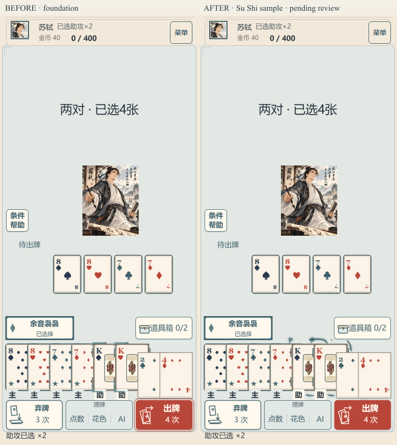

# 苏轼薄墨气可见性样例 · 待评审

**状态：仅苏轼可见性候选，视觉强度待 root/用户评审；没有签用户目标完成，没有推广六人。** 六人基础批已由 `08b01d21da92eb1d10045f391323ebf46b1edb7e` 更正为“基础附着已接、视觉强度待评估”，并推送原开发分支。

样例独立分支 `dev/amo-ink-visibility-sample-20261017`；产品 `0676e0d9f8d4eda2092dbd5265e985971293eaba`。对照是整合前基础版本 `5be8927f2ef464aff30c32b80d6f12a723929e89` 的原组件与原状态机 Git 快照，不拿不同手牌/不同位置比较。

## 先看正常手机尺寸

- **[3秒连续前后对比](390-comparison.webm)**：左右各390×844 CSS像素，未放大牌；仅加30px对照标题。新样例注入结束后仍有超过2秒持续墨丝，不需要hover或后续点击。
- [同尺寸关键帧对比](390-comparison.png)；[来源短连线](after-120.png)、[注入中段](after-300.png)、[持续墨丝](after-1300.png)、[后续流向](after-2200.png)。文件名是采样目标时间，精确实际时间见报告，未假装截图调用没有耗时。
- [原基础连续过程](before-390.webm)、[苏轼样例连续过程](after-390.webm)、[减少动态](390-reduced.png)。

## 样例改变

只在 `kind==='assist'` 的两张真实副组牌外侧绘制定向卷头墨丝。每张3条固定长度曲线，8/4.2/1.65px三层透明笔触形成薄墨气与流光，持续沿外侧运行；保留原“助”字，主手与普通手牌不添加墨气。选定时从实际技能按钮来源短暂注入两张副牌上方；注入后连线移除，墨丝持续，不留下新的整圈框或标签框。

新增图层在牌外可用空间绘制。整条线段连同笔触半径检查所有可见扑克牌面的矩形、原“助/主”标记、技能按钮、道具箱与出牌/弃牌/理牌控件，遇到遮挡就截断。没有移动/抬高/缩放牌，未触碰点数、花色、原画或按钮；相邻牌重叠时也保护普通牌的印刷区域。

复用同一个15Hz更新和现有生命周期，只增加一个共享Graphics，未加图片、纹理、粒子、持续tween或计分等待。苏轼来源注入采用420ms显示态；已保存命令可立即消费目标，不等待注入结束。其余五人继续原逻辑；GameScene、ShopScene、规则、存档、倍率和源牌导演时钟均未修改。

## 窄检查与边界

`node harness/amo-ink-visibility.mjs` 只运行苏轼390×844/DPR2样例。通过公开菜单导入同一合法fixture，实际点主手、技能快捷按钮；前后组件在同一个GameScene和同一来源/目标选项上替换，属于受控显示对比，不冒称自然完整对局或真机验收。

[report.json](report.json) 的PASS只表示样例与这些检查通过，`visualAcceptance`明确为`PENDING_REVIEW`：

- 前后各3秒连续过程；原state/journal/storage完全一致。
- 只开关新增墨气图层，按实际8张牌的变换矩形检查牌面内2px区域，变化 **0像素**。[墨气开](390-ink-on.png)/[墨气关](390-ink-off.png)原图保留；此项检查保护牌面，不当作视觉强度验收。
- 减少动态移除流动墨气与注入，保留原静态助攻标识；隐藏立即清除，返回不补播注入；取消和destroy无墨气残留。
- `npm exec vitest -- run tests/assist-ink-geometry.test.ts tests/hero-target-attachment.test.ts`：2文件13项通过，含整段/笔触半径裁剪、固定几何预算、立即保存、隐藏/取消/旧回调清理；`npm run typecheck`、`git diff --check`通过。

运行时真实HEAD `08b01d21`保留于原报告；[source-binding.json](source-binding.json)将实际3份样例源码原字节指纹绑定产品提交，并显式记录Git换行规范化。未伪造提交后重新执行的HEAD。

没有重跑六人矩阵、没有修改 main，没有把“像素在动”签成“视觉强度达标”。本轮交付到可评审苏轼样例为止；待同一模式获协调认可后再安排其他英雄。
