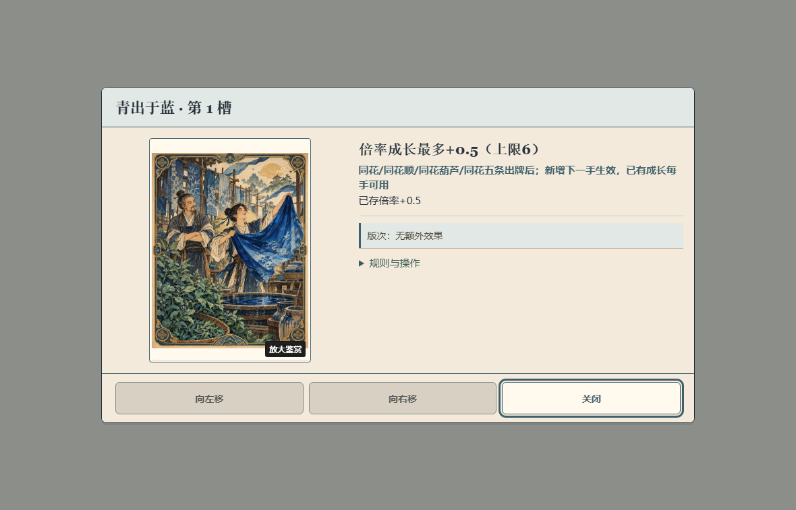
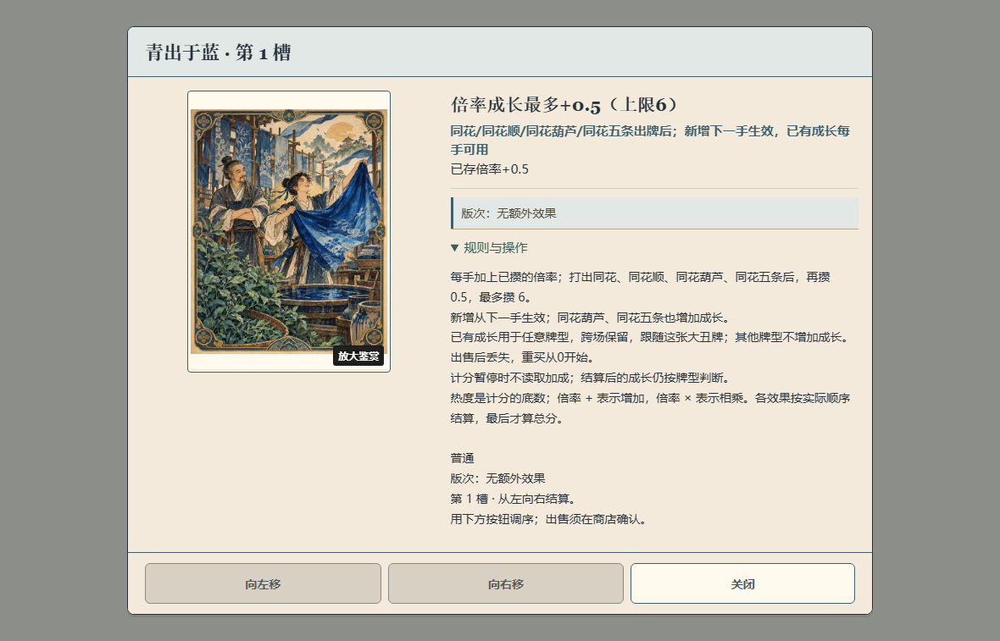

# 图片详情收尾 · 2026-10-17

- 基线：`50e82e5d44d25b1884415731a5d37e8228526a36`。
- 独立分支：`dev/card-detail-tail-20261017`；本目录随该分支提交。P08 仍为 `in_progress`。
- 本批仅修改 `JokerPlainCopy`、`DetailDialog` 的展示和两份对应测试；未修改 GameScene、规则数值、存档、RNG 或资源。

## 实际修改

1. c06 条件行已经明确列出同花葫芦、同花五条时，不在首层关键限制再重复“也增加成长”。完整规则保留原句；旧局“不增加成长”的排除说明保留，已存成长和下一手生效时机保留。
2. 卡面 caption 与标题卡名完全相同时，省略重复 caption。图片替代文字、可访问的放大鉴赏按钮、稀有度和不重复的提示 caption 保留。
3. 宽至少 761px、高至少 501px 的桌面卡牌图片详情改为内容高度，以卡图或文案较高者为准。展开长规则可增长至现有安全区上限，再由文字栏滚动；按钮留在固定操作行。英雄肖像、工具选择工作区、商店工具购买、小屏和矮屏布局沿用原规则。

## compact dialog 合同

现有 compact selector 仅匹配只有纯文字正文的确认框。本次 selector 要求图片卡牌 figure，且排除工具工作区；二者不重叠。桌面仍使用 `height:fit-content`，避免原生 dialog 四侧 inset 将 `height:auto` 拉高。未改确认/取消/焦点/关闭的行为代码。

## 本次必要检查

- `npm test -- tests/player-copy-closeout.test.ts tests/joker-plain-copy.test.ts tests/joker-detail-steps.test.ts tests/detail-dialog.test.ts`：4 文件、122 项通过，见 [unit-check.txt](unit-check.txt)。覆盖真实 0/已存成长、当前 c06 去重、旧局排除说明、只读状态、caption 去重、非重复提示 caption、图像恢复和放大入口等相关现有断言。
- `npm run build`：类型检查与 Vite 生产构建通过，见 [build-check.txt](build-check.txt)。构建仍有大 chunk 提示。
- `node docs/production/evidence/card-detail-tail-2026-10-17/browser-check.mjs`：一次局部 Chromium 组件检查通过。使用实际 `DetailDialog`、源 CSS、c06 公开文案与已存倍率 `+0.5`，未走完整游戏或新增运行时测试接口。源码 SHA-256、边界和结果见 [browser-check.json](browser-check.json)。

1180×757 下，收起详情为 880×499.30，展开 c06 真实规则为 880×695.75。卡图列 240×332.80；操作行距卡图底部 16px。首层同花葫芦与同花五条各出现一次，没有孤立重复卡名。完整规则展开仍可见原始说明。

| 收起：实际组件 | 展开：实际组件 |
| --- | --- |
|  |  |

同一检查用真实规则文本重复四次模拟极长说明：文字栏总高 1386px、可视高约 567px，可滚动到底，底部按钮仍在安全区内；此注入仅存在于检查页面。放大鉴赏打开第二层原图 dialog，Escape 返回详情。打开、展开、滚动和关闭均未改动受控 run/持牌数据。额外仅做 390×844、上下安全区 16/24px 的继承布局 sanity：没有横溢，操作按钮可见，仍为原 grid 布局；未跑截图矩阵。

## 验收边界

以上截图来自实际组件的受控浏览器页面，可证明本次排版和公开文案结果；不替代整合版 GameScene 的 dot 操作、真人理解或物理设备验收。父线程可在同版整合后仅复看 c06 桌面收起/展开和原图入口。此次无完整游戏长局验收。
