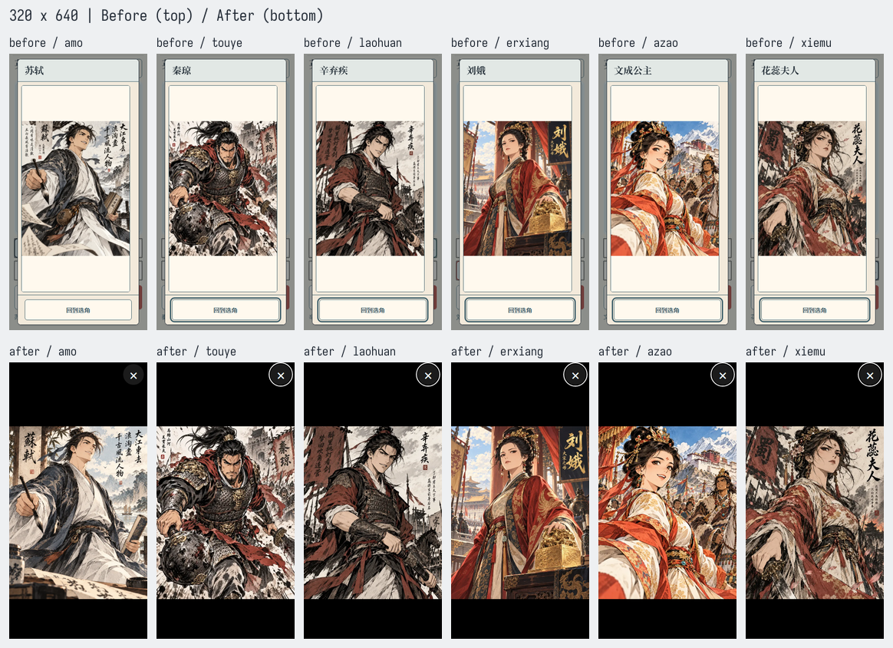
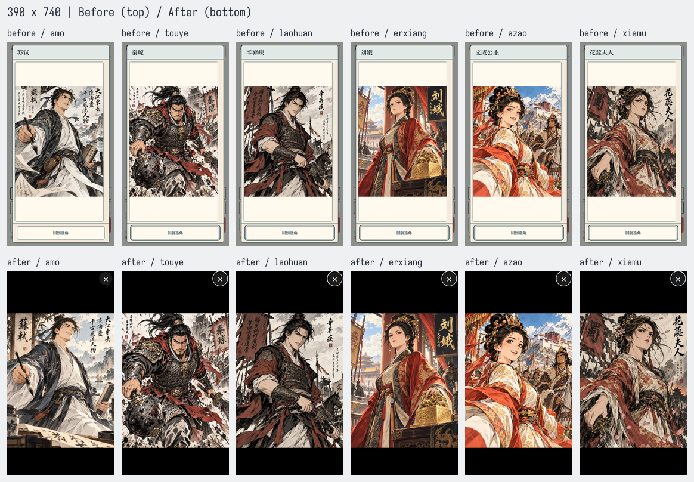
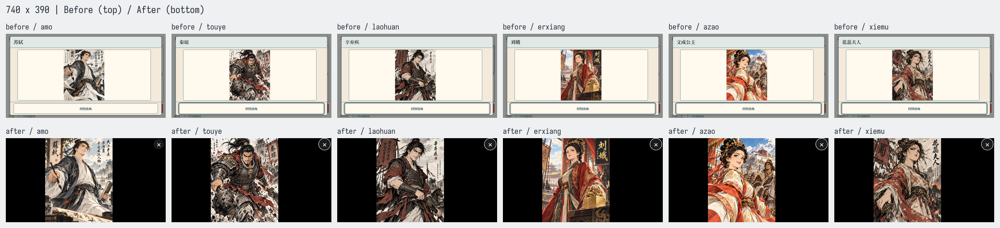
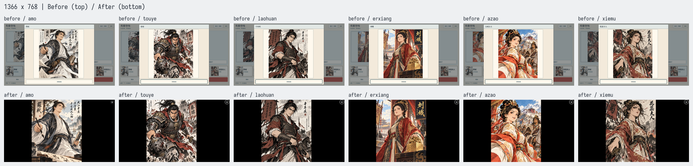

# 六英雄纯黑全图与苏轼原图替换

产品提交：`d6a52afcfefdc97033392037eefdd6be5c430052`。基线：`8728e18e823ef9cbe28a4350a566de21f1e3127c`。开发分支：`fix/hero-art-fullpage-20261016`；未合 main。

按用户最新方案，六人共用纯黑全屏查看器，图片完整等比放大到可用区域，允许黑边。去掉米白内卡、标题栏与底部返回栏，只保留 48px 关闭按钮；竖屏按钮在图片上方，横屏在右侧，始终不盖住画作。保留原生 modal、ESC、高清失败重试、指针隔离；Tab 在可见按钮间循环，关闭后焦点回选角画布。人物身份保留在无障碍名称内，页面无技能说明。

苏轼使用用户新交付的 1122×1402 PNG 原字节，替换 `art/sources/tangsong-portraits-20261015/amo-su-shi.png`。SHA256：`abe4446d6c57b1c2d8d83434c766e0a452aeb8ee198615cf58bd918b1021dfcb`，2,971,253 bytes。未自行改字、绘图或重生图；其他五人的源图及全部派生二进制与基线相同。

`build-approved-character-art.mjs` 按既有裁切与预算重建四类派生，manifest 保留来源修订。注册器对全部英雄资源使用各自文件哈希作为版本参数；没有变的文件保持相同版本值。

## 高光资源接入约定

物理路径保留，不改高光组件。高光负责人继续使用 `portraitURL('amo')`、`portraitFocusURL('amo')`，不要硬编码没有版本的 URL。

|用途|URL|
|---|---|
|头像|`assets/tangsong-portraits/amo.avatar.webp?v=c1818763446d`|
|选角|`assets/tangsong-portraits/amo.selection.webp?v=e9764fb0dd3f`|
|立绘|`assets/tangsong-portraits/amo.portrait.webp?v=d5089a32b739`|
|高光头部裁切|`assets/tangsong-portraits/amo.focus.webp?v=f158579f7e05`|

尝试向父线程发送协调消息时返回 `thread not found`，消息未送达；需由整合负责人转交本约定。未改高光、结算组件或主仓库。

## 本地证据

- [四尺寸逐角色旧版数据](before-report.json)：基线实际构建，24 张原尺寸截图。
- [最终逐角色数据](after-report.json)：产品提交的 clean 构建；320×640、390×740、740×390、1366×768 各六人，另含 390×528、390×360、1920×1080 等旋转、模拟安全区、高清失败→重试，共 32 项。
- [构建](build.txt)：TypeScript 与 Vite e2e build 通过。构建 metadata revision 为产品提交，sourceStatus=clean；保留既有大 bundle 提示。
- [单测](tests.txt)：10 个相关文件、68 项通过，包含六人注册/版本 URL、尺寸拒绝、恢复加载、展示与 146 项启动资源预算。
- [资产逐字节审计](art-audit.json)：六源图、24 派生，五人源/派生与基线相同；派生共 1,741,290 bytes，启动英雄像素 884,736，所有英雄像素 5,601,956，均与既有像素预算结构一致。
- [验证索引](verification.json)。浏览器操作全程没有创建对局；查看、切换、关闭、重试后的 state/journal/storage/localStorage 均未变化。

初次键盘失败原样保留：[Tab 离开单按钮弹窗](initial-keyboard-focus-fail.json)、[触屏开窗前无 DOM 焦点所有者](initial-focus-return-fail.json)。已分别补循环及画布焦点，最终同路径通过。仅将日志中的本机目录前缀替换为 `<worktree>`。

初次 Vite 开发服务器导航超时，现有资产审计 CLI 的 Windows Vite SSR 调用停滞，均已终止，未作为通过证据。最终截图改用同源 e2e 构建的静态服务器；资产采用独立哈希/解码核验和实际 `scene-resources` 单测，未改公共 Vite 或审计脚本。

## 前后截图

每张总览上排 before，下排 after，按 amo/苏轼、touye/秦琼、laohuan/辛弃疾、erxiang/刘娥、azao/文成公主、xiemu/花蕊夫人排列。苏轼 after 同时包含用户授权的新原图。

390 六人的原尺寸 after 分别见本目录 `after-390x740-{id}.png`；四尺寸苏轼 before/after 均保留原尺寸 PNG。完整 48 张原尺寸截图另在工作树 `shots/hero-portrait-fullpage/{before,after}/`。

软件视口、AI 像素检查不代签真人观感或物理手机验收；没有长局试玩、新图生成、CI/域名查询或 main 合并。
