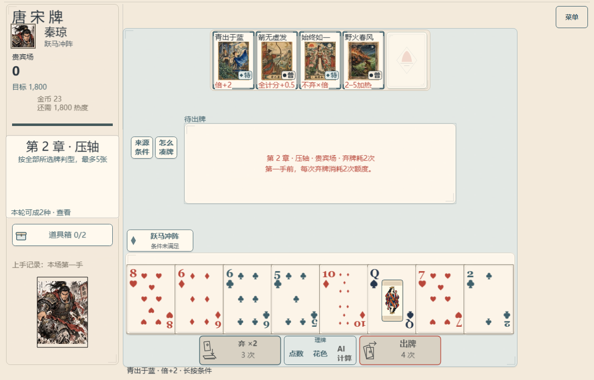
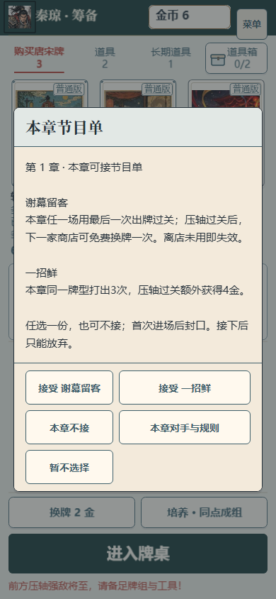

# 战前流程：Boss 去重与节目单入口

开始时已 fetch 远端 main，基线 `a470da228a85283eabc00811f610ba6a41a38738`；新分支 `dev/prebattle-flow-20261017` 保留已提交的小修 `43216be21d1ac551fb1ffdc55ad4bb67eebb0cc5`。复用干净独立工作区，不修改共享 main。P08 仍为 `in_progress`。

## 实际行为

- Boss 备战页、当前 Boss 的章节目录和局内规则介绍共用原 sessionStorage＋内存历史，key 在 shop、stage-ready、实际战斗间保持同一完整身份与场次。只有规则弹窗真正可见时才记已见，隐藏、关闭前未见、失效 owner 不标记；不增加领域存档字段。
- 已看规则后，玩家点击离店直接沿原 LeaveShop→EnterStage 入场，省去章节目录与再次规则确认。入口意图绑定原 controller 对象；恢复到待战存档时不沿用旧 scene data 自行进场，而是保留明确入场按钮。未见规则的待战路径仍有目录，未见规则的战斗恢复只介绍一次。
- 战斗状态与手动“规则 / 物品”入口保留；非 B05 Boss 现在先显示具名的本场限制、目标和完整细则，并可继续查看角色技能与物品。B05 原手动对策入口保持。取消规则页面不提交命令。
- 商店的节目单按钮直接复用 ProgramDialog；本章对手从该页按需查看。待战页和章节目录也有同一节目单入口。待选、已接、本章不接、已放弃、已兑现、关闭由实际状态显示；必要挑战与当前封角按本局目录/ID读取。
- 接受与“本章不接”分别提交原 ChooseProgram(id/null)；“暂不选择”只关页面。接受前校验当前弹窗、owner 和序号，迟到结果不关闭替代弹窗；放弃仍有损失确认。首次 EnterStage 的选择封口完全由原领域处理。

未改领域规则、计分、价格、存档格式、RNG、音频实现或图片；备战页原可见帧音轨回调保持。

## 集中有限验证

[focused-check.txt](focused-check.txt)：4文件68项通过，覆盖 Boss 跨阶段身份/可见历史、隐藏与失效/关闭、章节原跳场保存和取消、节目单接受/不接/取消/拒绝/迟到、首场封口及实际模式约束。随后仅修改 GameScene 的手动规则入口和 ShopScene/GameScene 的 controller 入口绑定，由下述真实 UI 与最终类型构建检查覆盖；未重跑未改的4文件。

[build-check.txt](build-check.txt)：最终类型检查与生产构建通过，321模块，已有大 chunk 提示保留。[browser-check.mjs](browser-check.mjs) 与[最终报告](browser-check.json)绑定最终六个产品文件 SHA-256，8项有限原生流程通过、浏览器错误为空：

1. 复用上一批已验证的受控贵宾场商店，实际离店只有 LeaveShop/EnterStage 两条命令；完整状态与相同命令重新经原 reducer 计算相等。无自动章节/规则弹窗。
2. 局内手动查看规则不改 state/journal/storage；已见待战存档恢复后仍为 stage-ready；未见战斗恢复显示一次，之后同身份恢复不再显示。
3. 正常新局商店的取消完全不变；接受仅一条真实 ChooseProgram；本章不接保存 null，区别于取消；放弃确认选择保留不变。
4. stage-ready 目录能在首次 EnterStage 前选择；Q11＋节目单关闭只展示实际挑战与封角，无接受按钮，查看关闭不变。

只跑1180×757的一条短流程，加同一节目选择态390×844缩窗；没有计分手牌、自然长局、全模式或全 Boss 浏览器矩阵。受控 Boss 夹具来源及其人为历史边界见[原回执](../shop-purchase-consistency-2026-10-17/README.md)，不冒称自然通关。

[挑战关闭与真实封角画面](challenge-program-off.png)。以上图已查看；不代签真人阅读、物理设备或听感。

## 原始失败与范围

[手动规则原 FAIL](manual-rules-initial-fail.json)及截图保留：原菜单实际打开秦琼弃牌技能选择器，已接为明确 Boss 规则页面；[恢复入口原 FAIL](restore-entry-initial-fail.json)及截图保留，之后增加 controller 入口身份绑定与原生转场等待。最终同序列通过。最初稀疏工作区缺少已提交夹具的 setup 错误保留在 browser-setup-fail.txt，补检出原文件，未重造或放宽校验。中间成功构建与重复控制台 JSON不额外留存。

已完成本分支要求的软件接线与有限检查；没有合 main、查 CI/域名或部署，其他正式验收门保持原状态。
