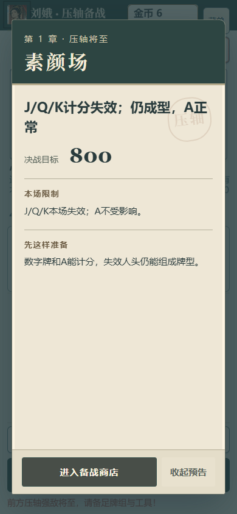

# 商店 Boss 备战页实际接线

基线为 `212e23d547d4fcfdd886f9dfe80699318e77a738`。本分支先提交商店体验修复 `c58ae03353aaacacf2d4d27da4a7544fa7ad8edd`，再正常合入负责人已推送的正式模块 `d77fd635c91b52d71ebbceaa635e2d5ae10825a0`，本目录记录其后 `ShopScene` 的实际接线。P08 仍为 `in_progress`，未合并 main、未查询 CI 或部署。

## 调用与生命周期

商店确认保存 owner 和 `phase==='shop'`，创建 view 并首次 render 后调用 `presentBossPreparation`。Phaser 在 `create()` 返回后才置为 RUNNING，因此初次入口通过本场景的 `create` 事件执行，避免将有效新场景误判成无效 owner。所有回调同时校验 owner 对象、owner.state、run 对象、场景 lifecycle、活动状态与 phase；shutdown 断开观察与待执行入口。

- `shown`：不提前切换音乐，只有页面已挂载并进入可见帧的 `onReveal` 才调用现有 `setScene('boss')` 和一次 Boss cue。
- `seen`：保持/设置 Boss 音轨，继续原 `resumeMakeCards` 流程。
- `not-applicable`：设置普通商店音轨并继续原流程。
- `deferred`：保持当前音乐，观察已有 dialog 关闭后再试；失效 owner 不继续。

关闭只恢复本地展示流程，不发送 OpenShop/LeaveShop，不修改局存档、日志或槽位。去重沿用正式模块的 sessionStorage 与内存回退，不加入局存档。未改音频实现、公共 DetailDialog、规则数值、购买或 RNG。

## 已执行验证

[focused-unit-check.txt](focused-unit-check.txt)：Boss 展示、商店决策文案、条件匹配、动态预览共4文件43项通过。[build-check.txt](build-check.txt)：最终接线版本类型检查与生产构建通过；已有大 chunk 提示保留。这些记录只证明对应软件检查，不代签真人阅读、听感或物理手机验收。

[browser-check.mjs](browser-check.mjs) 使用真实应用和原生菜单导入合法 checkpoint，390×844、DPR2、减少动态；由公开命令两次合法跳关得到 Boss 商店，不运行计分手牌或长局。[browser-check.json](browser-check.json) 记录最终源码 SHA-256 与 PASS：

1. 实际 ShopScene 已首 render，备战页挂载时音乐仍为 `menu`，下一可见帧才变为 `boss`。
2. 页面展示真实 B04「素颜场」规则与目标800；原生“收起预告”后存档、日志与槽位均未改变。
3. 再次导入同一完整身份，本 Boss 场次不重开页面，音乐为 Boss。
4. 普通保存商店不出现 Boss 预告，使用普通商店音轨；浏览器异常为空。

原始失败均保留：[browser-check-lifecycle-fail.json](browser-check-lifecycle-fail.json) 是首次调用早于 Phaser RUNNING 的真实接线缺陷，已按上述生命周期修复；[browser-check-import-wait-fail.json](browser-check-import-wait-fail.json) 是测试等待旧 scene 的时序问题，已改为等待新 lifecycle、场次和菜单关闭。对应 txt、截图与修复前构建也保留；不以最终通过覆盖失败记录。

## 范围与剩余边界

本次只接 ShopScene 与正式 Boss 页面窄接口，没有修改页面模块的版式或音频内部渐变。已覆盖正常显示、关闭、同身份去重与普通商店；现存模态延后、隐藏窗口与失效 owner 的模块边界有相关单测，未再扩展为整场浏览器矩阵。真人听感、物理触屏和正式门验收仍需负责人处理。

此前商店首触清晰度、真实余额、条件联动与 T18 差额说明见[商店体验证据](../shop-experience-2026-10-17/README.md)。
