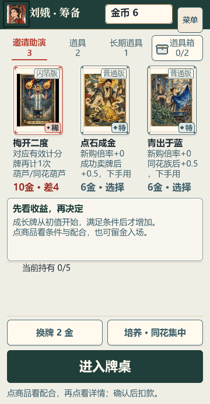
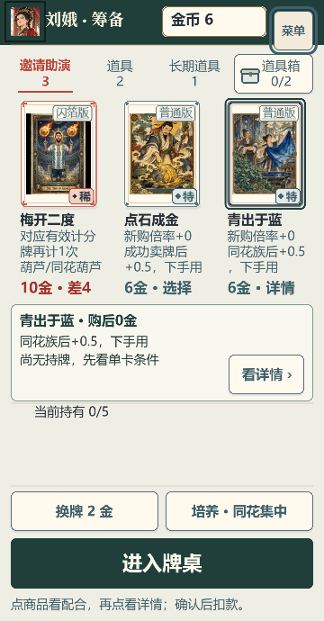
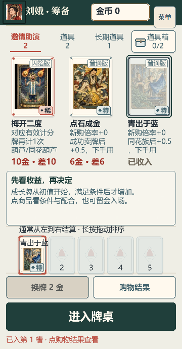
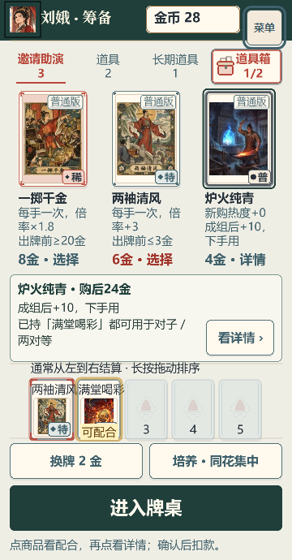

# 商店选择依据与手机首击反馈 · 2026-10-17

基线 `212e23d547d4fcfdd886f9dfe80699318e77a738`，分支 `dev/shop-experience-20261017`。本批为商店展示整改；P08 保持 `in_progress`。Boss 备战入口按父级要求等待模块负责人正式提交后另接线，本次商店提交不包含未提交的外部模块。

## 原图与定位

两张用户原图 `16300.jpg`、`16301.jpg` 已使用本次读取的 Library helper 原样材料化，并实际查看像素。Windows Python 缺少 `os.setxattr`；改在现有 Ubuntu-Dev 临时目录运行未修改的同一 helper，身份与版本扩展属性回读通过。原图未修改、未收入 Git。Library ID、版本、字节数、SHA-256 与本地来源见 [user-image-provenance.json](user-image-provenance.json)。

- “起手”只是路线保证货源，星级则混合当前条件、现有来源、现金代价和有限比较窗口。c06 新购成长为0，原星级把尚未产生的成长排除在当前收益之外，却又叠加起手角标，不能帮助玩家理解取舍。
- e06 在复现的6金场景中，购入 c06 前后算法均为3星；截图的选中勾叠在末颗星上，视觉上进一步混淆推荐与选择状态。本批同时撤下两种标记。
- 临时首击说明绕过 `SceneView.text`，默认以1倍纹理画14px文字；全局相机已经按屏幕密度放大。新预览不属于正文容器，未自动获得其清晰度设置。这是独立于整页 DPR 的文本栅格问题。

## 实际改变与取舍

1. 货架、购买详情、逐槽比较和无障碍说明撤下可见星级；内部既有推荐计算保留，供现有审计与其他推导读取。改显示新购值、条件与时机、真实购后余额、已持牌的保守条件交集。例：c06 为“新购倍率+0 / 同花族后+0.5，下手用”；e06 为“新购倍率+0 / 成功卖牌后+0.5，下手用”。没有声称哪张必然更强或强制买起手牌。
2. 撤掉挤占卡名的起手角标、牌面路线/潜力小标签和选中勾；稀有度、版次、完整卡名仍保留。手机首章的重复大提示区改为紧凑的选择说明，不再重复商品名、6金、看起手与提示选项。
3. 手机第一击选商品，稳定说明区显示真实余额、短条件和已持配合，提供44px“看详情”按钮；再次点商品仍进入详情。购买确认/取消及长规则保留。说明和“可配合”字样按当前 framebuffer 密度重新栅格并对齐像素，保持 alpha=1、scale=1；仅已持牌金色描边呼吸，减少动态时静态保留。
4. 说明文字最多三行，长条件留在详情；秦琼弃牌冲突优先呈现。原 `ShopSynergy` 条件匹配实现未改，互斥条件与缺少依据不会变成强联动。换商品、购买、刷新、取消/关闭、失焦和场景销毁沿用清理边界。
5. 商店增加深墨绿页眉、偏冷纸底与同色主按钮，详情沿用相同页眉和层级。卡图原字节及共用主题/SceneView/DetailDialog 未改。持牌和操作区保留，矮屏沿用原收纳方式。
6. 去掉余额数字从旧值滚动的中间帧：保存发布后立即显示实际金币，交易前后变化仍在购物结果中说明。
7. T18 新增纯展示 helper，直接调用 `r2PurchasePrice` 和 `r2PaidRerollPrice`，不复制价格公式。现货/购买详情显示实付价与当前直刷价的差额；例如4金买来立用、直刷2金时明确“多花2金”。已持列表和工具详情不再计购买价，说明当前可省的刷费、已有免费机会、可跨店保留、占槽与刷新次数仍增加。数值、效果、刷新池和 RNG 均未修改。

## 集中验证与画面

一次集中相关单测检查后，仅修复/复查受影响的布局、短说明与工具工作区。原始失败保留于 [focused-check-initial-fail.txt](focused-check-initial-fail.txt) 和 [diagnostic-history.json](diagnostic-history.json)。最终涉及的9份相关测试共57项均有通过记录：原检查中未改动的5份结果复用，布局修复见 [affected-recheck.txt](affected-recheck.txt)，预览与短说明见 [preview-final-check.txt](preview-final-check.txt)，工具工作区见 [tool-workspace-check.txt](tool-workspace-check.txt)。这些断言不代签玩家理解或画面体验。

最终类型与生产构建通过，见 [build-check.txt](build-check.txt)；仍有既有大 chunk 提示。最初稀疏工作树缺少两份已跟踪证据输入，补齐原文件后再检查，没有修改对应测试或存档校验。最终源文件校验见 [verified-source.json](verified-source.json)。

浏览器只跑有限手机商店操作，主视口360×690、DPR3，末尾390×844做继承布局 sanity；未跑长局或全截图矩阵。有效存档通过原生菜单导入，所有购买/取消/刷新均为实际触控。截图场景是明确标注的受控公开状态，非自然掉落证明。早期材料的工具ID、起手购买凭证ID与对照价格不合法，均被原校验拒绝；修正测试材料后通过，未放宽游戏校验。诊断原文已集中归档。

- [browser-full-pass.json](browser-full-pass.json)：完整有限序列通过。首击不写状态/日志/存档，显式按钮和二次点击进入详情；取消不变；真实购买 c06 后0金，e06 同步变为金币不足；T18 买前与已持对照可见；e08/f04不错误互亮；真实匹配牌描边动态、文字静态；减少动态与刷新清理通过。
- [browser-check.json](browser-check.json)：实际查看匹配截图后，仅复查长理由不再覆盖持牌标题。复用已经通过的购买段，记录其原始源校验；未再次重跑整段。

| 初始：完整卡名与具体依据 | 首击：固定清楚说明与详情入口 |
| --- | --- |
|  |  |

| 购买后：真实余额0，其他商品不足 | 匹配已持牌：金色标记与短理由 |
| --- | --- |
|  |  |

原生3倍截图局部：[phone-first-tap-native.png](phone-first-tap-native.png)。预览文本分辨率3、alpha1、scale1；匹配描边采样 alpha 从约0.41到0.67，文字不变；减少动态后描边固定1。具体帧值以报告为准。

## 边界

未修改机制、商品价格、存档格式、RNG、音频文件、GameScene、英雄选择页或图片资源。未操作 main、CI、部署或域名。软件浏览器的清晰度/生命周期与行为证据不替代真人手机阅读、审美或最终整合版 dot 复看。Boss 入口依赖正式模块 SHA，按约定后续独立接线提交。

## 后续 Boss 接线回执

上述独立商店提交之后，已正常合入负责人正式模块 `d77fd635c91b52d71ebbceaa635e2d5ae10825a0` 并完成 ShopScene 实际接线。页面可见帧才切换 Boss 音轨；关闭、同身份去重与普通商店路径已做一次短实机浏览器流程检查。最终接线源码校验、4文件43项相关检查、类型与生产构建，以及原始失败记录见[Boss 接线证据](../shop-boss-wiring-2026-10-17/README.md)。本补充替代本页首版“等待 Boss 模块”的进度描述，不扩大原商店验收范围。
