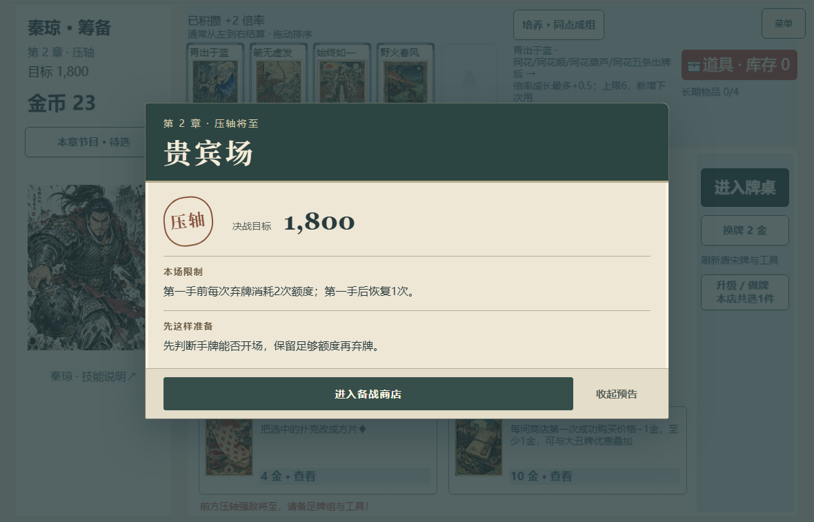
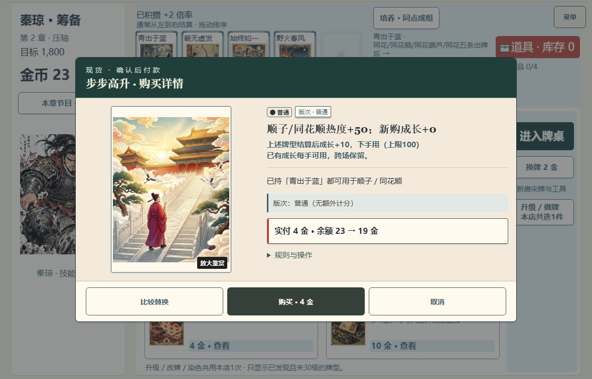

# 购买文案与 Boss 备战页小修

从已发布 `a470da22` 新建独立分支 `dev/shop-purchase-copy-fix-20261017`。仅改 ShopScene、ShopDecisionCopy、BossPreparationPresentation 及相关测试；不合 main，不查 CI、域名或部署。P08 仍为 `in_progress`。

## 确切根因与处理

“步步高升”是技术 ID `c04`。当前身份的定义来自 `r2RouteGrowthJokers.ts`：`hooks[0]` 只在顺子/同花顺时加热度50；`hooks[1]` 每手读取本实例已存成长；`hooks[2]` 在上述牌型结算后成长10、上限100。新实例没有已存成长，读取为0。原 ShopDecisionCopy 只要发现 read-growth/add-growth 就把整张牌的当前收益覆盖成0，遗漏固定50；详情读到的50本身正确，但缺少同层条件，叠加两套说明便显得矛盾，并非拿了已持牌的成长。

本次按完整 hook 结构生成候选说明和购买主效果：“顺子/同花顺热度+50；新购成长+0”。紧接说明上述牌型结算后成长10、下一手用、上限100，以及已有成长任意牌型可用且跨场保留。完整规则保留在展开区。没有修改定义、成长、计分、价格、存档、RNG 或技术身份。

购买页去掉重复选购依据块、价格框中的重复配合、规则区重复推荐/付款段和路线角标；真实配合只保留一处，现金条件损失仍在实付说明中。“邀请助演/邀请”改为“购买唐宋牌/购买”。比较、确认购买与取消的真实操作保持。

Boss 页原来继承公共固定高度，改为内容高度；移除首行 scope 摘要，只展示一次完整限制，保留真实目标、准备指引与两个出口。DOM 外观变更未改可见帧、owner、去重历史或音乐回调。

## 有限必要验证

- 3文件60项有通过记录：首次集中运行中的购买说明与实际购买价值31项通过；新 Boss 断言最初误用了原 stub 不支持的 null，改为原 undefined 契约后29项通过。按用户反馈把测试持牌精确换成 c06/d07/f09/a08 后，仅重查4项购买说明。见 [首次日志](focused-check-initial-fail.txt)、[Boss补查](boss-recheck.txt)、[文案补查](purchase-copy-recheck.txt)。不相加重复计数。
- [最终类型/生产构建](build-check.txt)通过，321模块，保留已有大 chunk 提示。首次构建因删了仍供持牌管理使用的 import 失败，已恢复原 import；[原失败](build-initial-fail.txt)保留。
- [短浏览器脚本](browser-check.mjs)与[报告](browser-check.json)：一份原校验器接受的受控秦琼第二章贵宾场商店，持有青出于蓝/箭无虚发/始终如一/野火春风，23金、c04售价4金。该材料人为指定了章节与历史，不是自然通关证据。原生菜单导入、收起、查看、取消和实际购买；只加同状态390×844的 Boss 页面缩窗，不打计分手牌、不跑长矩阵。
- 1180×757 的 Boss 页约760×460px，底部内容至按钮间20px；390×844约352×450px，按钮可达。页面挂载时原音轨 `menu`，下一可见帧 `boss`，浏览器错误为空。取消后 state/journal/storage 完整不变；购买只增加1条命令，23→19金，新 c04 成长空表（即0），已持 c06 保存成长不变。

[手机 Boss 同状态](boss-phone.png)。初期受控材料的 route history、program chapter、旧 skip stage 三次校验拒绝的原报告与原始日志均保留；当时尚未进入待测页面，三张重复菜单截图已清理。修正材料字段后通过，未放宽产品校验。最终报告绑定四个产品文件 SHA-256，不另存重复的控制台 JSON。

## 跨模块去重方案，尚未实施

用户后续自然路径发现“备战专页→章节目录→GameScene 首次规则框”连续出现同一规则。GameScene 当前首次入场分支及章节展示由其他窗口负责，本分支未改它们。建议共享备战页现有“完整身份＋Boss 场次”的可见记录：已看过同一限制时省去后续自动规则确认，保留局内主动查看；未看过或首次直达仍介绍。记录须只在规则真正可见时标记，不进局存档，不跳过购买、不可逆消耗等危险操作确认。需要相关负责人协调后接线，不由此次版式修复冒称已去重。

本次软件画面已经查看；真人阅读、物理设备和听感仍未签收。
